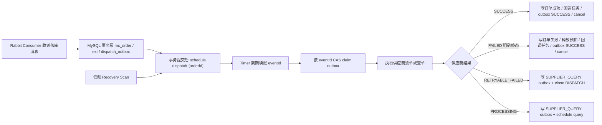

# Outbox 供应商履约 Timer 唤醒设计

> 日期：2026-07-22  
> 状态：待用户评审  
> 关联背景：pro143 `PERF-A39-C100-R100-T5-5M-B15-20260722150303` 100 并发、100 QPS、5 分钟压测中，同步受理 29999/30000 基本稳定，但窗口落库只有 6107，追赶到 15:10:10 也只有 8822；用户补充供应商派单成功不到 5000。核心瓶颈已经从入口同步处理转移到 MySQL 落库、outbox 扫描、派单/查单任务与 Hikari/MySQL 资源竞争。
> 关联现有设计：`docs/superpowers/specs/2026-07-22-outbox-dispatch-parallel-fair-design.md` 仍作为“扫描/人工恢复路径的公平并行规则”保留；本文补充并优先定义正常履约触发方式。

## 1. 问题

现有派单链路已经完成一次优化：拆分 `rechargeSupplierDispatchJob` 与 `rechargeSupplierQueryJob`，并支持 `parallelism=8` 和公平选择。但触发方式仍以 XXL-Job 周期性扫描 `recharge_dispatch_outbox` 为主：

1. 正常新订单落库后不会直接被唤醒，只能等待下一轮扫描，吞吐取决于 Job 调度频率、`limit`、扫描 SQL 和连接池余量。
2. 高并发压测时，落库 Consumer 与派单/查单 Job 争用同一 MySQL/Hikari 资源。pro143 本轮 Hikari `active=16` 且有 pending，批落库事务平均耗时升到 4.988s。
3. `selectDueForShard` 会扫描 due 集合，再在 application 层做公平预检。现有实现中 DISPATCH 公平预检会在 claim 前按订单调用 `findByOrderId`，在积压时形成额外 N 次 MySQL 读。
4. QUERY 返回 `PROCESSING` 时，现有 worker 会持续通过 outbox 失败退避等待下一轮 Job 扫描。中间态订单越多，扫描越容易把 MySQL 压力从“新派单”转成“查单追赶”。
5. XXL-Job 适合低频补偿和人工运维入口，不适合做每笔订单的毫秒/秒级唤醒器。正常路径需要从“扫出来再做”改成“落库后直接安排执行”。

## 2. 目标与非目标

目标：

1. 订单 MySQL 事务提交后立即安排供应商派单，默认提交后 1 秒触发。
2. 正常路径不依赖 XXL-Job 高频扫描数据库；XXL-Job 降级为人工入口、低频恢复和灰度回退手段。
3. 自定义 Timer 基于 `java.util.concurrent.ScheduledThreadPoolExecutor`，参考 jain-sip `SipTimer` / `ScheduledExecutorSipTimer` 的 start、stop、schedule、cancel、future 持有和异常隔离模型。
4. `recharge_dispatch_outbox` 继续作为持久事实源。Timer 只做内存唤醒，不做事实源，不绕过 DB CAS。
5. 派单失败只对确认请求未发出的本地前置失败保留 DISPATCH 退避重试；对 MINISO 这类可按本地订单号查单的供应商，传输层不可确认、HTTP 5xx/超时或已有供应商流水时必须补写 QUERY 并先查单确认，避免盲目重复发券；供应商明确业务失败直接推进失败终态。
6. 派单返回处理中后转供应商查单 Timer，查单延迟序列为 2、4、6、8、16、32 秒；自动查单次数默认等于该序列长度，耗尽后转人工，直到供应商明确成功或失败前不得自动释放预扣。
7. 多节点、重启、中断、Timer 调度失败、执行中宕机都不能丢事件，最多产生重复唤醒；重复业务执行由 outbox CAS、供应商幂等号和恢复前查单规则兜底。
8. 减少数据库开销：正常路径避免大范围 due 扫描、避免 claim 前 N+1 订单读取、减少 QUERY 中间态重复订单状态写。

非目标：

1. 本设计不把 outbox 替换成 MQ、Redis Stream、RocketMQ 延迟消息或外部调度系统。
2. 本设计不改变 V1 下单/查单接口协议、供应商协议和商户回调协议。
3. 本设计不改变 `recharge_balance_delta_outbox` 的余额刷账模型。
4. 本设计不移除 XXL-Job 模块；它仍作为低频恢复、人工 runOnce 和紧急回退入口。
5. 本设计不把 Timer 内存任务当成持久任务表；持久化仍只落在 MySQL outbox 行的 `status/retry_count/next_retry_time/locked_*` 字段。

## 3. 旧卡管语义对齐：不可确认失败

“不可确认失败”是供应商履约领域术语，指本地已经进入或可能进入供应商调用窗口，但没有拿到可证明订单成功、处理中或明确失败的供应商业务语义。它不能等同于供应商明确失败，不能释放预扣、不能创建失败回调，也不能切换供应商或商品；只能保持订单处理中，通过幂等号查单、退避重试或转人工核实。

旧卡管系统里存在两种历史风格：

1. 旧通用直充入口 `McOrderServiceImpl#doThirdPartyDelivery` 会把 `SupplierApiResponse == null`、`response.getSuccess=false`、`response.data == null` 和 catch 异常都折叠成“第三方渠道发货失败”字符串，再由上层重试或最终失败处理。这是实现上的粗粒度失败收敛，不能作为新引擎“供应商明确失败”的领域定义。
2. 较新的滴滴开放券链路已经把语义拆开：`DidiApiResult` 区分传输是否成功、HTTP 状态、JSON 是否可解析和协议业务响应；`DidiErrorPolicy` 明确把网络超时、HTTP 5xx、响应非 JSON、缺少错误码、未识别错误码、重复请求但本地无成功明细等归为 UNKNOWN/TRANSPORT_UNKNOWN/REMOTE_UNKNOWN，并同步主订单为 `SUCCESS_HD(13)`，避免进入通用 retryOrder 或误判失败。

因此新交易引擎采用滴滴链路的语义作为统一标准，对旧通用直充类中的“空响应/异常 buildFailed”做安全纠偏。

### 3.1 归为不可确认失败

| 场景 | 判定 | 后续动作 |
| --- | --- | --- |
| HTTP 连接异常、读超时、连接重置、TLS/DNS/IO 异常、客户端线程中断后无法确认响应 | 不可确认失败 | 若请求已经可能发出或已有供应商流水，补写 QUERY 并关闭 DISPATCH；确认请求未发出时才允许按 outbox 退避重试。 |
| HTTP 5xx、502/503/504、网关错误、供应商临时不可用 | 不可确认失败 | 不退款、不失败回调；对 MINISO 等可按订单号查单的渠道，优先补写 QUERY。 |
| HTTP 2xx 但响应体不是合法 JSON，或无法按渠道协议解析 | 不可确认失败 | 保持处理中；记录原始响应摘要，按策略重试或查单。 |
| HTTP 2xx 且业务码缺失、状态字段缺失、返回码未识别 | 不可确认失败，除非渠道白名单明确该码是业务失败 | 保持处理中；告警并进入查单/人工。 |
| 供应商返回成功业务码，但缺少完成履约所必需的数据，例如供应商订单号、卡券明细或充值凭证，导致本地无法闭环 | 不可确认失败 | 保持处理中；补查单或人工核实。 |
| 供应商返回重复请求/幂等冲突，但本地没有成功流水、成功卡券明细或已受理状态 | 不可确认失败 | 不能重新盲派；用同一幂等号查单。 |
| 派单请求已经写入本地供应商流水为 `new/processing`，应用在收到响应或 outbox 标记成功前宕机 | 不可确认失败 | 恢复后先查本地流水和供应商状态；必要时补写 QUERY。 |
| 供应商查单接口自身超时、5xx、非 JSON、返回不可识别 | 查单不可确认失败 | 不改变主订单终态；按查单退避继续查。 |

### 3.2 不归为不可确认失败

| 场景 | 判定 | 后续动作 |
| --- | --- | --- |
| 本地参数校验失败、渠道配置缺失、商品快照缺失、签名材料缺失，且确认没有发出供应商请求 | 本地确定失败或配置错误 | 不走供应商查单；按配置错误转失败或人工，具体由实现策略决定。 |
| 供应商返回已识别的明确成功码，且必要履约数据完整 | 成功 | 写成功终态。 |
| 供应商返回已识别的处理中/受理码，例如旧状态 `SUCCESS_HD(13)` 对应的等待结果 | 中间态 | 写 `SUPPLIER_ACCEPTED` 并安排 QUERY。 |
| 供应商返回渠道文档中列明的明确业务失败码，例如订单不存在、库存不足、余额不足、账号不符合规则、充值失败终态 | 明确失败 | 释放预扣、写失败回调、关闭 outbox。 |
| 供应商返回重复请求，且本地已有成功流水或成功卡券明细 | 幂等成功 | 修复本地主订单为成功。 |
| 查单返回明确订单不存在，但该订单曾经有已发送派单流水 | 不直接等同失败 | 先按渠道规则确认“订单不存在”是否表示未受理终态；不确定时转人工，避免误退款。 |

### 3.3 适配器实现要求

1. `SupplierGatewayStatus.FAILED` 只能由“已识别的供应商业务失败语义”产生，不能由 HTTP 异常、5xx、解析异常、未知码、空响应直接产生。
2. `SupplierGatewayStatus.RETRYABLE_FAILED` 应覆盖传输层不可确认、远端结果未知和查单不可确认。名称保留为 `RETRYABLE_FAILED`，领域含义是“不可确认，需要靠同一幂等号继续确认”，不是“供应商失败”。
3. 每个真实供应商 adapter 必须维护渠道响应码分类白名单：success、processing、business_failed、remote_unknown。没有被白名单识别的业务码默认按 `remote_unknown`，不能默认失败。
4. 只有在确认请求未发出时，本地前置失败才可以不查供应商；一旦请求可能已经发出，就必须按不可确认失败处理。
5. DISPATCH 达到 3 次不可确认自动重试上限后转 `MANUAL_REQUIRED`，订单保持处理中，不自动退款；人工或专用查单链路确认终态后再释放资金或成功回调。

### 3.4 MINISO 名创专项结论

旧卡管中 MINISO 有明确的供应商适配器和一段更老的直充方法，结论如下：

1. 旧 `MINISOSupplierTradeServiceImpl#createOrder` 会先插入 `mc_order_supplier_flow(new)`，再调用 `MCUtils.batchGrandCoupon(account, batchList, orderId)`；旧 `McOrderServiceImpl#extProductRechargeMc` 也是把本地 `orderId` 作为名创 `orderNo` 传入。
2. 名创成功口径是响应能解析为 JSON、`code == "200"`，且 `data` 中能取得券码明细。旧系统随后把 `mc_order.data` 写成 `couponKey/couponCode/validTime` 列表，将主单置为 `SUCCESS(12)`，并写 `mc_batch_record(state_type=3,state=1,channel=MINISO)`。
3. 名创查单使用同一个本地 `orderId` 调 `MCUtils.queryGrand(orderId)`。这说明 `orderId/orderNo` 是新系统恢复确认时最重要的幂等查询键；只要派单请求可能已经发出，就不能把空响应或异常直接当失败。
4. 旧系统把 `res == null`、外层异常、非 `200` 响应直接收敛为失败或返回失败码，这是历史实现的粗粒度处理，不应继承为新交易引擎的领域语义。
5. 新仓库 dev/test 供应商 mock 在 MINISO 兼容路径上会先返回 `PROCESSING`，再由查单返回终态；这是压测模拟行为，不代表旧卡管真实 MINISO 必然异步。真实 MINISO adapter 必须以名创协议和旧卡管证据为准。
6. 当前通用 `HttpRechargeSupplierGatewayAdapter` 会把 `code=200` 归为成功，适合 mock 或简单协议，不足以承载 MINISO 真实语义。MINISO 需要专属 response normalizer：成功必须同时校验 `code=200`、券码明细完整、数量匹配和本地成功凭据可落库。

MINISO 的结果分类：

| 场景 | 新系统判定 | 后续动作 |
| --- | --- | --- |
| `batchGrandCoupon` 连接异常、读超时、调用返回 `null`、线程中断后不知道响应是否已到达本地 | 不可确认失败 | 主单保持处理中；按 `orderId` 先调用 `queryGrand`，查不到明确终态则继续查单或转人工，只有协议证明请求未受理时才允许重派。 |
| HTTP 2xx 但响应不是合法 JSON，或缺少 `code` / `data` / `message` 等协议字段 | 不可确认失败 | 记录响应摘要和告警；优先 `queryGrand(orderId)`，不直接释放预扣。 |
| `code == "200"` 但 `data` 为空、不是数组、券码数量少于购买数量、缺少 `couponCode` 或 `endTime` | 不可确认失败或本地闭环不完整 | 不能给商户成功，也不能失败退款；优先查单补齐券码，仍不完整则转人工。 |
| `code != "200"` 且返回码没有被 MINISO 专属白名单证明为业务终态失败 | 远端未知 | 默认不可确认；用 `queryGrand(orderId)` 确认，不能按旧代码“一切非 200 失败”处理。 |
| `code != "200"` 且 MINISO 协议白名单确认是确定业务失败，例如请求未受理、批次不可用、库存不足、账号规则不符等 | 明确失败 | 执行失败终态、副作用和退款释放；该白名单需要按供应商文档或生产对账证据维护，旧仓库未沉淀完整码表。 |
| `queryGrand(orderId)` 返回成功且券码明细完整 | 成功 | 写成功终态、券码明细、批次记录和商户成功回调。 |
| `queryGrand(orderId)` 超时、5xx、非 JSON、未知码或返回内容不完整 | 查单不可确认失败 | 按查单退避继续查；达到自动上限转人工，不自动失败。 |
| `queryGrand(orderId)` 返回订单不存在 | 不直接等同失败 | 只有 MINISO 协议明确“订单不存在=该 orderNo 未被受理且可重派/可失败”时才进入对应动作；否则转人工。 |

因此对 MINISO 需要把用户初稿中的“派单失败每 10 秒重试 3 次”细化为“可确认请求未发出时可以重派；请求可能发出时先查单确认”。如果后续拿到名创文档证明 `orderNo` 完全幂等，才允许用同一 `orderNo` 直接重派，否则默认查单优先。

## 4. 核心结论

采用“持久 outbox + 内存 Timer 唤醒 + DB CAS 执行”的方案：



Timer 的职责只有三个：

1. 在内存中持有 `eventId -> ScheduledFuture`，到点触发。
2. 对同一个 `eventId` 做本地去重、替换、取消和 pending 数控制。
3. 触发时把 `eventId` 交给执行器，不直接成为业务事实源。

数据库 outbox 的职责保持不变：

1. 记录任务是否存在。
2. 记录任务何时可执行。
3. 记录任务是否被某个节点抢占。
4. 记录任务重试次数、最大次数和最后错误。
5. 在多节点和重启恢复时提供唯一可信状态。

## 5. 模块设计

### 5.1 `FulfillmentTimer`

位置：application 定义 interface，infrastructure/bootstrap 提供基于 `ScheduledThreadPoolExecutor` 的 adapter。

Interface：

```java
public interface FulfillmentTimer extends AutoCloseable {

    boolean schedule(FulfillmentTimerTask task);

    boolean cancel(String eventId);

    boolean isStarted();

    int pendingCount();

    void start();

    @Override
    void close();
}
```

`FulfillmentTimerTask` 是一个小 record：

```java
public record FulfillmentTimerTask(
        String eventId,
        OutboxEventType eventType,
        Instant dueAt,
        FulfillmentTriggerSource triggerSource) {
}
```

设计约束：

1. Timer 只接受 one-shot 任务，不使用 `scheduleWithFixedDelay` 长期循环业务任务。每次执行后由业务结果重新安排下一次 one-shot，避免旧 future 在状态变化后继续触发。
2. 同一节点内 `eventId` 只能保留一个 future。新任务 dueAt 更早时替换旧 future；新任务 dueAt 不早于已存在任务时直接复用旧 future 并计 `duplicate_suppressed`。
3. 取消时调用 `ScheduledFuture.cancel(false)`，并从本地 map 移除。已经开始执行的任务不强行中断，最终由 DB CAS 判断是否还能写回。
4. Java 21 下开启 `setRemoveOnCancelPolicy(true)`；同时保留低频 `purge()` 防御长期运行时取消任务堆积，呼应 jain-sip 的周期 purge 思路。
5. Timer 线程只做轻量唤醒和投递，不在 Timer 线程里执行供应商 HTTP。实际 DB claim 和供应商 I/O 交给独立的 fulfillment executor，避免少数慢供应商调用拖住后续定时触发。
6. Timer 队列默认设置内存保护阈值，例如 `trade.engine.fulfillment.timer.max-pending-tasks=200000`。达到阈值时拒绝新增内存任务，记录限流指标，依赖 recovery scan 补漏。

### 5.2 `FulfillmentTimerCoordinator`

位置：application。

这是对调用方暴露的主要 module，外部调用方不直接碰 `ScheduledThreadPoolExecutor`。

Interface：

```java
public interface FulfillmentTimerCoordinator {

    void scheduleAfterPersist(OrderPersistAggregate aggregate);

    void scheduleAfterPersistBatch(List<OrderPersistAggregate> aggregates);

    void scheduleOutboxEvent(String eventId, OutboxEventType eventType, Instant dueAt, FulfillmentTriggerSource source);

    void cancel(String eventId);

    RechargeCompensationBatchResult recoverDueEvents(int shardTotal, int shardIndex, int limit);
}
```

设计约束：

1. `PersistRechargeOrderConsumerService` 在 `persistencePort.persist(...)` 或 `batchPersistencePort.persistBatch(...)` 返回后调用 `scheduleAfterPersist`。Spring 事务在 adapter 方法返回前完成提交，因此 Timer 不会早于 MySQL commit。
2. `scheduleAfterPersist` 只对 `aggregate.dispatchOutboxRequired()` 的订单生效，eventId 固定为 `dispatch-{orderId}`。
3. schedule 失败不影响 RabbitMQ ack 决策。因为 outbox 已经持久化，失败只记录 warn 和指标，等待 recovery scan 重新安排。
4. 对批落库，Coordinator 接收本批真正进入 `persistBatch` 的 aggregates，批量注册 Timer；已经被 `persisted_version` 判定为无需重写 MySQL 的重复消息，不重复安排派单。
5. Worker 在派单返回 `PROCESSING` 或派单结果不可确认并成功幂等写入 `SUPPLIER_QUERY` outbox 后，调用 Coordinator 安排 `supplier-query-{orderId}`。
6. Worker 只有在确认供应商请求未发出的本地前置失败并成功回写 `next_retry_time` 后，才调用 Coordinator 按新的 dueAt 重新安排同一个 DISPATCH eventId。
7. Worker 在终态副作用完成且 outbox 标记 `SUCCESS` 后，调用 Coordinator cancel 当前 eventId。

### 5.3 `FulfillmentTaskExecutor`

位置：application。

它是新的事件级执行 module，用来替代“必须先扫一批 due 行才能执行”的入口。

Interface：

```java
public interface FulfillmentTaskExecutor {

    FulfillmentExecutionResult execute(String eventId, FulfillmentTriggerSource source);
}
```

`FulfillmentExecutionResult` 至少包含：

```java
public record FulfillmentExecutionResult(
        FulfillmentExecutionStatus status,
        String eventId,
        OutboxEventType eventType,
        Optional<Instant> nextDueAt,
        String message) {
}
```

状态枚举：

| 状态 | 语义 |
| --- | --- |
| `SUCCEEDED` | outbox 已成功关闭，不需要重排。 |
| `RETRY_SCHEDULED` | outbox 已写入下一次 `next_retry_time`，Coordinator 应重新安排。 |
| `NOT_DUE` | stale timer 提前触发或事件已被其他流程推迟，按当前 `next_retry_time` 重排。 |
| `CLAIM_SKIPPED` | 事件已被其他节点抢占、已成功、已人工处理或不属于新系统；本次不重排，等待持久状态或 recovery。 |
| `MANUAL_REQUIRED` | 已达到自动处理上限，订单不再自动推进。 |

执行规则：

1. Executor 先通过 `RechargeOutboxPort.claimDueByEventId(eventId, workerId, lease)` 抢占单个事件。该方法在 SQL 中校验 `event_id`、`status`、`next_retry_time`、`locked_until`、`retry_count < max_retry_count` 和 `recharge_order_ext.persist_status=DB_PERSISTED`。
2. claim 成功后才加载订单当前状态。正常路径不再有“扫描 1000 行，再 claim 前读取 1000 次订单”的 N+1 读。
3. DISPATCH 事件执行前先检查本地订单状态和最近供应商流水。若发现订单已是 `SUPPLIER_ACCEPTED` 或已有同 `supplier_request_id` 的已发送流水，不能盲目重复派单；应幂等补写 `SUPPLIER_QUERY` 事件并关闭 DISPATCH。
4. DISPATCH 明确业务失败直接推进失败终态、释放 Redis reservation、写 `recharge_balance_delta_outbox(RELEASE)`、生成失败回调，然后把 DISPATCH outbox 标为 `SUCCESS`。明确业务失败不再占用派单重试次数。
5. DISPATCH 的 `RETRYABLE_FAILED` 表示派单结果不可确认。对 MINISO 等已经支持按本地订单号查单的渠道，当前实现直接把订单推进 `SUPPLIER_ACCEPTED`、补写 `SUPPLIER_QUERY` 并关闭 DISPATCH；只有能证明供应商请求未发出时，才允许按固定 10 秒退避重排 DISPATCH。查单耗尽后进入 `MANUAL_REQUIRED`，订单保持处理中或当前可审计状态，不自动退款。
6. QUERY 返回 `PROCESSING` 时，订单已经是 `SUPPLIER_ACCEPTED` 的情况下不重复写订单状态；只更新供应商流水必要审计信息和 outbox 的 `retry_count/next_retry_time/last_error`。返回码、返回描述没有变化时可以不插入新的处理中流水，以降低中间态查单写放大。
7. QUERY 明确成功或失败时执行终态副作用，副作用全部完成后才标记 QUERY outbox `SUCCESS`。
8. 执行过程中所有异常都转换为 retryable failure 或明确 manual required；高频路径日志使用 `LogStormGuard` 采样，指标保持全量计数。

### 5.4 `FulfillmentRecoveryService`

位置：application，bootstrap/infrastructure 提供启动和周期调用。

Recovery 不是主触发器，只负责补漏：

1. 应用启动后延迟 5～30 秒随机抖动，避免多节点同时扫库。
2. 默认每 30 秒执行一轮小批量扫描，例如 `limit=500`，只扫描 due 或租约过期事件。
3. 可配置 `look-ahead-seconds=120`，把未来 2 分钟内会到期的事件也安排到本地 Timer，降低刚好错过 due 时间后的等待。
4. 多节点默认允许重复扫描和重复 schedule，DB CAS 保证只有一个节点执行。生产若有固定实例编号，可配置 `recovery-shard-total/recovery-shard-index` 复用现有 `crc32(shard_key)` 分片规则进一步降读。
5. recovery scan 的 SQL 继续使用 `status + next_retry_time + id` 和 `status + locked_until + id` 索引，不做高频全表扫描。
6. XXL-Job 的 `rechargeSupplierDispatchJob` / `rechargeSupplierQueryJob` 保留为人工 runOnce 和紧急回退；Timer 启用后生产默认不再高频触发它们。

## 6. 数据持久化规则

### 6.1 `SUPPLIER_DISPATCH` 插入

落库事务继续写 `recharge_dispatch_outbox`，但插入规则调整为：

| 字段 | 新规则 |
| --- | --- |
| `event_id` | `dispatch-{orderId}`，保持不变。 |
| `event_type` | `SUPPLIER_DISPATCH`。 |
| `payload` | 保留现有字段，并补齐派单所需不可变快照，尽量避免执行期为构造请求再读商品/商户配置。 |
| `status` | `INIT`。 |
| `retry_count` | 0。 |
| `max_retry_count` | DISPATCH 默认 3，对应“最多重试 3 次”。 |
| `next_retry_time` | `persistedAt + initial-dispatch-delay`，默认 1 秒。 |
| `shard_key` | 固定等于 eventId。 |

`next_retry_time` 与 Timer dueAt 使用同一时间。这样 Timer 丢失时，recovery scan 可以按同一字段补漏；Timer 提前触发时，claim SQL 会因未到期拒绝。

### 6.2 `SUPPLIER_QUERY` 插入

派单返回 `PROCESSING`，或派单结果不可确认且请求已经可能发出时，写入独立查单事件：

| 字段 | 新规则 |
| --- | --- |
| `event_id` | `supplier-query-{orderId}`，保持稳定幂等。 |
| `event_type` | `SUPPLIER_QUERY`。 |
| `payload` | 包含 `order_id/out_order_sn/org_code/account/supplier_channel/supplier_request_id` 和必要源 payload。 |
| `status` | `INIT`。 |
| `retry_count` | 0。 |
| `max_retry_count` | 默认等于查单退避序列长度，当前为 6。达到上限后转 `MANUAL_REQUIRED`，不自动失败、不自动退款。 |
| `next_retry_time` | `now + 2s`。 |

查单退避使用配置序列 `2,4,6,8,16,32` 秒。自动查单次数默认等于该序列长度，耗尽后转 `MANUAL_REQUIRED`，订单继续保持处理中等待人工或专用查单链路确认终态。

### 6.3 状态回写返回值

现有 `markSuccess/markFailed/markManualRequired` 返回 `void`，Timer 方案中需要更明确的持久化结果：

1. `markSuccess` 返回是否成功更新。CAS miss 说明事件已被其他节点推进，Coordinator 不再重排。
2. `markRetryableFailure` 返回下一次 `next_retry_time` 和新的 retryCount。只有 DB 写成功后才能 schedule 下一次 Timer。
3. `markManualRequired` 返回是否成功更新。失败时依赖租约过期后 recovery 重试。

推荐把端口调整为结果对象，而不是让业务层根据本地 delay 推测数据库已成功写入。

## 7. 运行流程

### 7.1 新订单派单

```text
PersistRechargeOrderConsumerService.persist(message)
  -> persistencePort.persist(aggregate)
       -> MySQL transaction commits mc_order / ext / dispatch_outbox(next_retry_time=now+1s)
  -> fulfillmentTimerCoordinator.scheduleAfterPersist(aggregate)
  -> markDbPersisted(...)
  -> listener ack policy follows existing persist result
```

设计选择：Timer 调度放在 MySQL commit 之后、Redis `markDbPersisted` 之前。原因是供应商履约只依赖 DB_PERSISTED 事实和 Redis reservation，不依赖 Redis 查询态已经标记完成；若 Timer 调度失败，也不会影响 MySQL 事实和 RabbitMQ ack，recovery 会补漏。

### 7.2 派单可重试失败

```text
Timer fires dispatch-{orderId}
  -> claimDueByEventId
  -> supplier dispatch timeout / 5xx / connection error
  -> if request may have reached supplier and supplier supports query:
       query by the same idempotency key first
       terminal query result: close dispatch and apply terminal side effects
       unknown query result: markRetryableFailure(next_retry_time=now+10s, retry_count+1)
  -> otherwise markRetryableFailure(next_retry_time=now+10s, retry_count+1)
  -> schedule next due event from persisted next_retry_time
```

第 3 次可重试失败后：

```text
markManualRequired("dispatch retry exhausted")
order remains non-terminal
metric + alert
```

不释放余额、不生成失败回调，避免把未知调用窗口误判为供应商业务失败。

### 7.3 派单明确失败

```text
Timer fires dispatch-{orderId}
  -> claimDueByEventId
  -> supplier dispatch returns FAILED
  -> update order FAILED
  -> release Redis reservation
  -> enqueue recharge_balance_delta_outbox(RELEASE)
  -> create merchant notify task
  -> mark dispatch outbox SUCCESS
  -> cancel dispatch timer
```

明确业务失败不进行 10 秒重试。

### 7.4 派单处理中与查单

```text
supplier dispatch returns PROCESSING
  -> update order SUPPLIER_ACCEPTED
  -> enqueue supplier-query-{orderId}
  -> mark dispatch outbox SUCCESS
  -> schedule query in 2s
```

后续：

```text
Timer fires supplier-query-{orderId}
  -> claimDueByEventId
  -> supplier query
  -> SUCCESS: update order success + notify + release frequency + mark query SUCCESS
  -> FAILED: update order failed + release reservation + balance delta + notify + mark query SUCCESS
  -> PROCESSING: markRetryableFailure(next delay from 2,4,6,8,16,32)
```

达到查单自动上限后：

```text
markManualRequired("supplier query still processing after max attempts")
order remains SUPPLIER_ACCEPTED
no refund
alert operations
```

### 7.5 作废事件

`INVALID_ORDER` 仍共用 `recharge_dispatch_outbox` 的持久化、claim 和 recovery 能力。本轮 Timer 方案优先覆盖 `SUPPLIER_DISPATCH` 与 `SUPPLIER_QUERY`；作废事件可在同一个 Coordinator 中按 `eventId=invalid-{orderId}` 安排。若作废入口没有同步安排 Timer，低频 recovery 和人工 XXL runOnce 仍会处理。

## 8. 数据库开销削减策略

1. 正常路径从“每轮扫 due 集合”改为“按 eventId 触发 claim”，将数据库读从批量扫描变成单事件精准读写。
2. 去掉正常派单路径上的 claim 前公平 N+1 订单读取；同账号串行和频控判断在 claim 成功后做。
3. outbox payload 补齐不可变派单快照，避免为了构造供应商请求重复读商品/商户配置。
4. QUERY 返回 `PROCESSING` 且订单状态没有变化时，不重复写 `mc_order/recharge_order_ext` 状态。
5. QUERY 中间态供应商流水采用“首条、变化、终态、异常必写”的策略；完全重复的处理中响应用 outbox `last_error` 和指标记录，减少流水写放大。
6. Recovery scan 降为低频、小批、可分片；它只安排 Timer 或补偿租约过期事件，不承担主要吞吐。
7. Timer 执行并发与落库 Consumer DB pool 隔离配置。供应商 I/O 使用独立 executor；DB claim/update 使用受控并发，避免派单再次打满 Hikari。
8. 旧 XXL 高频任务默认暂停或降频，仅在 Timer 关闭、恢复排障或人工补偿时使用。

## 9. 多节点与故障边界

| 场景 | 处理规则 |
| --- | --- |
| 事务提交后、schedule 前应用宕机 | outbox 已有 `INIT + next_retry_time`；recovery scan 补排。 |
| schedule 成功后应用宕机 | 内存 Timer 丢失；recovery scan 补排。 |
| 多节点重复 schedule 同一 eventId | 本地 map 只能去重本节点；跨节点重复依赖 DB CAS，只有一个节点 claim 成功。 |
| Timer 提前触发 | `claimDueByEventId` 因 `next_retry_time > now` 拒绝，Executor 返回 `NOT_DUE` 并按 DB 时间重排。 |
| 事件已被其他节点处理成功 | claim 返回空，本节点取消本地 future，不重排。 |
| 执行时间超过租约 | lease 默认大于供应商 HTTP P99；长调用可在 lease 半程续租，续租必须校验 `locked_by + version`。 |
| 派单请求已发出但 outbox 未标成功前宕机 | 恢复 claim DISPATCH 后先看订单状态和供应商流水；必要时补写 QUERY，不盲目重复 dispatch。 |
| Timer executor 队列达到上限 | 拒绝内存 schedule，记录 warn 与指标；持久 outbox 不受影响，recovery 后续继续尝试。 |
| 应用优雅停机 | 停止接收新 schedule，取消未触发 future；执行中的任务不强杀，未完成任务靠租约过期恢复。 |
| MySQL 短暂不可用 | Timer 触发 claim 失败时采样 warn/error，不在内存无限忙重试；按短延迟重排少量事件，其余由 recovery 接管。 |
| Redis 不可用 | 下单入口仍按现有 fail closed；已落库派单可继续，失败退款释放 Redis reservation 时失败则当前 outbox 保持 retry。 |

## 10. 配置

新增或调整 `trade.engine.fulfillment`：

| 配置项 | 默认值 | 说明 |
| --- | ---: | --- |
| `timer-enabled` | `false` | 灰度开关。关闭时沿用 XXL 扫描。 |
| `timer-thread-count` | `2` | ScheduledThreadPoolExecutor 核心线程数，只做唤醒投递。 |
| `timer-max-pending-tasks` | `200000` | 本地未触发 Timer 上限，保护堆内存。 |
| `timer-purge-period-seconds` | `60` | 取消任务清理周期；Java 21 remove-on-cancel 已开启，purge 作为防御。 |
| `dispatch-initial-delay-seconds` | `1` | 落库后首次派单延迟。 |
| `dispatch-retry-delay-seconds` | `10` | 确认供应商请求未发出的 DISPATCH 本地前置失败退避。 |
| `dispatch-max-retry-count` | `3` | 确认供应商请求未发出的 DISPATCH 自动重试次数；请求可能发出时优先 QUERY。 |
| `query-backoff-seconds` | `2,4,6,8,16,32` | QUERY 中间态退避序列；自动查单上限默认等于序列长度，耗尽后转人工。 |
| `query-max-auto-attempts` | `6` | 查单自动尝试上限；达到后转人工，订单保持处理中。 |
| `recovery-enabled` | `true` | Timer 补漏扫描开关。 |
| `recovery-interval-seconds` | `30` | 低频恢复扫描间隔。 |
| `recovery-look-ahead-seconds` | `120` | 扫描未来即将到期事件并安排 Timer。 |
| `recovery-limit` | `500` | 单节点单轮恢复扫描数量。 |
| `recovery-initial-jitter-seconds` | `30` | 启动抖动，避免多节点同时扫。 |

现有 `outbox-claim-lease-seconds`、`frequency-*`、`outbox-parallelism` 可保留。Timer 启用后，`outbox-parallelism` 只服务人工/恢复批处理路径；事件级执行的供应商 I/O 并发应使用独立配置或复用 `thread-pool.supplier-io-size`。

## 11. 可观测性

新增指标：

| 指标 | 标签 | 说明 |
| --- | --- | --- |
| `trade.engine.fulfillment.timer.pending` | `event_type` | 本节点内存 Timer 待触发数量。 |
| `trade.engine.fulfillment.timer.scheduled.total` | `event_type,source,result` | schedule 尝试次数与结果。 |
| `trade.engine.fulfillment.timer.fired.total` | `event_type,source` | Timer 到期触发次数。 |
| `trade.engine.fulfillment.timer.lag.seconds` | `event_type` | 实际触发时间减 dueAt。 |
| `trade.engine.fulfillment.executor.inflight` | `event_type` | 正在执行的履约事件数。 |
| `trade.engine.fulfillment.executor.completed.total` | `event_type,result` | 单事件执行结果。 |
| `trade.engine.fulfillment.recovery.scanned.total` | `event_type,status` | recovery 扫描补排数量。 |
| `trade.engine.fulfillment.recovery.scheduled.total` | `event_type,result` | recovery 补排结果。 |

保留已有 outbox 双年龄指标：

1. `trade_engine_dispatch_outbox_max_age_since_created_seconds`
2. `trade_engine_dispatch_outbox_max_age_since_due_seconds`

日志规则：

1. schedule/cancel/fired 的普通路径不打印逐单 info。
2. claim miss、stale timer、重复 schedule 使用 debug 或指标表达。
3. MySQL/Rabbit/Redis/供应商异常按仓库规则记录异常栈；高频路径必须通过 `LogStormGuard` 采样或汇总，避免压测和生产故障时日志本身打爆磁盘或采集链路。
4. 日志上下文包含 `eventId/eventType/orderId/outOrderSn/orgCode/workerId/source/retryCount`，不打印密钥、token、完整供应商敏感 payload。

## 12. 灰度与回退

阶段 1：文档与配置准备。

1. 同步本文到 `docs/交行直充业务系统详细设计.md` 与 `docs/交行直充业务系统高可用方案设计.md`。
2. 增加配置默认值，`timer-enabled=false`。
3. 保持现有 XXL job 不变。

阶段 2：Timer shadow。

1. Timer 接收 schedule，但只记录指标，不执行 supplier。
2. 验证落库后 schedule 数量与 `SUPPLIER_DISPATCH INIT` 生成数量一致。
3. 验证 recovery 能补排人工构造的 due 事件。

阶段 3：DISPATCH Timer 灰度。

1. `timer-enabled=true`，先观察 `SUPPLIER_DISPATCH` 热唤醒收益；当前实现已具备 `SUPPLIER_QUERY` 热唤醒能力，灰度时仍保留 query job 兜底。
2. 降低或暂停 `rechargeSupplierDispatchJob` 高频触发。
3. 保留 `rechargeSupplierQueryJob`，观察派单成功增长、Hikari active/pending、Timer lag。

阶段 4：QUERY Timer 灰度。

1. 启用 `SUPPLIER_QUERY` Timer。
2. 将 `rechargeSupplierQueryJob` 降为低频 recovery 或人工入口。
3. 验证处理中订单按 2/4/6/8/16/32 秒曲线推进，终态副作用幂等。

阶段 5：生产常态。

1. 正常履约由 Timer 唤醒。
2. XXL 仅保留低频补偿、人工 runOnce 和紧急回退。
3. 若 Timer 指标异常，关闭 `timer-enabled` 并恢复原 XXL 调度参数。

## 13. 需要修改的现有设计文档

按仓库规则，实施前必须同步以下文档：

1. `docs/交行直充业务系统详细设计.md`
   - 「8.3 异步落库 Consumer」增加事务提交后 schedule 协议。
   - 「9.1 派单 Outbox」增加 Timer 唤醒、eventId claim、dispatch/query 退避规则。
   - 「10.1 XXL-Job Handler 契约」说明 XXL 从主触发降级为恢复/人工/回退。
   - 「11. 配置中心、部署与健康检查」增加 `trade.engine.fulfillment.timer-*` 配置。
2. `docs/交行直充业务系统高可用方案设计.md`
   - 「6.6 新增表」补充 `next_retry_time` 作为 Timer/recovery 统一持久调度时间。
   - 派单幂等与宕机恢复段补充“恢复 claim DISPATCH 先查本地流水/订单状态，不盲目重复派单”。
   - 「17.2 分片规则」补充 recovery scan 的低频分片和多节点重复唤醒语义。
3. `docs/部署手册.md` / Nacos 模板
   - 增加 Timer 开关、并发和 recovery 参数。
   - 说明 Timer 启用后 XXL 高频任务的降频/暂停建议和回退命令。
4. `docs/集成测试.md`
   - 下一轮 pro143 对照压测记录 Timer 启用前后的落库、派单成功数、Hikari、Timer lag 和 outbox 年龄。

## 14. 测试策略

Application 单元测试：

1. `FulfillmentTimerCoordinatorTest`
   - 单条落库后只对 `dispatchOutboxRequired=true` 安排 Timer。
   - 批落库后按 aggregates 数量安排 Timer。
   - schedule 抛异常不改变 persist 结果。
   - 同一 eventId 新 dueAt 更早时替换，较晚时抑制重复。
2. `FulfillmentTaskExecutorTest`
   - DISPATCH 成功关闭 outbox 并 cancel。
   - DISPATCH 明确失败不重试，执行释放预扣和失败回调。
   - DISPATCH retryable failure 对 MINISO/current 支持查单渠道补写 QUERY 并关闭 DISPATCH。
   - DISPATCH 恢复时发现订单已 `SUPPLIER_ACCEPTED` 或已有同订单供应商流水，补写 QUERY 而不重复派单。
   - QUERY 按 2/4/6/8/16/32 秒退避，耗尽后转人工。
   - QUERY 中间态不重复写订单状态。
   - QUERY 终态成功/失败副作用幂等。
3. `RechargeOutboxWorkerServiceTest`
   - 扫描批处理入口继续可用，并委托事件级 executor 或共享同一状态机，避免两套业务逻辑分叉。

Infrastructure 测试：

1. `ScheduledThreadPoolFulfillmentTimerTest`
   - start/stop/schedule/cancel/pendingCount。
   - cancel 后 future 从队列移除。
   - task 异常不杀 timer 线程。
   - pending 上限生效。
2. `RechargeDispatchOutboxMapperTest`
   - `claimDueByEventId` 校验 due、租约、retry 上限、归属哨兵。
   - recovery scan 支持 due、look-ahead 和租约过期。
   - DISPATCH 插入 `next_retry_time=now+1s/max_retry_count=3`。
   - QUERY 插入 `next_retry_time=now+2s/max_retry_count=queryMaxAutoAttempts`。

Bootstrap/配置测试：

1. Timer disabled 时不创建执行型 Timer bean，XXL 行为保持。
2. Timer enabled 时创建 Coordinator、Timer、Recovery 调度 bean。
3. 配置边界校验：线程数、pending 上限、retry 次数、backoff 序列都必须为正数。

多节点/恢复测试：

1. 两个 Coordinator 同时 schedule 同一 eventId，只有一个 fake outbox claim 成功。
2. schedule 后模拟应用重启，recovery scan 能重新安排 due 事件。
3. 执行中模拟租约过期，第二节点 reclaim 后不破坏已成功终态。

压测验收：

1. pro143 同参数 100 并发、100 QPS、5 分钟复压。
2. 记录同步成功数、窗口落库数、供应商派单成功数、终态成功数。
3. 对比 Hikari active/pending、批落库 phase duration、Timer lag、outbox since_due 年龄。
4. 成功口径：在 MySQL 环境负载相近时，Timer 启用后供应商派单成功数明显高于“不到 5000”的基线；Hikari pending 不因派单/查单扫描而持续打满；DISPATCH since_due 最大年龄能持续回落。

## 15. 方案取舍

本文选择 Timer 唤醒而不是直接在落库 Consumer 中同步调用供应商，原因是：

1. 落库 Consumer 的首要职责是可靠沉淀订单事实和推进 RabbitMQ ack；同步供应商 HTTP 会把外部供应商延迟反向拖住 MQ 消费和 MySQL 事务后的确认链路。
2. Timer 可以做到“落库后 1 秒内触发”，同时仍保留 outbox 的持久重试、租约恢复和人工处理能力。
3. DB CAS 让多节点重复唤醒变成可接受的低成本竞争，而不是分布式 Timer 唯一性的复杂问题。

本文选择 `ScheduledThreadPoolExecutor` 而不是 `java.util.Timer`，原因是：

1. 单个 TimerTask 异常不会杀死整个调度线程。
2. 支持线程池、future 取消、remove-on-cancel 和队列观测。
3. 与 jain-sip `ScheduledExecutorSipTimer` 的模型一致，便于按 start/stop/schedule/cancel 做独立 module。

本文不把 Timer 任务单独持久化到新表，原因是：

1. `recharge_dispatch_outbox.next_retry_time` 已经是任务持久化时间。
2. 新增 timer 表会引入双事实源，恢复时反而需要解决 outbox 与 timer 表一致性。
3. 内存 Timer 丢失后用低频 recovery scan 从 outbox 重建即可。

## 16. 实施边界

正式实现前先完成三件事：

1. 更新两份权威设计文档和部署/Nacos 文档。
2. 为 Timer/Coordinator/Executor/Mapper 写单元测试，先锁住重试、查单退避和多节点 CAS 行为；为 MINISO normalizer 增加 code=200 但券码缺失、非 200 未知码、查单订单不存在、查单成功补齐券码等分类测试。
3. 以灰度开关接入，不一次性停掉 XXL；Timer 指标稳定后再调整生产 XXL 高频调度。
