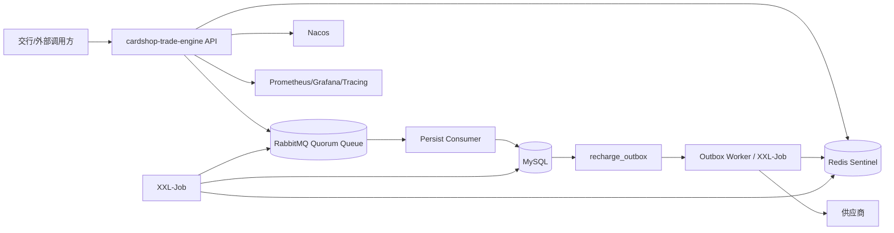
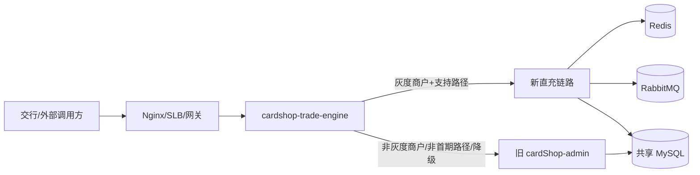
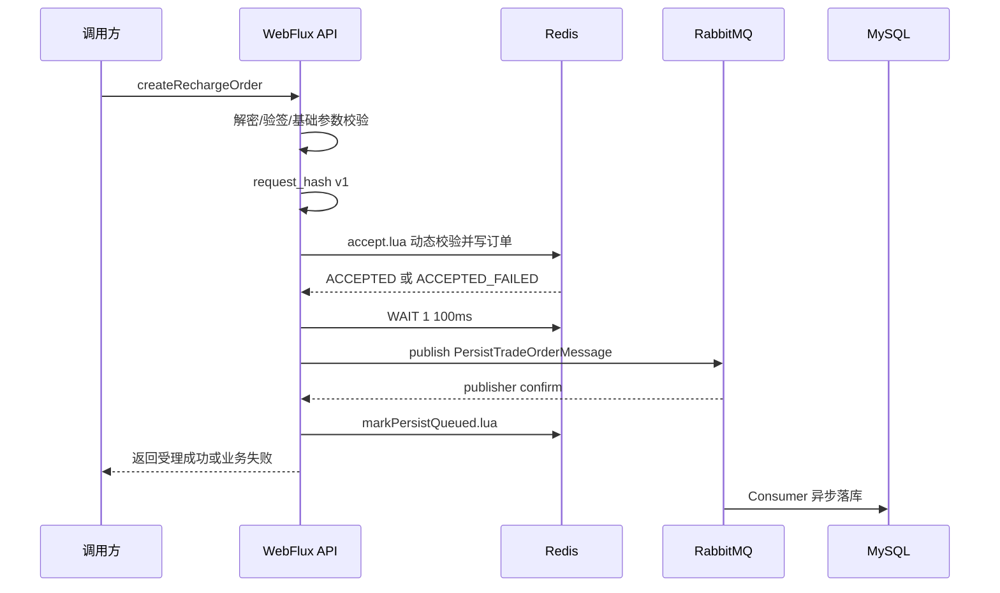
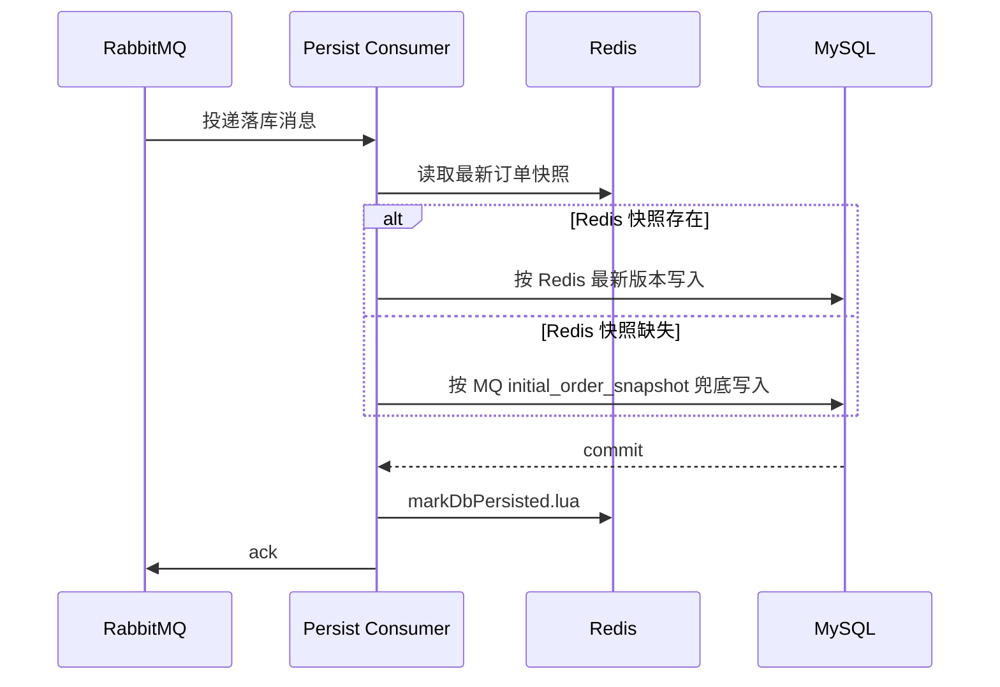

# cardshop-trade-engine 系统详细设计

## 1. 文档目标

本文面向新建 Spring Boot 应用 `cardshop-trade-engine`，在《交行直充接口 Redis 与 MySQL 一致性及高可用设计实现方案》的基础上，给出可落地实施的工程详细设计。

设计目标：

1. 新服务独立建设，不基于旧 RuoYi 应用代码启动。
2. 数据库表继续与旧系统共享，订单最终事实仍沉淀到 MySQL。
3. 下单入口先写 Redis，RabbitMQ 异步驱动 MySQL 持久化。
4. 支持多节点部署，所有 Consumer、Worker、XXL-Job 任务具备幂等和抢占能力。
5. 使用 JDK 21、Spring Boot 3.x、Spring WebFlux、Redis 7.x、RabbitMQ、MySQL、XXL-Job、Nacos、Liquibase。
6. 开发、测试、生产环境配置完全隔离。

非目标：

1. 不重构旧后台管理系统。
2. 不在第一阶段迁移所有交易类型；先以交行直充链路落地，但服务命名和模块边界预留其他交易类型扩展。
3. 不把 Redis 当作永久事实库；Redis 是高并发受理期的短期数据源，MySQL 是最终事实库。

## 2. 应用定位

应用名称：

```text
cardshop-trade-engine
```

Spring 应用名：

```yaml
spring:
  application:
    name: cardshop-trade-engine
```

业务定位：

| 能力 | 说明 |
| --- | --- |
| 交易接入 | 承接交行等外部渠道下单、查单、作废请求。 |
| 订单受理 | 基础安全校验后，基于 Redis Lua 完成幂等、动态业务校验和余额预扣。当前阶段直充产品不校验商品限额和库存。 |
| 异步落库 | 通过 RabbitMQ Quorum Queue 驱动 MySQL 异步持久化。 |
| 交易履约 | MySQL 落库成功后，通过 outbox 驱动供应商派单、查单、作废、回调等动作。 |
| 补偿对账 | 通过 XXL-Job 分片执行 MQ 补投、MySQL 落库补偿、余额对账、Redis 缓存修复。 |

## 3. 总体架构



关键数据流：

1. `/createRechargeOrder` 在接口返回前完成 Redis Lua 写入、Redis `WAIT`、RabbitMQ publisher confirm。
2. RabbitMQ 落库消息携带 `initial_order_snapshot`，用于 Redis 异常丢失时兜底落库。
3. Persist Consumer 优先读取 Redis 最新订单快照；Redis 不可读时使用 MQ 初始快照兜底写 MySQL。
4. MySQL 落库成功后写 `recharge_outbox`，供应商派单、余额刷账、通知回调均从 outbox 可靠推进。
5. XXL-Job 分片处理 Redis pending、MQ 补投、outbox 重试、余额对账和缓存修复。

### 3.1 `/v1/cardapi` 无侵入路由切流

新服务上线不能修改旧系统 `TradeOrderApiV3`、`McOrderV3ServiceImpl` 及其 Controller 映射。`/v1/cardapi` 的切流必须在入口层完成：



推荐方案：

1. 入口 Nginx 或 API 网关把 `/v1/cardapi/**` 统一转发到 `cardshop-trade-engine`，不改旧 Java 代码。
2. 新服务内置 `V1CardApiRouteProxy`：对灰度商户且首期支持的 `/auth/getToken`、`/order/createRechargeOrder`、`/order/getRechargeOrder`、`/order/invalid` 走新链路；其他请求原样代理到旧 `cardShop-admin`。
3. 路由决策以 token 解析出的 `app_id/orgCode` 为准；`/auth/getToken` 以 `app_id` 为准。请求体不作为路由信任来源。
4. 新服务必须兼容旧 token 规则：支持裸 JWT 和 `Bearer`，JWT claim、签名算法、Redis token key 与旧系统保持一致；密钥通过 Nacos/Secret 注入，禁止写入 Git。
5. 代理旧系统时必须透传 method、path、query、body、`Authorization`、`Content-Type`、调用方 IP 头和请求超时时间，响应 status/body/header 原样返回。
6. 回滚时只需要把入口 `/v1/cardapi/**` 的 upstream 切回旧 `cardShop-admin`，或在 Nacos 关闭 `trade.engine.routing.enabled` 让新服务全部代理旧系统。

Nginx 示例：

```nginx
upstream cardshop_trade_engine {
    server 127.0.0.1:18080 max_fails=3 fail_timeout=10s;
}

upstream cardshop_admin_old {
    server 127.0.0.1:8080 max_fails=3 fail_timeout=10s;
}

location /v1/cardapi/ {
    proxy_set_header Host $host;
    proxy_set_header X-Real-IP $remote_addr;
    proxy_set_header X-Forwarded-For $proxy_add_x_forwarded_for;
    proxy_set_header X-Forwarded-Proto $scheme;
    proxy_pass http://cardshop_trade_engine;
}
```

新服务代理旧系统的内部地址必须走内网域名或内网 IP，不允许通过公网域名回环访问，避免额外 TLS、DNS 和出口链路风险。

## 4. 技术栈

| 分类 | 选型 | 落地要求 |
| --- | --- | --- |
| JDK | JDK 21 | 编译、运行、容器镜像统一 JDK 21。 |
| 框架 | Spring Boot 3.x | 使用公司统一 Spring Boot 3.x BOM；禁止引入旧 Spring Boot 2.x 依赖。 |
| Web | Spring WebFlux | 接口层使用 WebFlux；阻塞 DB 操作必须切换到独立线程池。 |
| Redis | Redis 7.x + Lettuce | 第一阶段 Sentinel；key 保留 `{orgCode}` hash tag，兼容后续 Cluster。 |
| MQ | RabbitMQ Quorum Queue | 开启 publisher confirm、mandatory return、manual ack、DLQ。 |
| DB | MySQL 8.0+ | 共享旧表，新增表和字段由 Liquibase 管理。 |
| ORM | MyBatis 3.x / mybatis-spring-boot-starter 3.x | 显式 resultMap 映射旧表字段。 |
| DB 版本 | Liquibase | changelog 纳入 Maven 工程，生产由发布流水线执行。 |
| 配置中心 | Nacos 2.x | dev/test/prod namespace 隔离。 |
| 任务 | XXL-Job 2.4+ | 所有任务支持分片和幂等抢占。 |
| 观测 | Actuator + Micrometer + Prometheus + Grafana | 暴露接口、Redis、MQ、DB、任务、余额差异指标。 |

## 5. Maven 多模块工程设计

### 5.1 目录结构

建议新工程独立目录：

```text
cardshop-trade-engine/
  pom.xml
  cardshop-trade-engine-bootstrap/
    pom.xml
    src/main/java/com/cardshop/trade/engine/TradeEngineApplication.java
    src/main/resources/bootstrap.yml
    src/main/resources/application.yml
  cardshop-trade-engine-api/
    pom.xml
    src/main/java/com/cardshop/trade/engine/api/
  cardshop-trade-engine-application/
    pom.xml
    src/main/java/com/cardshop/trade/engine/application/
  cardshop-trade-engine-domain/
    pom.xml
    src/main/java/com/cardshop/trade/engine/domain/
  cardshop-trade-engine-infrastructure/
    pom.xml
    src/main/java/com/cardshop/trade/engine/infrastructure/
    src/main/resources/mapper/
    src/main/resources/lua/
  cardshop-trade-engine-job/
    pom.xml
    src/main/java/com/cardshop/trade/engine/job/
  cardshop-trade-engine-migration/
    pom.xml
    src/main/resources/db/changelog/db.changelog-master.yaml
    src/main/resources/db/changelog/changes/
  cardshop-trade-engine-test-support/
    pom.xml
    src/main/java/com/cardshop/trade/engine/testsupport/
```

### 5.2 模块职责

| 模块 | 职责 | 依赖方向 |
| --- | --- | --- |
| `bootstrap` | 启动入口、Spring Boot 自动配置、profile、Nacos、Actuator、线程池 Bean。 | 依赖所有业务模块。 |
| `api` | WebFlux Controller、请求/响应 DTO、参数校验、接口错误码映射。 | 依赖 `application`。 |
| `application` | 下单、查单、作废、持久化 Consumer、outbox Worker 的用例编排。 | 依赖 `domain`，通过端口调用基础设施。 |
| `domain` | 交易聚合、订单状态机、请求摘要、金额、幂等、领域事件、端口接口。 | 不依赖 Spring 和基础设施。 |
| `infrastructure` | Redis Lua、RabbitMQ、MySQL MyBatis、Nacos 配置映射、供应商 Client、观测埋点。 | 实现 `domain/application` 定义的端口。 |
| `job` | XXL-Job handler，负责 MQ 补投、余额对账、缓存修复、outbox 重试。 | 依赖 `application`。 |
| `migration` | Liquibase changelog，管理新增表、字段、索引和回滚脚本。 | 不依赖业务代码。 |
| `test-support` | Testcontainers、测试数据构造器、Fake supplier、MQ/Redis 故障注入工具。 | 测试作用域依赖。 |

`test-support` 模块必须沉淀可复用的端到端测试能力，避免每个模块重复搭建中间件：

```text
cardshop-trade-engine-test-support/
  containers/
    MysqlContainerSupport.java
    RedisSentinelContainerSupport.java
    RabbitMqQuorumContainerSupport.java
  fixtures/
    MerchantFixture.java
    ProductFixture.java
    RechargeOrderFixture.java
  fault/
    RedisWaitFaultInjector.java
    RabbitConfirmFaultInjector.java
    MysqlTransactionFaultInjector.java
  fake/
    FakeSupplierServer.java
    FakeLegacyCardApiServer.java
  assertx/
    RedisOrderAssert.java
    MysqlOrderAssert.java
    RabbitMessageAssert.java
```

该模块只允许作为 `test` scope 依赖，不能被生产代码依赖。

### 5.3 模块依赖规则

```text
bootstrap
  -> api
  -> application
  -> infrastructure
  -> job
  -> migration

api -> application -> domain
infrastructure -> application/domain
job -> application
domain -> 无业务外部依赖
```

禁止事项：

1. `domain` 不能依赖 Spring、MyBatis、Redis、RabbitMQ。
2. Controller 不能直接调用 Mapper、RedisTemplate、RabbitTemplate。
3. MyBatis DO 不能泄露到 API 响应层。
4. 旧表字段名不能直接扩散到领域模型，必须通过 mapper 转换。

父 POM 关键配置：

```xml
<project>
  <modelVersion>4.0.0</modelVersion>
  <groupId>com.cardshop</groupId>
  <artifactId>cardshop-trade-engine</artifactId>
  <version>1.0.0-SNAPSHOT</version>
  <packaging>pom</packaging>

  <properties>
    <java.version>21</java.version>
    <spring-boot.version>3.3.6</spring-boot.version>
    <spring-cloud-alibaba.version>2023.0.1.2</spring-cloud-alibaba.version>
    <mybatis-spring-boot.version>3.0.3</mybatis-spring-boot.version>
    <liquibase.version>4.29.2</liquibase.version>
  </properties>

  <modules>
    <module>cardshop-trade-engine-domain</module>
    <module>cardshop-trade-engine-application</module>
    <module>cardshop-trade-engine-infrastructure</module>
    <module>cardshop-trade-engine-api</module>
    <module>cardshop-trade-engine-job</module>
    <module>cardshop-trade-engine-migration</module>
    <module>cardshop-trade-engine-test-support</module>
    <module>cardshop-trade-engine-bootstrap</module>
  </modules>
</project>
```

## 6. 核心包与类设计

### 6.1 API 层

```text
com.cardshop.trade.engine.api
  controller
    V1AuthController
    V1RechargeOrderController
    MerchantNotifyController
  dto
    V1RawOrderRequest
    V1RechargeCreatePayload
    V1RechargeQueryPayload
    V1InvalidOrderPayload
    V1ApiResponse
  error
    ApiErrorCode
    ApiExceptionHandler
  codec
    V1RequestBodyCodec
  security
    V1TokenAuthenticator
    V1Sm3SignatureVerifier
```

接口：

| 接口 | 方法 | 说明 |
| --- | --- | --- |
| `/v1/cardapi/order/createRechargeOrder` | POST | 创建交易订单，兼容交行直充请求。 |
| `/v1/cardapi/order/getRechargeOrder` | POST | 查单，Redis 优先，MySQL 兜底。 |
| `/v1/cardapi/order/invalid` | POST | 作废或退款申请，仅允许已落库订单进入作废链路。 |

第一阶段 API 层只实现 `/v1/cardapi` 直充链路；`/cardapi`、`/v5/cardapi` 以及旧系统其他卡券入口不纳入本服务首期范围。

### 6.2 Application 层

```text
com.cardshop.trade.engine.application
  command
    CreateRechargeOrderCommand
    QueryRechargeOrderCommand
    InvalidRechargeOrderCommand
  service
    CreateRechargeOrderUseCase
    QueryRechargeOrderUseCase
    InvalidRechargeOrderUseCase
    PersistRechargeOrderConsumer
    OutboxDispatchService
    BalanceReconcileService
    RedisCacheRepairService
  port
    RedisOrderPort
    PersistMessagePort
    TradeOrderRepository
    BalanceLedgerRepository
    OutboxRepository
    SupplierGateway
```

核心用例：

| 用例 | 输入 | 输出 |
| --- | --- | --- |
| `CreateRechargeOrderUseCase#create` | `CreateRechargeOrderCommand` | `CreateRechargeOrderResult` |
| `PersistTradeOrderConsumer#consume` | `PersistTradeOrderMessage` | MQ ack/nack 决策 |
| `OutboxDispatchService#dispatch` | `OutboxEvent` | 供应商派单结果 |
| `BalanceReconcileService#reconcile` | `orgCode` | 差异报告和修复动作 |

### 6.3 Domain 层

```text
com.cardshop.trade.engine.domain
  model
    TradeOrder
    TradeOrderId
    OutOrderSn
    OrgCode
    Money
    RequestHash
    BalanceReservation
    PersistState
    TradeBizState
  service
    RequestHashCanonicalizer
    TradeOrderStateMachine
    BalancePolicy
  event
    TradeOrderAcceptedEvent
    TradeOrderValidationFailedEvent
    TradeOrderPersistedEvent
```

领域规则：

1. `RequestHashCanonicalizer` 只覆盖业务语义字段，不包含签名、随机数、时间戳、请求 IP。
2. `TradeOrderStateMachine` 统一接口状态、Redis 状态、MySQL 状态和回调状态。
3. `BalanceReservation` 明确 `PENDING_MQ`、`DB_PERSISTED`、`RELEASED`、`REFUNDED` 状态。

### 6.4 Infrastructure 层

```text
com.cardshop.trade.engine.infrastructure
  redis
    RedisTradeOrderRepository
    RedisLuaScriptExecutor
    RedisWaitSupport
    RedisHaGuard
  mq
    RabbitPersistMessagePublisher
    RabbitPersistMessageConsumer
    RabbitConfirmWorker
    RabbitOutboxPublisher
  mysql
    mapper
      McOrderMapper
      RechargeOrderExtMapper
      McDepartRecordMapper
      RechargeOutboxMapper
      RechargeNotifyTaskMapper
    entity
      McOrderDO
      RechargeOrderExtDO
      RechargeOutboxDO
    converter
      McOrderConverter
  supplier
    SupplierGatewayRouter
    SupplierClient
  config
    TradeEngineProperties
    RedisProperties
    RabbitProperties
    ThreadPoolProperties
```

## 7. 配置中心与多环境隔离

### 7.1 环境划分

| 环境 | profile | Nacos namespace | Nacos group | 用途 |
| --- | --- | --- | --- | --- |
| 本机轻量 | `local` | 不连接 Nacos | 不连接 Nacos | 本机启动、Actuator 调试、接口骨架开发；禁用 Redis/RabbitMQ/MySQL/Liquibase 自动连接。 |
| 开发 | `dev` | `cardshop-trade-engine-dev` | `TRADE_ENGINE_DEV` | 开发联调，允许 Liquibase 自动执行；MySQL 共用原卡管测试库 `cardshop_test`。 |
| 测试 | `test` | `cardshop-trade-engine-test` | `TRADE_ENGINE_TEST` | 集成测试、压测、故障演练。 |
| 生产 | `prod` | `cardShop` 或独立 `cardshop-trade-engine-prod` | `TRADE_ENGINE_PROD` | 生产运行，配置只允许发布流程变更。 |

隔离要求：

1. dev 环境为了复用旧卡管测试数据，MySQL datasource 指向原卡管测试库 `cardshop_test`；新系统自有表必须使用独立表名/前缀，禁止无设计变更地修改旧系统核心表结构。
2. trade-engine dev 的 Redis 连接参数与旧卡管 dev 当前配置保持一致，用于兼容旧 token key 和联调数据；发布到新服务 Nacos 时必须使用 Spring Boot 3 的 `spring.data.redis.*`。
3. trade-engine 的 dev/test/prod 不得共用 Redis DB index 或业务 key prefix；dev Redis 指向旧卡管 dev 同一组资源时，新链路订单、余额、pending 等 key 必须使用 `recharge:{orgCode}:...` 前缀，避免污染旧系统 key。
4. dev/test/prod 不得共用 RabbitMQ vhost、exchange、queue。
5. dev/test/prod 不得共用 XXL-Job executor appName。
6. Nacos namespace 必须隔离；生产配置只允许发布账号变更。
7. 服务器本地 `config/.<profile>.env` 只保留启动引导配置和当前代码通过环境变量占位符读取的 runtime 键，包括 profile、端口、JDK、JVM 参数、Nacos、RabbitMQ、旧卡管代理地址和 V1 JWT secret；MySQL、Redis、XXL-Job、灰度名单和业务开关统一放 Nacos，减少测试/生产配置漂移。
8. `local` profile 只允许用于本机轻量开发，不参与 Redis/MQ/MySQL 一致性验证，也不能作为灰度上线依据。

### 7.2 本地 bootstrap 配置

`bootstrap.yml` 只保留连接 Nacos 所需的非敏感配置，敏感信息放 Nacos 或部署平台 Secret。

```yaml
spring:
  application:
    name: cardshop-trade-engine
  profiles:
    active: ${APP_PROFILE:dev}
  config:
    import:
      - optional:nacos:cardshop-trade-engine-common.yaml
      - optional:nacos:cardshop-trade-engine-${spring.profiles.active}.yaml
  cloud:
    nacos:
      server-addr: ${NACOS_SERVER_ADDR:127.0.0.1:8848}
      username: ${NACOS_USERNAME:}
      password: ${NACOS_PASSWORD:}
      config:
        namespace: ${NACOS_NAMESPACE:cardshop-trade-engine-dev}
        group: ${NACOS_GROUP:TRADE_ENGINE_DEV}
        file-extension: yaml
      discovery:
        namespace: ${NACOS_NAMESPACE:cardshop-trade-engine-dev}
        group: ${NACOS_GROUP:TRADE_ENGINE_DEV}
```

`local` profile 使用 `bootstrap-local.yml` 显式关闭 Nacos 配置和注册发现，避免本机没有 Nacos 时影响启动。该 profile 同时通过 `application-local.yml` 关闭 DataSource、MyBatis、RabbitMQ、Redis、Liquibase 自动配置，只保留 WebFlux、Actuator、配置绑定和线程池等本机开发所需能力。

```yaml
spring:
  cloud:
    discovery:
      enabled: false
    nacos:
      config:
        enabled: false
      discovery:
        enabled: false
```

`dev` 使用独立 Nacos namespace `cardshop-trade-engine-dev` 和 group `TRADE_ENGINE_DEV`。启动脚本允许 `NACOS_SERVER_ADDR` 填写 `47.117.130.100:8848` 或控制台 URL 形式，运行前会规整为 Spring Cloud Nacos 需要的 `host:port`。Nacos 用户名、密码只允许通过服务器 env 或部署密钥注入，不写入 Git。dev Redis 配置由 `CARD_SHOP_REDIS_*` 发布变量显式写入 `cardshop-trade-engine-dev.yaml`，参数值应与旧卡管 dev 当前 Redis 配置保持一致。

### 7.3 Nacos DataId 规划

| DataId | 内容 |
| --- | --- |
| `cardshop-trade-engine-common.yaml` | 通用日志、Actuator、线程池默认值、业务默认开关。 |
| `cardshop-trade-engine-dev.yaml` | 开发环境 datasource、Redis、RabbitMQ、XXL-Job、旧卡管地址和低阈值配置；datasource 指向 `cardshop_test`。 |
| `cardshop-trade-engine-test.yaml` | 测试环境隔离资源、压测阈值、故障注入开关。 |
| `cardshop-trade-engine-prod.yaml` | 生产资源、限流阈值、降级开关、告警阈值。 |
| `cardshop-trade-engine-supplier.yaml` | 供应商路由、超时、重试、熔断配置。 |
| `cardshop-trade-engine-risk.yaml` | 商户迁移 owner、交易类型开关、限流、灰度策略。 |

### 7.4 核心配置项

```yaml
trade:
  engine:
    redis:
      write-enabled: true
      wait-replicas: 1
      wait-timeout-ms: 100
      pending-org-bucket-count: 128
      unavailable-fail-closed: true
      lua-warn-threshold-ms: 30
    mq:
      persist-exchange: recharge.persist.exchange
      persist-routing-key: recharge.persist.mysql
      publish-confirm-timeout-ms: 500
      publish-retry-times: 3
      confirm-worker-queue-capacity: 10000
      breaker:
        enabled: true
        failure-threshold: 20
        rolling-window-seconds: 30
        open-seconds: 30
        half-open-permits: 3
    order:
      pending-ttl-days: 7
      terminal-ttl-hours: 72
      pending-protect-seconds: 300
      request-hash-version: v1
      request-hash-alg: SHA-256
      config-changed-retry-min-ms: 500
      config-changed-retry-max-ms: 2000
    routing:
      enabled: true
      legacy-base-url: ${LEGACY_CARD_SHOP_BASE_URL}
      proxy-timeout-ms: 3000
      gray-org-codes: []
      gray-app-ids: []
      supported-paths:
        - /v1/cardapi/auth/getToken
        - /v1/cardapi/order/createRechargeOrder
        - /v1/cardapi/order/getRechargeOrder
        - /v1/cardapi/order/invalid
    v1:
      request-sm4-enabled: true
      timestamp-allowed-skew-seconds: 300
      nonce-replay-ttl-seconds: 600
      token-clock-skew-seconds: 30
      sign-alg: SM3
      jwt-secret: ${V1_CARDAPI_JWT_SECRET}
      token-redis-key-prefix: token:app_id:
      token-claim-key: order_token_key:
      crypto:
        sm4-key-source: MERCHANT_SECRET
        sign-key-source: MERCHANT_SECRET
        key-rotation-previous-enabled: true
    balance:
      owner-mode: NEW
      reconcile-diff-threshold-cent: 100
    thread-pool:
      db-core-size: 16
      db-max-size: 32
      mq-confirm-worker-size: 8
      supplier-io-size: 32
```

配置说明：

1. `redis.unavailable-fail-closed=true` 表示 Redis Sentinel、master 连接或 Lua 执行入口不可用时，下单直接拒绝，不代理旧系统、不降级 MySQL 扣款。
2. `mq.breaker` 用于 RabbitMQ broker 不可用或 confirm 连续失败时的全局断路；断路打开后，新订单不进入 `accept_recharge_order.lua`，避免产生大量待核查异常。
3. `order.pending-ttl-days` 是未落库订单兜底 TTL，默认 7 天，必须长于所有补偿任务最大处理窗口。
4. `order.terminal-ttl-hours` 是 MySQL 已持久化后的 Redis 终态保留时间，默认 72 小时；如售后查单依赖 Redis，可按商户调高到 7 天。
5. `v1.token-clock-skew-seconds` 只用于 JWT `exp/nbf/iat` 容忍，不延长 Redis token key 的真实有效期。
6. `v1.crypto.*` 约束密钥来源和轮换能力，生产密钥必须来自 Secret/KMS 或商户密钥表，Nacos 不保存明文生产密钥。

## 8. Liquibase 数据库版本控制

### 8.1 模块组织

Liquibase changelog 放在 `cardshop-trade-engine-migration`：

```text
src/main/resources/db/changelog/
  db.changelog-master.yaml
  changes/
    20260701-001-mc-order-compatible-fields.yaml
    20260701-002-create-recharge-order-ext.yaml
    20260701-003-create-recharge-outbox.yaml
    20260701-004-create-recharge-notify-task.yaml
    20260701-005-create-indexes.yaml
```

### 8.2 执行策略

| 环境 | 执行方式 | 说明 |
| --- | --- | --- |
| dev | 应用启动自动执行 | 便于开发快速初始化。 |
| test | 发布流水线执行，也可手工执行 | 集成测试前必须固定 schema 版本。 |
| prod | 发布流水线执行，应用启动不自动变更表结构 | 生产 DDL 必须审批、备份、低峰执行。 |

生产建议：

```yaml
spring:
  liquibase:
    enabled: false
```

生产发布流水线执行：

```bash
mvn -pl cardshop-trade-engine-migration liquibase:update \
  -Dliquibase.url="${MYSQL_URL}" \
  -Dliquibase.username="${MYSQL_USER}" \
  -Dliquibase.password="${MYSQL_PASSWORD}" \
  -Dliquibase.contexts=prod
```

### 8.3 changelog 示例

`mc_order` 兼容字段：

```yaml
databaseChangeLog:
  - changeSet:
      id: 20260701-001-add-mc-order-fail-fields
      author: cardshop
      preConditions:
        onFail: MARK_RAN
        not:
          columnExists:
            tableName: mc_order
            columnName: fail_code
      changes:
        - addColumn:
            tableName: mc_order
            columns:
              - column:
                  name: fail_code
                  type: varchar(64)
                  remarks: 失败码
              - column:
                  name: fail_reason
                  type: varchar(500)
                  remarks: 失败原因
```

直充幂等生成列与唯一索引策略：

```yaml
  - changeSet:
      id: 20260701-005-add-direct-recharge-out-order-key-column
      author: cardshop
      preConditions:
        onFail: MARK_RAN
        not:
          columnExists:
            tableName: mc_order
            columnName: direct_recharge_out_order_key
      changes:
        - sql:
            sql: |
              ALTER TABLE mc_order
                ADD COLUMN direct_recharge_out_order_key varchar(191)
                GENERATED ALWAYS AS (
                  CASE
                    WHEN product_type = 1
                      AND org_code IS NOT NULL
                      AND org_code <> ''
                      AND out_orderId IS NOT NULL
                      AND out_orderId <> ''
                    THEN concat(org_code, ':', out_orderId)
                    ELSE NULL
                  END
                ) STORED COMMENT '直充订单幂等唯一键，仅product_type=1时生成'
```

直充幂等唯一索引前置检查：

```yaml
  - changeSet:
      id: 20260701-006-check-direct-recharge-duplicate
      author: cardshop
      preConditions:
        onFail: HALT
        sqlCheck:
          expectedResult: 0
          sql: >
            select count(1)
            from (
              select direct_recharge_out_order_key
              from mc_order
              where direct_recharge_out_order_key is not null
              group by direct_recharge_out_order_key
              having count(*) > 1
            ) t
      changes:
        - createIndex:
            tableName: mc_order
            indexName: uk_direct_recharge_out_order_key
            unique: true
            columns:
              - column:
                  name: direct_recharge_out_order_key
```

`recharge_order_ext`：

```yaml
  - changeSet:
      id: 20260701-002-create-recharge-order-ext
      author: cardshop
      changes:
        - createTable:
            tableName: recharge_order_ext
            remarks: 交易订单扩展表，保存Redis/MQ/MySQL一致性状态
            columns:
              - column:
                  name: id
                  type: bigint
                  autoIncrement: true
                  constraints:
                    primaryKey: true
                    nullable: false
              - column:
                  name: order_id
                  type: varchar(100)
                  constraints:
                    nullable: false
              - column:
                  name: org_code
                  type: varchar(64)
                  constraints:
                    nullable: false
              - column:
                  name: out_order_sn
                  type: varchar(100)
                  constraints:
                    nullable: false
              - column:
                  name: request_hash
                  type: varchar(128)
              - column:
                  name: request_hash_version
                  type: varchar(16)
              - column:
                  name: request_hash_alg
                  type: varchar(16)
              - column:
                  name: persist_msg_id
                  type: varchar(100)
              - column:
                  name: persist_status
                  type: varchar(32)
              - column:
                  name: persist_source
                  type: varchar(32)
              - column:
                  name: redis_order_version
                  type: bigint
                  defaultValueNumeric: 0
              - column:
                  name: persisted_version
                  type: bigint
                  defaultValueNumeric: 0
              - column:
                  name: validation_status
                  type: varchar(32)
              - column:
                  name: dispatch_allowed
                  type: tinyint
                  defaultValueNumeric: 0
              - column:
                  name: balance_reserved
                  type: tinyint
                  defaultValueNumeric: 0
              - column:
                  name: mq_publish_count
                  type: int
                  defaultValueNumeric: 0
              - column:
                  name: persist_retry_count
                  type: int
                  defaultValueNumeric: 0
              - column:
                  name: last_error
                  type: varchar(1000)
              - column:
                  name: create_time
                  type: datetime
                  defaultValueComputed: CURRENT_TIMESTAMP
              - column:
                  name: update_time
                  type: datetime
                  defaultValueComputed: CURRENT_TIMESTAMP
        - addUniqueConstraint:
            tableName: recharge_order_ext
            constraintName: uk_ext_order_id
            columnNames: order_id
        - addUniqueConstraint:
            tableName: recharge_order_ext
            constraintName: uk_ext_org_out_order
            columnNames: org_code,out_order_sn
        - createIndex:
            tableName: recharge_order_ext
            indexName: idx_ext_persist_status
            columns:
              - column:
                  name: persist_status
              - column:
                  name: update_time
```

## 9. Redis 设计落地

### 9.1 Lua 脚本资源

```text
cardshop-trade-engine-infrastructure/src/main/resources/lua/
  accept.lua
  markPersistQueued.lua
  markDbPersisted.lua
  markPersistFailed.lua
  changeOrderState.lua
  cancelUnconfirmedAccept.lua
  release.lua
  completeBalanceRepair.lua
```

启动时加载脚本并缓存 SHA：

```java
public interface RedisLuaScriptExecutor {
    AcceptResult accept(AcceptCommand command);
    void markPersistQueued(String orgCode, String orderId);
    void markDbPersisted(String orgCode, String orderId, long persistedVersion);
    void markPersistFailed(String orgCode, String orderId, String error, Instant nextRetryTime);
    CancelAcceptResult cancelUnconfirmedAccept(CancelAcceptCommand command);
    void completeBalanceRepair(BalanceRepairCompleteCommand command);
}
```

### 9.2 Key 规范

```text
recharge:{orgCode}:balance
recharge:{orgCode}:idem:{outOrderSn}
recharge:{orgCode}:order:{outOrderSn}
recharge:{orgCode}:reservation:{orderId}
recharge:{orgCode}:persist:pending
recharge:persist:pending:org_index:{bucket}
recharge:{orgCode}:persist:claim:{orderId}
recharge:{orgCode}:nonce:{nonceStr}
recharge:{orgCode}:balance:repairing_lock
recharge:{orgCode}:balance:flush_lock
```

### 9.3 Redis HA Guard

`RedisHaGuard` 负责写入熔断：

1. 监听 Sentinel switch-master、连接重建、Redis timeout、`WAIT` 失败率。
2. 本地缓存 `writeEnabled`，同时接受 Nacos 动态开关。
3. 写入关闭时 `/createRechargeOrder` 返回系统繁忙，查单降级 MySQL。
4. 恢复前必须完成余额、pending、订单快照和受理异常订单修复。
5. 周期扫描 `recharge_accept_anomaly` 中 `status in (INIT, CHECKING, MANUAL_REQUIRED)` 的记录，按 `orgCode/outOrderSn/orderId/requestHash` 核对 Redis、RabbitMQ、MySQL 后推进状态。
6. 如果 Redis 主从切换期间出现 `ACCEPT_STATE_UNKNOWN`，HA Guard 必须保持写入关闭，直到异常表中对应商户的未知状态订单全部确认或转人工。

余额修复和刷账锁：

1. 余额修复不能用简单 `HSET repairing=1`。必须使用 `SET recharge:{orgCode}:balance:repairing_lock owner NX PX 300000` 获取修复锁。
2. 获取修复锁后，修复任务通过 Lua 写入 `balance.repairing=1`、`repairing_owner`、`repairing_until` 和递增的 `repairing_token`。
3. `accept.lua` 以 `balance:repairing_lock` 是否存在作为阻断依据；`balance.repairing` 只用于展示和诊断，不能单独阻断下单。
4. 修复任务完成后用 Lua 校验 `owner/token` 后清理 repairing 标志和释放锁。
5. `recharge:{orgCode}:balance:flush_lock` 用于 `BALANCE_DELTA_FLUSH` 按商户聚合刷账，语义同样为 `SET NX PX`，防止多个分片同时刷同一商户余额。
6. 任何修复或刷账任务宕机，锁 TTL 到期后允许其他节点重新抢占；重新抢占前必须重新读取 MySQL 和 Redis 当前版本，不能沿用旧快照。

## 10. RabbitMQ 设计落地

### 10.1 Exchange 和 Queue

```text
exchange: recharge.persist.exchange
queue:    recharge.persist.mysql.queue
routing:  recharge.persist.mysql
dlq:      recharge.persist.mysql.dlq
```

队列参数：

```text
queue type: quorum
durable: true
delivery mode: persistent
x-delivery-limit: 5
```

### 10.2 持久化消息

```java
public record PersistTradeOrderMessage(
    String messageId,
    String orderId,
    String orgCode,
    String outOrderSn,
    String requestHash,
    String requestHashVersion,
    String requestHashAlg,
    Long amount,
    String productId,
    String parentId,
    String account,
    Integer num,
    Long orderPrice,
    Integer productType,
    String notifyUrl,
    Long orderVersion,
    String validationStatus,
    Boolean dispatchAllowed,
    Boolean balanceReserved,
    String failCode,
    String failReason,
    InitialOrderSnapshot initialOrderSnapshot,
    Instant createdAt
) {}
```

规则：

1. `messageId` 全局唯一，用于 publisher confirm 和消费日志。
2. `initialOrderSnapshot` 必须包含兜底落库所需字段。
3. Consumer 正常读取 Redis 最新版本；Redis 不可读时使用 MQ 快照兜底落库。
4. Consumer 只有在 MySQL 事务提交成功后 ack。

### 10.3 Publisher Confirm

实现要求：

1. `RabbitPersistMessagePublisher` 发送消息后返回 `CompletableFuture<ConfirmResult>`。
2. confirm callback 只完成 Future 或轻量入队，不访问 Redis/MySQL。
3. `RabbitConfirmWorker` 负责根据 confirm 结果调用 `markPersistQueued.lua` 或 `markPersistFailed.lua`。
4. confirm pending 队列达到阈值时，下单入口限流或 fail closed。

RabbitMQ 断路器：

1. 断路器统计 channel 创建失败、basic publish 异常、mandatory return、confirm nack 和 confirm timeout。
2. 连续失败超过 `trade.engine.mq.breaker.failure-threshold` 或滚动窗口失败率超过阈值时，状态切为 `OPEN`。
3. `OPEN` 状态下，新下单在调用 `accept_recharge_order.lua` 前直接返回 `MQ_UNAVAILABLE`，不写 Redis、不写 anomaly。
4. `OPEN` 到期后进入 `HALF_OPEN`，只放行 `half-open-permits` 个探测请求；全部 confirm 成功后关闭断路，否则重新打开。
5. 已经写入 Redis pending 的历史订单不受断路器阻断，仍由 XXL-Job 补投和 Consumer 落库。

## 11. MySQL 持久化设计

### 11.1 写入事务

校验通过订单事务：

```text
insert mc_order
insert recharge_order_ext
insert mc_depart_record(PRE_DEDUCT)
insert recharge_outbox(SUPPLIER_DISPATCH)
insert recharge_outbox(BALANCE_DELTA_FLUSH)
commit
markDbPersisted.lua
ack RabbitMQ
```

校验失败订单事务：

```text
insert mc_order(order_status=6 或约定失败状态)
insert recharge_order_ext(validation_status=FAILED, dispatch_allowed=0, balance_reserved=0)
commit
markDbPersisted.lua
ack RabbitMQ
```

### 11.2 旧字段映射

| 领域字段 | `mc_order` 字段 |
| --- | --- |
| `orderId` | `order_Id` |
| `outOrderSn` | `out_orderId` |
| `productCode` | `produt_code` |
| `createdAt` | `create_time` |
| `updatedAt` | `update_time` / `edit_time` |

MyBatis 要求：

1. 必须使用显式 `resultMap` 或 SQL alias。
2. 禁止依赖全局自动驼峰映射处理 `order_Id/out_orderId/produt_code`。
3. 新增表字段统一 snake_case。

## 12. 核心业务流程

### 12.1 下单



### 12.2 异步落库



## 13. XXL-Job 任务设计

| Job | 分片字段 | 处理内容 |
| --- | --- | --- |
| `rechargePersistMqRepublishJob` | bucket + `order_id` | 扫描 Redis pending，补投 MQ。 |
| `rechargePersistMysqlRetryJob` | `order_id` | 处理 DLQ 或持久化失败订单。 |
| `rechargeOutboxPublishJob` | `event_id` | 抢占 outbox 并执行派单、查单、刷账。 |
| `rechargeBalanceDeltaFlushJob` | `event_id` + `org_code` 行锁 | 聚合余额 delta 并刷入 `mc_ext_depart.balance`。 |
| `rechargeBalanceReconcileJob` | `org_code` | Redis/MySQL 余额对账。 |
| `rechargeCacheRepairJob` | `order_id` / `org_code` | 修复 Redis 订单快照和余额。 |

所有任务必须满足：

1. 支持 XXL-Job 分片。
2. 使用 Redis claim 锁或 MySQL CAS 抢占。
3. 任务重复执行结果一致。
4. 超过最大重试进入人工处理或 DLQ。

## 14. 环境配置样例

### 14.1 local

```yaml
server:
  port: ${SERVER_PORT:18081}
spring:
  liquibase:
    enabled: false
trade:
  engine:
    environment: local
    redis:
      write-enabled: false
    routing:
      enabled: false
    health:
      external-check-enabled: false
```

`local` 只用于本机启动和接口骨架开发；一旦开始 Redis Lua、RabbitMQ Confirm、MySQL 落库或补偿任务联调，必须切换到 `dev` 或 `test` 并连接真实中间件。

### 14.2 dev

`dev` 的 Nacos namespace 固定为 `cardshop-trade-engine-dev`，group 为 `TRADE_ENGINE_DEV`。MySQL datasource 共用原卡管测试库 `cardshop_test`，用于复用旧卡管测试数据和对照旧实现行为；数据库 URL、用户名、密码只写入 Nacos `cardshop-trade-engine-dev.yaml` 或部署密钥，不提交到 Git。

```yaml
spring:
  datasource:
    url: ${MYSQL_URL}
    username: ${MYSQL_USER}
    password: ${MYSQL_PASSWORD}
    hikari:
      maximum-pool-size: 16
      minimum-idle: 4
      connection-timeout: 2000
  data:
    redis:
      host: ${CARD_SHOP_REDIS_HOST}
      port: 6379
      database: 15
      password: ${CARD_SHOP_REDIS_PASSWORD}
      timeout: 3s
      lettuce:
        pool:
          min-idle: 20
          max-idle: 50
          max-active: 100
          max-wait: 5000ms
  liquibase:
    enabled: true
  rabbitmq:
    virtual-host: cardshop-trade-dev
trade:
  engine:
    redis:
      write-enabled: true
    balance:
      owner-mode: NEW
    mq:
      publish-confirm-timeout-ms: 1000
```

### 14.3 test

```yaml
spring:
  liquibase:
    enabled: true
  rabbitmq:
    virtual-host: cardshop-trade-test
trade:
  engine:
    redis:
      write-enabled: true
    fault-injection:
      enabled: true
    mq:
      publish-confirm-timeout-ms: 500
```

### 14.4 prod

```yaml
spring:
  liquibase:
    enabled: false
  rabbitmq:
    virtual-host: cardshop-trade-prod
trade:
  engine:
    redis:
      write-enabled: false
    fault-injection:
      enabled: false
    mq:
      publish-confirm-timeout-ms: 500
```

生产 `write-enabled` 初始建议为 `false`，完成 Redis 初始化、Liquibase、MQ 队列声明、健康检查和灰度商户配置后再通过 Nacos 打开。

## 15. 测试设计

### 15.1 单元测试

| 类型 | 覆盖内容 |
| --- | --- |
| Domain | 请求摘要、状态机、金额计算、余额策略。 |
| Application | 下单编排、confirm 失败、WAIT 失败、Consumer 幂等。 |
| Infrastructure | MyBatis 映射、RabbitMQ 消息序列化、Redis key 构造。 |

### 15.2 集成测试

使用 `cardshop-trade-engine-test-support` 提供 Testcontainers：

```text
MySQL 8.0
Redis 7.x
RabbitMQ 3.x
Nacos 可使用测试实例或 Mock ConfigService
```

必须覆盖：

1. WAIT 成功 + confirm 成功。
2. WAIT 成功 + confirm 失败。
3. WAIT 失败 + 回滚成功。
4. WAIT 失败 + 回滚失败。
5. Redis 主从切换期间下单。
6. 补投任务与 MQ Consumer 并发。
7. Redis 快照缺失但 MQ 快照存在。
8. `BALANCE_DELTA_FLUSH` 多分片同商户并发。
9. 新旧系统 balance owner 冲突。

### 15.3 压测

压测输入：

```text
Q_peak       交行预估峰值下单 QPS
Q_query_peak 交行预估查单 QPS
```

压测场景：

1. 常态 `Q_peak`。
2. 峰值 `2 * Q_peak`。
3. 暂停 Consumer 5 分钟后恢复。
4. Redis replica 延迟导致 WAIT 失败率升高。
5. RabbitMQ confirm P99 升高。

## 16. 部署设计

### 16.1 交付包结构

同一个 zip 包必须可部署到 dev/test/prod，环境差异通过 `config/.<profile>.env` 和 Nacos 控制，不因环境不同重新打包。`config/.dev.env`、`config/.test.env`、`config/.prod.env` 保存当前代码中通过环境变量读取的启动引导配置，`bin/start.sh` 必须将这些键值转换为 JVM `-D` system properties 后再启动应用，确保 Spring bootstrap 阶段可以读取同一份 runtime 配置。

```text
cardshop-trade-engine-<version>/
  app/cardshop-trade-engine-bootstrap-<version>.jar
  bin/start.sh
  config/env.example
  config/.dev.env
  config/.test.env
  config/.prod.env
  logs/
  STARTUP.md
```

生成交付包：

```bash
./scripts/package.sh
```

打包脚本必须检测 JDK 21。若默认 `JAVA_HOME` 指向其他版本，必须使用 `CARD_SHOP_TRADE_JAVA_HOME` 指定 JDK 21；检测失败时脚本打印明确错误并退出。

### 16.2 启动命令

本机轻量开发：

```bash
./scripts/dev-local.sh
```

开发联调：

```bash
APP_PROFILE=dev \
NACOS_SERVER_ADDR=47.117.130.100:8848 \
NACOS_NAMESPACE=cardshop-trade-engine-dev \
NACOS_GROUP=TRADE_ENGINE_DEV \
NACOS_USERNAME=nacos \
NACOS_PASSWORD='***' \
mvn -pl cardshop-trade-engine-bootstrap -am spring-boot:run
```

服务器部署启动：

```bash
vi config/.dev.env
./bin/start.sh start dev
./bin/start.sh status dev
./bin/start.sh stop dev
```

`bin/start.sh` 支持 `start|stop|restart|status`。脚本会加载 `config/.<profile>.env`，检查 JDK 21、必填 Nacos 变量、端口占用和 pid 文件。`config/.<profile>.env` 覆盖 `APP_PROFILE`、`SERVER_PORT`、Nacos、RabbitMQ、旧卡管代理地址、V1 JWT secret、JDK 路径和 JVM 参数等当前代码直接从环境变量读取的启动项；脚本将这些配置注入为 JVM `-D` 参数。MySQL、Redis、XXL-Job、灰度名单和业务开关仍从 Nacos 加载，避免在服务器文件中维护大段动态配置。

### 16.3 健康检查

Actuator：

```text
/actuator/health/liveness
/actuator/health/readiness
/actuator/prometheus
```

Readiness 必须检查：

1. Nacos 配置加载成功。`local` profile 例外，它不连接 Nacos。
2. Redis master 可写且 `write-enabled` 状态可读。
3. RabbitMQ exchange/queue 可访问。
4. MySQL 可连接。
5. XXL-Job executor 注册成功。
6. `legacy-base-url` 可访问，且 `/v1/cardapi` 代理健康检查通过。

### 16.3 多节点部署

生产建议：

| 组件 | 初始节点 |
| --- | --- |
| `cardshop-trade-engine` | 3 个应用节点起步。 |
| Redis Sentinel | 1 master + 2 replica + 3 sentinel。 |
| RabbitMQ | 3 节点 Quorum Queue。 |
| MySQL | 主从或 RDS 高可用。 |
| XXL-Job executor | 与应用同节点注册，任务按分片执行。 |

应用节点无状态，扩容时注意：

1. Redis 单 master 是写入上限，不能只靠扩应用节点提升写能力。
2. Consumer 并发受 MySQL 写入能力限制。
3. XXL-Job 分片数变化时任务必须依赖 claim/CAS 保证幂等。

## 17. 发布实施步骤

1. 创建新 Maven 多模块工程和基础依赖。
2. 接入 Nacos dev/test/prod namespace 和 DataId。
3. 创建 Liquibase changelog，在 dev/test 执行验证。
4. 初始化 Redis key、Lua 脚本加载和 RabbitMQ exchange/queue。
5. 实现 `/createRechargeOrder` 主链路。
6. 实现 Persist Consumer 和 MySQL 幂等落库。
7. 实现 outbox Worker 和供应商派单。
8. 实现 XXL-Job 补投、对账、缓存修复。
9. 完成端到端集成测试和故障注入测试。
10. 测试环境压测，确认 Redis、RabbitMQ、MySQL 容量基线。
11. 生产执行 Liquibase，部署应用但保持 `write-enabled=false`、`routing.enabled=false`。
12. 配置新服务 `legacy-base-url`，验证新服务代理旧 `/v1/cardapi` 的响应和旧入口一致。
13. 在 Nginx/网关把 `/v1/cardapi/**` upstream 切到新服务，不修改旧系统代码。
14. 开启 `routing.enabled=true`，先让非灰度商户全部代理旧系统。
15. 灰度商户切流，观察 pending、队列、MySQL 落库、余额差异。
16. 分批扩大商户范围。

## 18. 回滚方案

回滚前提：

1. 新服务停止接单。
2. Redis pending 全部落 MySQL 或进入人工清单。
3. RabbitMQ 落库队列和 DLQ 清空或全部登记。
4. `BALANCE_DELTA_FLUSH` 未完成事件处理完成。
5. balance owner 切回旧系统。

回滚步骤：

```text
1. Nacos 设置 trade.engine.redis.write-enabled=false
2. Nacos 设置 trade.engine.routing.enabled=false，使新服务全部代理旧系统
3. 如需完全旁路新服务，将入口 Nginx/网关 /v1/cardapi/** upstream 切回旧系统
4. 保留 Persist Consumer、outbox Worker、XXL-Job 处理存量
5. 确认 Redis pending = 0，RabbitMQ persist queue = 0
6. 切换 balance owner 到 OLD
7. 旧系统恢复接单
```

## 19. 交付物清单

| 交付物 | 路径/说明 |
| --- | --- |
| Maven 工程 | `cardshop-trade-engine/` |
| Liquibase changelog | `cardshop-trade-engine-migration/src/main/resources/db/changelog/` |
| Lua 脚本 | `cardshop-trade-engine-infrastructure/src/main/resources/lua/` |
| Nacos 配置 | dev/test/prod namespace 下 DataId |
| RabbitMQ 声明脚本 | exchange、queue、DLQ、binding |
| XXL-Job 任务 | executor appName 和 job handler |
| 集成测试 | `cardshop-trade-engine-test-support` + 各模块测试 |
| 压测报告 | Redis、RabbitMQ、MySQL、应用线程池容量基线 |
| 异常核查手册 | `recharge_accept_anomaly` 的自动核查、人工确认和恢复流程。 |
| 运维手册 | 启停、回滚、补偿、对账、告警处理 |

## 20. 实施级详细设计补充

本章节用于把前文设计落到可直接开发的接口、类、SQL、消息和配置契约。

### 20.1 Maven 模块 POM 细节

根 POM 必须统一插件和依赖版本，所有模块禁止自行声明 Spring Boot、Spring Cloud Alibaba、MyBatis、Liquibase 版本。

`cardshop-trade-engine-bootstrap/pom.xml`：

```xml
<dependencies>
  <dependency>
    <groupId>com.cardshop</groupId>
    <artifactId>cardshop-trade-engine-api</artifactId>
  </dependency>
  <dependency>
    <groupId>com.cardshop</groupId>
    <artifactId>cardshop-trade-engine-application</artifactId>
  </dependency>
  <dependency>
    <groupId>com.cardshop</groupId>
    <artifactId>cardshop-trade-engine-infrastructure</artifactId>
  </dependency>
  <dependency>
    <groupId>com.cardshop</groupId>
    <artifactId>cardshop-trade-engine-job</artifactId>
  </dependency>
  <dependency>
    <groupId>org.springframework.boot</groupId>
    <artifactId>spring-boot-starter-webflux</artifactId>
  </dependency>
  <dependency>
    <groupId>org.springframework.boot</groupId>
    <artifactId>spring-boot-starter-actuator</artifactId>
  </dependency>
  <dependency>
    <groupId>com.alibaba.cloud</groupId>
    <artifactId>spring-cloud-starter-alibaba-nacos-config</artifactId>
  </dependency>
  <dependency>
    <groupId>com.alibaba.cloud</groupId>
    <artifactId>spring-cloud-starter-alibaba-nacos-discovery</artifactId>
  </dependency>
</dependencies>
```

`cardshop-trade-engine-infrastructure/pom.xml`：

```xml
<dependencies>
  <dependency>
    <groupId>com.cardshop</groupId>
    <artifactId>cardshop-trade-engine-application</artifactId>
  </dependency>
  <dependency>
    <groupId>org.mybatis.spring.boot</groupId>
    <artifactId>mybatis-spring-boot-starter</artifactId>
  </dependency>
  <dependency>
    <groupId>org.springframework.boot</groupId>
    <artifactId>spring-boot-starter-data-redis-reactive</artifactId>
  </dependency>
  <dependency>
    <groupId>org.springframework.boot</groupId>
    <artifactId>spring-boot-starter-amqp</artifactId>
  </dependency>
  <dependency>
    <groupId>com.mysql</groupId>
    <artifactId>mysql-connector-j</artifactId>
    <scope>runtime</scope>
  </dependency>
</dependencies>
```

`cardshop-trade-engine-migration/pom.xml`：

```xml
<build>
  <plugins>
    <plugin>
      <groupId>org.liquibase</groupId>
      <artifactId>liquibase-maven-plugin</artifactId>
      <version>${liquibase.version}</version>
      <configuration>
        <changeLogFile>db/changelog/db.changelog-master.yaml</changeLogFile>
        <driver>com.mysql.cj.jdbc.Driver</driver>
      </configuration>
    </plugin>
  </plugins>
</build>
```

### 20.2 API 契约

本节给出首期实际落地的 `/v1/cardapi` 契约。前文领域对象中的 `Trade*` 表示交易域通用命名，进入 V1 接口层后必须使用 `V1Recharge*` DTO 和 `V1Sm3SignatureVerifier`，避免把后续其他交易类型的字段混入交行直充协议。

#### 20.2.1 创建订单

路径：

```text
POST /v1/cardapi/order/createRechargeOrder
Content-Type: application/json
```

请求 DTO 使用 Java 驼峰属性映射外部 snake_case 字段：

```java
public record V1RechargeCreatePayload(
    String productId,
    String outOrderSn,
    String account,
    String timestamp,
    String nonceStr,
    String notifyUrl,
    String sign,
    Integer num
) {}
```

响应 DTO：

```java
public record ApiResponse<T>(
    Integer code,
    String msg,
    T data
) {}

public record CreateRechargeOrderData(
    String orderId,
    String outOrderSn,
    String orderStatus,
    String failCode,
    String failReason
) {}
```

响应语义：

| 场景 | HTTP | `code` | `msg` | `data.orderStatus` | 说明 |
| --- | --- | --- | --- | --- |
| 受理成功 | 200 | `200` | `操作成功` | `2` | Redis 已保存订单，MQ confirm 成功，等待异步落库/派单。 |
| 业务校验失败 | 200 | `503/504/505/506/508` | 具体失败原因 | `6` | Redis 已保存失败订单，MQ confirm 成功，后续落 MySQL。 |
| 重复商户订单号 | 200 | `505` | `订单号重复` | `6` | 不创建新订单，不重投 MQ。 |
| Redis 连接失败或 Sentinel 不可写 | 503 或 200 | `500` | `系统繁忙` | 空 | 内部失败码 `TRADE_REDIS_UNAVAILABLE`；未进入 Redis Lua，不代理旧系统。 |
| RabbitMQ 断路器打开 | 503 或 200 | `500` | `系统繁忙` | 空 | 内部失败码 `MQ_UNAVAILABLE`；未进入 Redis Lua，避免生成大量 pending/anomaly。 |
| MQ confirm 达阈值失败 | 200 | `500` | `系统繁忙，请稍后查询订单状态` | `2` | Redis pending 保留，后台补投；查单返回处理中。 |
| Redis 不可写或 WAIT 回滚成功 | 200 | `500` | `系统繁忙` | 空 | 本次未确认受理，可由调用方稍后重试。 |
| WAIT 失败且回滚失败 | 200 | `500` | `系统繁忙，请稍后查询订单状态` | `2` | 写入 `recharge_accept_anomaly`，状态为 `ACCEPT_STATE_UNKNOWN`；查单返回处理中或待核查，不代理旧系统重试。 |
| 配置版本变化 | 200 | `500` | `系统繁忙，请稍后重试` | 空 | 内部失败码 `CONFIG_CHANGED`，响应 `data.retry_after_ms` 使用 500-2000ms jitter。 |
| token 或签名失败 | 200 | `401/501` | 凭证错误或验签失败 | 空 | 身份不可确认，不写 Redis/MySQL 订单。 |
| JSON 解析或基础参数失败 | 200 | `506/507` | 参数异常或解析错误 | 空 | 无法可靠识别业务语义，不写 Redis/MySQL 订单。 |

说明：旧 `/v1/cardapi` 调用方如果强依赖 HTTP 200，生产可保持 HTTP 200 并通过 body `code/msg/data.error_code` 表达失败；新调用方或网关健康检查可对 Redis/MQ 全局不可用返回 HTTP 503。两种模式都必须保证请求未进入 Redis Lua 时不生成订单。

Controller 骨架：

```java
@RestController
@RequestMapping("/v1/cardapi/order")
public class V1RechargeOrderController {
    private final CreateRechargeOrderUseCase createRechargeOrderUseCase;

    @PostMapping("/createRechargeOrder")
    public Mono<ApiResponse<CreateRechargeOrderData>> createRechargeOrder(
            @RequestBody Mono<String> rawBodyMono,
            ServerHttpRequest httpRequest) {
        return rawBodyMono
            .map(raw -> V1RawOrderRequest.from(raw, httpRequest))
            .flatMap(createRechargeOrderUseCase::create)
            .map(V1ApiResponseMapper::toCreateRechargeOrderResponse);
    }
}
```

#### 20.2.2 查单

路径：

```text
POST /v1/cardapi/order/getRechargeOrder
```

请求 DTO：

```java
public record V1RechargeQueryPayload(
    String outOrderSn,
    String timestamp,
    String nonceStr,
    String sign
) {}
```

响应 DTO：

```java
public record V1RechargeQueryData(
    String createTime,
    String productName,
    String productValue,
    String productType,
    Integer num,
    String orderId,
    String outOrderSn,
    Long orderPrice,
    String orderStatus,
    String parentId,
    String account,
    String useTime,
    String stateType,
    String useState,
    String invalidTime
) {}
```

查单规则：

1. 先查 Redis `idem:{outOrderSn}` 定位订单。
2. Redis 命中时返回 Redis 当前状态。
3. Redis 未命中查 MySQL `mc_order`。
4. Redis 不可用时查 MySQL；如果 MySQL 未落库但请求近期可能已受理，返回 `PROCESSING` 或引导稍后查询。

#### 20.2.3 作废

路径：

```text
POST /v1/cardapi/order/invalid
```

请求 DTO 与查单保持一致：

```java
public record V1InvalidOrderPayload(
    String outOrderSn,
    String timestamp,
    String nonceStr,
    String sign
) {}
```

作废规则：

1. 未 `DB_PERSISTED` 的订单返回处理中，不允许直接作废。
2. 已派单订单通过 outbox 生成 `INVALID_ORDER`。
3. 作废成功后写退款/释放流水，生成 `BALANCE_DELTA_FLUSH` 和回调任务。

### 20.3 错误码与状态码

`/v1/cardapi` 对外继续使用接口文档的数字 `code`，内部标准失败码写入 `recharge_order_ext.fail_code`、`mc_order.fail_code` 和日志 MDC，不替换对外 `code`。

对外状态码：

| 对外 `code` | 含义 | 典型内部失败码 | 是否写订单 | 是否派单 |
| --- | --- | --- | --- | --- |
| `200` | 操作成功或订单已受理 | `SUCCESS` | 是 | 是 |
| `401` | 凭证错误 | `AUTH_FAILED` | 否 | 否 |
| `500` | 系统繁忙 | `SYSTEM_BUSY` / `MQ_PUBLISH_FAILED` / `MQ_UNAVAILABLE` / `TRADE_REDIS_UNAVAILABLE` / `BALANCE_REPAIRING` / `CONFIG_CHANGED` | 视 Redis 是否已受理 | 否 |
| `501` | 验签异常或 IP 白名单失败 | `SIGN_FAILED` / `IP_NOT_ALLOWED` | 否 | 否 |
| `502` | 网络错误 | `NETWORK_ERROR` | 否或异常审计 | 否 |
| `503` | 价格异常、无权限、非直充商品 | `PRICE_INVALID` / `PRODUCT_NO_PERMISSION` / `NOT_RECHARGE_PRODUCT` | 是 | 否 |
| `504` | 账户不存在或余额不足 | `MERCHANT_NOT_FOUND` / `BALANCE_NOT_ENOUGH` | 是 | 否 |
| `505` | 订单生成失败、订单号重复、订单状态失败 | `ORDER_CREATE_FAILED` / `DUPLICATE_OUT_ORDER_SN` / `ORDER_STATUS_INVALID` | 重复订单不新增，其他可落失败订单 | 否 |
| `506` | 数据参数异常 | `INVALID_PARAM` | 否或失败订单 | 否 |
| `507` | 入参解析错误或系统异常 | `JSON_PARSE_FAILED` | 否 | 否 |
| `508` | 充值用户异常 | `ACCOUNT_INVALID` | 是 | 否 |
| `510` | 请等待，稍后查询 | `PROCESSING` | 是 | 暂不重复派单 |

持久化状态：

```java
public enum PersistStatus {
    PENDING_MQ,
    PERSIST_QUEUED,
    PERSISTING,
    DB_PERSISTED,
    PERSIST_FAILED,
    MANUAL_REQUIRED,
    ACCEPT_REJECTED,
    ACCEPT_STATE_UNKNOWN
}
```

业务状态：

```java
public enum TradeBizStatus {
    RECEIVED,
    VALIDATION_FAILED,
    ACCEPTED,
    WAIT_DISPATCH,
    DISPATCHING,
    SUPPLIER_ACCEPTED,
    SUCCESS,
    FAILED,
    REFUNDING,
    REFUNDED,
    CLOSED
}
```

状态分层规则：

| 状态层 | 字段/位置 | 允许值 | 说明 |
| --- | --- | --- | --- |
| Redis 受理状态 | `recharge:{orgCode}:order:{outOrderSn}.accept_status` | `ACCEPTED`、`ACCEPTED_FAILED`、`ACCEPT_REJECTED`、`ACCEPT_STATE_UNKNOWN` | 描述 Redis 受理、WAIT 和 cancel 结果。 |
| Redis/MySQL 持久化状态 | `persist_status`、`recharge_order_ext.persist_status` | `PENDING_MQ`、`PERSIST_QUEUED`、`PERSISTING`、`DB_PERSISTED`、`PERSIST_FAILED`、`MANUAL_REQUIRED` | 描述 Redis/MQ/MySQL 落库链路。 |
| 业务履约状态 | `trade_biz_status`、`recharge_order_ext.dispatch_status` | `WAIT_DISPATCH`、`FREQUENCY_WAIT`、`DISPATCHING`、`SUPPLIER_ACCEPTED`、`SUCCESS`、`FAILED`、`REFUNDING`、`REFUNDED`、`CLOSED` | 描述 MySQL 落库后的派单、供应商、退款和关闭流程。 |
| MySQL 对外状态 | `mc_order.order_status` | `0`、`2`、`6`、`11`、`12`、`13` | 沿用旧系统数字状态，用于后台展示和 `/v1/cardapi` 查单响应。 |

`DISPATCHING`、`FREQUENCY_WAIT` 只属于业务履约状态，不能写入 `persist_status`；Redis 内部状态也不能直接返回给交行，必须映射为旧接口数字状态。

### 20.4 领域对象和端口接口

`CreateRechargeOrderCommand`：

```java
public record CreateRechargeOrderCommand(
    String orgCode,
    String outOrderSn,
    String productId,
    String parentId,
    String account,
    Integer num,
    Long orderPrice,
    Integer productType,
    String notifyUrl,
    String requestIp,
    String rawBody,
    Instant requestTime
) {}
```

`AcceptCommand`：

```java
public record AcceptCommand(
    String orgCode,
    String outOrderSn,
    String orderId,
    String persistMsgId,
    RequestHash requestHash,
    Long amount,
    String productId,
    String parentId,
    String account,
    String nonceStr,
    Integer num,
    String yyyyMMdd,
    Instant now,
    Instant nextRetryTime,
    Instant pendingExpireAt,
    CandidateValidation candidateValidation,
    Long merchantConfigVersion,
    Long productConfigVersion,
    Long expectedPrice
) {}
```

`RedisOrderPort`：

```java
public interface RedisOrderPort {
    AcceptResult accept(AcceptCommand command);
    boolean waitReplicas(int replicas, Duration timeout);
    void markPersistQueued(String orgCode, String orderId, String outOrderSn);
    void markPersistFailed(String orgCode, String orderId, String outOrderSn, String error, Instant nextRetryTime);
    void markDbPersisted(String orgCode, String orderId, String outOrderSn, long persistedVersion);
    Optional<RedisOrderSnapshot> findLatestSnapshot(String orgCode, String outOrderSn, String orderId);
    CancelAcceptResult cancelUnconfirmedAccept(CancelAcceptCommand command);
}
```

`TradeOrderRepository`：

```java
public interface TradeOrderRepository {
    boolean existsByOrgCodeAndOutOrderSn(String orgCode, String outOrderSn);
    void insertOrderAggregate(OrderPersistAggregate aggregate);
    Optional<OrderPersistAggregate> findByOrgCodeAndOutOrderSn(String orgCode, String outOrderSn);
    Optional<OrderPersistAggregate> findByOrderId(String orderId);
}
```

`PersistMessagePort`：

```java
public interface PersistMessagePort {
    CompletableFuture<PublishConfirmResult> publishPersistMessage(PersistTradeOrderMessage message);
}
```

`AcceptAnomalyRepository`：

```java
public interface AcceptAnomalyRepository {
    void insert(RejectUnknownAcceptAnomaly anomaly);
    List<RejectUnknownAcceptAnomaly> findUnresolved(int limit);
    void markChecking(String anomalyId, String workerId);
    void markResolved(String anomalyId, String resolution, String operator);
    void markManualRequired(String anomalyId, String reason);
}
```

### 20.5 下单服务实现细节

执行顺序必须固定：

```text
1. 基础安全校验：解密、验签、时间戳、必填字段。
2. 构造 request_hash v1。
3. 入口依赖门禁：Redis 写入可用且 RabbitMQ publish breaker 未打开。
4. 查询 MySQL 幂等兜底：只处理 Redis 未命中或 Redis 异常场景，不作为常态路径。
5. Java 候选业务校验：商户、商品、价格、基础权限。
6. 调用 accept.lua：Lua 内最终校验幂等、nonce、repairing_lock、商户状态、商品权限、直充类型、价格、余额和配置版本。当前阶段不校验商品限额和库存。
7. Redis WAIT。
8. WAIT 失败：调用 cancelUnconfirmedAccept.lua。
9. cancel 成功：返回系统繁忙，本次不确认受理。
10. cancel 失败：关闭 Redis 写入，写入 `recharge_accept_anomaly`，返回 `ACCEPT_STATE_UNKNOWN` 对应的系统繁忙语义，查单返回处理中或待核查。
11. WAIT 成功后构造带 initial_order_snapshot 的 MQ 消息。
12. 发布 RabbitMQ 并等待 confirm。
13. confirm 成功：markPersistQueued.lua。
14. confirm 失败：有限重试，达阈值返回 MQ_PUBLISH_FAILED，pending 保留。
15. 按 Lua 最终结果返回接口响应。
```

关键代码骨架：

```java
public Mono<CreateRechargeOrderResult> create(CreateRechargeOrderCommand command) {
    return Mono.fromCallable(() -> securityValidator.validate(command))
        .flatMap(validated -> Mono.fromCallable(() -> requestHashService.hash(command)))
        .flatMap(hash -> Mono.fromCallable(() -> candidateValidator.validate(command, hash)))
        .flatMap(candidate -> Mono.fromCallable(() -> redisOrderPort.accept(candidate.toAcceptCommand())))
        .flatMap(accept -> {
            if (accept.duplicated()) {
                return Mono.just(CreateRechargeOrderResult.duplicate(accept));
            }
            return waitAndPublish(command, accept);
        })
        .subscribeOn(blockingDbScheduler);
}
```

WAIT 失败处理伪代码：

```java
private Mono<CreateRechargeOrderResult> waitAndPublish(CreateRechargeOrderCommand command, AcceptResult accept) {
    if (!redisOrderPort.waitReplicas(waitReplicas, waitTimeout)) {
        CancelAcceptResult cancel = redisOrderPort.cancelUnconfirmedAccept(
            CancelAcceptCommand.from(command, accept)
        );
        if (cancel.success()) {
            return Mono.just(CreateRechargeOrderResult.systemBusyRetryable(command.outOrderSn()));
        }

        acceptAnomalyRepository.insert(RejectUnknownAcceptAnomaly.from(command, accept, cancel));
        redisHaGuard.closeWrite("WAIT_FAILED_CANCEL_FAILED");
        return Mono.just(CreateRechargeOrderResult.acceptStateUnknown(command.outOrderSn(), accept.orderId()));
    }

    return publishPersistMessageWithConfirm(command, accept);
}
```

`cancelUnconfirmedAccept` 失败不能只抛异常，因为 Redis 主从切换时无法确认 accept 是否已经在新主可见。该分支必须保留完整上下文，包括 `orgCode/outOrderSn/orderId/requestHash/persistMsgId/rawBody/acceptResult/cancelError/redisNode/sentinelEpoch`，由 HA Guard 和人工核查后决定是补落库、释放预扣，还是标记拒绝。

入口依赖门禁规则：

1. Redis Sentinel 无 master、master 不可写、Lua 加载失败、连接池不可用或 HA Guard 关闭写入时，返回 `TRADE_REDIS_UNAVAILABLE`，不代理旧系统。
2. RabbitMQ broker 连接断开、exchange/queue 不可达、confirm 连续失败导致断路器 `OPEN` 时，返回 `MQ_UNAVAILABLE`，不调用 `accept.lua`。
3. 依赖门禁发生在 Redis 写入前，因此不写 `recharge_accept_anomaly`；只有 Lua 状态未知、WAIT cancel 失败等“可能已写入”的窗口才写 anomaly。
4. 一旦 `accept.lua` 已经执行，无论后续 WAIT/MQ 结果如何，都不能把请求代理到旧系统重试。

约束：

1. WebFlux event loop 内不能直接执行 MyBatis。
2. Redis Lua 和 RabbitMQ publish 可以使用响应式/异步接口，但 confirm 结果处理不能阻塞 RabbitMQ callback。
3. 所有失败分支必须落日志，日志字段包含 `orgCode/outOrderSn/orderId/messageId/requestHash`。

### 20.6 Redis Lua 入参与 Key 构造

`accept.lua` Key 顺序必须稳定：

```java
public final class RechargeRedisKeys {
    public static List<String> acceptKeys(AcceptCommand c, int bucket) {
        return List.of(
            "recharge:{" + c.orgCode() + "}:balance",
            "recharge:{" + c.orgCode() + "}:idem:" + c.outOrderSn(),
            "recharge:{" + c.orgCode() + "}:order:" + c.outOrderSn(),
            "recharge:{" + c.orgCode() + "}:reservation:" + c.orderId(),
            "recharge:{" + c.orgCode() + "}:persist:pending",
            "recharge:{" + c.orgCode() + "}:order:event_index:" + c.orderId(),
            "recharge:{" + c.orgCode() + "}:order:event:" + c.orderId() + ":1",
            "recharge:{" + c.orgCode() + "}:nonce:" + c.nonceStr(),
            "recharge:{" + c.orgCode() + "}:merchant:config",
            "recharge:{" + c.orgCode() + "}:product:" + c.productId() + ":config",
            "recharge:{" + c.orgCode() + "}:balance:repairing_lock",
            "recharge:persist:pending:org_index:" + bucket
        );
    }
}
```

bucket 计算：

```java
int bucket = Math.floorMod(Hashing.crc32().hashString(orgCode, UTF_8).asInt(), pendingOrgBucketCount);
```

TTL 规则：

1. `accept.lua` 对 `order`、`idem`、`reservation`、`event_index`、`event`、`nonce` 必须设置兜底 TTL。
2. `PENDING_MQ/PERSIST_QUEUED/PERSISTING` 状态的订单 TTL 不得短于补偿最大窗口，默认 7 天，可通过 `trade.engine.order.pending-ttl-days` 配置。
3. `nonce` TTL 默认 10 分钟，按 `trade.engine.v1.nonce-replay-ttl-seconds` 配置。
4. `markDbPersisted.lua` 成功后，将 `order/idem/event_index/event/reservation` TTL 调整为终态保留周期，默认 72 小时，按 `trade.engine.order.terminal-ttl-hours` 配置；如售后查单要求更长，可按商户提高到 7 天。
5. TTL 只是孤儿数据兜底清理，不能作为资金释放和 pending 完成依据；资金释放和 pending 移除必须依赖明确状态机和 MySQL 事实。

`accept_recharge_order.lua` 入口检查顺序：

1. 先检查 `idemKey`，重复商户订单号直接返回 `DUPLICATE`，不新增订单、不检查 nonce、不写 pending。
2. 对非重复请求检查 `repairingLockKey` 是否存在；存在则返回 `BALANCE_REPAIRING`，不写订单、不预扣余额、不写 pending。
3. 再检查 nonce、商户配置、商品配置、价格版本、直充类型和余额。
4. `balance.repairing=1` 只能作为展示/诊断字段，真正阻断下单必须以 `repairingLockKey` 的 `SET NX PX` 锁为准，避免修复任务宕机后永久阻断。

`cancelUnconfirmedAccept.lua` 必须同时处理：

1. 校验订单仍处于本次 `orderId/requestHash/persistMsgId` 对应的未确认受理窗口。
2. 未发生 MySQL 持久化、MQ confirm 成功或更高版本状态变化时，释放余额 reservation。
3. 将 `accept_status` 标为 `ACCEPT_REJECTED` 或删除未确认订单快照。
4. 从 `recharge:{orgCode}:persist:pending` 移除当前 `orderId`。
5. 重新读取该商户 pending ZSET 的最小 `nextRetryTime`：如果还有 pending 订单，则更新 `recharge:persist:pending:org_index:{bucket}` 中 `orgCode` 的 score；如果已无 pending，则从 org_index 移除 `orgCode`。
6. cancel 成功时写订单事件，便于排查 WAIT 失败原因。
7. cancel 失败或 Redis 不可达时不得本地释放余额，也不得删除本地上下文，必须走 `recharge_accept_anomaly`。

`org_index` 刷新必须与 pending 变更在同一个 Lua 中完成，禁止 Java 先 `ZCARD` 再 `ZREM`：

```lua
redis.call('ZREM', pendingKey, orderId)
local next = redis.call('ZRANGE', pendingKey, 0, 0, 'WITHSCORES')
if next[1] == nil then
  redis.call('ZREM', orgIndexBucketKey, orgCode)
else
  redis.call('ZADD', orgIndexBucketKey, next[2], orgCode)
end
```

`cancelUnconfirmedAccept.lua`、`markDbPersisted.lua`、`markPersistFailed.lua` 和 XXL-Job 兜底清理都必须复用同一段 Lua 语义；否则清理 `org_index` 的同时新订单写入 pending，会出现索引丢失或无意义扫描。

Lua 超时保护：

1. `accept.lua`、`cancelUnconfirmedAccept.lua`、`markDbPersisted.lua` 必须保持 O(1)，禁止 `HGETALL` 大对象、无界循环和按商户全量扫描。
2. 压测必须记录各 Lua 脚本 P99、P99.9 和最大耗时；`accept.lua` 常态 P99 目标小于 10ms，峰值 P99 小于 30ms。
3. Redis `lua-time-limit` 可评估调至 10000ms，但不能把调大超时作为主要治理手段。
4. 客户端超时或 Redis 返回 BUSY 时，应用必须按“脚本执行状态未知”处理：关闭写入、记录异常上下文、进入 HA Guard 核查，不得立即重试同一请求或代理旧系统。
5. 只有确认脚本未执行或 cancel 成功后，才允许调用方重试同一商户订单号。

Redis Lua 返回统一结构：

```java
public record AcceptResult(
    String code,
    String orderId,
    String orgCode,
    String outOrderSn,
    String validationStatus,
    String failCode,
    String failReason,
    boolean dispatchAllowed,
    boolean balanceReserved,
    long orderVersion,
    InitialOrderSnapshot initialOrderSnapshot
) {
    public boolean acceptedForPersistence() {
        return "ACCEPTED".equals(code) || "ACCEPTED_FAILED".equals(code);
    }
}
```

### 20.7 MyBatis Mapper 细节

`McOrderMapper.xml` 插入必须只写旧表存在字段和新增兼容字段：

```xml
<insert id="insertIfAbsent" parameterType="McOrderDO">
  insert into mc_order (
    org_code,
    create_time,
    edit_time,
    produt_code,
    product_name,
    product_price,
    product_value,
    product_type,
    num,
    order_Id,
    out_orderId,
    out_order_no,
    order_price,
    refund_order_price,
    order_status,
    callback_url,
    request_ip,
    remark,
    supplier_channel,
    res_data,
    parent_id,
    account,
    coupon_type,
    order_type,
    fail_code,
    fail_reason
  )
  values (
    #{orgCode},
    #{createTime},
    #{editTime},
    #{productCode},
    #{productName},
    #{productPrice},
    #{productValue},
    #{productType},
    #{num},
    #{orderId},
    #{outOrderId},
    #{outOrderNo},
    #{orderPrice},
    0,
    #{orderStatus},
    #{callbackUrl},
    #{requestIp},
    #{remark},
    #{supplierChannel},
    #{resData},
    #{parentId},
    #{account},
    #{couponType},
    0,
    #{failCode},
    #{failReason}
  )
  on duplicate key update
    order_Id = order_Id
</insert>
```

`RechargeOrderExtMapper.xml`：

```xml
<insert id="insertOrUpdatePersistState" parameterType="RechargeOrderExtDO">
  insert into recharge_order_ext (
    order_id,
    org_code,
    out_order_sn,
    request_hash,
    request_hash_version,
    request_hash_alg,
    redis_order_id,
    persist_msg_id,
    persist_status,
    persist_source,
    redis_order_version,
    persisted_version,
    validation_status,
    dispatch_allowed,
    balance_reserved,
    mq_publish_count,
    persist_retry_count,
    last_error,
    create_time,
    update_time
  )
  values (
    #{orderId},
    #{orgCode},
    #{outOrderSn},
    #{requestHash},
    #{requestHashVersion},
    #{requestHashAlg},
    #{redisOrderId},
    #{persistMsgId},
    #{persistStatus},
    #{persistSource},
    #{redisOrderVersion},
    #{persistedVersion},
    #{validationStatus},
    #{dispatchAllowed},
    #{balanceReserved},
    #{mqPublishCount},
    #{persistRetryCount},
    #{lastError},
    #{createTime},
    #{updateTime}
  )
  on duplicate key update
    persist_status = case
      when values(persisted_version) > persisted_version then values(persist_status)
      when values(persisted_version) = persisted_version
        and persist_status in ('PENDING_MQ', 'PERSIST_QUEUED', 'PERSISTING')
        and values(persist_status) in ('DB_PERSISTED', 'MANUAL_REQUIRED')
      then values(persist_status)
      else persist_status
    end,
    persist_source = case
      when values(persisted_version) > persisted_version then values(persist_source)
      when values(persisted_version) = persisted_version and persist_status <> 'DB_PERSISTED' then values(persist_source)
      else persist_source
    end,
    persisted_version = greatest(persisted_version, values(persisted_version)),
    redis_order_version = greatest(redis_order_version, values(redis_order_version)),
    last_error = case
      when values(persisted_version) >= persisted_version then values(last_error)
      else last_error
    end,
    update_time = values(update_time)
</insert>
```

并发约束：

1. `persisted_version` 必须随 Redis `order_version` 单调递增，Consumer 和补投任务不能生成回退版本。
2. `DB_PERSISTED`、`MANUAL_REQUIRED` 不能被 `PENDING_MQ/PERSIST_QUEUED/PERSISTING/PERSIST_FAILED` 覆盖。
3. 如果 Mapper 难以表达完整状态优先级，生产实现应改为事务内 `SELECT ... FOR UPDATE` 后按状态机条件更新，而不是依赖无条件 `on duplicate key update`。
4. MySQL 唯一冲突只能作为幂等恢复信号，不能让后到的旧 MQ 快照覆盖先到的新 Redis 快照。

资金流水幂等：

测试库现有 `mc_depart_record` 为旧字段模型，D7B 代码按 `type=1` 映射 `PRE_DEDUCT`，按正数 `value=order_price` 记录扣款金额。为避免 RabbitMQ 重投、Consumer 重启或补投 Job 并发造成重复扣款流水，迁移脚本会先为旧表增加生成列 `trade_engine_record_key`，其值在 `type=1 + order_id` 时生成为 `PRE_DEDUCT:{order_id}`，再增加唯一键 `uk_mc_depart_record_trade_engine_key`。Mapper 只执行幂等 insert/upsert，不再使用先查后插作为幂等保证：

```java
@Insert("""
        insert into mc_depart_record (
          org_code,
          before_balance,
          balance,
          create_time,
          type,
          order_id,
          value
        )
        values (
          #{orgCode},
          #{beforeBalance},
          #{balance},
          #{createTime},
          #{type},
          #{orderId},
          #{value}
        )
        on duplicate key update
          order_id = order_id
        """)
int insertIfAbsent(McDepartRecordDO record);
```

如果目标库存在历史重复的 `type=1 + order_id` 记录，changeset `0011-d7-check-mc-depart-record-trade-engine-key-duplicates` 必须 HALT，由上线前数据清洗处理；不能在代码中重新退回 `select + insert`，否则补投 Job 与 Consumer 并发仍会出现重复扣款流水。

### 20.8 Liquibase 生产级变更清单

必须按以下顺序发布：

1. `mc_order` 增加可空 `fail_code/fail_reason`。
2. `mc_order` 增加 `direct_recharge_out_order_key` 生成列。
3. 检查 `direct_recharge_out_order_key` 历史重复数据并创建 `uk_direct_recharge_out_order_key`。
4. 创建 `recharge_order_ext`。
5. 创建 `recharge_outbox`。
6. 创建 `recharge_notify_task`。
7. 创建 `recharge_accept_anomaly`。

`recharge_outbox` 表建议字段：

```sql
create table recharge_outbox (
  id bigint not null auto_increment,
  event_id varchar(100) not null,
  event_type varchar(64) not null,
  org_code varchar(64) not null,
  order_id varchar(100) not null,
  out_order_sn varchar(100) not null,
  payload json not null,
  status varchar(32) not null,
  retry_count int not null default 0,
  max_retry_count int not null default 10,
  next_retry_time datetime not null,
  locked_by varchar(100) default null,
  locked_until datetime default null,
  version bigint not null default 0,
  last_error varchar(1000) default null,
  shard_key varchar(128) not null comment '固定使用event_id，避免不同任务分片语义冲突',
  create_time datetime not null default current_timestamp,
  update_time datetime not null default current_timestamp on update current_timestamp,
  primary key (id),
  unique key uk_outbox_event_id (event_id),
  key idx_outbox_status_retry (status, next_retry_time),
  key idx_outbox_locked_until (status, locked_until),
  key idx_outbox_shard (shard_key)
) engine=InnoDB default charset=utf8mb4;
```

`recharge_outbox.shard_key` 固定写 `event_id`，不再按任务临时使用 `order_id`、`org_code` 或 `org_code + out_order_sn`。不同任务如需按订单或商户聚合，应在扫描到事件后基于事件字段二次分组或加锁，不能改变 `shard_key` 字段语义。

outbox 扫描 SQL 必须同时覆盖待执行事件和僵尸事件：

```sql
select *
from recharge_outbox
where (
    status in ('INIT', 'FAILED')
    and next_retry_time <= now()
  )
  or (
    status = 'PROCESSING'
    and (locked_until < now() or locked_until is null)
  )
  and mod(crc32(shard_key), ?) = ?
order by next_retry_time, id
limit ?
```

实际实现时需注意 SQL 运算符优先级，建议写成以下形式，避免 `and mod(...)` 只作用于第二个分支：

```sql
select *
from recharge_outbox
where (
    (status in ('INIT', 'FAILED') and next_retry_time <= now())
    or (status = 'PROCESSING' and (locked_until < now() or locked_until is null))
  )
  and mod(crc32(shard_key), ?) = ?
order by next_retry_time, id
limit ?
```

随后再逐条执行 CAS 抢占。仅在 CAS 条件里允许过期 `PROCESSING` 不够，因为扫描阶段如果漏掉僵尸事件，抢占 SQL 根本不会被执行。

如果生产 DDL 允许调整，`locked_until` 推荐改为 `not null` 并在 claim 时强制赋值；保留 `locked_until is null` 分支用于兼容旧版本或代码缺陷产生的异常行。

`recharge_notify_task` 表建议字段：

```sql
create table recharge_notify_task (
  id bigint not null auto_increment,
  task_id varchar(100) not null,
  notify_type varchar(64) not null,
  org_code varchar(64) not null,
  order_id varchar(100) not null,
  out_order_sn varchar(100) not null,
  notify_url varchar(500) not null,
  biz_status varchar(64) not null,
  payload json not null,
  status varchar(32) not null,
  retry_count int not null default 0,
  max_retry_count int not null default 10,
  next_retry_time datetime not null,
  locked_by varchar(100) default null,
  locked_until datetime default null,
  last_error varchar(1000) default null,
  create_time datetime not null default current_timestamp,
  update_time datetime not null default current_timestamp on update current_timestamp,
  primary key (id),
  unique key uk_notify_task_id (task_id),
  key idx_notify_status_retry (status, next_retry_time)
) engine=InnoDB default charset=utf8mb4;
```

`recharge_accept_anomaly` 表建议字段：

```sql
create table recharge_accept_anomaly (
  id bigint not null auto_increment,
  anomaly_id varchar(100) not null,
  org_code varchar(64) not null,
  out_order_sn varchar(100) not null,
  order_id varchar(100) default null,
  request_hash varchar(128) default null,
  persist_msg_id varchar(100) default null,
  anomaly_type varchar(64) not null,
  status varchar(32) not null,
  raw_context json not null,
  redis_check_result json default null,
  mysql_check_result json default null,
  mq_check_result json default null,
  resolution varchar(64) default null,
  resolved_by varchar(100) default null,
  resolved_at datetime default null,
  last_error varchar(1000) default null,
  create_time datetime not null default current_timestamp,
  update_time datetime not null default current_timestamp on update current_timestamp,
  primary key (id),
  unique key uk_accept_anomaly_id (anomaly_id),
  key idx_accept_anomaly_status (status, update_time),
  key idx_accept_anomaly_org_out (org_code, out_order_sn)
) engine=InnoDB default charset=utf8mb4;
```

该表只记录“接口尚未确认受理、但 Redis 是否执行成功已不可判定”的异常窗口，例如 `WAIT` 失败且 `cancelUnconfirmedAccept.lua` 也失败。它不是订单事实表，最终处理结果仍要回写 Redis/MySQL 或转人工。

### 20.9 RabbitMQ 声明契约

应用启动时检查 exchange/queue/binding，不在生产运行时自动删除或重建已存在队列。

```java
@Bean
Declarables rechargePersistDeclarables() {
    DirectExchange exchange = ExchangeBuilder
        .directExchange("recharge.persist.exchange")
        .durable(true)
        .build();

    DirectExchange retryExchange = ExchangeBuilder
        .directExchange("recharge.persist.retry.exchange")
        .durable(true)
        .build();

    DirectExchange dlx = ExchangeBuilder
        .directExchange("recharge.persist.dlx")
        .durable(true)
        .build();

    Queue queue = QueueBuilder
        .durable("recharge.persist.mysql.queue")
        .quorum()
        .deadLetterExchange("recharge.persist.dlx")
        .deadLetterRoutingKey("recharge.persist.mysql.dlq")
        .build();

    Queue retryQueue = QueueBuilder
        .durable("recharge.persist.mysql.retry.queue")
        .quorum()
        .deadLetterExchange("recharge.persist.exchange")
        .deadLetterRoutingKey("recharge.persist.mysql")
        .ttl(30000)
        .build();

    Queue dlq = QueueBuilder
        .durable("recharge.persist.mysql.dlq")
        .quorum()
        .build();

    return new Declarables(
        exchange,
        retryExchange,
        dlx,
        queue,
        retryQueue,
        dlq,
        BindingBuilder.bind(queue).to(exchange).with("recharge.persist.mysql"),
        BindingBuilder.bind(retryQueue).to(retryExchange).with("recharge.persist.mysql.retry"),
        BindingBuilder.bind(dlq).to(dlx).with("recharge.persist.mysql.dlq")
    );
}
```

Consumer 配置：

```yaml
spring:
  rabbitmq:
    listener:
      simple:
        acknowledge-mode: manual
        prefetch: 50
        concurrency: 4
        max-concurrency: 16
```

### 20.10 Nacos 配置全量模板

`cardshop-trade-engine-dev.yaml` 最小字段：

```yaml
spring:
  datasource:
    url: ${MYSQL_URL}
    username: ${MYSQL_USER}
    password: ${MYSQL_PASSWORD}
    hikari:
      maximum-pool-size: 16
      minimum-idle: 4
      connection-timeout: 2000
  data:
    redis:
      host: ${CARD_SHOP_REDIS_HOST}
      port: 6379
      database: 15
      password: ${CARD_SHOP_REDIS_PASSWORD}
      timeout: 3s
      lettuce:
        pool:
          min-idle: 20
          max-idle: 50
          max-active: 100
          max-wait: 5000ms
  liquibase:
    enabled: true
  rabbitmq:
    virtual-host: cardshop-trade-dev

trade:
  engine:
    environment: dev
    redis:
      write-enabled: true
    balance:
      owner-mode: NEW
    mq:
      publish-confirm-timeout-ms: 1000
    fault-injection:
      enabled: false
```

实际 dev Nacos 配置中，`${MYSQL_URL}` 指向原卡管测试库 `cardshop_test`，Redis 字段通过 `CARD_SHOP_REDIS_*` 发布变量写入，并与旧卡管 dev 当前 Redis 参数保持一致。旧卡管 dev Nacos 只允许作为临时辅助来源，不作为默认发布依赖。真实用户名、Redis host 和密码只保存在 Nacos 或部署密钥中，禁止写入 Git、README 或交付包模板。

`cardshop-trade-engine-prod.yaml` 最小字段：

```yaml
server:
  port: 18080

spring:
  datasource:
    url: ${MYSQL_URL}
    username: ${MYSQL_USER}
    password: ${MYSQL_PASSWORD}
    hikari:
      maximum-pool-size: 32
      minimum-idle: 8
      connection-timeout: 2000
  data:
    redis:
      sentinel:
        master: ${REDIS_SENTINEL_MASTER}
        nodes: ${REDIS_SENTINEL_NODES}
      timeout: 500ms
      lettuce:
        pool:
          max-active: 128
          max-idle: 32
          min-idle: 8
  rabbitmq:
    addresses: ${RABBITMQ_ADDRESSES}
    username: ${RABBITMQ_USER}
    password: ${RABBITMQ_PASSWORD}
    virtual-host: cardshop-trade-prod
    publisher-confirm-type: correlated
    publisher-returns: true
    template:
      mandatory: true
  liquibase:
    enabled: false

trade:
  engine:
    redis:
      write-enabled: false
      wait-replicas: 1
      wait-timeout-ms: 100
      pending-org-bucket-count: 128
      unavailable-fail-closed: true
    mq:
      publish-confirm-timeout-ms: 500
      publish-retry-times: 3
      confirm-worker-queue-capacity: 10000
      breaker:
        enabled: true
        failure-threshold: 20
        rolling-window-seconds: 30
        open-seconds: 30
        half-open-permits: 3
    order:
      pending-ttl-days: 7
      pending-protect-seconds: 300
      terminal-ttl-hours: 72
      request-hash-version: v1
      request-hash-alg: SHA-256
      config-changed-retry-min-ms: 500
      config-changed-retry-max-ms: 2000
    routing:
      enabled: true
      legacy-base-url: ${LEGACY_CARD_SHOP_BASE_URL}
      proxy-timeout-ms: 3000
      gray-org-codes: []
      gray-app-ids: []
      supported-paths:
        - /v1/cardapi/auth/getToken
        - /v1/cardapi/order/createRechargeOrder
        - /v1/cardapi/order/getRechargeOrder
        - /v1/cardapi/order/invalid
    v1:
      request-sm4-enabled: true
      timestamp-allowed-skew-seconds: 300
      nonce-replay-ttl-seconds: 600
      token-clock-skew-seconds: 30
      sign-alg: SM3
      jwt-secret: ${V1_CARDAPI_JWT_SECRET}
      token-redis-key-prefix: token:app_id:
      token-claim-key: order_token_key:
      crypto:
        sm4-key-source: MERCHANT_SECRET
        sign-key-source: MERCHANT_SECRET
        key-rotation-previous-enabled: true
    balance:
      owner-mode: READ_ONLY
      reconcile-diff-threshold-cent: 100
    thread-pool:
      db-core-size: 16
      db-max-size: 32
      mq-confirm-worker-size: 8
      supplier-io-size: 32

xxl:
  job:
    admin:
      addresses: ${XXL_JOB_ADMIN_ADDRESSES}
    executor:
      appname: cardshop-trade-engine-prod
      address:
      ip:
      port: 19999
      logpath: /data/logs/cardshop-trade-engine/xxl-job
      logretentiondays: 30
    accessToken: ${XXL_JOB_ACCESS_TOKEN}
```

### 20.11 XXL-Job Handler 契约

每个 handler 必须记录 `shardIndex/shardTotal/workerId/batchId`。

```java
@Component
public class RechargePersistMqRepublishJob {
    private final PersistRepublishService persistRepublishService;

    @XxlJob("rechargePersistMqRepublishJob")
    public void execute() {
        int shardIndex = XxlJobHelper.getShardIndex();
        int shardTotal = XxlJobHelper.getShardTotal();
        String workerId = InetAddress.getLocalHost().getHostName() + ":" + ManagementFactory.getRuntimeMXBean().getName();
        PersistRepublishResult result = persistRepublishService.republish(shardIndex, shardTotal, workerId);
        XxlJobHelper.log("republish result={}", result);
    }
}
```

任务返回结构：

```java
public record PersistRepublishResult(
    int scannedOrgCount,
    int scannedOrderCount,
    int claimedCount,
    int republishedCount,
    int alreadyPersistedCount,
    int failedCount
) {}
```

`rechargePersistMqRepublishJob` 扫描路径必须显式分两级：

```text
1. 按 XXL-Job shardIndex 分配 org_index bucket。
2. 扫描 recharge:persist:pending:org_index:{bucket}，取 nextRetryTime <= now 的 orgCode。
3. 对每个 orgCode 扫描 recharge:{orgCode}:persist:pending，取 due orderId。
4. 对 orderId 做二次分片过滤，避免大商户集中在一个分片。
5. 对每个 orderId 获取 recharge:{orgCode}:persist:claim:{orderId}，SET NX PX 120000。
6. claim 成功后执行二次确认，再决定是否重新 publish MQ。
```

补投与原始 Consumer 的竞态处理：

1. Consumer 开始写 MySQL 前应把 Redis 订单 `persist_status` 标记为 `PERSISTING`，并写 `processing_until`，或持有同一个 `persist:claim` 锁。
2. 补投任务 claim 成功后不能立即判定 MySQL 未落库就重发 MQ；必须等待 2-3 秒后重新查询 MySQL 和 Redis。
3. 如果 MySQL 已存在 `mc_order/recharge_order_ext` 且版本满足要求，补投任务只调用 `markDbPersisted.lua` 修复 Redis 状态并释放 claim。
4. 如果 Redis 显示 `persist_status=PERSISTING` 且 `processing_until` 未过期，补投任务延后 `nextRetryTime`，不重发 MQ。
5. 只有 MySQL 不存在、Redis 未处于有效 PERSISTING、且 pending 已到期，才重新 publish MQ。
6. 重复消息仍必须依赖 MySQL 唯一键和资金流水幂等兜底，但补投任务应尽量减少无效投递和冲突写。

pending 索引维护规则：

1. `recharge:{orgCode}:persist:pending` 的 member 是 `orderId`。
2. `recharge:persist:pending:org_index:{bucket}` 的 member 是 `orgCode`，score 是该商户 pending ZSET 的最小 nextRetryTime。
3. 新增、延后、移除 pending 订单后，都必须重新计算该商户最小 score；商户 pending 为空时从 org_index 移除 orgCode。
4. `cancelUnconfirmedAccept.lua`、`markDbPersisted.lua`、`markPersistFailed.lua` 都必须维护 org_index，不能只改商户 pending ZSET。

### 20.12 观测指标明细

Micrometer 指标：

| 指标 | 类型 | tag |
| --- | --- | --- |
| `trade_order_accept_total` | counter | `result, org_code` |
| `trade_order_validation_failed_total` | counter | `fail_code, org_code` |
| `trade_redis_wait_total` | counter | `result` |
| `trade.lua.accept.duration` | timer | `result` |
| `trade.lua.cancel.duration` | timer | `result` |
| `trade.lua.mark_persist.duration` | timer | `script, result` |
| `trade_mq_publish_confirm_latency` | timer | `exchange, routing_key` |
| `trade_mq_publish_confirm_total` | counter | `result` |
| `trade_mq_publish_breaker_state` | gauge | `state` |
| `trade_persist_consume_total` | counter | `result, source` |
| `trade_mysql_persist_latency` | timer | `result` |
| `trade_pending_orders` | gauge | `bucket` |
| `trade_balance_diff_cent` | gauge | `org_code` |
| `trade_outbox_pending` | gauge | `event_type` |
| `trade_v1_route_total` | counter | `target, path, org_code, result` |
| `trade_legacy_proxy_latency` | timer | `path, result` |
| `trade_legacy_proxy_failure_total` | counter | `path, reason` |
| `trade_accept_anomaly_total` | counter | `anomaly_type, org_code` |
| `trade_accept_anomaly_unresolved` | gauge | `status` |
| `trade_redis_lua_timeout_total` | counter | `script` |
| `trade_outbox_zombie_claim_total` | counter | `event_type` |
| `trade_balance_repair_lock_total` | counter | `result, org_code` |

Lua 指标要求：

1. `trade.lua.accept.duration` 是下单热路径核心指标，P99 超过 30ms 或 P99.9 超过 100ms 必须告警并触发限流评估。
2. `trade.lua.cancel.duration` 用于观察 WAIT 失败回滚路径，超时或 BUSY 必须进入 `ACCEPT_STATE_UNKNOWN`。
3. Lua 指标 tag 禁止包含 `org_code/out_order_sn/order_id`，避免高基数；单商户慢查询通过日志 MDC 和采样追踪定位。

日志 MDC：

```text
trace_id
org_code
out_order_sn
order_id
message_id
request_hash
event_id
```

### 20.13 `/v1/cardapi` 小粒度详细设计

本节只以现有 `/v1/cardapi` 链路为业务参考，不以 `/cardapi`、`/v5/cardapi` 等历史入口为设计依据。现有 `/v1/cardapi` 入口对应旧系统 `TradeOrderApiV3`，其业务处理进入 `McOrderV3ServiceImpl`，再复用旧订单 core 方法。新应用不能复制旧实现，但必须继承其对外交互协议和业务语义，并修复旧链路中的并发、一致性和可观测性问题。

#### 20.13.1 协议基线

对外路径必须与接口文档 V1.1 保持一致：

| 接口 | 方法 | 新服务 Controller | 说明 |
| --- | --- | --- | --- |
| `/v1/cardapi/auth/getToken` | POST | `V1AuthController#getToken` | 使用 `app_id/app_secret` 换取 token。 |
| `/v1/cardapi/order/createRechargeOrder` | POST | `V1RechargeOrderController#createRechargeOrder` | 直充下单。请求体可为明文 JSON 或 SM4 密文字符串。 |
| `/v1/cardapi/order/getRechargeOrder` | POST | `V1RechargeOrderController#getRechargeOrder` | 直充查单。 |
| `/v1/cardapi/order/invalid` | POST | `V1RechargeOrderController#invalid` | 代金券作废申请。 |
| 商户 `notify_url` | POST | `MerchantNotifyDispatcher` | 订单状态回调、核销回调。 |

协议边界：

1. `Authorization` 头支持裸 JWT 和 `Bearer ${token}`，兼容旧 `TokenUtils.normalizeToken` 行为。
2. token 只承载 `app_id` 标识，服务端必须从 Redis/Nacos/MySQL 查询商户资料，不信任请求体传入的 `orgCode`。
3. `/createRechargeOrder` 请求体如果开启 `trade.engine.v1.request-sm4-enabled=true`，先使用商户 `aesKey` 做 SM4-CBC 解密；关闭时按明文 JSON 处理。
4. SM4 只负责报文保密；业务签名必须使用 SM3。
5. 所有响应统一使用接口文档格式：`{"code": 状态码, "msg": "状态描述", "data": 响应数据对象}`。

#### 20.13.1.1 `/v1/cardapi` 路由兼容设计

在不改旧 `/v1/cardapi` 代码的前提下，入口层把 `/v1/cardapi/**` 交给新服务。新服务收到请求后按以下顺序决策：

1. 如果 `trade.engine.routing.enabled=false`，直接代理旧系统。
2. 如果 path 不在 `supported-paths`，直接代理旧系统。
3. `/auth/getToken` 解析请求体 `app_id`，命中 `gray-app-ids` 才走新服务 token 生成，否则代理旧系统。
4. 其他接口先按旧规则解析 token，取得 `app_id/orgCode`；命中 `gray-app-ids` 或 `gray-org-codes` 才走新链路，否则代理旧系统。
5. 新链路发生 Redis 写入熔断、重大依赖不可用或灰度开关关闭时，不能把已受理订单再代理旧系统重试；只允许在未写 Redis 前代理或返回系统繁忙。

`V1CardApiRouteProxy` 代理要求：

| 项 | 要求 |
| --- | --- |
| 请求透传 | method、path、query、body、`Authorization`、`Content-Type`、`X-Forwarded-For`、`X-Real-IP`。 |
| 响应透传 | HTTP status、body、`Content-Type` 原样返回，避免破坏旧调用方兼容。 |
| 超时 | 代理超时单独配置，默认 3 秒；超时返回旧接口一致的 `code=500/502` 语义。 |
| 熔断 | 旧系统代理失败率升高时，新服务 readiness 失败，入口可直接切回旧 upstream。 |
| 审计 | 每次路由记录 `routeTarget=NEW/LEGACY`、`path`、`appId/orgCode`、耗时、结果码。 |

token 兼容要求：

1. 新服务生成和解析 token 必须兼容旧 `TokenUtils`：JWT HS512、claim key `order_token_key:`、Redis key `token:app_id:{appId}`、裸 JWT/Bearer 双格式。
2. JWT 密钥和 token 过期时间通过 Nacos/Secret 注入，不能硬编码。
3. 新旧服务共享 Redis token key 空间，保证调用方在切流前后不需要重新获取 token。
4. `/auth/getToken` 灰度期间必须按 `app_id` 切流，避免同一商户一半 token 来自旧服务、一半来自新服务但校验规则不一致。
5. JWT `exp/nbf/iat` 校验允许 `trade.engine.v1.token-clock-skew-seconds` 的服务端时钟偏差，默认 30 秒，最大不超过 60 秒；Redis token key 不存在时仍判定 token 无效。

#### 20.13.2 V1 请求 DTO 和字段来源

`/createRechargeOrder` 原始字段：

| JSON 字段 | 类型 | 必填 | 来源 | 设计约束 |
| --- | --- | --- | --- | --- |
| `product_id` | String | 是 | 调用方 | 父产品编号，落 `mc_order.parent_id`。 |
| `out_order_sn` | String | 是 | 调用方 | 商户订单号，`org_code + out_order_sn` 全局幂等。 |
| `account` | String | 是 | 调用方 | 充值账号；手机号类产品按 `account_type` 校验手机号格式。 |
| `timestamp` | String | 是 | 调用方 | 支持 10 位秒或 13 位毫秒；超过允许偏移拒绝。 |
| `nonce_str` | String | 是 | 调用方 | 文档要求 32 位随机字符；新服务必须严格校验长度。 |
| `notify_url` | String | 是 | 调用方 | 必须是 HTTP/HTTPS URL；长度按 `mc_order.callback_url` 兼容限制校验。 |
| `sign` | String | 是 | 调用方 | SM3 hex 小写或大小写兼容比对，服务端归一成小写。 |
| `num` | Integer | 是 | 调用方 | 第一阶段直充只允许 `1`。 |

禁止由调用方传入或信任的字段：

| 字段 | 计算来源 |
| --- | --- |
| `orgCode` | token 对应的商户资料。 |
| `orderId` | 新服务订单号生成器。 |
| `orderPrice/productPrice/productValue/productName/couponType/supplierChannel` | `mc_depart_product + mc_product` 有效配置。 |
| `requestIp` | `ServerHttpRequest` 和可信代理头解析。 |
| `dispatchAllowed/balanceReserved` | Redis Lua 动态校验结果。 |

Java DTO 分层：

```java
public record V1RawOrderRequest(
    String rawBody,
    String authorization,
    String requestIp,
    Instant receivedAt
) {}

public record V1RechargeCreatePayload(
    String productId,
    String outOrderSn,
    String account,
    String timestamp,
    String nonceStr,
    String notifyUrl,
    String sign,
    Integer num
) {}

public record AuthenticatedMerchant(
    String orgCode,
    String appId,
    String aesKey,
    String creditStatus,
    boolean enabled
) {}
```

#### 20.13.3 SM4 解密与 SM3 验签

实现类：

```text
api/
  controller/V1RechargeOrderController
  codec/V1RequestBodyCodec
  security/V1TokenAuthenticator
  security/V1Sm3SignatureVerifier
```

处理顺序必须固定：

1. 从 `Authorization` 解析 token，查询商户资料。
2. 根据配置判断请求体是否需要 SM4 解密。
3. 将 JSON 映射为 `V1RechargeCreatePayload`，字段名保持 snake_case。
4. 执行必填、类型、长度和时间戳校验。
5. 构造签名参数，不包含 `sign`，包含 `aesKey`。
6. 按 ASCII 升序拼接 `key=value`，分隔符为英文逗号。
7. 使用 SM3 对拼接串做摘要，和请求 `sign` 比对。
8. 签名通过后进入 `accept.lua`，脚本内先判断 `orgCode + out_order_sn` 是否重复；重复时返回 `505/订单号重复`，不再检查 nonce，保证交行重复请求能得到明确失败原因。
9. 对非重复下单请求，`accept.lua` 原子写入 Redis nonce 防重放 key，key 为 `recharge:{orgCode}:nonce:{nonce_str}`，TTL 默认 10 分钟；同商户不同业务请求复用 nonce 时拒绝，不写订单。

V1 各接口签名参数集合：

| 接口 | 参与签名字段 |
| --- | --- |
| `/order/createRechargeOrder` | `account/aesKey/nonce_str/notify_url/num/out_order_sn/product_id/timestamp` |
| `/order/getRechargeOrder` | `aesKey/nonce_str/out_order_sn/timestamp` |
| `/order/invalid` | `aesKey/nonce_str/out_order_sn/timestamp` |

其中 `aesKey` 由 token 解析出的商户资料提供，不允许从请求体传入；空值字段按接口文档的“非空参数”规则处理，首期直充创建接口的必填字段不能为空。

SM4/SM3 密钥管理：

1. SM4 报文加密密钥和 SM3 签名密钥逻辑上必须分离，推荐商户维度分别配置 `encrypt_key_id` 和 `sign_key_id`，由 KMS/Secret 或商户密钥表解析实际密钥。
2. 兼容旧链路时可临时沿用商户 `aesKey` 同时承担 SM4 和 SM3 签名盐值，但必须标记为过渡方案，并预留独立密钥字段。
3. 密钥轮换采用 current/previous 双 key 窗口：解密和验签先试 current，再试 previous；新签名和新 token 只使用 current。
4. Nacos 只保存 keyId、开关和轮换窗口，不保存生产明文密钥。
5. 密钥轮换、解密失败、previous key 命中次数必须记录审计日志和指标，便于确认调用方是否完成切换。

签名规范代码：

```java
public final class V1Sm3SignatureVerifier {
    public SignatureVerifyResult verifyCreate(V1RechargeCreatePayload p, AuthenticatedMerchant merchant) {
        Map<String, Object> params = new TreeMap<>();
        params.put("account", p.account());
        params.put("aesKey", merchant.aesKey());
        params.put("nonce_str", p.nonceStr());
        params.put("notify_url", p.notifyUrl());
        params.put("num", p.num());
        params.put("out_order_sn", p.outOrderSn());
        params.put("product_id", p.productId());
        params.put("timestamp", p.timestamp());
        String source = Joiner.on(",").withKeyValueSeparator("=").join(params);
        String expected = Sm3.digestHex(source);
        return SignatureVerifyResult.of(expected.equalsIgnoreCase(p.sign()), source);
    }

    public SignatureVerifyResult verifyQuery(V1RechargeQueryPayload p, AuthenticatedMerchant merchant) {
        Map<String, Object> params = new TreeMap<>();
        params.put("aesKey", merchant.aesKey());
        params.put("nonce_str", p.nonceStr());
        params.put("out_order_sn", p.outOrderSn());
        params.put("timestamp", p.timestamp());
        String source = Joiner.on(",").withKeyValueSeparator("=").join(params);
        String expected = Sm3.digestHex(source);
        return SignatureVerifyResult.of(expected.equalsIgnoreCase(p.sign()), source);
    }

    public SignatureVerifyResult verifyInvalid(V1InvalidOrderPayload p, AuthenticatedMerchant merchant) {
        Map<String, Object> params = new TreeMap<>();
        params.put("aesKey", merchant.aesKey());
        params.put("nonce_str", p.nonceStr());
        params.put("out_order_sn", p.outOrderSn());
        params.put("timestamp", p.timestamp());
        String source = Joiner.on(",").withKeyValueSeparator("=").join(params);
        String expected = Sm3.digestHex(source);
        return SignatureVerifyResult.of(expected.equalsIgnoreCase(p.sign()), source);
    }
}
```

安全要求：

1. 签名失败、token 失败、JSON 解析失败不写 Redis/MySQL 订单，因为此时不能可靠证明调用方身份或请求语义。
2. 日志禁止打印完整 `aesKey/sign/rawBody/account`；账号只允许脱敏。
3. `request_hash` 不包含 `timestamp/nonce_str/sign/requestIp`，只包含业务语义字段：`orgCode/productId/outOrderSn/account/notifyUrl/num`。
4. `request_hash` 使用独立规范：字段名按 ASCII 排序，空格不裁剪业务字段值，使用 `key=value\n` 逐行拼接后计算 SHA-256 hex。
5. `request_hash` 拼接格式必须独立于签名格式，避免未来签名协议调整影响幂等判断。

#### 20.13.4 下单业务校验矩阵

新服务下单分两层校验：Java 候选校验用于快速返回明确错误；Redis Lua 终局校验用于防止 TOCTOU。凡属于动态资源的判断，必须在 Lua 内重新判断。

当前阶段直充产品不做商品限额和库存校验，也不维护 Redis `stock`、`limit` key；这两类能力只作为后续阶段扩展点保留。当前动态资源只包括幂等、nonce、商户配置、商品权限/价格版本和商户余额。

| 校验项 | Java 候选校验 | Lua 终局校验 | 失败码 | 是否落订单 | 是否派单 |
| --- | --- | --- | --- | --- | --- |
| token 无效 | 是 | 否 | `AUTH_FAILED` | 否 | 否 |
| SM4 解密失败 | 是 | 否 | `DECRYPT_FAILED` | 否 | 否 |
| SM3 验签失败 | 是 | 否 | `SIGN_FAILED` | 否 | 否 |
| nonce 重放 | 是 | 是 | `NONCE_REPLAY` | 否 | 否 |
| `num != 1` | 是 | 是 | `INVALID_NUM` | 是 | 否 |
| 商户停用或不存在 | 是 | 是 | `MERCHANT_DISABLED` | 是 | 否 |
| 重复 `orgCode + outOrderSn` | 是 | 是 | `DUPLICATE_OUT_ORDER_SN` | 否 | 否 |
| 商品无权限 | 是 | 是 | `PRODUCT_NO_PERMISSION` | 是 | 否 |
| 非直充商品 | 是 | 是 | `NOT_RECHARGE_PRODUCT` | 是 | 否 |
| 售价低于底价 | 是 | 是 | `PRICE_INVALID` | 是 | 否 |
| 余额不足 | 是 | 是 | `BALANCE_NOT_ENOUGH` | 是 | 否 |
| MQ confirm 失败达阈值 | 否 | 否 | `MQ_PUBLISH_FAILED` | Redis 已保存 | 否 |

旧链路参考和修复点：

1. 旧 `validateProductVo` 先查 MySQL 判断重复订单，新设计以 Redis `SETNX`/Lua 为主，MySQL 唯一键兜底，避免并发重复受理。
2. 旧链路余额先读后扣，新设计在 Lua 内预扣 Redis 余额，并由 outbox 聚合刷 MySQL，避免读写竞态。
3. 当前阶段直充产品不校验商品限额和库存，避免引入额外 Redis 热点和库存同步风险；后续如恢复限额/库存，必须放入 Lua 原子校验并单独评审容量和一致性。
4. 旧链路部分失败校验直接返回不落库，新设计在身份和签名通过后，所有业务校验失败都生成失败订单快照，异步落 MySQL。
5. 旧链路 MQ 发送失败只记录日志，新设计必须在接口返回前等待 publisher confirm；确认失败按阈值重试，仍失败则保留 Redis pending 并返回处理中/投递失败语义。

#### 20.13.5 商品选择规则

旧系统 `mc_depart_product.listByProductId` 返回商户可售子产品。新服务保留商户商品权限、直充类型和计价语义，但当前阶段不校验商品库存和商品限额：

```java
public interface ProductCandidateSelector {
    ProductSelection select(String orgCode, String parentProductId, String account);
}
```

选择规则：

1. 只选择 `mc_depart_product.status=1` 且 `mc_product.status=1` 的配置。
2. `parentProductId` 对应调用方 `product_id`，实际派单产品为子产品 `mc_product.product_id`。
3. 对调用方计价使用候选集合中的最高商户售价 `max(dp.price)`，延续旧链路“取最大价格商品”的语义。
4. 多个候选 `dp.price` 相同时，必须使用确定性决胜规则：`price desc -> dp.sort desc -> channel_priority asc -> mc_product.product_id asc -> mc_depart_product.id asc`。
5. 派单候选按上述排序结果和渠道可用性选择；不按库存字段筛选，不扣减 `enable_quantity`。
6. 第一阶段只处理 `product_type=1` 的直充产品，卡券、电影、代金券不进入本链路。
7. `limit_number`、`enable_quantity`、`stock` 相关字段只读取用于运营展示或后续扩展，不参与当前阶段下单拒绝条件。

`ProductSelection` 必须包含：

```java
public record ProductSelection(
    String parentProductId,
    String selectedProductId,
    String supplierChannel,
    String productName,
    String couponType,
    Integer productType,
    Integer accountType,
    Long salePriceCent,
    Long faceValueCent,
    Long basePriceCent,
    Long productConfigVersion
) {}
```

#### 20.13.6 Redis Lua 下单结果

`accept_recharge_order.lua` 必须同时完成：

1. 幂等占位。
2. 余额修复锁 `repairing_lock` 检查。
3. 最终业务校验。
4. 成功订单 Redis 快照写入。
5. 失败订单 Redis 快照写入。
6. 余额预扣。
7. pending 索引写入。
8. 初始事件写入。

核心返回码：

| Lua 返回码 | 接口响应 | MySQL 目标状态 | 说明 |
| --- | --- | --- | --- |
| `ACCEPTED` | `code=200,msg=操作成功` | `order_status=2` | 受理成功，等待派单。 |
| `ACCEPTED_FAILED` | 业务失败码 | `order_status=6` | 业务校验失败，记录失败原因，不派单。 |
| `DUPLICATE` | `code=505` | 不新增 | 交行重复请求，拒绝并返回明确原因。 |
| `NONCE_REPLAY` | `code=501` | 不新增 | 同商户不同业务请求复用 nonce，按重放风险拒绝。 |
| `CONFIG_CHANGED` | `code=500` | 不新增或失败审计 | Java 候选配置版本过期，调用方稍后重试。 |
| `REDIS_WRITE_DISABLED` | `code=500` | 不新增 | Redis 写入被运维开关关闭。 |
| `BALANCE_REPAIRING` | `code=500` | 不新增 | 商户余额修复锁存在，拒绝新下单并提示稍后重试。 |

`CONFIG_CHANGED` 返回时，应用层先刷新商户/商品配置并内部重试一次；仍失败再返回调用方。响应 `data.retry_after_ms` 必须使用 500-2000ms 随机抖动，避免配置变更瞬间调用方集中重试。

Lua 内失败订单也要落 Redis 快照，快照字段至少包括：

```text
order_id
org_code
out_order_sn
product_id
selected_product_id
account
notify_url
num
order_price
product_name
product_value
product_type
coupon_type
supplier_channel
request_hash
validation_status
fail_code
fail_reason
dispatch_allowed
balance_reserved
persist_status
version
created_at
```

`recharge_accept_anomaly` 处理流程：

1. 写入场景：`WAIT` 失败且 `cancelUnconfirmedAccept.lua` 失败、Lua 客户端超时无法判定执行结果、Redis BUSY 且无法确认脚本是否完成。
2. 写入内容：`orgCode/outOrderSn/orderId/requestHash/persistMsgId/rawBodyHash/acceptResult/cancelError/redisEndpoint/sentinelEpoch/requestTime`。
3. 接口响应：返回系统繁忙和处理中语义，不返回受理成功，不代理旧系统重试。
4. 自动核查：HA Guard 或 XXL-Job 查询 Redis order/idem/reservation/pending、RabbitMQ confirm 状态、MySQL `mc_order/recharge_order_ext`。
5. 如果 Redis 未保留订单且 MySQL/MQ 均无记录，可标记 `RESOLVED_NOT_ACCEPTED`，允许同一 `outOrderSn` 重试。
6. 如果 Redis 或 MQ 证明订单已受理，则补投或补落库，标记 `RESOLVED_ACCEPTED`。
7. 如果 Redis、MQ、MySQL 结果互相矛盾，标记 `MANUAL_REQUIRED`，人工确认后才能释放余额或关闭订单。

#### 20.13.7 MySQL 落库字段映射

成功订单写 `mc_order`：

| 新领域字段 | 旧表字段 | 示例值 |
| --- | --- | --- |
| `orgCode` | `org_code` | token 商户机构号 |
| `orderId` | `order_Id` | 新服务生成 |
| `outOrderSn` | `out_orderId` | 请求 `out_order_sn` |
| `selectedProductId` | `produt_code` | 子产品编号 |
| `parentProductId` | `parent_id` | 请求 `product_id` |
| `notifyUrl` | `callback_url` | 请求 `notify_url` |
| `orderStatus` | `order_status` | 成功受理先写 `2` |
| `supplierChannel` | `supplier_channel` | 商品渠道 |
| `requestPayload` | `res_data` | 脱敏后的原始业务参数 |
| `account` | `account` | 充值账号 |
| `dataStatus` | `data_status` | 固定写 `PROCESSED`，避免旧链路任务误捞；新服务不复用为落库状态 |

失败订单写 `mc_order`：

| 字段 | 值 |
| --- | --- |
| `order_status` | `6` |
| `remark` | 面向运营的失败原因摘要 |
| `fail_code` | 标准失败码 |
| `fail_reason` | 标准失败原因 |
| `res_data` | 脱敏请求参数 |

新增 `recharge_order_ext` 保存新链路状态，不能把 `data_status/max_retry_count/already_retry_count/flow_id` 当成 Redis/MySQL 一致性控制字段；这些字段仍留给旧后台展示和旧派单逻辑兼容。

`mc_order.data_status` 在新链路中统一写 `PROCESSED`。真实 Redis/MQ/MySQL 落库状态只看 `recharge_order_ext.persist_status`，不得再用 `data_status` 表示 `PENDING_MQ/PERSISTING/DB_PERSISTED`。

#### 20.13.8 异步落库 Consumer

`PersistRechargeOrderConsumer` 消费 `PersistTradeOrderMessage`：

1. 按 `messageId` 做 MQ 消费幂等。
2. 优先读取 Redis 最新订单快照。
3. Redis 订单版本大于 MQ 快照版本时，以 Redis 为准。
4. Redis 快照缺失时，使用 MQ `initial_order_snapshot` 兜底，并设置 `persistSource=MQ_SNAPSHOT_FALLBACK`。
5. Redis 快照存在时，设置 `persistSource=REDIS_SNAPSHOT`。
6. 事务内 `insert mc_order`、`insert recharge_order_ext`、必要时 `insert mc_depart_record(PRE_DEDUCT)`、`insert recharge_outbox(SUPPLIER_DISPATCH)`。
7. `insertOrUpdatePersistState` 必须把 `persistSource` 写入 `recharge_order_ext.persist_source`，不能只在内存快照中保留。
8. 提交成功后调用 `mark_db_persisted.lua`。
9. 只有事务提交和 Redis 标记完成后 ack；Redis 标记失败时记录告警但不重复插入 MySQL。

Consumer 快照选择伪代码：

```java
RedisOrderSnapshot snapshot;
PersistSource persistSource;

Optional<RedisOrderSnapshot> redisSnapshot = redisOrderPort.findLatestSnapshot(
    msg.orgCode(), msg.outOrderSn(), msg.orderId()
);
if (redisSnapshot.isPresent()) {
    snapshot = redisSnapshot.get();
    persistSource = PersistSource.REDIS_SNAPSHOT;
} else {
    snapshot = RedisOrderSnapshot.fromMqInitialSnapshot(msg.initialOrderSnapshot());
    persistSource = PersistSource.MQ_SNAPSHOT_FALLBACK;
}

OrderPersistAggregate aggregate = OrderPersistAggregate.from(snapshot, persistSource);
tradeOrderRepository.insertOrderAggregate(aggregate);
```

失败订单 Consumer 不生成 `SUPPLIER_DISPATCH` outbox，只生成必要的审计和通知任务。

#### 20.13.9 派单 Outbox

新服务不在 MySQL 落库 Consumer 中直接调用供应商。落库成功后由 `RechargeSupplierDispatchWorker` 消费 `recharge_outbox`。

派单步骤：

1. CAS 抢占 `SUPPLIER_DISPATCH` outbox。
2. 查询 `mc_order + recharge_order_ext`。
3. 判断 `dispatch_allowed=1` 且 `order_status=2`。
4. 获取同账号直充限频锁：`recharge:{orgCode}:deliver:frequency:{account}`。
5. 未获取锁时，订单保持 `order_status=2`，`recharge_order_ext.dispatch_status=FREQUENCY_WAIT`，生成延迟重试 outbox。
6. 获取锁后写 `mc_order_supplier_flow(status=new, request_param=派单请求JSON)`。
7. 调用供应商。
8. 根据供应商返回更新 `mc_order_supplier_flow` 和 `mc_order`。
9. 供应商返回处理中时写 `order_status=13`。
10. 供应商返回成功时写 `order_status=12` 并生成订单回调任务。
11. 供应商返回明确失败时按渠道策略判断是否换渠道重试；无可用渠道后写 `order_status=6` 并生成失败回调任务。

限频规则延续旧业务语义并改进原子性：

| 规则 | 设计 |
| --- | --- |
| 锁维度 | `orgCode + account`，不区分商品，避免同账号多个直充并发派单。 |
| 锁 TTL | 默认 30 分钟，可由 Nacos 配置。 |
| 成功最小持有时间 | 默认 5 秒，避免供应商同步成功后同账号瞬时连发。 |
| 释放条件 | 只有锁值等于当前 `orderId` 且订单进入 `12/6` 终态才释放。 |
| 积压告警 | 同账号 `FREQUENCY_WAIT` 超过 5 笔告警，阈值可配置。 |

#### 20.13.10 查单设计

`/v1/cardapi/order/getRechargeOrder` 查询顺序：

1. token、SM3 签名校验。
2. 查 Redis `idem` 定位订单。
3. Redis 命中时返回 Redis 最新状态；如果 `persist_status` 仍是 `PENDING_MQ/PERSIST_QUEUED`，返回处理中。
4. Redis 未命中查 MySQL `mc_order`。
5. MySQL 命中后补齐核销状态 `state_type/use_state/use_time/invalid_time`。
6. MySQL 未命中但 Redis HA Guard 显示近期有写入降级或 pending 补投时，返回 `510` 或 `order_status=2` 的处理中语义。
7. 查单接口不得直接调用供应商并修改订单状态；供应商查询必须通过 outbox/XXL-Job 异步推进，避免调用方频繁查单放大供应商压力。

响应字段必须兼容接口文档：

```java
public record V1RechargeQueryData(
    String createTime,
    String productName,
    String productValue,
    String productType,
    Integer num,
    String orderId,
    String outOrderSn,
    Long orderPrice,
    String orderStatus,
    String parentId,
    String account,
    String useTime,
    String stateType,
    String useState,
    String invalidTime
) {}
```

状态映射：

| 内部状态 | 对外 `order_status` | 说明 |
| --- | --- | --- |
| `ACCEPTED/PERSISTING/WAIT_DISPATCH/FREQUENCY_WAIT` | `2` | 处理中。 |
| `SUPPLIER_ACCEPTED` | `13` | 充值中或等待回调。 |
| `SUCCESS` | `12` | 成功。 |
| `VALIDATION_FAILED/SUPPLIER_FAILED` | `6` | 失败。 |
| `REFUNDED` | `11` | 已退款。 |

#### 20.13.11 作废设计

作废入口 `/v1/cardapi/order/invalid`：

1. token、SM3 签名校验。
2. 订单未落 MySQL 或 `persist_status != DB_PERSISTED` 时返回处理中，不直接调用供应商。
3. 仅允许支持作废的供应商渠道进入作废流程。
4. 先查询本地核销状态；只有以下状态允许发起作废：
   - `state_type=1` 且 `use_state in (1,2)`。
   - `state_type=2` 且 `use_state=1`。
   - `state_type=3` 且 `use_state=1`。
5. 作废请求生成 `INVALID_ORDER` outbox，由 worker 调供应商。
6. 供应商作废成功后更新 `mc_order.order_status=6` 或按财务定义转 `11`，写退款/释放流水，生成核销回调任务。
7. 已核销、已过期、已回收订单直接返回当前核销状态，不重复发起作废。

旧链路存在 `orderInvalidCore` 直接同步调用供应商的问题；新设计改为 outbox 异步化，避免接口超时导致调用方重复请求和供应商重复作废。

#### 20.13.12 回调设计

订单状态回调和核销回调统一由 `RechargeNotifyWorker` 发送。

订单状态回调载荷：

```java
public record V1OrderStatusNotifyPayload(
    String orderId,
    String outOrderSn,
    Long totalPrice,
    String type,
    Long totalSettlePrice,
    String timestamp,
    String nonceStr,
    String orderStatus,
    String sign,
    String account
) {}
```

核销回调载荷：

```java
public record V1WriteOffNotifyPayload(
    String orderId,
    String outOrderSn,
    String timestamp,
    String nonceStr,
    String sign,
    String account,
    String useTime,
    String stateType,
    String useState,
    String invalidTime
) {}
```

回调规则：

1. 空字段保留 key 并参与签名，符合接口文档。
2. `sign` 使用商户 `aesKey` 加入参数集合后做 SM3。
3. 商户返回 `code=200` 才标记成功。
4. 非 200、网络异常、超时进入指数退避重试。
5. 同一 `orderId + notifyType + statusVersion` 只能存在一个通知任务。

空字段签名规范：

1. 协议字段必须全部进入签名 Map，未知扩展字段不参与签名。
2. Java `null`、JSON `null`、字段缺失和值为空字符串，统一规范化为 `""` 后参与签名。
3. 发送给商户的 JSON 也必须保留协议 key，值使用 `""`，不能省略 key。
4. 签名串生成前按 ASCII 升序排序，和请求验签规则保持一致。

#### 20.13.13 旧链路漏洞和新设计修复

| 旧链路问题 | 影响 | 新设计修复 |
| --- | --- | --- |
| 业务校验分散在 Java 和 MySQL 查询，动态资源存在 TOCTOU | 并发下可能超卖、超扣、重复受理 | 动态资源全部进入 Redis Lua 原子校验和预扣。 |
| MQ 发送失败只记录日志 | 订单已落库但派单任务丢失 | 下单接口等待 RabbitMQ confirm；失败进入 Redis pending 补投。 |
| 查单接口可能同步查供应商并修改订单 | 高频查单会放大供应商压力，状态变更不可控 | 查单只读 Redis/MySQL；供应商状态推进走 outbox/Job。 |
| `data_status` 复用为消费幂等和限频状态 | 状态语义混杂，容易卡单 | 新增 `recharge_order_ext` 管一致性状态，旧字段仅兼容展示。 |
| 同账号限频释放依赖多处业务回调 | 异常路径可能锁泄漏 | 限频锁 owner/value 为 `orderId`，终态释放和 XXL-Job 兜底扫描并存。 |
| 业务校验失败不落订单 | 调用方失败不可追踪，运营无法定位原因 | 身份和签名通过后，所有业务失败订单都落 Redis/MySQL 并记录 `fail_code/fail_reason`。 |
| 重复请求部分历史入口返回已存在订单 | 调用方可能误认为重复下单成功 | 交行重复请求统一拒绝，返回 `505` 和明确失败原因。 |
| 直接修改旧 `/v1/cardapi` Controller 做转发 | 增加旧系统发布风险，回滚复杂 | 入口 Nginx/网关切流到新服务，新服务按灰度策略处理或代理旧系统，旧代码零改动。 |

#### 20.13.14 文件级落地清单

```text
cardshop-trade-engine-api
  controller/V1AuthController.java
  controller/V1RechargeOrderController.java
  routing/V1CardApiRouteProxy.java
  routing/V1RouteDecisionService.java
  routing/LegacyCardApiClient.java
  dto/V1RechargeCreatePayload.java
  dto/V1RechargeQueryPayload.java
  dto/V1InvalidOrderPayload.java
  dto/V1ApiResponse.java
  mapper/V1ApiResponseMapper.java
  codec/V1RequestBodyCodec.java
  security/V1TokenAuthenticator.java
  security/V1Sm3SignatureVerifier.java

cardshop-trade-engine-application
  service/CreateRechargeOrderUseCase.java
  service/QueryRechargeOrderUseCase.java
  service/InvalidRechargeOrderUseCase.java
  service/PersistRechargeOrderConsumer.java
  service/RechargeSupplierDispatchWorker.java
  service/RechargeNotifyWorker.java
  service/PersistRepublishService.java
  service/AcceptAnomalyCheckService.java
  service/BalanceRepairService.java
  service/OutboxScanService.java
  validator/RechargeCreateSemanticValidator.java
  selector/ProductCandidateSelector.java

cardshop-trade-engine-domain
  model/RechargeOrder.java
  model/RechargeOrderSnapshot.java
  model/ProductSelection.java
  model/MerchantAccount.java
  model/RechargeOrderStatus.java
  model/ValidationFailure.java
  service/RechargeOrderStateMachine.java
  service/RequestHashCanonicalizer.java

cardshop-trade-engine-infrastructure
  redis/lua/accept_recharge_order.lua
  redis/lua/mark_persist_queued.lua
  redis/lua/mark_db_persisted.lua
  redis/lua/mark_persist_failed.lua
  redis/lua/cancel_unconfirmed_accept.lua
  redis/lua/release_frequency_lock.lua
  redis/lua/complete_balance_repair.lua
  redis/RedisRechargeOrderRepository.java
  mysql/mapper/McOrderMapper.java
  mysql/mapper/RechargeOrderExtMapper.java
  mysql/mapper/RechargeOutboxMapper.java
  mysql/mapper/RechargeAcceptAnomalyMapper.java
  rabbit/RabbitPersistMessagePublisher.java
  supplier/SupplierGatewayRouter.java
```

#### 20.13.15 `/v1/cardapi` 测试清单

| 测试类型 | 场景 |
| --- | --- |
| 协议单测 | 明文 JSON + SM3 验签成功。 |
| 协议单测 | SM4 密文 + SM3 验签成功。 |
| 协议单测 | `sign` 篡改、`nonce_str` 非 32 位、时间戳过期。 |
| 协议单测 | 同一 `out_order_sn` 重复请求优先返回 `505/订单号重复`，不被 nonce 防重放改写成其他错误。 |
| 协议单测 | 不同 `out_order_sn` 复用同一 `nonce_str` 时触发 nonce 防重放。 |
| 路由集成 | `routing.enabled=false` 时 `/v1/cardapi/**` 全部代理旧系统，响应 body 与旧系统一致。 |
| 路由集成 | 非灰度商户代理旧系统，灰度商户进入新链路。 |
| 路由集成 | `/auth/getToken` 按 `app_id` 灰度，生成 token 可被新旧服务按相同规则校验。 |
| 路由集成 | 新链路已写 Redis 后发生异常，不再代理旧系统重试，避免重复受理。 |
| 依赖门禁 | Redis Sentinel 无 master、Redis 连接失败或 HA Guard 关闭写入时，下单返回 `TRADE_REDIS_UNAVAILABLE`，不代理旧系统，不写 Redis。 |
| 依赖门禁 | RabbitMQ publish breaker 打开时，下单返回 `MQ_UNAVAILABLE`，不调用 `accept.lua`，不写 anomaly。 |
| 下单集成 | 成功受理：Redis 写入、WAIT 成功、MQ confirm 成功、返回 `code=200`。 |
| 下单集成 | 商品无权限/非直充/余额不足，均落失败订单且不派单。 |
| 下单集成 | 商品存在 `limit_number` 或库存字段不足时，当前阶段不因限额/库存拒绝下单。 |
| 下单集成 | 余额修复期间存在 `repairing_lock`，非重复新请求返回 `BALANCE_REPAIRING`，不预扣余额，不写 pending。 |
| 下单集成 | 多个商品候选同价时，所有节点按 `price desc -> sort desc -> channel_priority asc -> product_id asc -> dp.id asc` 选择同一商品。 |
| 下单集成 | `CONFIG_CHANGED` 触发一次内部刷新重试；仍失败时响应包含 `retry_after_ms` 且具备随机抖动。 |
| 幂等集成 | 同一 `orgCode + out_order_sn` 并发 100 次，只生成一个 Redis 幂等记录，其余返回重复。 |
| MQ 集成 | WAIT 成功但 confirm 失败，pending 保留，查单返回处理中，补投成功后落库。 |
| Redis 集成 | WAIT 失败且 `cancelUnconfirmedAccept.lua` 成功，释放 reservation、清理 pending 和 org_index。 |
| Redis 集成 | WAIT 失败且 `cancelUnconfirmedAccept.lua` 失败，写入 `recharge_accept_anomaly`，关闭写入，查单返回处理中或待核查。 |
| Redis 集成 | `accept.lua` 写入的 order/idem/reservation/event key 具备长兜底 TTL；`markDbPersisted.lua` 调整为终态 TTL。 |
| Redis 集成 | Lua 客户端超时或 Redis BUSY 时进入 `ACCEPT_STATE_UNKNOWN` 异常核查，不重复执行或代理旧系统。 |
| Redis 集成 | pending 清空时通过 Lua 原子 `ZREM org_index`；清理同时有新 pending 写入时，`org_index` 不丢商户。 |
| 落库集成 | Redis 快照存在时按最新版本落库；Redis 快照缺失时按 MQ snapshot 兜底。 |
| 落库集成 | Redis 快照缺失使用 MQ snapshot 时，`recharge_order_ext.persist_source=MQ_SNAPSHOT_FALLBACK`。 |
| 落库集成 | 正常 Consumer 与补投 Consumer 并发写 `recharge_order_ext` 时，`DB_PERSISTED` 不被 `PERSISTING/PERSIST_FAILED` 覆盖。 |
| 补投集成 | XXL-Job 通过 `org_index -> orgCode -> pending ZSET -> orderId` 扫描，claim 后二次确认，避免与正在提交的 Consumer 竞态。 |
| Outbox 集成 | `PROCESSING and (locked_until < now() or locked_until is null)` 的僵尸事件能被扫描并重新 CAS 抢占。 |
| Outbox 集成 | `shard_key` 固定为 `event_id`，余额刷账按 `org_code` 二次聚合并使用 flush lock。 |
| 余额集成 | `repairing_lock` 使用 `SET NX PX`，任务宕机后锁自动过期，商户不会永久无法下单。 |
| 协议集成 | JWT `exp/nbf/iat` 支持 30 秒时钟偏差，Redis token key 不存在仍判无效。 |
| 协议集成 | SM4/SM3 current/previous key 轮换窗口内可解密验签，响应和回调只使用 current key。 |
| 派单集成 | 同账号两笔直充并发，第二笔进入 `FREQUENCY_WAIT`，第一笔终态后第二笔继续派单。 |
| 查单集成 | Redis 期间查单返回 Redis 状态；MySQL 落库后返回 MySQL 状态；查单不调用供应商。 |
| 作废集成 | 未落库订单作废返回处理中；已核销订单不发供应商；可作废订单生成 outbox。 |
| 回调集成 | 成功/失败/核销回调签名正确；字段缺失、JSON null、Java null 均规范化为空字符串并保留 key；商户非 200 时按退避重试。 |
| 状态机集成 | Redis 受理状态、持久化状态、业务履约状态、MySQL 数字状态映射一致，`DISPATCHING` 不写入 `persist_status`。 |

### 20.14 实施任务拆分

| 阶段 | 任务 | 输出 |
| --- | --- | --- |
| 1 | 创建 Maven 多模块工程和父 POM | 工程可 `mvn clean package`。 |
| 2 | 接入 Nacos、profile、Actuator、线程池配置 | dev/test/prod 可启动并读取不同 DataId。 |
| 3 | 编写 Liquibase changelog | dev/test 可自动建表，包含 `recharge_accept_anomaly`，生产可流水线执行。 |
| 4 | 实现 request_hash v1 和基础 DTO | 单元测试覆盖相同/不同请求摘要。 |
| 5 | 实现 Redis key builder 和 Lua 加载 | 单元测试覆盖所有 key 顺序、`repairing_lock`、bucket 和 TTL 配置。 |
| 6 | 实现 `accept.lua`、`cancelUnconfirmedAccept.lua` 和 Redis adapter | 集成测试覆盖幂等、nonce、repairing_lock、商户状态、商品权限、价格、余额 TOCTOU、WAIT cancel 成功/失败、TTL 和 org_index 原子维护。 |
| 7 | 实现 RabbitMQ publisher confirm 和 publish breaker | 集成测试覆盖 ack/nack/timeout、broker 不可用、断路器 OPEN/HALF_OPEN/CLOSED。 |
| 8 | 实现 Persist Consumer 和 MyBatis Mapper | 集成测试覆盖 Redis 快照、MQ 快照兜底、唯一冲突、`recharge_order_ext` 版本前进和状态不回退。 |
| 9 | 实现 outbox 和供应商派单 Worker | 集成测试覆盖抢占、租约、重试、`locked_until is null` 僵尸事件。 |
| 10 | 实现 XXL-Job 补投、对账、缓存修复、异常受理核查 | 集成测试覆盖多分片并发、补投与 Consumer 竞态、repairing/flush 锁。 |
| 11 | 补齐监控、日志、告警 | Prometheus 可采集指标，日志可按订单串联。 |
| 12 | 压测和故障演练 | 输出容量基线和上线门槛。 |

## 21. 验收标准

工程验收：

1. `cardshop-trade-engine` 多模块 Maven 工程可执行 `mvn clean package`。
2. `domain` 模块不依赖 Spring、MyBatis、Redis、RabbitMQ。
3. `bootstrap` 模块可通过 `APP_PROFILE=dev/test/prod` 加载不同 Nacos namespace。
4. 生产 profile 下 `spring.liquibase.enabled=false`，Liquibase 只由发布流水线执行。

配置验收：

1. dev/test/prod 配置完全隔离，生产无明文密钥落库或入 Git。
2. MySQL schema、Redis key prefix 或 Sentinel master、RabbitMQ vhost、XXL-Job appName 均按环境隔离。
3. Nacos 可动态关闭 `trade.engine.redis.write-enabled`。
4. balance owner 可按商户和交易类型灰度切换。
5. `/v1/cardapi` 可通过 Nginx/网关切到新服务或切回旧系统，不需要发布旧 `cardShop-admin`。
6. `routing.enabled=false` 时新服务只作为反向代理，不进入新下单链路。
7. Redis 不可用、HA Guard 关闭写入或 RabbitMQ publish breaker 打开时，下单在 Redis Lua 前 fail closed。
8. SM4/SM3 生产密钥不以明文放入 Nacos，密钥轮换支持 current/previous 双 key 窗口。

数据库验收：

1. Liquibase 能在空库创建新增表。
2. Liquibase 能在已有旧表上安全添加 `fail_code/fail_reason`。
3. D2 主 changelog 自动检查 `direct_recharge_out_order_key` 历史重复数据，并在检查通过后增加 `uk_direct_recharge_out_order_key`。
4. `recharge_order_ext`、`recharge_outbox`、`recharge_notify_task`、`recharge_accept_anomaly` 的唯一键和查询索引符合设计。
5. `recharge_outbox.shard_key` 固定使用 `event_id`，扫描 SQL 覆盖过期 `PROCESSING` 和 `locked_until is null` 僵尸事件。
6. `recharge_order_ext` 写入必须保证版本和状态只前进，`DB_PERSISTED/MANUAL_REQUIRED` 不会被旧消息覆盖。
7. 新链路写 `mc_order.data_status='PROCESSED'`，一致性状态只写 `recharge_order_ext.persist_status`。

业务验收：

1. `/createRechargeOrder` 支持 Redis-first、Redis `WAIT`、RabbitMQ confirm、异步 MySQL 落库。
2. 业务校验失败订单可落 MySQL，记录失败码和失败原因，不派单、不扣款。
3. 同一 `orgCode + outOrderSn` 重复请求被拒绝，不重复扣余额、不重复派单。
4. Redis 快照缺失时，Consumer 可使用 MQ `initial_order_snapshot` 兜底落库。
5. 当前阶段直充产品不因商品限额、库存、`limit_number`、`enable_quantity` 拒绝下单。
6. 旧 `/v1/cardapi` Java 代码零改动，切流仅通过入口路由和新服务灰度开关完成。
7. 余额修复锁存在时，非重复新请求不能进入余额预扣和 pending 写入。
8. 商品候选同价时，多节点选择结果必须稳定一致。

高可用验收：

1. 多节点部署下无重复扣款、重复派单、重复落库。
2. WAIT 成功/失败、confirm 成功/失败、Consumer 失败、Redis 主从切换、补投并发全部有集成测试。
3. Redis pending、RabbitMQ 队列、MySQL 落库失败、余额差异有监控和告警。
4. 灰度商户可通过 Nacos 独立开关切流和回滚。
5. WAIT 失败且 cancel 失败、Lua 超时、Redis BUSY 均进入 `recharge_accept_anomaly`，不会静默丢失或重复受理。
6. `repairing_lock`、`balance:flush_lock` 具备 TTL 和 owner 校验，任务宕机后可自动恢复。
7. Outbox Worker 宕机后，过期 `PROCESSING` 或 `locked_until is null` 事件可被其他节点扫描并重新抢占。
8. `trade.lua.accept.duration`、`trade.lua.cancel.duration`、MQ breaker、Redis WAIT 失败率具备监控和告警。
