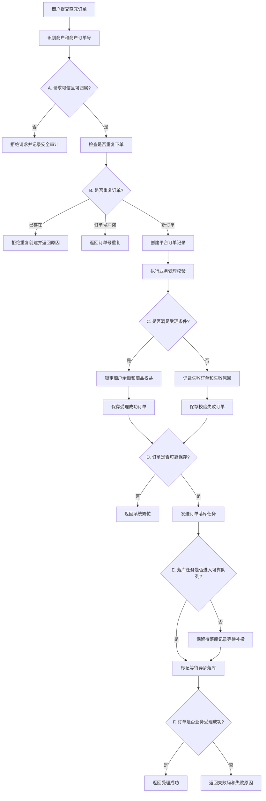
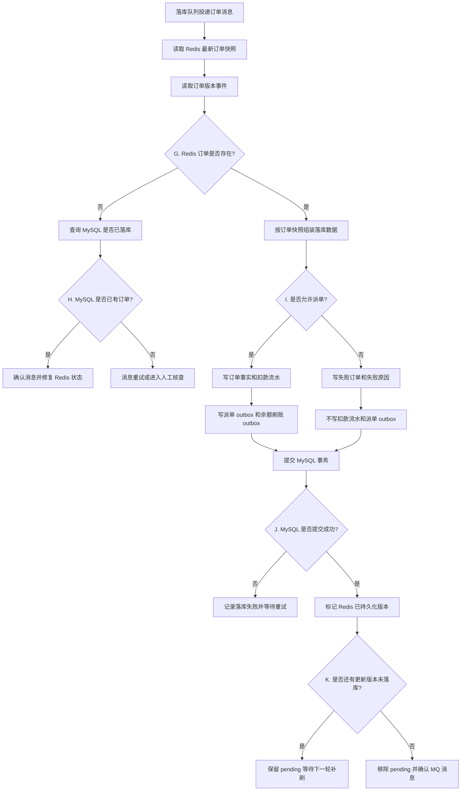
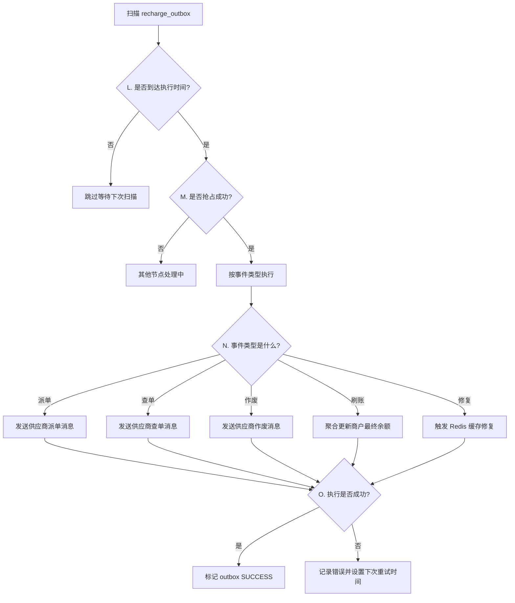
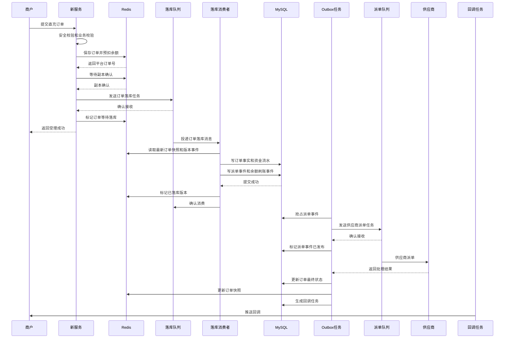
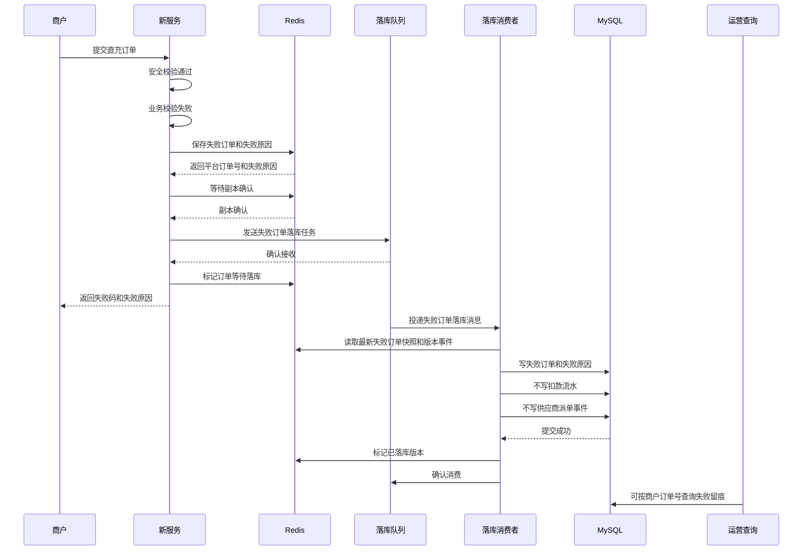
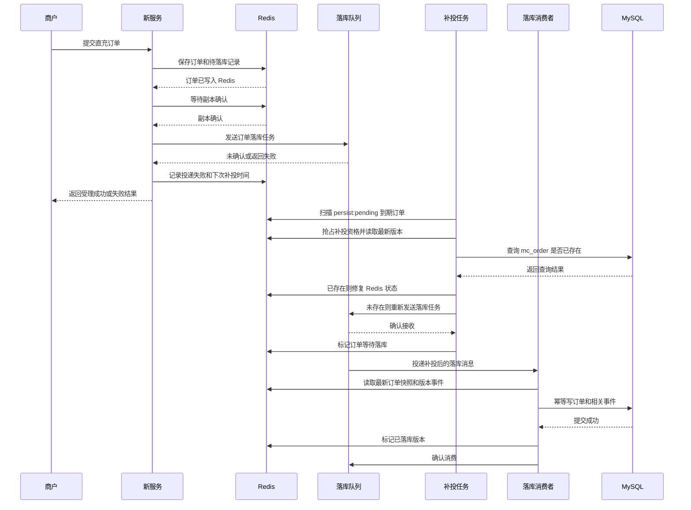
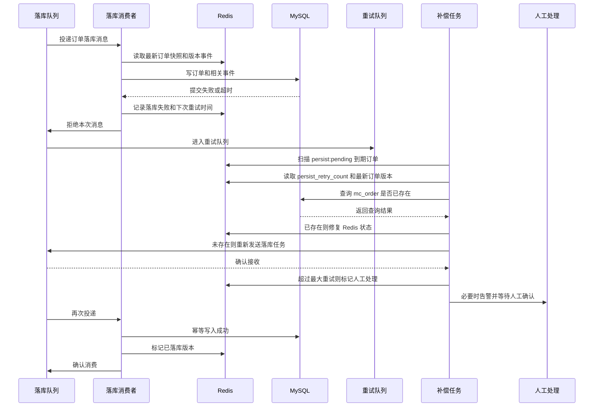
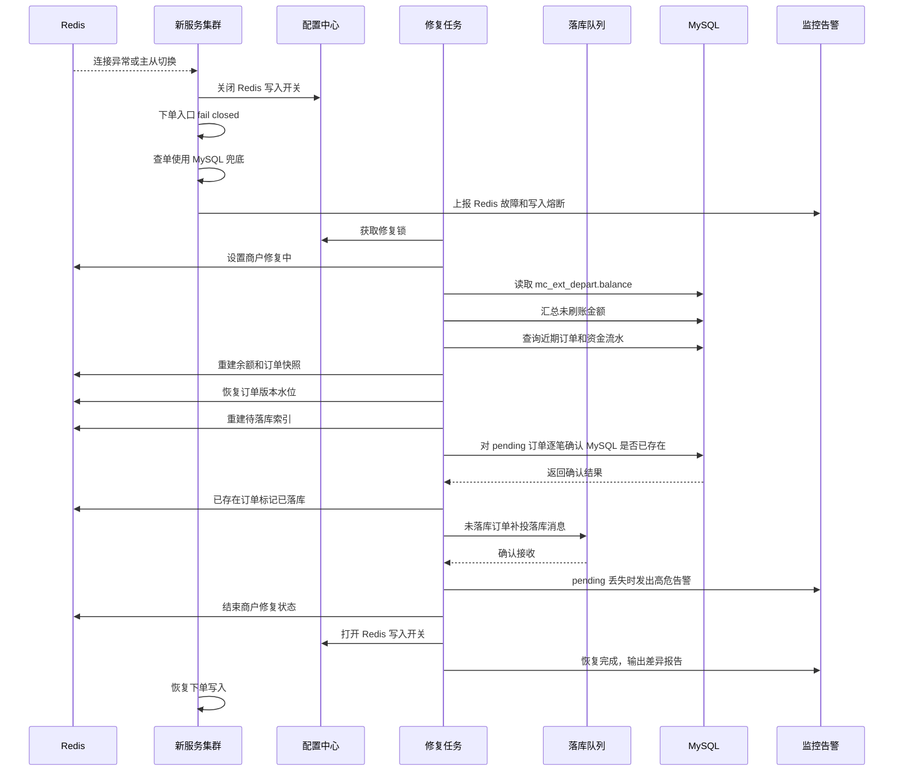
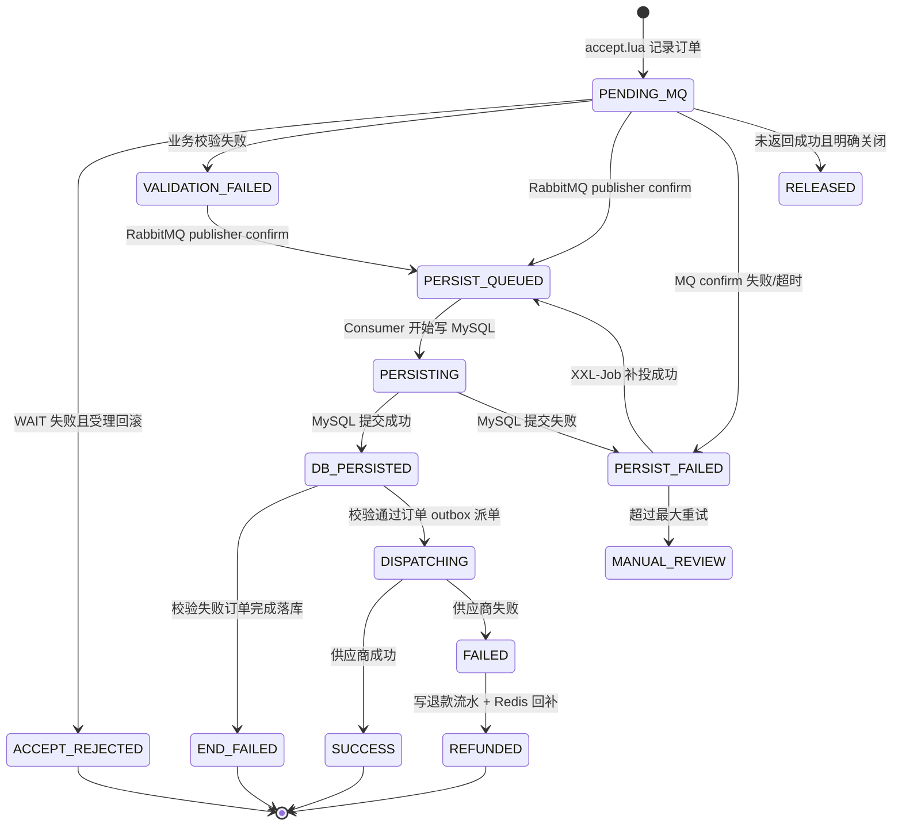
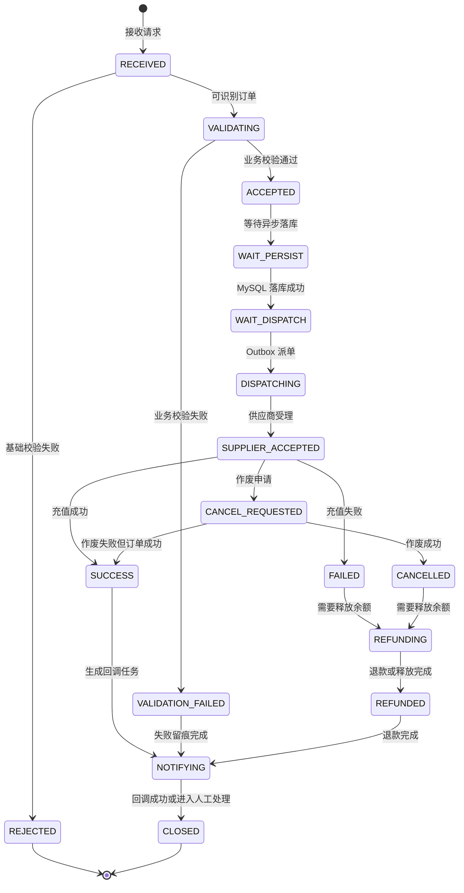

# 交行直充接口 Redis 与 MySQL 一致性及高可用设计实现方案

## 1. 方案概述

本方案基于《交行直充接口重构技术方案修订版（2.2-2.6）》和最新方案调整，面向新建独立服务 `cardshop-recharge-api` 的落地实现。

最新下单模型调整为：

```text
基础安全校验通过后，Redis 先保存订单信息
业务校验通过的订单完成余额预扣
业务校验不通过的订单也进入持久化链路，记录失败原因
RabbitMQ 确认接收异步持久化消息
接口立即返回成功或失败结果
Consumer 异步持久化 MySQL
MySQL 仍是最终事实和账务沉淀
```

核心设计：

```text
新服务独立部署
数据库表继续共享
Redis 承担下单受理期的短期数据源、订单快照、校验结果、实时余额、库存、限购和幂等
RabbitMQ 承担 Redis 到 MySQL 的异步持久化消息通道
MySQL 承担订单最终数据、资金流水、异步任务和回调任务
XXL-Job 承担 MQ 补投、异步持久化补偿、余额对账和缓存修复
```

本方案需要重点解决两个问题：

1. Redis 先记录所有可识别订单、MySQL 异步落库时，如何保证订单和资金数据最终一致。
2. Redis 主从切换、节点故障、数据回滚、RabbitMQ 投递失败或 MySQL 落库失败时如何 fail closed 并恢复。

## 2. 核心设计原则

### 2.1 数据职责

| 数据 | 存储 | 职责 | 一致性级别 |
| --- | --- | --- | --- |
| 商户实时可用余额 | Redis | 下单实时预扣、防超卖 | 强实时控制，最终以 MySQL 修复 |
| 下单订单记录 | Redis | 接口返回前的订单短期数据源，包含成功和失败订单 | Redis 强依赖，必须高可用 |
| 业务校验结果 | Redis | 记录校验失败原因、失败码、失败阶段 | 必须异步落 MySQL |
| 订单快照 | Redis | 查单加速、异步落库前查询 | 可从 MySQL 或 Redis pending 修复 |
| 待持久化索引 | Redis ZSET | 兜底 Redis 成功但 MQ 未确认、MQ 消费失败 | 必须保留到 MySQL 落库成功 |
| 异步持久化消息 | RabbitMQ | 驱动 Consumer 写 MySQL | broker confirm + consumer ack |
| 幂等请求 | Redis + MySQL 唯一约束 | 防重复下单 | Redis 优先，MySQL 最终兜底 |
| 订单事实 | `mc_order` | 订单最终事实 | MySQL 强一致 |
| 资金流水 | `mc_depart_record` | 资金最终流水 | MySQL 强一致 |
| 商户最终余额 | `mc_ext_depart.balance` | 余额展示和账务沉淀 | MySQL 最终一致 |
| 可靠事件 | `recharge_outbox` | 派单、余额刷账、缓存修复 | MySQL 强一致 |
| 回调任务 | `recharge_notify_task` | 回调重试和人工处理 | MySQL 强一致 |

### 2.2 一致性原则

1. 基础安全校验通过且能识别 `orgCode/outOrderSn` 后，所有订单都必须先写 Redis，再异步落 MySQL。
2. 业务校验失败也要生成订单记录，记录失败原因，返回失败，不进入余额预扣和供应商派单。
3. 业务校验通过的订单不能绕过 Redis 余额预扣。
4. 下单返回前，不要求 MySQL 已落库，但必须保证 Redis 订单、Redis 待持久化索引和 RabbitMQ 持久化消息至少有一个可恢复入口。
5. 推荐返回前完成 Redis Lua 原子写入、Redis `WAIT` 副本确认、RabbitMQ publisher confirm。
6. Redis 是下单受理期短期数据源，MySQL 是最终数据。
7. RabbitMQ 只负责驱动异步落库，不替代 Redis pending 索引；因为 Redis 写成功和 MQ 投递成功之间没有原子事务。
8. MySQL 异步落库失败不能直接释放 Redis 余额，必须重试落库；只有业务最终失败、作废退款或明确下单受理失败才释放余额。
9. 供应商派单必须在 MySQL 订单和资金流水落库成功后执行，且只有校验通过订单才允许派单。
10. Redis 高可用故障期间，下单必须 fail closed，不能降级成直接查 MySQL 扣款。
11. 所有补偿任务必须支持多节点抢占和 XXL-Job 分片。

第 5 点的目标是避免接口已经向商户返回成功，但系统内部订单丢失或无法恢复。

它覆盖三个风险窗口：

1. Redis Lua 原子写入解决“订单写了一半”的问题。订单快照、幂等 key、余额预扣、pending 索引必须一起成功或一起失败，避免出现扣了余额但没有订单，或有订单但没有待持久化任务。
2. Redis `WAIT` 副本确认解决 Redis 主节点刚写成功就宕机，数据还没有复制到从节点，故障切换后订单丢失的问题。关键写入至少被 1 个副本确认后再继续。
3. RabbitMQ publisher confirm 解决 Redis 已保存订单，但 MQ 没收到异步落库消息的问题。broker 确认接收后，才认为持久化任务进入可靠通道；未确认时必须依赖 Redis `persist:pending` 后续补投。

因此，“返回成功”必须建立在 Redis 数据可恢复和 MQ 落库任务可恢复的基础上，避免商户拿到成功响应后，系统没有可靠凭据把订单最终落到 MySQL。


## 3. 技术栈与中间件选型

### 3.1 后端基础技术栈

| 组件 | 选型 | 说明 |
| --- | --- | --- |
| JDK | JDK 17+，优先 JDK 21 LTS | Spring Boot 3.x 基础要求，长期维护周期更好，运行时性能和 GC 表现优于 Java 8。 |
| 应用框架 | Spring Boot 3.x | 新服务独立部署，不受旧 RuoYi Java 8 / Spring Boot 2.x 约束。 |
| Web 框架 | Spring WebFlux | 下单、查单、回调和供应商调用以 IO 密集为主，WebFlux 更适合高并发连接和异步编排。 |
| HTTP 客户端 | Spring WebClient | 用于供应商接口、商户回调等异步 HTTP 调用，避免阻塞 servlet 线程模型。 |
| 数据访问 | MyBatis / JDBC | 共享旧 MySQL 表，SQL 和字段兼容 |
| Redis 客户端 | Lettuce + Spring Data Redis Reactive | 支持 Redis Sentinel / Cluster、拓扑刷新、连接恢复和响应式访问。 |
| JSON | Jackson | Spring Boot 默认集成，适合接口报文、MQ payload、outbox payload。 |

说明：

1. WebFlux 只解决 HTTP 和 Redis/MQ/供应商调用的异步编排问题。
2. MySQL 访问仍使用 MyBatis/JDBC，必须放到独立 DB 线程池，不能阻塞 Netty event loop。
3. 所有 MyBatis/JDBC 调用必须通过统一的阻塞执行器封装，例如 `BlockingDbExecutor` 或独立 `Scheduler`，并配置队列长度、超时时间、拒绝策略和监控指标。
4. RabbitMQ Consumer、XXL-Job 和供应商阻塞 SDK 不要求使用 WebFlux 模型，可以使用独立阻塞线程池；但不能复用 Netty event loop。
5. 建议在测试和压测环境启用 BlockHound 或线程名监控，发现 Netty event loop 内误调用 JDBC、文件 IO、阻塞加密或阻塞供应商 SDK 时直接告警。

### 3.2 中间件选型

| 中间件 | 版本/模式 | 角色 |
| --- | --- | --- |
| Redis | Redis 7.x，第一阶段可用 Sentinel，后续可升级 Cluster | 订单短期数据源、实时余额预扣、幂等、pending、订单快照、库存和限购。 |
| RabbitMQ | 生产目标 3.12+ / 3.13+，订单主队列 Quorum Queue；dev/test 兼容 3.8.8 | Redis 到 MySQL 异步持久化、供应商派单、查单、作废、重试和 DLQ。 |
| MySQL | 8.0+ | 订单最终事实、资金流水、商户最终余额、outbox、回调任务和核销事实。 |
| XXL-Job | 2.4+ | MQ 补投、outbox 重试、余额对账、Redis 缓存修复、超时订单处理。 |
| Nacos | 2.x | 配置中心和服务发现，承载 Redis 写入开关、降级开关、第三方配置。 |

### 3.3 Redis 7.x 选型说明

Redis 7.x 在本方案中是资金链路的实时控制层，不是普通缓存。

使用要求：

```text
appendonly yes
appendfsync everysec
maxmemory-policy noeviction
min-replicas-to-write 1
min-replicas-max-lag 2
```

当前阶段采用 Sentinel：

```text
1 master + 2 replica + 3 sentinel
```

适用前提和约束：

1. 峰值写入 QPS 在单主 Redis 可承载范围内。
2. 下单关键写入后执行 `WAIT 1 100ms`。
3. Redis 主从切换期间由 Redis HA Guard 关闭下单写入。
4. 修复任务完成后再恢复接单。
5. 大商户写入热点必须通过商户级限流、应用扩容和独立容量监控控制，不能假设 Sentinel 自动横向扩展写能力。

升级到 Cluster 的触发条件：

1. Redis CPU 长期超过 60%-70%。
2. `WAIT` 超时或失败率升高。
3. 复制延迟明显升高。
4. `persist:pending` 堆积增长。
5. 单主内存或网络成为瓶颈。

### 3.4 RabbitMQ 选型说明

RabbitMQ 用于可靠异步，不用于替代 Redis pending。

必须启用以下配置：

| 配置项 | 建议配置 | 设计意图 |
| --- | --- | --- |
| durable exchange | 所有业务 exchange 声明为 durable | 防止 RabbitMQ 节点重启后 exchange 元数据丢失，导致生产者消息无法路由。 |
| durable queue | 所有业务队列声明为 durable | 防止节点重启后队列元数据丢失；订单落库队列、派单队列、回调队列都必须持久化。 |
| Quorum Queue | 订单落库队列优先使用 Quorum Queue | 基于 Raft 多副本复制，替代 classic mirrored queue，降低单节点故障导致消息不可用或丢失的风险。 |
| persistent message | 消息投递设置 `deliveryMode=2` | 消息写入持久化队列后具备落盘能力；配合 publisher confirm 才能认为消息进入可靠通道。 |
| publisher confirm | 生产者开启 correlated confirm | 接口线程必须知道 broker 是否确认接收消息；confirm 失败时保留 Redis pending，由 XXL-Job 补投。 |
| mandatory return | 开启 mandatory 和 return callback | exchange 存在但 routing key 无法路由到队列时，消息会返回生产者，避免静默丢失。 |
| manual ack | Consumer 手动 ack | MySQL 事务提交成功、Redis 标记完成后再 ack；失败时 nack/requeue 或转入重试队列。 |
| retry queue | TTL + DLX 或延迟队列插件 | 对 MySQL 短暂故障、网络抖动、供应商临时失败做延迟重试，避免立即重试打爆下游。 |
| dead letter queue | 每条业务队列配置 DLQ，DLX 本身也必须 durable 声明并绑定到 DLQ | 超过最大重试次数、消息格式错误、幂等冲突无法自动处理时进入 DLQ，触发告警和人工介入。 |
| consumer prefetch | 按队列设置合理 prefetch | 控制单个 Consumer 未 ack 消息数量，避免 MySQL 慢写时大量消息堆积在应用内存中。 |
| consumer 幂等 | `message_id`、`org_code + out_order_sn` 唯一约束 | MQ 至少一次投递不可避免，Consumer 必须允许重复消费且结果一致。 |

Spring Boot 侧建议配置：

```yaml
spring:
  rabbitmq:
    publisher-confirm-type: correlated
    publisher-returns: true
    template:
      mandatory: true
    listener:
      simple:
        acknowledge-mode: manual
        prefetch: 50
        default-requeue-rejected: false
```

说明：

1. `publisher-confirm-type: correlated` 用于把 RabbitMQ confirm 和订单 `message_id` 关联起来，confirm 成功后才能把 Redis 订单标记为 `PERSIST_QUEUED`。
2. `publisher-returns: true` 和 `mandatory: true` 用于发现“exchange 存在但 routing key 错误或队列未绑定”的问题，此类消息不能认为投递成功。
3. `acknowledge-mode: manual` 要求 Consumer 在 MySQL 事务提交成功后再 ack；如果事务失败，不能 ack，否则订单会停留在 Redis pending 中但 MQ 消息已经丢失。
4. `prefetch` 需要按 MySQL 写入能力调整。订单落库队列建议从 `50` 起步压测，目标是控制 `unacked` 可预期增长，避免 DB 抖动时应用侧囤积过多未提交订单。
5. `default-requeue-rejected: false` 避免异常消息无限立即重投；可重试异常进入 retry queue，不可重试异常进入 DLQ。
6. WebFlux 不代表 RabbitMQ Consumer 和 MySQL 写入也必须跑在 Netty event loop；MQ 发布、confirm 回调和 Consumer 持久化必须使用独立线程池。
7. 当前 dev/test RabbitMQ `3.8.8` 不支持 quorum retry queue 搭配 `x-message-ttl` 声明；因此订单落库主队列和最终 DLQ 使用 Quorum Queue，`recharge.persist.mysql.retry.queue` 使用 classic durable queue + `x-message-ttl + DLX`。该 retry queue 只保存短暂延迟重试消息，订单事实仍由 Redis pending、主队列持久化消息和 MySQL 幂等兜底保护。
8. Rabbit listener 的最终装配必须在 Spring Boot `RabbitAutoConfiguration` 之后执行。若普通业务配置类过早按 `RabbitTemplate` 做 `@ConditionalOnBean`，RabbitTemplate 还未由 AMQP 自动配置注册时会导致 listener Bean 被跳过，现象是应用健康、RabbitMQ 指标存在但 connection/consumer 均为 `0`。因此 dev/test/prod 以 `TradeEngineRabbitListenerAutoConfiguration` 作为最终兜底。

订单落库队列建议使用以下策略：

```text
queue type: quorum
durable: true
delivery mode: persistent
x-delivery-limit: 5
retry interval: 5s / 30s / 2m / 10m
dlq: recharge.persist.mysql.dlq
```

其中 `x-delivery-limit` 用于限制 Quorum Queue 消息反复 redelivery 的次数，超过后转入 DLQ；业务侧仍要保留 Redis `persist:pending`，由补偿任务判断是重新投递、延后处理还是人工介入。

核心队列：

```text
recharge.persist.mysql.queue
recharge.supplier.dispatch.queue
recharge.supplier.query.queue
recharge.invalid.order.queue
recharge.notify.retry.queue
```

订单落库队列 `recharge.persist.mysql.queue` 优先级最高，建议使用 Quorum Queue，并单独监控：

```text
publisher confirm 延迟
队列堆积
consumer ack 延迟
redeliver 数量
unacked 数量
DLQ 数量
磁盘剩余空间
```

### 3.5 MySQL 选型说明

MySQL 8.0+ 继续作为最终事实库。

使用原则：

1. 下单接口不逐笔同步更新 `mc_ext_depart.balance`。
2. 订单异步落库时写 `mc_order`、`recharge_order_ext` 和必要资金流水。
3. 校验失败订单也要写 `mc_order` 和 `recharge_order_ext`，记录失败码、失败原因和持久化状态。
4. 供应商派单、余额刷账、缓存修复通过 `recharge_outbox` 驱动。
5. 高并发查询和运营查询尽量走从库或归档表，避免影响主库写入。

关键索引：

```text
mc_order: unique(direct_recharge_out_order_key)，仅约束 product_type=1 的直充订单幂等
recharge_order_ext: unique(order_id), unique(org_code, out_order_sn)
recharge_outbox: idx(status, next_retry_time), unique(event_id)
recharge_notify_task: idx(status, next_retry_time), unique(task_id)
```

### 3.6 任务调度与配置中心

XXL-Job：

1. 所有补偿任务必须支持分片。
2. 分片字段优先使用 `order_id`、`out_order_sn`、`task_id`。
3. 不按单一 `org_code` 分片，避免大商户热点集中。

Nacos：

1. 管理 Redis 写入开关：`recharge.redis.writeEnabled`。
2. 管理 Redis 修复开关：`recharge.redis.forceMysqlRebuild`。
3. 管理 MQ、供应商、回调、限流、线程池等动态配置。
4. 本机 `local` profile 不连接 Nacos，只用于轻量启动和接口骨架开发；所有动态开关、接入口径和高可用验证必须在 `dev`/`test`/`prod` 等真实配置中心环境中执行。
5. `dev` 使用独立 Nacos namespace `cardshop-trade-engine-dev` 和 group `TRADE_ENGINE_DEV`。MySQL datasource 共用原卡管测试库 `cardshop_test` 以复用旧系统数据；Redis 连接参数与旧卡管 dev 当前配置保持一致，用于兼容旧 token key 和联调数据，发布到新服务 Nacos 时使用 Spring Boot 3 的 `spring.data.redis.*`。
6. dev Redis 指向旧卡管 dev 同一组资源时，新链路订单、余额、pending、幂等 key 必须继续使用 `recharge:{orgCode}:...` 前缀；trade-engine 的 dev/test/prod 之间仍不得共用 Redis DB index 或业务 key prefix。
7. 部署包只保存启动引导配置，dev/test/prod 分别使用 `config/.dev.env`、`config/.test.env`、`config/.prod.env` 描述当前代码直接从环境变量读取的 runtime 键；启动脚本加载这些键后再启动应用。`.env` 由 Bash `source` 读取，密码、JWT secret、API key 等同类密钥值必须用单引号包起来，尤其当值包含 `$`、`!`、空格、反引号、`&`、`|`、`;`、`<`、`>` 时。MySQL、Redis、XXL-Job、接入口径和业务开关统一从 Nacos 加载，减少测试/生产环境配置漂移。当前 dev/test 共用 test188 的 `dev` profile，业务侧只接入 A39 交行机构，暂不按灰度名单切流。

### 3.7 线程池与隔离

建议线程池隔离：

| 线程池 | 用途 |
| --- | --- |
| Netty event loop | WebFlux 网络 IO，不允许执行阻塞 DB 操作。 |
| crypto-pool | SM3/SM4、签名验签。 |
| db-persistence-pool | MyBatis/JDBC 写 MySQL。 |
| mq-publisher-pool | RabbitMQ publisher confirm。 |
| mq-confirm-callback | RabbitMQ confirm 回调线程，只完成 Future 或轻量入队，不访问 Redis/MySQL。 |
| mq-confirm-worker | 处理 confirm 结果，更新 Redis 持久化状态和补投索引。 |
| supplier-io-pool | 无法 WebClient 化的阻塞供应商 SDK。 |
| xxl-job-pool | 补投、对账、缓存修复、回调重试。 |

线程隔离规则：

1. `db-persistence-pool` 的线程数不能明显大于 Hikari 最大连接数，避免线程堆积但拿不到连接。
2. WebFlux handler 中调用 MyBatis 时必须显式切换到 DB 线程池，并设置单次 DB 操作超时。
3. RabbitMQ publisher confirm callback 不能直接访问 Redis、MySQL 或执行复杂 JSON 序列化；否则 broker IO 线程被拖慢，会放大 confirm 延迟。
4. confirm callback 只完成 `CompletableFuture` 或把结果写入内存有界队列，后续 Redis 状态更新由 `mq-confirm-worker` 执行。
5. `mq-confirm-worker` 队列必须有上限，超过上限时下单入口应限流或 fail closed，不能无限堆积 confirm 待处理结果。

### 3.8 可观测性组件

建议接入：

| 组件 | 用途 |
| --- | --- |
| Micrometer | 应用指标采集。 |
| Prometheus | 指标存储和查询。 |
| Grafana | 监控面板。 |
| SkyWalking / OpenTelemetry | 链路追踪，追踪 Redis、MQ、MySQL、供应商调用。 |
| 日志平台 | 订单号、商户订单号、MQ message_id、outbox event_id 全链路检索。 |

必须监控：

```text
Redis Lua P99
Redis WAIT 成功率
Redis 主从切换次数
RabbitMQ publisher confirm P99
RabbitMQ 队列堆积
MySQL commit P99
outbox pending 数量
notify failed 数量
Redis pending 超时数量
```

## 4. 总体设计说明


1. 新服务先写 Redis，再发送 RabbitMQ 持久化消息。
2. 持久化 Consumer 消费消息后写 MySQL。
3. MySQL 中的 outbox 事件由 Outbox Worker 推送到业务队列，再调用供应商。
4. 供应商结果回写 MySQL 和 Redis，并通过 Notify Worker 回调商户。
5. XXL-Job 在 Redis、RabbitMQ、MySQL 之间做补投、对账和修复。

## 5. 关键 Redis Key 设计

当前阶段 Redis 采用 Sentinel 单主部署，不存在 Cluster cross slot 限制。Key 命名仍保留 `{orgCode}` hash tag，目的是为后续平滑迁移 Redis Cluster 预留兼容能力。

Sentinel 阶段需要重点控制单主热点：

1. 单个大商户的余额、订单、库存、限购和 pending 写入都在同一个 Redis master 上执行，必须设置商户级 QPS 上限。
2. 对大商户单独监控 Redis Lua P99、`WAIT` 成功率、pending 堆积和 key 数量。
3. 当大商户流量接近单主瓶颈时，优先采用商户级限流、削峰、独立 Redis 实例组或迁移 Cluster，而不是继续扩大应用节点。
4. 迁移 Cluster 后，所有下单 Lua 需要访问的 key 必须落在同一个 slot，因此统一使用 `{orgCode}` 作为 hash tag。

```text
recharge:{orgCode}:balance
recharge:{orgCode}:idem:{outOrderSn}
recharge:{orgCode}:order:{outOrderSn}
recharge:{orgCode}:reservation:{orderId}
recharge:{orgCode}:persist:pending
recharge:{orgCode}:persist:mq_confirm_pending
recharge:persist:pending:org_index:{bucket}
recharge:{orgCode}:order:event_index:{orderId}
recharge:{orgCode}:order:event:{orderId}:{version}
recharge:{orgCode}:reservation_index
recharge:{orgCode}:stock:{productId}
recharge:{orgCode}:limit:{productId}:{account}:{yyyyMMdd}
```

### 5.1 Key 设计原则

1. `{orgCode}` 作为 hash tag，保证后续迁移 Redis Cluster 时，同一商户下单 Lua 涉及的余额、订单、幂等、预扣、库存、限购和 pending 索引在同一个 Redis Cluster slot 内，可以原子执行。
2. Redis 订单 key 是 MySQL 落库前的短期数据源，必须能支撑查单、幂等、失败原因展示和补偿恢复。
3. 余额、订单、待持久化索引、订单事件分开存储，避免单个大 value 频繁改写，也方便按职责补偿。
4. pending 类 key 不依赖过期事件驱动资金释放，资金释放必须由明确状态机、MySQL 事实或人工处理触发。
5. 失败订单和成功订单使用同一套订单 key 和 pending 机制，保证所有可识别订单最终都能落 MySQL。
6. Sentinel 阶段不做跨 master 分片，大商户热点必须通过商户级限流、独立容量评估和后续 Cluster 迁移治理。

### 5.2 Key 作用说明

| Key | 类型 | 设计意图 | 生命周期 |
| --- | --- | --- | --- |
| `recharge:{orgCode}:balance` | Hash | 商户实时可用余额和冻结金额，承接高并发余额预扣，避免每笔订单同步更新 MySQL 热点余额行。 | 长期保留，充值、退款、对账和缓存重建时更新。 |
| `recharge:{orgCode}:balance:repairing_lock` | String | 余额修复期间阻断非重复新下单，避免修复任务覆盖刚发生的 Redis 预扣。必须使用 `SET owner NX PX` 获取。 | 修复任务完成后按 owner 释放；任务宕机由 TTL 自动释放。 |
| `recharge:{orgCode}:idem:{outOrderSn}` | Hash/String | 商户订单号幂等入口，防止相同 `outOrderSn` 重复创建订单；查单接口可基于该 key 定位原订单状态。 | 至少保留到订单终态后一段时间， 覆盖售后/查单周期。 |
| `recharge:{orgCode}:order:{outOrderSn}` | Hash | Redis 订单短期数据源，保存订单状态、校验结果、失败原因、持久化状态和版本水位。 | MySQL 落库前必须保留，终态后可按查询周期设置 TTL。 |
| `recharge:{orgCode}:reservation:{orderId}` | Hash | 记录余额预扣 reservation，用于释放、退款、对账和防重复回补。校验失败订单可写 `NONE` 或不产生有效预扣。 | 订单终态并完成对账后可清理。 |
| `recharge:{orgCode}:persist:pending` | ZSET | MySQL 异步持久化补偿索引，覆盖 MQ confirm 失败、消费失败、MySQL 落库失败、Redis 标记失败等场景。 | MySQL 持久化到最新版本后移除。 |
| `recharge:{orgCode}:persist:mq_confirm_pending` | ZSET | 记录正在等待 RabbitMQ publisher confirm 的订单，便于接口线程异常退出后补查 confirm 结果或重新补投。 | publisher confirm 成功或转入 `persist:pending` 后移除。 |
| `recharge:persist:pending:org_index:{bucket}` | ZSET | 分桶后的活跃商户 pending 索引，member 为 `orgCode`，score 为该商户最小 `nextRetryTime`；避免所有分片争用单个全局 org_index。 | 对应商户 pending 清空后移除。 |
| `recharge:{orgCode}:order:event_index:{orderId}` | ZSET | 订单版本事件索引，记录每次 Redis 订单状态变化的版本号，保证 MySQL 可按版本补刷。 | MySQL `persisted_version` 追上 `order_version` 且订单终态后可清理。 |
| `recharge:{orgCode}:order:event:{orderId}:{version}` | Hash/String | 单个订单变更事件，保存该版本的状态变化、失败原因或人工处理动作，避免旧 MQ 消息覆盖新状态。 | 随事件索引清理。 |
| `recharge:{orgCode}:reservation_index` | ZSET | reservation 扫描索引，用于查找超时未确认、待释放、待对账的预扣记录。 | reservation 完成释放/确认/对账后移除。 |
| `recharge:{orgCode}:stock:{productId}` | String/Hash | 商品实时库存预扣，避免高峰期每笔订单同步扣 MySQL 库存。 | 商品活动或售卖周期内保留，按商品库存重建。 |
| `recharge:{orgCode}:limit:{productId}:{account}:{yyyyMMdd}` | String/Counter | 账号日限购计数，Lua 内原子增加，防止同账号并发绕过限购。 | 按业务日设置 TTL，通常保留 1 到 3 天。 |

### 5.3 关键 Hash 结构

`recharge:{orgCode}:balance`  使用 Hash：

```text
available       实时可用余额，单位分
frozen          Redis 已预扣且尚未最终释放/确认完成的金额，单位分
version         Redis 余额逻辑版本
repairing       是否正在修复的展示/诊断字段；真正阻断以下单入口检查 repairing_lock 为准
updated_at      最近更新时间
```

`recharge:{orgCode}:order:{outOrderSn}`  使用 Hash：

```text
order_id
out_order_sn
org_code
product_id
selected_product_id
account
amount
request_hash
order_status        RECEIVED / VALIDATING / ACCEPTED / VALIDATION_FAILED / PERSISTING / WAIT / SUCCESS / FAILED / REFUNDED
persist_status      PENDING_MQ / PERSIST_QUEUED / PERSISTING / DB_PERSISTED / PERSIST_FAILED
validation_status   PASSED / FAILED
fail_stage          PARAM_VALIDATE / MERCHANT_VALIDATE / PRODUCT_VALIDATE / BALANCE_VALIDATE / STOCK_VALIDATE / LIMIT_VALIDATE / SYSTEM
fail_code
fail_reason
dispatch_allowed    0 / 1
balance_reserved    0 / 1
order_version       Redis 订单当前版本
persisted_version   MySQL 已持久化版本
mq_publish_count
persist_retry_count
last_error
created_at
updated_at
```

`recharge:{orgCode}:reservation:{orderId}`  使用 Hash：

```text
order_id
out_order_sn
request_hash
amount
status              NONE / PENDING_MQ / PERSIST_QUEUED / PERSISTING / DB_PERSISTED / RELEASED / EXPIRED
expire_at
created_at
updated_at
```

说明：

1. 业务校验失败订单也必须写 `order` hash 和 `persist:pending`。
2. 业务校验失败订单不写余额 reservation，或写 `reservation.status=NONE`。
3. 只有 `validation_status=PASSED` 且 `balance_reserved=1` 的订单才允许后续派单。
4. 基础安全校验失败、SM4 无法解密、签名无法确认、无法解析 `orgCode/outOrderSn` 的请求不能归属订单，可只写安全审计日志，不进入订单表。
5. 订单在 Redis 作为短期数据源期间发生状态变化时，必须递增 `order_version` 并写订单变更事件。
6. Consumer 持久化时必须读取 Redis 当前快照和变更事件，不能只使用 MQ 消息中的旧快照。

`recharge:{orgCode}:persist:pending` 使用 ZSET：

```text
member = orderId
score = nextRetryTimestamp
```

职责：

1. Redis 写成功但 RabbitMQ publisher confirm 失败时，补投任务可扫描重发。
2. RabbitMQ 消息消费失败或 MySQL 落库失败时，补偿任务可重新投递。
3. MySQL 已落库但 Redis 标记失败时，修复任务可查询 MySQL 后标记 `DB_PERSISTED` 并移除索引。

注意：不要只依赖 Redis key 过期事件释放余额。资金释放必须基于 MySQL 状态、供应商最终状态或明确的下单受理失败结果执行。

## 6. MySQL 表与约束

### 6.1 共享旧表

新服务独立部署，但数据库表继续与现有系统共享。MySQL 表承担最终事实、账务沉淀、运营查询、售后排查和对账依据。

继续写入和读取以下旧表：

```text
mc_order
mc_depart_record
mc_ext_depart
mc_batch_record
mc_use_history
mc_order_snapshot
mc_order_supplier_flow
mc_order_processing_rule
mc_order_customer_reissue
```

共享旧表业务说明：

| 表 | 业务说明 | 新服务写入时机 | 关键要求 |
| --- | --- | --- | --- |
| `mc_order` | 订单最终事实表，记录成功受理订单和业务校验失败订单。 | Redis 订单经 RabbitMQ 异步落库时写入。 | 直充幂等优先使用现有生成列 `direct_recharge_out_order_key`；失败订单要在主表记录运营可见失败原因。 |
| `mc_depart_record` | 商户资金流水表，记录预扣、确认扣款、释放、退款等资金动作。 | 业务校验通过且发生余额预扣时写入；校验失败订单不写扣款流水。 | 资金流水必须有业务唯一键，防止重复消费 MQ 导致重复记账。 |
| `mc_ext_depart` | 商户最终余额表，用于余额展示、运营管理和最终账务沉淀。 | 不在下单接口逐笔同步更新；由 `BALANCE_DELTA_FLUSH` 批量刷账或对账修正。 | 避免恢复旧链路的热点余额行锁。 |
| `mc_batch_record` | 卡券批次、核销或供应商侧凭证状态表。 | 供应商返回核销、作废、过期等结果后写入或更新。 | 与 `mc_order` 状态保持最终一致。 |
| `mc_use_history` | 核销历史或使用明细表。 | 供应商核销成功、作废成功或状态刷新时写入。 | 用于查单、核销回调和售后追溯。 |
| `mc_order_snapshot` | 下单时商品和订单快照表，保存 `product_info`。 | 订单异步落库成功后按需写入。 | 只保存业务快照，不保存 Redis/MQ 技术状态。 |
| `mc_order_supplier_flow` | 供应商派单流水表，保存供应商请求参数、响应结果和处理状态。 | `SUPPLIER_DISPATCH` outbox 执行时写入或更新。 | 可继续通过 `mc_order.flow_id` 关联，但不复用为 MQ 落库消息 ID。 |
| `mc_order_processing_rule` | 商品维度派单节奏规则表，控制随机间隔、单笔间隔和启停状态。 | 派单 Worker 选择供应商或执行派单前读取。 | 只影响供应商派单节奏，不影响 Redis 受理和 MySQL 订单落库。 |
| `mc_order_customer_reissue` | 客诉补发记录表，关联原订单和补发新订单。 | 售后补发流程创建或更新。 | 补发产生的新订单仍需遵守直充幂等、状态机和资金一致性规则。 |

### 6.2 `mc_order` 字段说明

`mc_order` 是订单最终事实表，现有订单列表接口主要基于 `mc_order` 查询和展示。根据当前 DDL，`mc_order` 已包含以下关键字段：

| 字段 | 说明 |
| --- | --- |
| `id` | MySQL 自增主键或内部主键。 |
| `order_Id` | 平台订单号，对外返回给商户，当前已有唯一索引 `order_id_index`。 |
| `org_code` | 商户编码，用于商户隔离、余额归属和分片。 |
| `out_orderId` | 商户订单号，对接文档中的外部订单号。 |
| `direct_recharge_out_order_key` | 生成列，仅当 `product_type=1` 且 `org_code/out_orderId` 有效时生成 `org_code:out_orderId`，适合承载直充订单幂等唯一键。 |
| `produt_code` / `parent_id` | 沿用旧表字段命名；`parent_id` 保存接口请求父产品号，`produt_code` 保存受理阶段选定的实际子商品号。 |
| `account` | 充值账号或卡券接收账号。 |
| `order_price` | 订单金额或扣款金额。 |
| `order_status` | 订单业务状态，例如受理、校验失败、待派单、成功、失败、退款等。 |
| `data_status` | 旧链路队列/处理状态字段，当前为 `varchar(32)`；新链路固定写 `PROCESSED` 兼容旧后台，不承载 Redis/MQ 持久化状态。 |
| `remark` | 运营可读备注，可用于展示失败说明，但不建议只依赖该字段承载结构化失败原因。 |
| `res_data` | 接口请求/响应数据 JSON，继续用于历史排查，不承载新链路技术状态。 |
| `max_retry_count` / `already_retry_count` | 旧链路供应商或业务处理重试次数，不复用为 Redis 到 MySQL 落库重试次数。 |
| `flow_id` | 关联 `mc_order_supplier_flow.id`，不复用为 RabbitMQ 持久化消息 ID。 |
| `created_at` / `updated_at` | 当前 DDL 中对应 `create_time`、`edit_time`、`update_time` 等时间字段。 |

字段命名兼容规则：

1. 旧表字段保持现状，不为统一命名而重命名 `order_Id`、`out_orderId`、`produt_code` 等字段。
2. 新服务领域模型统一使用规范命名，例如 `orderId`、`outOrderSn`、`productCode`、`createdAt`。
3. MyBatis 必须通过显式 `resultMap` 或 SQL 别名映射旧字段，禁止依赖自动驼峰映射猜测字段名。
4. 新增表统一使用 snake_case，例如 `order_id`、`out_order_sn`、`product_code`、`created_at`。
5. 所有跨表 join、唯一冲突处理和排障工具必须明确标注旧字段与领域字段的映射关系。

新链路对 `mc_order` 只做轻量扩展：

| 建议新增字段 | 说明 |
| --- | --- |
| `fail_code` | 失败码，业务校验失败或系统失败时写入。 |
| `fail_reason` | 失败原因，用于接口返回、运营查询和售后排查。 |

不建议加入 `mc_order` 的字段：

```text
request_hash
redis_order_id
persist_msg_id
persist_status
redis_order_version
persisted_version
validation_status
dispatch_allowed
balance_reserved
mq_publish_count
persist_retry_count
last_error
```

这些字段属于 Redis/MQ/MySQL 一致性和补偿排障字段，应放入 `recharge_order_ext`，避免继续膨胀核心订单表，也避免与旧系统字段语义冲突。

直充幂等唯一约束：

```sql
-- 不建议直接对全表增加 unique(org_code, out_orderId)，避免影响卡券、批采、补发等非直充业务。
-- 推荐使用现有生成列，只约束 product_type=1 的直充订单。
unique key uk_direct_recharge_out_order_key (direct_recharge_out_order_key)
```

加唯一索引前必须先检查历史重复数据：

```sql
select direct_recharge_out_order_key, count(*) as cnt
from mc_order
where direct_recharge_out_order_key is not null
group by direct_recharge_out_order_key
having count(*) > 1;
```

轻量改表建议：

```sql
alter table mc_order
  add column fail_code varchar(64) default null comment '失败码',
  add column fail_reason varchar(500) default null comment '失败原因';
```

如果短期不能改 `mc_order`，可以临时把 `fail_code/fail_reason` 放入 `recharge_order_ext`，并继续把运营展示文案写入 `mc_order.remark`。长期仍建议补充结构化失败字段，便于订单列表、导出和售后检索。

### 6.2.1 共享旧表兼容与迁移方案

由于新服务独立部署但数据库表共享，表结构调整必须先于新链路放量完成，且不能破坏旧系统读写。

上线前必须完成：

1. 基于现有生成列 `direct_recharge_out_order_key` 做历史重复数据检查。只有确认 `direct_recharge_out_order_key is not null` 的直充订单不存在重复后，才能增加唯一索引。
2. `mc_order` 主表只新增允许为空的 `fail_code/fail_reason`，用于订单列表、导出和售后检索展示业务失败原因，避免旧系统 insert 未带新字段时报错。
3. `recharge_order_ext` 作为新链路必需扩展表上线，保存 `request_hash`、Redis 订单号、MQ 消息号、持久化状态、版本水位、补偿次数等技术字段。
4. 新增 `uk_direct_recharge_out_order_key` 时必须使用在线 DDL 或低峰期执行，避免锁表影响现有下单、查单和运营后台。
5. 新旧服务共写期间，旧系统不能覆盖新服务写入的 `fail_code/fail_reason` 和用于展示失败原因的 `remark`；涉及旧系统更新订单状态或备注的 SQL 需要做字段保护。
6. `data_status`、`max_retry_count`、`already_retry_count`、`flow_id` 保持旧系统语义，不复用为新链路 Redis/MQ/MySQL 一致性字段；新链路写 `mc_order.data_status='PROCESSED'`，真实落库状态写 `recharge_order_ext.persist_status`。
7. 回滚时，新服务停止接单后，Redis pending、RabbitMQ 持久化队列以及 `recharge_order_ext` 中未完成的持久化状态必须先收敛，不能直接切回旧服务导致 Redis 已受理订单丢失。

推荐上线顺序：

```text
1. 生产库执行兼容字段和索引变更
2. 部署新服务但关闭接单开关
3. 启动 Consumer、Outbox Worker、XXL-Job，先按当前接入机构 A39 交行验证闭环
4. 将已接入机构流量切到新服务；当前 dev/test 暂不使用灰度名单过滤
5. 验证 Redis pending、MQ 队列、MySQL 订单、资金流水和回调任务闭环
6. 按商户逐步放量
```

回滚原则：

1. 未写 Redis 的请求可直接切回旧服务。
2. 已写 Redis 但未落 MySQL 的订单，必须继续由新服务 Consumer/补偿任务落库，不能丢弃。
3. 已落 MySQL 的订单以 MySQL 状态为准，旧服务接管前必须确认不会重复派单、重复扣款或覆盖失败原因。
4. 回滚期间 `/createRechargeOrder` 可关闭新服务入口，但查单、补偿、回调任务必须继续运行到存量订单完成。

### 6.3 `mc_depart_record` 字段说明

`mc_depart_record` 是资金最终流水表，校验失败订单不应写扣款流水。

| 字段 | 说明 |
| --- | --- |
| `id` | 流水主键。 |
| `record_id` | 业务流水号， 全局唯一。 |
| `order_id` | 平台订单号。 |
| `org_code` | 商户编码。 |
| `amount` | 流水金额，扣款为负数或按旧表方向约定写入。 |
| `record_type` | 流水类型，例如 `PRE_DEDUCT`、`CONFIRM_DEDUCT`、`RELEASE`、`REFUND`。 |
| `biz_type` | 业务类型，例如交行直充、作废退款、对账修正。 |
| `before_balance` | 变动前余额，如果旧表支持。 |
| `after_balance` | 变动后余额，如果旧表支持。 |
| `remark` | 备注， 写入 Redis 预扣、退款、对账修正等说明。 |
| `created_at` | 创建时间。 |

唯一约束：

```sql
unique key uk_record_order_type (order_id, record_type)
```

旧表兼容说明（2026-07-07 代码核对）：

当前测试库 `mc_depart_record` 仍使用旧字段模型：`type` 表示流水类型、`value` 表示发生金额、`balance` 表示变动后余额。D7B 代码按旧表写 `type=1`、`value=order_price` 的 `PRE_DEDUCT` 兼容流水，并通过 Liquibase 为 `type=1 + order_id` 增加生成列 `trade_engine_record_key` 和唯一键 `uk_mc_depart_record_trade_engine_key`。Mapper 使用 `insert ... on duplicate key update order_id = order_id` 做 DB 级幂等，避免 RabbitMQ 重投、Consumer 重启或补投 Job 并发产生重复扣款流水。

如果目标库存在历史重复的 `type=1 + order_id` 记录，迁移必须 HALT 并先做数据清洗；不能退回应用层先查后插作为资金流水幂等方案。

### 6.4 `mc_ext_depart` 字段说明

`mc_ext_depart` 是商户最终余额表，不参与下单接口逐笔实时扣减。

| 字段 | 说明 |
| --- | --- |
| `org_code` | 商户编码。 |
| `balance` | 商户最终余额。 |
| `updated_at` | 更新时间。 |

使用规则：

1. 下单实时可用余额以 Redis `recharge:{orgCode}:balance` 为准。
2. MySQL `mc_ext_depart.balance` 由 `BALANCE_DELTA_FLUSH` 批量刷账或对账任务修正。
3. 商户充值、人工调账、退款完成后，需要同步修正 Redis 余额。

新旧系统并行期间的余额写入边界：

1. 必须按 `org_code + product_type/交易类型` 配置余额写入 owner，例如 `OLD`、`NEW`、`READ_ONLY`。
2. 同一商户同一交易类型不能由旧系统和新服务同时受理并同时写 `mc_ext_depart.balance`。
3. 迁移到新服务的商户，旧 `/createRechargeOrder` 必须拒绝、路由到新服务或只读查询，不能继续独立扣减 MySQL 余额。
4. 旧系统如果仍会更新 `mc_ext_depart.balance`，必须确认全部使用原子增量语义，例如 `balance = balance + delta`，禁止基于旧余额计算后 `set balance = fixedValue`。
5. 商户充值、人工调账、退款、作废释放等非下单资金动作必须统一生成余额事件，同步更新 Redis 余额和 MySQL 最终余额。
6. 切流前需要按商户冻结余额 owner，完成 Redis 余额初始化和 MySQL/Redis 差异核对后，再打开新服务接单。
7. 回滚时需要先停止新服务接单，等待 Redis pending、RabbitMQ 持久化队列、未刷账 `BALANCE_DELTA_FLUSH` 全部收敛，再把余额 owner 切回旧系统。

### 6.5 `mc_batch_record` 和 `mc_use_history` 字段说明

这两张表保存核销、作废、使用历史等最终状态。

| 表 | 关键字段 | 说明 |
| --- | --- | --- |
| `mc_batch_record` | `order_id` | 关联平台订单。 |
| `mc_batch_record` | `state_type` | 卡券状态类型，沿用旧系统约定。 |
| `mc_batch_record` | `use_state` | 未使用、已使用、已核销、已过期、已回收等状态。 |
| `mc_batch_record` | `use_time` | 核销或使用时间。 |
| `mc_batch_record` | `invalid_time` | 作废或回收时间。 |
| `mc_use_history` | `order_id` | 关联平台订单。 |
| `mc_use_history` | `account` | 充值或核销账号。 |
| `mc_use_history` | `use_state` | 使用状态。 |
| `mc_use_history` | `created_at` | 记录创建时间。 |

使用规则：

1. 供应商查单、回调、作废结果和对账修正都可以更新核销状态。
2. 更新 MySQL 后必须同步刷新 Redis 订单快照。
3. 核销状态变化需要生成 `recharge_notify_task`。

### 6.5.1 其他相关旧表兼容说明

根据当前 DDL，以下旧表对新链路有辅助作用，但不承载 Redis/MQ/MySQL 一致性状态：

| 表 | 关键字段 | 兼容规则 |
| --- | --- | --- |
| `mc_order_snapshot` | `order_no`、`product_info`、`order_type` | 可继续保存下单时商品快照。写入失败不应影响 `mc_order` 已受理事实，但需要通过 outbox 或补偿任务补写，避免订单详情缺少快照。 |
| `mc_order_supplier_flow` | `order_Id`、`out_order_no`、`channel`、`status`、`request_param`、`response_result` | 供应商派单 Worker 写入，用于记录供应商请求和响应。`mc_order.flow_id` 可以继续关联该表主键，但不能作为 RabbitMQ `message_id` 或 Redis 持久化标识。 |
| `mc_order_processing_rule` | `product_id`、`random_type`、`random_min_second`、`random_max_second`、`single_order_min_second`、`rule_status` | 派单前读取启用规则，控制同产品订单的派单节奏。该表只影响 `SUPPLIER_DISPATCH` 执行时间，不影响订单是否写入 Redis 和 MySQL。 |
| `mc_order_customer_reissue` | `order_id`、`internal_order_no`、`account`、`status`、`reason` | 客诉补发属于售后链路。补发生成的新订单应进入同一套订单状态机；原订单和补发订单之间通过 `internal_order_no` 保持可追溯。 |

风险点：

1. `mc_order_supplier_flow` 当前 DDL 只有主键，没有 `order_Id + channel` 或 `out_order_no` 唯一约束；派单 Worker 必须先查后写，或补充唯一约束，避免 outbox 重试时重复插入流水。
2. `mc_order_snapshot` 当前未见 `order_no` 唯一索引；如果新链路需要强依赖订单快照，应补充唯一约束或在写入前按 `order_no` 幂等查询。
3. `mc_order_customer_reissue.status` 使用 `0/12/6`，需要和 `mc_order.order_status` 做映射，不能直接把补发记录状态当作订单状态。

### 6.6 新增表

保留：

```text
recharge_order_ext
recharge_outbox
recharge_notify_task
```

`recharge_order_ext` 是新链路订单扩展表，用于保存 Redis、RabbitMQ、MySQL 一致性相关的技术状态。它不是新的订单事实表，订单业务事实仍以 `mc_order` 为准。

设计意图：

1. 避免继续把 `mc_order` 扩展成技术状态大宽表，降低对旧订单列表、导出、运营后台和旧系统 SQL 的影响。
2. 避免复用 `data_status`、`max_retry_count`、`already_retry_count`、`flow_id` 等旧字段造成语义混乱。
3. 支撑 Redis-first 下单后，MQ confirm、异步落库、版本补刷、失败补偿和排障检索。
4. 与 `mc_order` 在同一个 MySQL 事务中写入，保证订单事实和扩展状态要么同时成功，要么同时失败。

`recharge_order_ext` 字段说明：

| 字段 | 说明 |
| --- | --- |
| `id` | 表主键。 |
| `order_id` | 平台订单号，对应 `mc_order.order_Id`。 |
| `org_code` | 商户编码。 |
| `out_order_sn` | 商户订单号，对应 `mc_order.out_orderId`。 |
| `request_hash` | 标准化请求摘要，用于区分“同一商户订单号重复请求”和“同一商户订单号但请求内容不一致”。 |
| `request_hash_version` | 请求摘要规范版本，例如 `v1`，用于后续字段规则升级。 |
| `request_hash_alg` | 请求摘要算法，例如 `SM3` 或 `SHA-256`。 |
| `redis_order_id` | Redis 订单 key 或 Redis 侧订单标识，便于排查 Redis pending 与 MySQL 订单关系。 |
| `persist_msg_id` | RabbitMQ 落库消息 ID，用于 publisher confirm、消费日志和链路追踪。 |
| `persist_status` | 持久化状态，例如 `PENDING_MQ`、`PERSIST_QUEUED`、`PERSISTING`、`DB_PERSISTED`、`PERSIST_FAILED`、`MANUAL_REQUIRED`。 |
| `persist_source` | 持久化来源，例如 `REDIS_SNAPSHOT`、`MQ_SNAPSHOT_FALLBACK`，用于识别是否发生 Redis 丢失兜底落库。 |
| `redis_order_version` | Redis 当前订单版本，Redis 订单发生状态变化时递增。 |
| `persisted_version` | 已成功写入 MySQL 的订单版本，用于判断是否还有 Redis 新版本需要补刷。 |
| `validation_status` | 业务校验状态，例如 `PASSED`、`FAILED`。 |
| `dispatch_allowed` | 是否允许生成供应商派单事件，校验失败订单为 `0`。 |
| `balance_reserved` | 是否已在 Redis 完成余额预扣，校验失败订单为 `0`。 |
| `mq_publish_count` | 落库消息发布次数，用于判断 MQ confirm 失败后的接口内重投和后台补投。 |
| `persist_retry_count` | Redis 到 MySQL 异步落库重试次数，不使用 `mc_order.already_retry_count`。 |
| `last_error` | 最近一次 MQ 发布、消费或 MySQL 持久化失败原因。 |
| `created_at` | 创建时间。 |
| `updated_at` | 更新时间。 |

建议约束：

```sql
unique key uk_ext_order_id (order_id)
unique key uk_ext_org_out_order (org_code, out_order_sn)
key idx_ext_persist_status (persist_status, updated_at)
key idx_ext_msg_id (persist_msg_id)
```

写入规则：

1. 落库 Consumer 在同一 MySQL 事务中写入 `mc_order` 和 `recharge_order_ext`。
2. 业务校验失败订单同样写入 `mc_order` 和 `recharge_order_ext`，但 `dispatch_allowed=0`、`balance_reserved=0`，不生成供应商派单事件。
3. Consumer 成功提交 MySQL 后，更新 `persist_status=DB_PERSISTED` 和 `persisted_version`，再 ack RabbitMQ 消息。
4. MQ 重复消息或补偿重投遇到唯一冲突时，先按 `order_id` 或 `org_code + out_order_sn` 查询原扩展记录，再比对 `request_hash`，一致则视为幂等成功，不一致则告警并进入异常处理。
5. 并发 Consumer 或补投任务写同一 `recharge_order_ext` 时，只允许 `persisted_version` 前进；`DB_PERSISTED/MANUAL_REQUIRED` 不能被 `PENDING_MQ/PERSIST_QUEUED/PERSISTING/PERSIST_FAILED` 覆盖。
6. 如果使用 `on duplicate key update`，update 子句必须带版本和状态优先级判断；更稳的方式是事务内 `SELECT ... FOR UPDATE` 后按状态机条件更新。
7. 现有订单列表接口默认仍查询 `mc_order`；订单详情、排障页面或内部诊断接口可以按 `order_id` 关联 `recharge_order_ext` 展示 Redis/MQ 持久化状态。

`recharge_outbox` 在 MySQL 异步持久化成功后写入，覆盖以下事件：

```text
SUPPLIER_DISPATCH          供应商派单
SUPPLIER_QUERY             供应商查单
INVALID_ORDER              作废
BALANCE_DELTA_FLUSH        余额增量刷入 mc_ext_depart
BALANCE_RELEASE            余额释放
CACHE_REPAIR               Redis 缓存修复
```

`recharge_outbox` 字段说明：

| 字段 | 说明 |
| --- | --- |
| `id` | 表主键。 |
| `event_id` | 事件唯一 ID，必须全局唯一，用于幂等和 CAS 抢占。 |
| `event_type` | 事件类型，例如 `SUPPLIER_DISPATCH`、`BALANCE_DELTA_FLUSH`。 |
| `org_code` | 商户编码。 |
| `order_id` | 平台订单号。 |
| `out_order_sn` | 商户订单号。 |
| `payload` | 事件参数 JSON，例如供应商派单参数、刷账金额、作废参数。 |
| `status` | 事件状态：`INIT`、`PROCESSING`、`SUCCESS`、`FAILED`。 |
| `retry_count` | 已重试次数。 |
| `max_retry_count` | 最大重试次数。 |
| `next_retry_time` | 下次允许执行时间。 |
| `locked_by` | 当前抢占该事件的应用实例 ID。 |
| `locked_until` | 抢占租约到期时间，用于处理 Worker 宕机后的僵尸任务。 |
| `version` | 乐观锁版本号，每次抢占或状态变更递增。 |
| `last_error` | 最近一次失败原因。 |
| `shard_key` | XXL-Job 分片字段， 使用 `order_id` 或 `org_code + out_order_sn`。 |
| `created_at` | 创建时间。 |
| `updated_at` | 更新时间。 |

 约束：

```sql
unique key uk_outbox_event_id (event_id)
key idx_outbox_status_retry (status, next_retry_time)
key idx_outbox_locked_until (status, locked_until)
key idx_outbox_shard (shard_key)
```

`outbox` 任务指的是：MySQL 订单落库成功后，在 `recharge_outbox` 中记录“后续必须异步执行的可靠动作”，再由后台 Worker 或 XXL-Job 扫描、抢占、执行和重试。

它解决的是“订单已经成为 MySQL 最终事实以后，后续派单、刷账、查单、作废、缓存修复等动作如何可靠执行”的问题。

设计要点：

1. `recharge_outbox` 不是订单主表，也不是资金主表，只是可靠事件表。
2. 订单落库 Consumer 在同一个 MySQL 事务中写入 `mc_order`、`mc_depart_record` 和对应的 outbox 事件。
3. 只要 MySQL 事务提交成功，后续供应商派单、余额刷账等动作就一定有可恢复入口。
4. Outbox Worker 处理前必须基于租约 CAS 抢占，避免多节点重复执行同一个事件，并允许 Worker 宕机后自动回收僵尸任务。
5. 事件执行失败时记录 `retry_count`、`next_retry_time`、`last_error`，由 Worker 或 XXL-Job 后续重试。
6. 业务校验失败订单只写 `mc_order` 失败状态和失败原因，不生成 `SUPPLIER_DISPATCH` 事件。

典型处理方式：

```sql
update recharge_outbox
set status = 'PROCESSING',
    locked_by = ?,
    locked_until = date_add(now(), interval 2 minute),
    version = version + 1
where event_id = ?
  and (
    status in ('INIT', 'FAILED')
    or (status = 'PROCESSING' and (locked_until < now() or locked_until is null))
  )
  and next_retry_time <= now()
```

只有抢占成功的节点才能执行该事件。

租约规则：

1. `locked_until` 必须大于单次正常处理 P99，建议从 2 分钟起步，按供应商调用超时和刷账事务耗时调整。
2. Worker 执行时间超过租约一半时可以续租，但续租必须校验 `locked_by` 和 `version`。
3. Worker 宕机后，其他节点只能在 `locked_until < now()` 后重新抢占；如果历史异常数据 `locked_until is null`，也允许重新抢占并修正租约。
4. 执行成功时更新 `status=SUCCESS`，清空或保留 `locked_by` 只作审计。
5. 执行失败时更新 `status=FAILED`、`retry_count+1`、`next_retry_time`、`last_error`，并释放租约。
6. `retry_count >= max_retry_count` 后不再自动执行，进入人工处理或 DLQ 处理流程。
7. 抢占 SQL 必须校验 `retry_count < max_retry_count`；扫描可以选出已耗尽的历史 `FAILED` 事件，但只能用于转 `MANUAL_REQUIRED`，不能执行业务动作。

供应商派单幂等：

1. `SUPPLIER_DISPATCH` 事件的 `event_id` 必须作为内部派单幂等号，同时在供应商请求中携带稳定的 `supplier_request_id`。
2. 同一订单只能生成一个有效的 `SUPPLIER_DISPATCH` outbox 事件；重复生成时依赖 `event_id` 或 `order_id + event_type` 唯一约束拦截。
3. 如果供应商支持幂等请求号，重复派单时供应商应返回同一受理结果。
4. 如果供应商不支持幂等，派单 Worker 在重试前必须先执行供应商查单或查询本地派单流水，确认未受理后才允许再次发起派单。
5. 派单请求已发送成功但标记 outbox `SUCCESS` 前应用宕机时，恢复后不能盲目重复派单，必须先按 `supplier_request_id` 或订单号查供应商状态。
6. 建议增加供应商派单流水字段或扩展表，记录 `order_id`、`event_id`、`supplier_request_id`、请求摘要、供应商响应码、供应商流水号和最后查询时间。

供应商派单重试只能重放订单受理时从请求父产品候选中选定并冻结的 `selectedProductId/produt_code/url` 子商品快照。供应商业务失败后不得恢复 sibling 候选，也不得切换到其它商品或供应商渠道；否则会破坏商品类型校验、扣款金额、失败退款金额和实际履约商品之间的一致性。传输层不可确认的失败仍按 outbox 退避重试，但重试目标必须是同一个子商品和同一个供应商渠道。

供应商处理中异步查单：

1. 派单返回 `PROCESSING/ACCEPTED` 时，订单先回写 `SUPPLIER_ACCEPTED`/旧状态 `13`，再以 `supplier-query-{order_id}` 为稳定 `event_id` 写入一条 `SUPPLIER_QUERY` outbox；原 `SUPPLIER_DISPATCH` 事件随后标记成功。
2. `SUPPLIER_QUERY` 与派单、作废共用 outbox 的 CAS 抢占、租约恢复、分片扫描和退避上限；重复插入依赖 `event_id` 唯一键幂等。
3. 查单返回处理中或 HTTP 5xx、超时、连接异常、查询地址未配置时，只增加查单事件重试现场，不生成回调、不释放 Redis 预扣，订单保持状态 `13`。
4. 查单明确返回成功时，回写订单成功、生成订单状态回调并释放同账号频控锁；明确返回失败时，回写失败、生成失败回调、释放 Redis reservation 并生成正向 `BALANCE_DELTA_FLUSH`，全部可靠副作用完成后才标记查单事件成功。
5. 查单事件重试期间若订单已被其他重试推进终态，Worker 只关闭当前事件，不再次调用供应商；若失败终态的余额释放尚未完成，则沿用当前查单事件继续补偿释放。

边界关系：

```text
Redis persist:pending：保证 Redis 订单最终能落 MySQL
RabbitMQ persist queue：驱动订单异步落 MySQL
recharge_outbox：保证 MySQL 落库后的派单、刷账、查单、作废、缓存修复不会丢
```

余额增量刷账不新增表，使用 `recharge_outbox(BALANCE_DELTA_FLUSH)` 记录待刷入 `mc_ext_depart.balance` 的金额变化：

```text
delta_amount < 0  扣减
delta_amount > 0  释放/退款
status            INIT / PROCESSING / SUCCESS / FAILED
```

`recharge_notify_task` 字段说明：

| 字段 | 说明 |
| --- | --- |
| `id` | 表主键。 |
| `task_id` | 回调任务唯一 ID。 |
| `notify_type` | 回调类型，例如 `ORDER_STATUS`、`VOUCHER_STATE`。 |
| `org_code` | 商户编码。 |
| `order_id` | 平台订单号。 |
| `out_order_sn` | 商户订单号。 |
| `notify_url` | 商户回调地址。 |
| `biz_status` | 需要通知给商户的业务状态。 |
| `payload` | 回调报文 JSON，包含签名前字段。 |
| `status` | 任务状态：`INIT`、`PROCESSING`、`SUCCESS`、`RETRY`、`FAILED`。 |
| `retry_count` | 已回调次数。 |
| `max_retry_count` | 最大回调次数。 |
| `next_retry_time` | 下次回调时间。 |
| `last_error` | 最近一次回调失败原因。 |
| `shard_key` | XXL-Job 分片字段， 使用 `task_id` 或 `order_id`。 |
| `created_at` | 创建时间。 |
| `updated_at` | 更新时间。 |

 约束：

```sql
unique key uk_notify_task_id (task_id)
unique key uk_notify_biz (order_id, notify_type, biz_status)
key idx_notify_status_retry (status, next_retry_time)
key idx_notify_shard (shard_key)
```

使用规则：

1. 订单状态、核销状态、作废状态或退款状态发生需要通知商户的变化时创建回调任务。
2. 回调 Worker 处理前必须 CAS 抢占，避免多节点重复推送。
3. 回调失败按重试策略更新 `retry_count` 和 `next_retry_time`。
4. 超过最大重试次数后标记 `FAILED`，进入人工处理。

## 7. RabbitMQ 设计

### 7.1 队列与消息

下单异步持久化单独队列：

```text
exchange: recharge.persist.exchange
queue:    recharge.persist.mysql.queue
routing:  recharge.persist.mysql
```

消息必须包含：

```text
message_id
order_id
org_code
out_order_sn
request_hash
request_hash_version
request_hash_alg
amount
product_id             请求父产品号
selected_product_id    实际子商品号
account
num
order_price
product_type
notify_url
created_at
redis_snapshot_version
order_version
validation_status
dispatch_allowed
balance_reserved
fail_code
fail_reason
initial_order_snapshot
```

`initial_order_snapshot` 是 RabbitMQ 落库消息中的初始订单快照，必须包含写入 `mc_order` 和 `recharge_order_ext` 所需的最小字段集合，例如商户、商户订单号、平台订单号、商品、账号、金额、数量、回调地址、校验结果、失败原因、是否允许派单、是否已预扣余额、请求摘要和请求原文摘要。

设计要求：

1. RabbitMQ 持久化消息不能只携带 Redis 定位信息。Redis 在 MySQL 落库前是短期数据源，但 AOF everysec、`WAIT` 和 Sentinel 都不能提供“已落盘”的绝对保证。
2. Consumer 正常情况下优先读取 Redis 最新订单快照和订单事件，确保不会丢失 Redis 中已发生的新版本状态。
3. 如果 Redis 短时不可用、订单 key 丢失或发生回滚，Consumer 可以使用 `initial_order_snapshot` 幂等写入 MySQL，至少保证已受理订单不会因为 Redis 丢失而完全无落库凭据。
4. 使用 MQ 快照兜底落库时，订单应标记 `persist_source=MQ_SNAPSHOT_FALLBACK` 或在 `recharge_order_ext.last_error` 中记录原因，并触发 Redis 缓存修复和人工审计。
5. MQ 快照只能兜底初始受理事实；如果 Redis 中已有更高 `order_version`，仍必须以 Redis 最新版本为准，禁止旧 MQ 快照覆盖新状态。

### 7.2 可靠性要求

RabbitMQ 必须启用：

```text
durable exchange
durable queue
persistent message
publisher confirm
mandatory return
manual ack
retry queue
dead letter queue
consumer 幂等
```

下单接口返回成功前，等待 publisher confirm。若 confirm 超时或失败，不释放 Redis 订单和余额，而是保留 `persist:pending`，在接口线程内按有限次数重新投递。

MQ处理状态逻辑：

```text
Redis WAIT 成功 + RabbitMQ confirm 成功：返回受理成功
Redis WAIT 成功 + RabbitMQ confirm 失败且重投未达阈值：保留 PENDING_MQ，查单返回处理中，接口继续重投或等待补投
Redis WAIT 成功 + RabbitMQ confirm 失败且重投达到阈值：返回下单失败，记录 MQ_PUBLISH_FAILED，订单仍保留 pending 供后台补偿落库
Redis WAIT 失败：释放 Redis reservation，返回系统繁忙
```

接口线程内建议重投 2 到 3 次，每次等待 publisher confirm。全部失败后返回失败码，例如：

```text
code = MQ_PUBLISH_FAILED
message = 订单已受理但落库任务投递失败，请稍后查询处理结果
query_status = PROCESSING
```

说明：

1. 返回失败不代表删除 Redis 订单，也不代表释放余额；此时订单已经在 Redis 中形成可恢复事实，必须继续通过 `persist:pending` 补偿落 MySQL。
2. 查单接口在 MySQL 未落库前读取 Redis，返回 `PROCESSING`，提示“订单处理中，请稍后查询”。
3. 交行对同一 `outOrderSn` 再次调用 `/createRechargeOrder` 视为重复创建请求，直接拒绝并返回失败，原因明确为“商户订单号已存在/重复下单”。不把重复创建请求当作补偿重投入口。
4. 内部 MQ 补投只由接口线程有限重投和 XXL-Job 补投任务触发，不能依赖交行重复请求触发。

## 8. 下单业务流程图

### 8.1 调用方收到响应前



### 8.2 异步处理 Redis 订单数据落库



### 8.3 Outbox 任务



判断规则说明：

| 判断节点 | 判断规则 |
| --- | --- |
| A. 请求可信且可归属? | IP 白名单、token、SM4 解密、SM3 验签通过，并且能解析出 `orgCode` 和 `outOrderSn`。不满足时不进入订单表，只记录安全审计。 |
| B. 是否重复订单? | 查询 Redis 幂等 key 或 MySQL 唯一键；只要同一 `orgCode + outOrderSn` 已存在，`/createRechargeOrder` 就拒绝重复创建。`request_hash` 相同返回“商户订单号已存在/重复下单”，`request_hash` 不同返回“商户订单号已存在但请求内容不一致”。 |
| C. 是否满足受理条件? | 参数合法、商户有效、商品可售、余额足够、库存足够、账号未超过限购。失败也要生成订单并记录失败原因。 |
| D. 订单是否可靠保存? | Redis Lua 写入订单快照、幂等 key、订单版本事件、pending 索引成功，并通过 Redis `WAIT` 副本确认。 |
| E. 落库任务是否进入可靠队列? | RabbitMQ publisher confirm 成功；失败或超时时接口线程有限重投，达到阈值后返回 `MQ_PUBLISH_FAILED`，Redis pending 保留，查单返回处理中，后台继续补投。 |
| F. 订单是否业务受理成功? | `validation_status=PASSED` 且余额/库存/限购预扣成功则返回受理成功；否则返回失败码和失败原因。 |
| G. Redis 订单是否存在? | Consumer 根据 `orderId/outOrderSn` 读取 Redis 订单快照；不存在时不能直接丢弃消息，必须查 MySQL 兜底。 |
| H. MySQL 是否已有订单? | 按 `orgCode + outOrderSn` 唯一键查询；存在说明可能已落库但 Redis 状态未修复。 |
| I. 是否允许派单? | `validation_status=PASSED`、`dispatch_allowed=1`、`balance_reserved=1`。校验失败订单不允许派单。 |
| J. MySQL 是否提交成功? | `mc_order`、必要资金流水、必要 outbox 事件在同一个 MySQL 事务内提交成功。 |
| K. 是否还有更新版本未落库? | 比较 Redis `order_version` 和本次 `persisted_version`；如果 Redis 版本更高，保留 pending 继续补刷。 |
| L. 是否到达执行时间? | outbox 状态为 `INIT` 或 `FAILED`，且 `next_retry_time <= now()`。 |
| M. 是否抢占成功? | CAS 更新 outbox 状态为 `PROCESSING` 成功；失败表示其他节点已处理。 |
| N. 事件类型是什么? | 根据 `event_type` 分派到供应商派单、查单、作废、余额刷账或缓存修复处理器。 |
| O. 执行是否成功? | 外部 MQ confirm 成功、供应商调用成功或 MySQL 刷账事务成功；失败则记录错误并按重试策略延后。 |

## 9. 下单成功时序图



## 10. 业务校验失败订单落库时序图



## 11. MQ 投递失败与补投时序图



## 12. MySQL 异步持久化失败时序图



## 13. Redis 主从切换与恢复时序图



## 14. Redis 与 MySQL 一致性协议

### 14.1 正常下单协议

步骤：

1. 基础安全校验、解密、验签通过后，解析 `orgCode/outOrderSn`。
2. Java 层执行参数、签名、请求格式和候选业务校验，提前发现明显失败原因。
3. Redis Lua 先处理幂等，再基于 Redis 当前商户、商品、余额、库存、限购和配置版本做最终动态校验。
4. Lua 写订单快照、最终校验结果、幂等 key、`persist:pending`。
5. 校验通过时，Lua 扣减 `available`，增加 `frozen`，写 reservation，扣减库存或记录限购。
6. 校验失败时，Lua 写 `VALIDATION_FAILED`、`fail_code`、`fail_reason`，不扣余额，不写派单资格。
7. 执行 Redis `WAIT`，至少等待 1 个副本确认。
8. 构造包含 `initial_order_snapshot` 的 RabbitMQ 持久化消息，等待 publisher confirm。
9. confirm 成功后，Redis 状态更新为 `PERSIST_QUEUED`。
10. 接口按 Lua 最终校验结果返回：通过返回受理成功，失败返回失败码和失败原因。
11. Consumer 消费持久化消息，优先读取 Redis 最新订单快照和订单事件，幂等写 MySQL。
12. 如果 Redis 快照缺失或不可用，Consumer 使用 MQ `initial_order_snapshot` 兜底落库，并标记 `persist_source=MQ_SNAPSHOT_FALLBACK`。
13. 校验通过订单写 `mc_order`、`recharge_order_ext`、`mc_depart_record(PRE_DEDUCT)`、`recharge_outbox(SUPPLIER_DISPATCH/BALANCE_DELTA_FLUSH)`。
14. 校验失败订单只写 `mc_order` 和 `recharge_order_ext` 失败状态和失败原因，不写扣款流水，不写供应商派单 outbox。
15. MySQL 提交成功后，Redis 标记已持久化版本；若当前版本已全部落库，则从 `persist:pending` 移除。

### 14.2 Redis 订单变更版本协议

Redis 作为短期数据源期间，订单可能在 MySQL 落库前发生变化，例如 MQ confirm 失败、系统关闭未落库订单、人工标记异常等。

处理规则：

1. Redis 订单变更必须通过 Lua 执行。
2. 每次变更递增 `order_version`。
3. 每次变更写入 `order:event:{orderId}:{version}`，并将 version 写入 `order:event_index:{orderId}`。
4. RabbitMQ 消息携带定位信息、触发语义和初始订单快照，但初始快照只用于 Redis 缺失时兜底落库。
5. Consumer 写 MySQL 前必须优先读取 Redis 当前 order hash 和事件列表。
6. Redis 存在且版本可读时，Consumer 本次写入版本记为 Redis 当前 `order_version`。
7. Redis 不存在或不可读时，Consumer 可使用 MQ 初始快照写入版本 `1`，并标记 `persist_source=MQ_SNAPSHOT_FALLBACK`。
8. MySQL 提交后调用 `markDbPersisted.lua(orderId, persistedVersion)`。
9. 如果 `current_order_version == persistedVersion`，则移除 `persist:pending`。
10. 如果 `current_order_version > persistedVersion`，只更新 `persisted_version`，保留 `persist:pending`，等待下一轮补刷。

这样可以避免旧 MQ 消息或旧 Redis 快照覆盖 Redis 中已经变化的新订单状态。

### 14.3 Redis 成功但 MQ confirm 失败协议

Redis 成功后，RabbitMQ confirm 失败或超时：

1. 不释放 Redis 余额。
2. 保留 `persist:pending`。
3. 订单 `persist_status` 标记为 `PENDING_MQ` 或 `PERSIST_FAILED`。
4. 接口线程内有限重投 RabbitMQ，建议最大 2 到 3 次。
5. 重投未达阈值期间，查单从 Redis 返回 `PROCESSING`。
6. 达到重投阈值仍未 confirm，`/createRechargeOrder` 返回失败码 `MQ_PUBLISH_FAILED`，失败原因说明“订单落库任务投递失败，稍后可查处理结果”。
7. 返回失败后仍保留 Redis 订单和 pending，后台继续补偿，确保可识别订单最终落 MySQL 留痕。
8. XXL-Job 扫描 `persist:pending` 到期订单。
9. 先查 MySQL，已存在则标记 `DB_PERSISTED`。
10. MySQL 不存在则重新投递 RabbitMQ。

原因：Redis 写成功和 RabbitMQ 投递成功之间无法做到单机原子事务，必须用 Redis pending 索引兜底。

对外重复请求规则：

1. 交行对同一 `outOrderSn` 重复调用 `/createRechargeOrder`，不作为内部 MQ 重投手段。
2. Redis 或 MySQL 已存在同一 `orgCode + outOrderSn` 时，直接拒绝重复创建，返回失败码 `DUPLICATE_OUT_ORDER_SN`。
3. 返回原因需要明确说明“商户订单号已存在/重复下单”，并可引导调用查单接口获取原订单状态。
4. 内部补偿重投只由接口线程有限重投和 `rechargePersistMqRepublishJob` 执行。

### 14.4 MQ 消费成功但 MySQL 失败协议

MySQL 异步落库失败：

1. Consumer 不 ack 或进入 retry queue。
2. Redis 订单标记 `PERSIST_FAILED`，更新 `nextRetryTime`。
3. 不释放 Redis 余额。
4. 补偿任务继续投递持久化消息。
5. 只有超过最大重试并人工确认不再受理时，才能执行订单关闭和余额释放。

### 14.5 MQ 重复消息协议

Consumer 必须幂等：

1. `mc_order` 使用 `unique(direct_recharge_out_order_key)`，只约束 `product_type=1` 且 `org_code/out_orderId` 有效的直充订单。
2. `recharge_order_ext` 使用 `unique(order_id)` 和 `unique(org_code, out_order_sn)`，作为新链路 Redis/MQ/MySQL 一致性的幂等保护。
3. `mc_depart_record` 使用业务唯一键，包含 `order_id + record_type`。
4. `recharge_outbox.event_id` 唯一。
5. 遇到 MySQL 唯一冲突时，查询原订单和 `recharge_order_ext`，并比对 `request_hash`。
6. 已存在且一致，视为消费成功，标记 Redis `DB_PERSISTED` 并 ack。
7. 已存在但不一致，进入异常队列并告警。

### 14.6 订单最终失败/作废退款协议

供应商最终失败、作废成功需要释放预扣时：

1. Worker 先把 `mc_order` 更新为失败/作废终态，并生成必要的 `recharge_notify_task`。
2. 调用 Redis `release_balance_reservation.lua`，用当前 `SUPPLIER_DISPATCH` 或 `INVALID_ORDER` outbox 的 `event_id` 作为 `release_event_id`，保证 Redis 可用余额回补幂等。
3. Redis 释放失败时，当前 outbox 只能标记 `FAILED` 或 `MANUAL_REQUIRED`，不得先生成 MySQL 余额回补事件，避免 Redis 和 `mc_ext_depart.balance` 偏差继续扩大。
4. Redis 返回 `RELEASED` 或 `ALREADY_RELEASED` 后，写入 `recharge_outbox(BALANCE_DELTA_FLUSH, delta_type=RELEASE, delta_amount > 0)`，事件 ID 固定为 `balance-flush-release-{orderId}`，依赖唯一键幂等。
5. 反向刷账 outbox 写入成功后，才能把 `recharge_order_ext.balance_reserved` 置为 `0`，再标记原 outbox `SUCCESS`。
6. `mc_depart_record(RELEASE/REFUND)` 是否落旧资金流水，必须先确认旧表 `type` 的释放/退款语义；在未确认前，第一阶段只保证 Redis 预扣释放和 `mc_ext_depart.balance` 正向回补闭环。

### 14.7 `mc_ext_depart.balance` 刷账协议

`mc_ext_depart.balance` 不再每笔订单同步更新，而是通过 `BALANCE_DELTA_FLUSH` 批量刷账。

刷账任务：

```text
1. XXL-Job 按 shard_key 分片扫描 BALANCE_DELTA_FLUSH。
2. CAS 抢占 INIT/FAILED 事件为 PROCESSING。
3. 按 org_code 聚合 delta_amount。
4. MySQL 事务中更新 mc_ext_depart.balance = balance + sum(delta_amount)。
5. 同事务标记对应 outbox 为 SUCCESS。
6. 失败则回滚，增加 retry_count，设置 next_retry_time。
```

Redis 余额重建公式：

```text
redis_available =
  mc_ext_depart.balance
  + sum(BALANCE_DELTA_FLUSH where status != SUCCESS)
  - sum(Redis orders where persist_status in PENDING_MQ/PERSIST_QUEUED/PERSISTING/PERSIST_FAILED)
```

说明：

1. 扣款 delta 为负数，退款/释放 delta 为正数。
2. 已在 Redis 受理但 MySQL 未落库的订单，必须从 Redis pending 中扣除。
3. Redis 故障恢复期间下单入口关闭，恢复任务需要合并 MySQL 已落库订单和 Redis pending 订单。

重试终止规则：

1. `retry_count + 1 >= max_retry_count` 的失败事件不再重排 `next_retry_time`，直接进入 `MANUAL_REQUIRED`。
2. 历史上已经满足 `retry_count >= max_retry_count` 的 `FAILED` 事件，扫描到后只做状态修正为 `MANUAL_REQUIRED`，不再执行余额刷账。
3. `MANUAL_REQUIRED` 事件必须停止自动重试，由人工核查 `payload.delta_amount`、商户余额行和 Redis 余额后再处理。
4. 最终一次失败属于预期的坏事件隔离路径，日志可以使用 `warn` 并携带堆栈；非最终失败仍记录错误上下文并按退避重试。

`delta_type` 约定：

```text
PRE_DEDUCT   MySQL 落库后沉淀 Redis 预扣，delta_amount < 0
RELEASE      供应商失败或作废成功后释放预扣，delta_amount > 0
REFUND       后续完整退款链路使用，delta_amount > 0
```

### 14.8 幂等协议

第一层：Redis 幂等。

```text
recharge:{orgCode}:idem:{outOrderSn} -> request_hash, order_id, persist_status
```

第二层：MySQL 唯一约束。

```text
mc_order: unique(direct_recharge_out_order_key)，仅约束 product_type=1 的直充订单
recharge_order_ext: unique(order_id), unique(org_code, out_order_sn)
```

处理规则：

1. Redis 命中且 `request_hash` 一致：在 `/createRechargeOrder` 中视为交行重复创建请求，返回失败码 `DUPLICATE_OUT_ORDER_SN`，原因说明“商户订单号已存在/重复下单”；查单接口可返回原订单或处理中。
2. Redis 命中但 `request_hash` 不一致：返回失败码 `DUPLICATE_OUT_ORDER_SN`，原因说明“商户订单号已存在但请求内容不一致”。
3. Redis 未命中但 MySQL 命中：以 MySQL 为准，回填 Redis 后返回。
4. MySQL 唯一冲突：查询原订单，比对请求摘要或关键字段后返回。

`request_hash v1` 规范：

1. 摘要只覆盖决定订单业务语义的字段，当前实现包含 `orgCode`、`outOrderSn`、`productId`、`account`、`num`、`notifyUrl`；`parent_id` 是旧协议兼容输入，不参与新链路商品匹配，也不参与 request_hash。
2. 不纳入摘要的字段包括 `sign`、`nonceStr`、`timestamp`、`requestIp`、HTTP header、链路追踪 ID 等非业务语义字段。
3. 字符串字段统一 UTF-8，去除首尾空白；空值统一为 `""`；字段名使用固定小写 snake_case 或固定 camelCase，不能混用。
4. 金额字段统一按分存整数，不使用浮点数和不同小数格式。
5. JSON canonical string 按字段名升序排列，不输出多余空格。
6. 算法优先使用 `SM3`；如运行环境不支持，可使用 `SHA-256`，并在 `recharge_order_ext.request_hash_alg` 中记录。
7. `recharge_order_ext` 必须同时记录 `request_hash_version`、`request_hash_alg`、`request_hash`，避免后续摘要规则升级后无法解释历史订单。

示例 canonical string：

```text
account=13800138000
notifyUrl=https://merchant.example/callback
num=1
orgCode=A11
outOrderSn=2683585
productId=74600828
```

## 15. Redis 高可用设计

### 15.1 部署模式

当前阶段使用 Redis Sentinel：

```text
1 master + 2 replica + 3 sentinel
```

生产部署要求：

1. 3 个 Redis 数据节点分别部署在不同机器或故障域。
2. 3 个 Sentinel 分散部署，避免单机故障导致无法仲裁。
3. 应用通过 Sentinel master name 连接 Redis，不直接固定 master IP。
4. Redis 写入能力以单 master 为上限，必须配套商户级限流和容量告警。

后续达到容量触发条件后再迁移 Redis Cluster：

```text
3 master + 3 replica 起步
关键商户高峰可升级为 3 master + 6 replica
```

Sentinel 单主写入能力有限，后续扩容仍需迁移到 Cluster。

### 15.2 Cluster 兼容 Key 设计

当前 Sentinel 阶段不涉及 slot，但 key 仍按 Cluster 兼容方式设计。后续迁移 Cluster 时，所有下单 Lua 访问的 key 使用同一个 hash tag：

```text
recharge:{orgCode}:balance
recharge:{orgCode}:idem:{outOrderSn}
recharge:{orgCode}:order:{outOrderSn}
recharge:{orgCode}:reservation:{orderId}
recharge:{orgCode}:persist:pending
recharge:{orgCode}:order:event_index:{orderId}
recharge:{orgCode}:stock:{productId}
recharge:{orgCode}:limit:{productId}:{account}:{yyyyMMdd}
```

这样同一商户下单的一次 Lua 可以原子访问余额、库存、限购、订单快照和待持久化索引。

不要把同一次 Lua 需要访问的 key 分散到不同 slot，否则 Redis Cluster 会报 cross slot。

### 15.3 Redis 持久化配置

 ：

```text
appendonly yes
appendfsync everysec
no-appendfsync-on-rewrite no
aof-use-rdb-preamble yes
maxmemory-policy noeviction
```

资金链路不允许使用会淘汰业务 key 的策略，例如 `allkeys-lru`、`volatile-lru`。

语义边界：

1. `appendfsync everysec` 只保证 AOF 最多约 1 秒刷盘窗口，并不保证每次下单写入已经落盘。
2. `WAIT 1 100ms` 只表示至少 1 个 replica 在超时时间内确认收到复制流，不表示 master 或 replica 已经完成 AOF fsync。
3. 因此，不能把 `AOF everysec + WAIT` 理解为“Redis 写入绝对不丢”。
4. 已返回受理成功的订单必须同时依赖 RabbitMQ 持久化消息中的 `initial_order_snapshot` 作为 Redis 丢失或回滚时的落库兜底。
5. 如果业务要求 Redis 写入也达到本地和副本 AOF 确认级别，可以评估 Redis 7.2+ `WAITAOF` 或 `appendfsync always`，但会显著增加延迟，需要单独压测后才能启用。

### 15.4 复制安全配置

```text
min-replicas-to-write 1
min-replicas-max-lag 2
```

业务侧每次关键受理后执行：

```text
WAIT 1 100ms
```

如果 `WAIT` 未达到副本确认数量：

1. 释放本次 reservation。
2. 删除或关闭本次订单快照。
3. 返回系统繁忙。
4. 记录 Redis 复制延迟指标。
5. 达到阈值后关闭下单写入。

`WAIT` 失败的常见场景：

1. Redis replica 宕机或正在重启，master 没有足够可确认副本。
2. master 与 replica 网络抖动、丢包或延迟过高，100ms 内未收到副本确认。
3. replica 正在做全量同步、AOF rewrite 或磁盘 IO 抖动，复制 ACK 延迟超过阈值。
4. Sentinel 刚发生主从切换，应用连接已恢复但新主从复制关系尚未稳定。
5. Redis 主库写入压力过高，复制 backlog 或 event loop 延迟导致 ACK 变慢。
6. `min-replicas-to-write` 条件不满足时，关键写入可能直接失败，业务侧也应按 WAIT 失败处理。

失败后的处理边界：

1. `WAIT` 失败表示“Redis 主节点已执行 Lua，但没有达到副本确认要求”，不能向交行返回受理成功。
2. 必须调用专门的 `cancelUnconfirmedAccept.lua` 或等价 Lua 原子关闭本次受理，释放余额、库存和限购预占，并标记订单为 `ACCEPT_REJECTED` 或删除未确认快照。
3. 如果取消 Lua 成功，则 `/createRechargeOrder` 返回系统繁忙，交行再次使用同一 `outOrderSn` 创建订单时可按新请求处理。
4. 如果取消 Lua 失败或 Redis 拓扑正在切换，必须关闭下单写入并进入人工/补偿检查，不能盲目释放本地状态。
5. WAIT 失败的订单默认不进入 MySQL；只有已经无法确认是否返回给交行或无法完成 Redis 回滚的订单，才进入人工审计或异常订单表留痕。

### 15.5 读写策略

1. 余额、幂等、库存、限购、订单受理状态全部读写 master。
2. 查单优先 Redis master，未命中查 MySQL。
3. 不从 replica 读取余额、幂等和订单受理状态，避免读到旧数据。
4. 非关键监控类查询可以读 replica。

### 15.6 故障策略

Redis 不可用时：

```text
下单：fail closed，返回系统繁忙
查单：降级查 MySQL；若订单尚未异步落库，可能短时查不到，需要提示处理中或稍后查询
作废：对未 DB_PERSISTED 订单返回处理中，不直接作废
回调：继续以 MySQL 任务表为准执行
派单：继续以 outbox/RabbitMQ 为准执行，但不会处理未落库订单
余额刷新：暂停或只写 MySQL outbox，待 Redis 恢复后修复
```

Redis 发生主从切换时：

1. 应用监听 Lettuce topology change、Sentinel switch-master 或连接重建事件。
2. 设置 `recharge.redis.writeEnabled=false`。
3. 下单入口拒绝新写入。
4. 修复任务按 MySQL 和 Redis pending 重建受影响商户余额。
5. 对未落库 pending 订单补投 RabbitMQ。
6. 校验通过后恢复 `writeEnabled=true`。

### 15.7 防脑裂和防回滚

防脑裂措施：

1. Redis 配置 `min-replicas-to-write`。
2. 应用关键写后执行 `WAIT`。
3. 网络分区或复制延迟超阈值时 fail closed。
4. Redis 拓扑变化后先修复再放量。
5. Nacos 增加全局开关：

```text
recharge.redis.writeEnabled
recharge.redis.forceMysqlRebuild
recharge.redis.degradeReason
```

防回滚措施：

1. MySQL 已落库订单和资金流水不可依赖 Redis 状态回滚。
2. Redis 丢失或回滚时，用 MySQL 最终事实重建已落库订单。
3. Redis 中尚未落库的 pending 订单，如果 Redis 丢失但 RabbitMQ 持久化消息还在，应使用 MQ `initial_order_snapshot` 兜底落 MySQL，并标记 `persist_source=MQ_SNAPSHOT_FALLBACK`。
4. Redis 中尚未落库的 pending 订单，如果 Redis 丢失且 MQ 也没有消息，无法从 MySQL 恢复，因此必须依赖 AOF、WAIT、noeviction、pending 补投、MQ confirm 和持久化消息快照共同降低窗口风险。
5. 如果 Redis 与 MySQL 差异超过阈值，关闭下单入口。

## 16. Redis Lua 设计

### 16.1 `accept.lua`

输入：

```text
orgCode / appId / outOrderSn / orderId
productId / selectedProductId / account / notifyUrl / nonceStr
num / amount / productName / productValue / productType / couponType / supplierChannel
requestHash / requestHashVersion / requestHashAlg
candidateValidationStatus / candidateFailCode / candidateFailReason
merchantConfigVersion / productConfigVersion
now / nextRetryTime / pendingTtlMs / nonceTtlMs
```

说明：

1. Java 层负责基础安全校验、解密、验签、参数格式校验，并按请求父产品号从 MySQL 候选中选定实际子商品；不能把 Java `validationStatus=PASSED` 作为最终受理结果。
2. Java 在 Lua 前使用该 MySQL 子商品快照对 Redis 商品配置执行原子 `put-if-absent`，已有 key 不覆盖。补热触发条件是「已选出可信子商品快照」，与候选校验是否通过无关：`NOT_RECHARGE_PRODUCT`/`PRICE_INVALID` 等带快照的候选失败必须照常补热，再由 Lua 落失败订单（`ACCEPTED_FAILED`）；未选出子商品的失败（如 `PRODUCT_NO_PERMISSION`）不补热，由 Lua fail closed 返回 `CONFIG_CHANGED`。
3. 余额、商户启停、商品启停、价格版本和交易类型等动态条件必须在 `accept.lua` 内基于 Redis 当前快照二次校验。
4. Lua 内校验使用的商户配置和实际子商品配置 key 必须与订单、余额、幂等 key 落在同一 `{orgCode}` hash tag 下，保证一次 Lua 原子执行。
5. 商品补热后仍缺失、已有配置版本不一致或商户配置缺失时，必须 fail closed 并返回配置变化结果，不能按 Java 层旧校验结果继续受理。

逻辑：

```text
1. 判断 idem 是否存在；重复商户订单号直接返回重复结果，不新增订单、不检查 nonce。
2. 非重复请求检查 `repairing_lock` 是否存在，存在则返回 `BALANCE_REPAIRING`，不写订单、不预扣余额、不写 pending。
3. 读取 Redis 商户配置、实际子商品配置、价格、类型和余额。
4. 如果配置缺失或版本不一致，返回 `CONFIG_CHANGED`；商户停用、商品停用、价格/类型不一致或余额不足时生成最终失败码和失败原因。
5. 如果 Java 候选校验已失败，Lua 继续使用该失败码，但仍写入订单和 pending，保证失败订单可落库。
6. 只有 Lua 内全部动态校验通过时，最终 validation_status=PASSED。
7. order_version = 1。
8. validation_status=FAILED 时，写失败订单：
   - order_status=VALIDATION_FAILED
   - validation_status=FAILED
   - fail_code/fail_reason
   - dispatch_allowed=0
   - balance_reserved=0
   - persist_status=PENDING_MQ
9. validation_status=PASSED 时，原子扣减 available、增加 frozen。
10. 写成功订单：
   - order_status=ACCEPTED
   - validation_status=PASSED
   - dispatch_allowed=1
   - balance_reserved=1
   - persist_status=PENDING_MQ
11. 写 reservation。失败订单 reservation.status=NONE，成功订单 reservation.status=PENDING_MQ。
12. 写 idem，persist_status=PENDING_MQ。
13. 写 order:event:{orderId}:1 和 order:event_index。
14. 写 persist:pending ZSET，score=nextRetryTime。
15. 更新分桶 org_index 中该商户最小 nextRetryTime。
16. 返回 ACCEPTED 或 ACCEPTED_FAILED。
```

动态校验必须进入 Lua 的原因：

1. Java 层读取商户、商品和余额后，到 Redis Lua 真正写订单之间存在时间窗口。
2. 该窗口内其他请求可能已经扣减余额或运营关闭商品。
3. 如果 Lua 只信任 Java 传入的 `validationStatus=PASSED`，会出现 TOCTOU 竞态，导致超卖或停用商品仍被受理。
4. 因此 Java 校验只能用于提前失败和减少 Lua 复杂度，最终能否受理由 Lua 基于 Redis 当前状态裁决。

伪代码：

```lua
-- KEYS
-- 1 balanceKey              recharge:{orgCode}:balance
-- 2 idemKey                 recharge:{orgCode}:idem:{outOrderSn}
-- 3 orderKey                recharge:{orgCode}:order:{outOrderSn}
-- 4 reservationKey          recharge:{orgCode}:reservation:{orderId}
-- 5 pendingKey              recharge:{orgCode}:persist:pending
-- 6 eventIndexKey           recharge:{orgCode}:order:event_index:{orderId}
-- 7 eventKey                recharge:{orgCode}:order:event:{orderId}:1
-- 8 nonceKey                recharge:{orgCode}:nonce:{nonceStr}
-- 9 merchantConfigKey       recharge:{orgCode}:merchant:config
-- 10 productConfigKey       recharge:{orgCode}:product:{selectedProductId}:config
-- 11 repairingLockKey       recharge:{orgCode}:balance:repairing_lock
-- 12 orgIndexBucketKey      recharge:persist:pending:org_index:{bucket}

-- ARGV follows AcceptRechargeOrderCommand:
-- orgCode, appId, outOrderSn, orderId, productId, selectedProductId,
-- account, notifyUrl, nonceStr, num, amount, productName, productValue,
-- productType, couponType, supplierChannel, requestHash, requestHashVersion,
-- requestHashAlg, candidateValidationStatus, candidateFailCode,
-- candidateFailReason, merchantConfigVersion, productConfigVersion,
-- now, nextRetryTime, pendingTtlMs, nonceTtlMs.

local idem = redis.call('HGETALL', KEYS[2])
if next(idem) ~= nil then
  local oldHash = redis.call('HGET', KEYS[2], 'request_hash')
  if oldHash == ARGV.requestHash then
    return {code = 'DUPLICATE_SAME_REQUEST', order_id = redis.call('HGET', KEYS[2], 'order_id')}
  end
  return {code = 'DUPLICATE_OUT_ORDER_SN'}
end

if redis.call('EXISTS', KEYS[11]) == 1 then
  return {code = 'BALANCE_REPAIRING', fail_code = 'BALANCE_REPAIRING'}
end

local finalStatus = 'PASSED'
local failCode = ''
local failReason = ''

local function fail(code, reason)
  if finalStatus == 'PASSED' then
    finalStatus = 'FAILED'
    failCode = code
    failReason = reason
  end
end

-- Java 候选校验失败时，保留失败原因，但仍继续写订单和 pending。
if ARGV.candidateValidationStatus == 'FAILED' then
  fail(ARGV.candidateFailCode, ARGV.candidateFailReason)
end

local merchantStatus = redis.call('HGET', KEYS[9], 'status')
local merchantVersion = redis.call('HGET', KEYS[9], 'version')
if merchantStatus == false or merchantVersion ~= ARGV.merchantConfigVersion then
  return {code = 'CONFIG_CHANGED', fail_code = 'MERCHANT_CONFIG_STALE'}
elseif merchantStatus ~= 'ENABLED' then
  fail('MERCHANT_DISABLED', '商户已停用')
end

local productStatus = redis.call('HGET', KEYS[10], 'status')
local productVersion = redis.call('HGET', KEYS[10], 'version')
local productPrice = redis.call('HGET', KEYS[10], 'price')
if productStatus == false or productVersion ~= ARGV.productConfigVersion then
  return {code = 'CONFIG_CHANGED', fail_code = 'PRODUCT_CONFIG_STALE'}
elseif productStatus ~= 'ENABLED' then
  fail('PRODUCT_DISABLED', '商品已停用')
elseif tostring(productPrice) ~= tostring(ARGV.amount) then
  fail('PRICE_CHANGED', '商品价格已变化')
end

local amount = tonumber(ARGV.amount)
local available = tonumber(redis.call('HGET', KEYS[1], 'available') or '0')

if finalStatus == 'PASSED' and available < amount then
  fail('BALANCE_NOT_ENOUGH', '商户余额不足')
end

local dispatchAllowed = '0'
local balanceReserved = '0'
local orderStatus = 'VALIDATION_FAILED'

if finalStatus == 'PASSED' then
  redis.call('HINCRBY', KEYS[1], 'available', -amount)
  redis.call('HINCRBY', KEYS[1], 'frozen', amount)
  dispatchAllowed = '1'
  balanceReserved = '1'
  orderStatus = 'ACCEPTED'
end

redis.call('HSET', KEYS[3],
  'order_id', ARGV.orderId,
  'org_code', ARGV.orgCode,
  'out_order_sn', ARGV.outOrderSn,
  'request_hash', ARGV.requestHash,
  'amount', ARGV.amount,
  'product_id', ARGV.productId,
  'selected_product_id', ARGV.selectedProductId,
  'account', ARGV.account,
  'order_status', orderStatus,
  'validation_status', finalStatus,
  'fail_code', failCode,
  'fail_reason', failReason,
  'dispatch_allowed', dispatchAllowed,
  'balance_reserved', balanceReserved,
  'persist_status', 'PENDING_MQ',
  'order_version', '1',
  'persisted_version', '0',
  'created_at', ARGV.now,
  'updated_at', ARGV.now
)

redis.call('HSET', KEYS[4],
  'order_id', ARGV.orderId,
  'amount', ARGV.amount,
  'status', finalStatus == 'PASSED' and 'PENDING_MQ' or 'NONE',
  'created_at', ARGV.now
)

redis.call('HSET', KEYS[2],
  'request_hash', ARGV.requestHash,
  'order_id', ARGV.orderId,
  'persist_status', 'PENDING_MQ',
  'created_at', ARGV.now
)

redis.call('HSET', KEYS[7],
  'order_id', ARGV.orderId,
  'version', '1',
  'order_status', orderStatus,
  'validation_status', finalStatus,
  'fail_code', failCode,
  'fail_reason', failReason,
  'created_at', ARGV.now
)
redis.call('ZADD', KEYS[6], 1, '1')
redis.call('ZADD', KEYS[5], ARGV.nextRetryTime, ARGV.orderId)
redis.call('ZADD', KEYS[12], ARGV.nextRetryTime, ARGV.orgCode)

return {
  code = finalStatus == 'PASSED' and 'ACCEPTED' or 'ACCEPTED_FAILED',
  order_id = ARGV.orderId,
  validation_status = finalStatus,
  fail_code = failCode,
  fail_reason = failReason,
  dispatch_allowed = dispatchAllowed,
  balance_reserved = balanceReserved,
  order_version = '1'
}
```

### 16.2 `changeOrderState.lua`

逻辑：

```text
1. 查询 order 当前状态和 order_version。
2. 校验状态流转是否合法。
3. order_version += 1。
4. 更新 order hash。
5. 写 order:event:{orderId}:{orderVersion}。
6. 写 order:event_index。
7. 更新 persist:pending score，确保新版本会被继续持久化。
```

### 16.3 `markPersistQueued.lua`

逻辑：

```text
1. 查询 order/reservation。
2. 如果已 DB_PERSISTED，幂等返回成功。
3. 如果状态为 PENDING_MQ/PERSIST_FAILED，则更新为 PERSIST_QUEUED。
4. 更新 mq_publish_count、updated_at。
5. persist:pending 保留，直到 DB_PERSISTED 后再删除。
```

### 16.4 `markDbPersisted.lua`

逻辑：

```text
1. 查询 order/reservation。
2. 如果 persisted_version >= 本次 persistedVersion，幂等返回成功。
3. persisted_version = 本次 persistedVersion。
4. 如果 current_order_version == persistedVersion：
   - persist_status = DB_PERSISTED。
   - reservation.status = DB_PERSISTED。
   - 从 persist:pending 移除 orderId。
5. 如果 current_order_version > persistedVersion：
   - 保留 persist:pending。
   - 下一轮补偿继续持久化新版本。
6. 校验通过订单可将 order_status 更新为 WAIT 或 DISPATCHING；校验失败订单保持 VALIDATION_FAILED。
```

客户端解析约束：`markDbPersisted.lua` 返回的 `{code, MARKED, ...}` 必须在 Java 侧同时兼容扁平 list
和 Lettuce reactive `eval(..., MULTI).collectList()` 产生的单元素嵌套 list。该约束与详细设计「20.6 Redis Lua 入参与 Key 构造」
一致，目的是避免 Redis 已经清理 pending 并推进 `DB_PERSISTED`，但 Consumer 因返回结构差异误判为 `MARK_FAILED`。

### 16.5 `markPersistFailed.lua`

逻辑：

```text
1. 查询 order/reservation。
2. 如果已 DB_PERSISTED，幂等返回成功。
3. persist_status = PERSIST_FAILED。
4. persist_retry_count += 1。
5. last_error = 当前错误。
6. 更新 persist:pending score = nextRetryTime。
```

### 16.6 `release.lua`

只用于明确下单不再受理、订单最终失败或退款场景。

逻辑：

```text
1. 查询 reservation 或订单快照。
2. 如果已 RELEASED，幂等返回成功。
3. 如果是下单受理失败释放：要求 status = PENDING_MQ 且未返回成功，或人工关闭未落库订单。
4. 如果是最终失败/退款释放：要求传入 release_event_id，防重复退款。
5. available += amount。
6. frozen 按状态扣减。
7. reservation.status = RELEASED。
8. order.status = FAILED/REFUNDED/CLOSED。
9. 未确认受理释放可以按状态机清理无须再持久化的 pending；已落库订单的最终失败/作废释放不清理 pending，只更新订单、reservation、释放事件和余额字段。
```

最终失败/作废释放必须 fail closed：

1. `release_event_id` 为空、订单快照不存在、订单号不匹配、预扣记录订单号不匹配时直接失败。
2. 订单仍标记 `balance_reserved=1` 但 reservation key 缺失时直接失败，禁止按幂等成功处理。
3. 订单已标记未预扣但 reservation 仍处于非 `RELEASED/NONE` 状态时直接失败，交给人工核查。
4. reservation 金额与释放金额不一致、`balance.frozen < amount` 时直接失败，避免自动制造资金差异。

### 16.7 `cancelUnconfirmedAccept.lua`

只用于 Redis Lua 已执行成功，但 `WAIT` 未达到副本确认数量，接口尚未向交行返回受理成功的场景。

逻辑：

```text
1. 查询 order、reservation、idem。
2. 校验订单仍处于 ACCEPTED 或 VALIDATION_FAILED 且 persist_status=PENDING_MQ。
3. 校验该订单尚未标记为 PERSIST_QUEUED/DB_PERSISTED，且未向交行返回受理成功。
4. 如果 balance_reserved=1：
   - available += amount
   - frozen -= amount
   - reservation.status = RELEASED
5. 回滚库存和限购预占。
6. 删除或标记 idem 为 ACCEPT_REJECTED，允许交行后续同一 outOrderSn 重新创建。
7. order_status = ACCEPT_REJECTED。
8. persist_status = ACCEPT_REJECTED。
9. 从 persist:pending 移除 orderId。
10. 写安全审计或异常受理日志。
```

注意：

1. 该脚本不能用于 MQ confirm 失败场景；MQ confirm 失败时 Redis 订单已经达到副本确认，必须保留 pending 并继续补偿落库。
2. 如果该脚本执行失败，应用必须关闭下单写入并进入人工核查，不能继续向交行返回成功。

## 17. 分片补偿与对账任务

### 17.1 任务清单

```text
rechargePersistMqRepublishJob
rechargePersistMysqlRetryJob
rechargeOutboxPublishJob
rechargeBalanceDeltaFlushJob
rechargeBalanceReconcileJob
rechargeCacheRepairJob
rechargeExpiredReservationJob
rechargeNotifyRetryJob
rechargeSupplierQueryJob
```

### 17.2 分片规则

分片目标：

1. 多节点并发执行时，不重复处理同一订单、事件或任务。
2. 大商户不能把所有任务压到一个分片。
3. Redis pending、MySQL outbox、notify task、对账任务按各自数据形态选择分片字段。
4. 分片只负责分散扫描压力，不能承担并发正确性；正确性必须由 Redis claim、MySQL CAS、唯一键和幂等共同保证。

统一表达式：

```text
mod(crc32(shard_key), shardTotal) = shardIndex
```

其中：

```text
shardTotal = XXL-Job 当前总分片数
shardIndex = 当前执行器分片序号
```

如果数据源在 Redis，应用侧按同样规则计算：

```java
Math.floorMod(crc32(shardKey), shardTotal) == shardIndex
```

各任务推荐分片字段：

| 任务 | 数据源 | 推荐 shard_key | 说明 |
| --- | --- | --- | --- |
| `rechargePersistMqRepublishJob` | Redis `persist:pending` | `order_id` | 扫描待补投订单，按订单维度分散，避免大商户集中。 |
| `rechargePersistMysqlRetryJob` | RabbitMQ DLQ 或 Redis pending | `order_id` | 与补投任务保持一致，避免同一订单被两个分片同时处理。 |
| `rechargeOutboxPublishJob` | MySQL `recharge_outbox` | `event_id`，或 `order_id + event_type` | 同一 outbox 事件只由一个分片扫描，并通过 CAS 抢占。 |
| `rechargeBalanceDeltaFlushJob` | MySQL `recharge_outbox` | 扫描用 `event_id`，写库时按 `org_code` 聚合 | 避免按 `org_code` 扫描导致大商户压住单分片。 |
| `rechargeBalanceReconcileJob` | 商户余额维度 | `org_code` | 对账天然按商户汇总，大商户需要单独拆批。 |
| `rechargeCacheRepairJob` | Redis / MySQL | 订单修复用 `order_id`，商户余额重建用 `org_code` | 订单快照修复按订单分散，余额重建按商户加锁。 |
| `rechargeExpiredReservationJob` | Redis `reservation_index` | `order_id` | reservation 释放或核查以订单维度分散。 |
| `rechargeNotifyRetryJob` | MySQL `recharge_notify_task` | `task_id` | 回调任务独立分散，避免一个订单多次通知互相影响。 |
| `rechargeSupplierQueryJob` | MySQL outbox 或订单表 | `order_id` | 供应商查单按订单分散；当前实现由 `rechargeOutboxPublishJob` 扫描 `SUPPLIER_QUERY` 事件。 |

Redis pending 扫描规则：

```text
1. Redis ZSET 按商户组织：recharge:{orgCode}:persist:pending。
2. 维护分桶活跃商户索引：recharge:persist:pending:org_index:{bucket}。
3. bucket = crc32(orgCode) % pendingOrgBucketCount，建议 64 或 128 起步，按商户数量和 pending 规模调整。
4. org_index:{bucket} 的 member 为 orgCode，score 为该商户最小 nextRetryTime。
5. XXL-Job 分片先分配 bucket：crc32(bucket) % shardTotal == shardIndex。
6. 任务只扫描自己命中的 bucket，再扫描 bucket 内 score <= now 的商户。
7. 每条 pending 记录取 order_id 作为 shard_key，必要时再用 order_id 做二次分片过滤。
8. 每个 orgCode 每轮限制处理数量，避免大商户拖慢其他商户。
9. 商户 pending 清空或最小 nextRetryTime 变化后，更新对应 bucket 的 org_index。
10. Redis ZSET 扫描必须把 `LIMIT offset count` 下推到 Redis，不能先全量 `ZRANGEBYSCORE` 再在 JVM 内截断。
11. `pendingOrgBucketCount` 必须大于等于最大 `shardTotal`；否则部分 XXL-Job 分片没有可扫描 bucket，应在配置解析或任务入口直接拒绝。
```

`org_index` 刷新必须与 pending 变更在同一个 Lua 中完成：

```lua
redis.call('ZREM', pendingKey, orderId)
local next = redis.call('ZRANGE', pendingKey, 0, 0, 'WITHSCORES')
if next[1] == nil then
  redis.call('ZREM', orgIndexBucketKey, orgCode)
else
  redis.call('ZADD', orgIndexBucketKey, next[2], orgCode)
end
```

该逻辑由 `cancelUnconfirmedAccept.lua`、`markDbPersisted.lua`、`markPersistFailed.lua` 和 XXL-Job 兜底清理复用。不能由 Java 先 `ZCARD` 再 `ZREM org_index`，否则清理期间有新 pending 写入时可能丢失商户索引；也不能不清理，否则空商户会长期留在 `org_index` 造成无效扫描。

不能让每个分片都全量扫描所有商户的大量 pending 后再过滤，否则扫描成本会被分片数放大。

也不能使用单个全局 `recharge:persist:pending:org_index` 承接所有商户，因为大流量下每笔订单都会更新该 ZSET，容易形成 Redis 单 key 热点。分桶 org_index 的目标是把“商户待处理索引”的写入和扫描压力拆散。

Redis pending 处理必须增加订单级 claim 锁：

```text
key = recharge:{orgCode}:persist:claim:{orderId}
value = workerId
ttl = 120s
```

获取方式：

```text
SET claimKey workerId NX PX 120000
```

释放方式：

```text
仅 value == workerId 时删除
```

处理流程：

```text
1. 分片命中。
2. 获取 claim 锁。
3. 查询 MySQL 是否已落库。
4. 已落库则 markDbPersisted.lua 并清理 pending。
5. 未落库则重新 publish RabbitMQ 持久化消息。
6. publisher confirm 成功则 markPersistQueued.lua。
7. publisher confirm 失败则 markPersistFailed.lua 并更新 nextRetryTime。
8. 释放 claim 锁。
```

MySQL outbox 分片与抢占：

1. `recharge_outbox.shard_key` 必须在写入时固化，推荐使用 `event_id`。
2. 分片扫描用于减少扫描范围，最终执行权仍由 CAS 和租约控制。
3. `PROCESSING` 但 `locked_until < now()` 或 `locked_until is null` 的事件允许重新抢占。

扫描 SQL：

```sql
select *
from recharge_outbox
where (
    (status in ('INIT', 'FAILED') and next_retry_time <= now())
    or (status = 'PROCESSING' and (locked_until < now() or locked_until is null))
  )
  and mod(crc32(shard_key), ?) = ?
order by next_retry_time asc, id asc
limit ?
```

抢占 SQL：

```sql
update recharge_outbox
set status = 'PROCESSING',
    locked_by = ?,
    locked_until = date_add(now(), interval 2 minute),
    version = version + 1
where id = ?
  and version = ?
  and (
      status in ('INIT', 'FAILED')
      or (status = 'PROCESSING' and (locked_until < now() or locked_until is null))
  )
```

余额刷账任务特殊规则：

```text
扫描阶段：按 event_id 分片扫描 BALANCE_DELTA_FLUSH 事件
抢占阶段：逐条 CAS 抢占 outbox 事件为 PROCESSING
聚合阶段：只聚合本执行器已抢占成功的事件，按 org_code 分组
写库阶段：按 org_code 加 MySQL 行锁或商户级应用锁
提交阶段：同一事务内更新 mc_ext_depart.balance，并把本批已抢占事件标记 SUCCESS
```

写库时必须避免两个分片同时更新同一商户余额：

```sql
select *
from mc_ext_depart
where org_code = ?
for update
```

也可以增加商户级刷账锁：

```text
recharge:{orgCode}:balance_flush_lock
```

正确性边界：

1. 分片只减少扫描范围，不能保证同一商户只被一个分片处理。
2. 同一商户的 `BALANCE_DELTA_FLUSH` 事件可能被不同分片扫描到，因此写库阶段必须靠事件 CAS 和 `mc_ext_depart` 行锁保证正确性。
3. 只有抢占成功的事件才能参与本批聚合，未抢占成功的事件必须跳过。
4. 写 `mc_ext_depart.balance = balance + sum(delta_amount)` 与标记 outbox `SUCCESS` 必须在同一个 MySQL 事务内完成。
5. 事务失败时，本批事件不能标记 `SUCCESS`，应释放租约或等待 `locked_until` 到期后重试。
6. 大商户可以按 `org_code + event_id_range` 拆批，但同一批写库仍必须串行持有该商户余额行锁。

余额对账任务特殊规则：

1. 普通商户按 `org_code` 分片。
2. 大商户按 `org_code + yyyyMMdd` 或 `org_code + order_id_range` 拆批。
3. 对账任务只负责发现差异和触发修复，不能在未确认 Redis pending 和未刷账 outbox 前直接释放资金。

分片数变化处理：

1. XXL-Job 的 `shardTotal` 变化会导致同一任务下一轮落到不同分片，这是正常现象。
2. 所有任务必须幂等，不能把“分片命中”当作唯一并发控制。
3. Redis 任务依赖 claim 锁防重复执行。
4. MySQL 任务依赖 CAS、唯一键、`version` 和 `locked_until` 防重复执行。
5. 单次任务批量不宜过大，避免分片数变化时旧任务长时间持有大量数据。

推荐批量参数：

| 参数 | 建议值 |
| --- | --- |
| Redis pending 每分片每轮最大处理 | 500 - 2000 |
| 单商户每轮最大处理 | 100 - 300 |
| Redis claim 锁 TTL | 120s |
| Outbox 每分片每轮最大处理 | 500 - 1000 |
| Notify 每分片每轮最大处理 | 500 - 1000 |
| Balance flush 每批商户数 | 50 - 200 |
| 失败重试退避 | 5s / 30s / 2m / 10m / 30m |
| 最大自动重试次数 | 10 - 20 |

### 17.3 MQ 补投任务

处理逻辑：

```text
1. 按分片扫描 Redis persist:pending 中 nextRetryTime <= now 的订单。
2. CAS 将订单标记为补投中，避免多节点重复补投。
3. 查询 MySQL mc_order 是否已存在。
4. 已存在：markDbPersisted.lua，移除 pending。
5. 不存在：重新 publish RabbitMQ 持久化消息。
6. publisher confirm 成功：markPersistQueued.lua。
7. publisher confirm 失败：markPersistFailed.lua 并设置下一次重试时间。
```

补投链路中的 `markPersistQueued.lua`、Consumer 后续 `markDbPersisted.lua` 以及失败路径 `markPersistFailed.lua`
都必须复用同一套 Lua 返回结构归一化逻辑。真实 dev/test 联调若出现 MySQL 已落库、Redis 已为 `DB_PERSISTED`，
但日志仍报 `MARK_FAILED`，应优先排查 Lettuce `MULTI` 返回结构解析，而不能把它直接归类为 Redis 标记失败窗口。

装配约束：

1. `RechargePersistMqRepublishService` 和 `RechargePersistMqRepublishJob` 必须在基础设施端口就绪后有后置兜底装配，`TradeEngineCompensationJobAutoConfiguration` 必须排在 Redis pending 和 MyBatis persistence 后置自动配置之后。
2. dev/test 人工触发入口依赖同一个 `runOnce` job facade；打开 `trade.engine.integration.manual-job-enabled=true` 后，不能因为普通配置类过早判断 `PersistRechargeOrderMessagePublisher` 不存在而导致应用启动失败。
3. `PendingPersistOrderPort.noop()` 只能作为构造参数级降级，不能注册成全局 Bean 抢占 Redis 真实端口。
4. `PersistOrderSnapshotPort` 和 `PendingPersistOrderPort` 的真实 Redis Bean 只允许由 `TradeEngineRedisPendingAutoConfiguration` 创建，普通基础设施配置不重复声明同签名 Bean，避免超时和 MySQL 二次确认逻辑双源维护。
5. dev/test 人工 HTTP 入口必须配置有限响应超时，默认 `trade.engine.integration.manual-job-timeout-ms=30000`。该 timeout 只让 HTTP 调用方收到 `status=FAILED` 的收敛响应，不保证中断已进入 `boundedElastic` 的 blocking `runOnce()`；线程释放仍依赖 Redis/RabbitMQ/MySQL 端口自身超时。
6. `RechargeBalanceDeltaFlushService`、`RechargeBalanceReconcileService`、`RechargeCacheRepairService` 只能把 noop 作为构造参数级降级，必须在每次 `runOnce` 时晚绑定真实端口。不能在 bootstrap service 构造阶段解析并长期持有 noop，否则 dev/test 会出现 outbox 或 Redis 具备待处理数据但人工入口持续 `scanned=0` 的误报窗口。
7. `RechargeBalanceDeltaFlushPort` 依赖 MyBatis Mapper 和事务管理器，`TradeEngineMybatisPersistenceAutoConfiguration` 必须排在 MyBatis-Plus、数据源事务管理器和事务自动配置之后。余额对账、缓存修复端口依赖 RedisTemplate 与 MyBatis Mapper，`TradeEngineRedisPendingAutoConfiguration` 必须避免用 Mapper 做启动期硬条件；Mapper 暂未就绪时应注册执行期晚解析端口，真正执行仍缺依赖则 fail-fast，不得静默降级为空扫描。

补投节流规则：

1. 每批 publish 必须限制 in-flight 数量，避免 `limit * confirmTimeout` 串行阻塞 XXL-Job 线程。
2. publisher confirm 成功后，pending 仍由 Consumer 成功落库后的 `markDbPersisted.lua` 清理；补投任务只把订单和 org_index 的 score 推进到 `now + retryDelay`，降低重复投递和 MySQL 二次确认频率。
3. `mq_publish_count` 表示订单生命周期内的 MQ 发布次数，应在 Redis 订单快照旧值基础上累计，不使用单次 publisher 内部重试序号覆盖。
4. 单次任务入口的 `limit` 上限应与 outbox mapper 硬上限保持一致；当前统一按 1000 控制，避免调度侧误判吞吐。

### 17.4 缓存修复任务

修复来源：

1. MySQL 成功但 Redis `markDbPersisted` 失败。
2. Redis 主从切换后缓存丢失或回滚。
3. 订单查单 Redis 未命中但 MySQL 命中。
4. 对账发现 Redis 余额差异。
5. Redis pending 中订单长时间未落库。

基线预热说明：

1. 首次部署、全新 Redis DB 或新商户接入时，批量缓存修复任务需要支持“无异常输入”的基线预热模式，先从 MySQL/Nacos 重建商户配置、商品配置和余额基线，再允许新链路写入。单笔 V1 请求的商品 key 缺失则由下单用例按选中子商品快照即时补热。
2. 预热必须先设置商户级 `repairing_lock`，防止预热期间新订单进入 Lua 校验窗口。
3. 预热版本必须与 MySQL 源一致：商户配置版本取 `mc_ext_depart.id`，商品配置版本取 `mc_product.version`，余额基线取 `mc_ext_depart.balance` 并结合未刷账 outbox/未终态订单重算冻结金额。
4. 批量预热失败时保持 Redis 写入 fail closed，不得让接口线程绕过 Redis 基线直接按 Java 候选校验受理；请求级补热也不得覆盖已存在的配置。

修复动作：

```text
1. 按 orgCode 设置 repairing=1。
2. 查询 mc_ext_depart.balance。
3. 汇总未 SUCCESS 的 BALANCE_DELTA_FLUSH。
4. 查询 Redis pending 未落库订单。
5. 查询近期 MySQL 已落库订单。
6. 重建 recharge:{orgCode}:balance。
7. 回填近期订单快照。
8. 对未落库订单补投 MQ。
9. repairing=0。
```

### 17.5 余额对账任务

对账维度：

```text
MySQL mc_ext_depart.balance
MySQL 未刷账 BALANCE_DELTA_FLUSH
Redis recharge:{orgCode}:balance.available
Redis PENDING_MQ/PERSIST_QUEUED/PERSIST_FAILED 订单金额
mc_depart_record 资金流水
```

差异处理：

1. 差异在保护窗口内，先观察，不立即修正。
2. Redis pending 订单超过保护时间但 MySQL 无订单，先补投 MQ，不直接释放。
3. MySQL 有订单但 Redis 无快照，回填 Redis。
4. Redis available 与公式不一致，关闭该商户写入并重建。
5. 记录对账结果，超过阈值告警。

## 18. 状态机

### 18.1 订单持久化状态机



### 18.2 订单业务状态机



业务状态说明：

| 状态 | 含义 |
| --- | --- |
| `RECEIVED` | 接收到下单请求，但尚未确认是否可归属订单。 |
| `REJECTED` | 基础安全校验失败，无法可靠识别订单，不进入订单表，只记录安全审计。 |
| `VALIDATING` | 已识别商户和商户订单号，开始业务校验。 |
| `VALIDATION_FAILED` | 业务校验失败，订单仍需落 MySQL 记录失败原因，不派单。 |
| `ACCEPTED` | 业务校验通过，Redis 已保存订单并完成必要预扣。 |
| `WAIT_PERSIST` | 等待 RabbitMQ/Consumer 异步写 MySQL。 |
| `WAIT_DISPATCH` | MySQL 已落库，等待 outbox 派单。 |
| `DISPATCHING` | Outbox 已发布或正在发布供应商派单。 |
| `SUPPLIER_ACCEPTED` | 供应商已受理，等待最终充值、核销、失败或作废结果。 |
| `SUCCESS` | 充值或核销最终成功。 |
| `FAILED` | 供应商最终失败或平台判定失败。 |
| `CANCEL_REQUESTED` | 商户发起作废，等待供应商结果。 |
| `CANCELLED` | 作废成功。 |
| `REFUNDING` | 正在释放 Redis 余额、写退款/释放流水、刷账。 |
| `REFUNDED` | 退款或余额释放完成。 |
| `NOTIFYING` | 已生成回调任务，等待通知商户。 |
| `CLOSED` | 订单生命周期结束；回调成功或进入人工处理，不再自动推进主链路。 |

## 19. 接口降级策略

| 场景 | 下单 | 查单 | 作废 | 回调 |
| --- | --- | --- | --- | --- |
| Redis 正常 + RabbitMQ 正常 | Redis Lua 受理 + MQ confirm | Redis 优先 | Redis 快照 + outbox | notify_task |
| Redis 完全不可达 | fail closed，返回 `TRADE_REDIS_UNAVAILABLE`/系统繁忙，不代理旧系统 | MySQL 兜底；若近期可能已受理但未落库，返回处理中或稍后查询 | fail closed | 继续 |
| Redis 复制延迟高 | 返回繁忙 | MySQL 兜底，未落库订单可能处理中 | 暂停或返回繁忙 | 继续 |
| Redis 主从切换 | fail closed | MySQL 兜底 | fail closed | 继续 |
| RabbitMQ confirm 失败 | Redis pending 保留，返回处理中/受理成功，等待补投 | Redis 返回处理中 | 未落库前不允许作废 | 不触发 |
| RabbitMQ broker 不可用或 publish breaker 打开 | 新订单在 Redis Lua 前直接拒绝，返回 `MQ_UNAVAILABLE`；历史 pending 继续补投 | Redis/MySQL 正常查单 | 未落库前不允许作废 | 不触发 |
| MySQL 异常 | Redis pending 保留，MQ/Consumer 持续重试 | Redis 返回处理中 | 返回处理中 | 暂停重试 |
| RabbitMQ 派单队列异常 | 下单和异步落库可继续，outbox 堆积 | 正常 | outbox 堆积 | notify_task 重试 |

下单资金链路只允许 fail closed，不允许直接绕过 Redis 改用 MySQL 热点余额扣减。

RabbitMQ publish breaker 统计 broker 连接失败、exchange/queue 不可达、mandatory return、confirm nack 和 confirm timeout。断路打开后，新订单不进入 Redis Lua，避免在 MQ 全局不可用时制造大量 Redis pending 和 `recharge_accept_anomaly`。

## 20. 实现模块划分

```text
com.cardshop.recharge
  api
    RechargeOrderController
    RechargeQueryController
    RechargeInvalidController
  application
    CreateRechargeOrderService
    PersistRechargeOrderConsumer
    QueryRechargeOrderService
    InvalidRechargeOrderService
    RedisHaGuard
    BalanceOwnerGuard
  domain
    OrderAggregate
    BalanceReservation
    RechargeOrderState
    BalanceDelta
    PersistMessage
    RequestHashCanonicalizer
  infrastructure
    redis
      RechargeRedisRepository
      LuaScriptExecutor
      RedisWaitSupport
      RedisTopologyListener
    mysql
      McOrderMapper
      McDepartRecordMapper
      RechargeOutboxMapper
      RechargeNotifyTaskMapper
    mq
      RechargePersistPublisher
      RechargeConfirmWorker
      RechargePersistConsumer
      OutboxPublisher
      SupplierDispatchConsumer
    mapping
      McOrderFieldMapper
    job
      RechargePersistMqRepublishJob
      RechargePersistMysqlRetryJob
      RechargeOutboxPublishJob
      RechargeBalanceDeltaFlushJob
      RechargeBalanceReconcileJob
      RechargeCacheRepairJob
```

### 20.1 下单服务伪代码

```java
public CreateOrderResult create(CreateOrderCommand cmd) {
    BasicAuthResult auth = authAndParse(cmd);
    if (!auth.canIdentifyOrder()) {
        securityAuditLogger.record(cmd, auth.failReason());
        return CreateOrderResult.failed(auth.failCode(), auth.failReason());
    }

    redisHaGuard.checkWritable();

    BusinessValidateResult candidateValidation = businessValidator.validateCandidate(cmd);
    AcceptResult accepted = redis.accept(cmd, candidateValidation);
    if (accepted.isDuplicatedSameRequest()) {
        return CreateOrderResult.failed(
            "DUPLICATE_OUT_ORDER_SN",
            "商户订单号已存在/重复下单"
        );
    }
    if (accepted.isDuplicatedConflict()) {
        return CreateOrderResult.failed(
            "DUPLICATE_OUT_ORDER_SN",
            "商户订单号已存在但请求内容不一致"
        );
    }
    if (!accepted.isSuccess()) {
        return accepted.toApiResult();
    }

    boolean replicated = redis.waitReplicas(1, Duration.ofMillis(100));
    if (!replicated) {
        redis.cancelUnconfirmedAccept(accepted);
        throw new SystemBusyException();
    }

    PersistMessage msg = PersistMessage.from(accepted, cmd)
        .withInitialOrderSnapshot(accepted.initialOrderSnapshot());
    boolean confirmed = false;
    for (int i = 0; i < 3; i++) {
        try {
            rabbitPublisher.publishPersistMessage(msg);
            confirmed = true;
            break;
        } catch (Exception e) {
            redis.markPersistFailed(accepted.orderId(), e.getMessage(), nextRetryTime());
        }
    }

    if (confirmed) {
        redis.markPersistQueued(accepted.orderId());
    } else {
        // Redis 已通过 WAIT，不能释放余额或删除订单。
        // 保留 Redis pending，查单返回处理中，由 XXL-Job 继续补投并最终落 MySQL。
        return CreateOrderResult.failed(
            accepted.orderId(),
            "MQ_PUBLISH_FAILED",
            "订单落库任务投递失败，请稍后查询处理结果"
        );
    }

    if (accepted.validationFailed()) {
        return CreateOrderResult.failed(
            accepted.orderId(),
            accepted.failCode(),
            accepted.failReason()
        );
    }
    return CreateOrderResult.accepted(accepted.orderId(), cmd.outOrderSn());
}
```

### 20.2 持久化 Consumer 伪代码

```java
public void consume(PersistMessage msg, Channel channel) {
    RedisOrderSnapshot snapshot = redis.getLatestOrderSnapshot(msg.orderId());
    if (snapshot == null) {
        if (mcOrderMapper.exists(msg.orgCode(), msg.outOrderSn())) {
            redis.markDbPersistedIfPossible(msg.orderId());
            channel.basicAck(msg.deliveryTag(), false);
            return;
        }
        // Redis 快照缺失时，使用 MQ 中的初始订单快照兜底落库，避免已受理订单无 MySQL 留痕。
        snapshot = RedisOrderSnapshot.fromMqInitialSnapshot(
            msg.initialOrderSnapshot(),
            PersistSource.MQ_SNAPSHOT_FALLBACK
        );
    }

    try {
        long persistedVersion = snapshot.orderVersion();
        transactionTemplate.executeWithoutResult(tx -> {
            mcOrderMapper.insertIfAbsent(snapshot);
            rechargeOrderExtMapper.insertOrUpdatePersistState(snapshot);
            if (snapshot.dispatchAllowed()) {
                mcDepartRecordMapper.insertPreDeductIfAbsent(snapshot);
                outboxMapper.insertSupplierDispatchIfAbsent(snapshot);
                outboxMapper.insertBalanceDeltaFlushIfAbsent(snapshot, snapshot.amount().negate());
            } else {
                mcOrderMapper.updateFailedReasonIfAbsent(snapshot);
            }
        });
        redis.markDbPersisted(snapshot.orderId(), persistedVersion);
        channel.basicAck(msg.deliveryTag(), false);
    } catch (DuplicateKeyException e) {
        verifyExistingOrder(snapshot);
        redis.markDbPersistedIfPossible(snapshot.orderId(), snapshot.orderVersion());
        channel.basicAck(msg.deliveryTag(), false);
    } catch (Exception e) {
        redis.markPersistFailed(snapshot.orderId(), e.getMessage(), nextRetryTime());
        channel.basicNack(msg.deliveryTag(), false, false);
    }
}
```

## 21. 容量规划与压测基线

容量规划必须以交行预估峰值 QPS 为输入，不能只按日均订单量估算。本文用以下变量描述：

```text
Q_peak          交行下单峰值 QPS
Q_query_peak    交行查单峰值 QPS
T_pending       Redis 订单从受理到 MySQL 落库完成的保护窗口，单位秒
T_order_ttl     Redis 订单终态保留时间，单位秒
R_retry         MQ confirm 失败或 MySQL 失败导致的平均补投放大系数
```

建议初始压测按以下倍率准备：

```text
常态压测 QPS = Q_peak
峰值压测 QPS = 2 * Q_peak
故障压测 QPS = Q_peak 且暂停 Consumer / 延迟 Redis replica / RabbitMQ confirm 抖动
容量冗余目标 = 3 * Q_peak 的短时承载能力
```

如果交行暂未给出明确峰值，建议先按以下三档压测并记录拐点：

| 档位 | 下单 QPS | 目的 |
| --- | --- | --- |
| S | 100 | 验证功能闭环、线程池、连接池、基础监控。 |
| M | 500 | 验证 Redis Sentinel 单主、RabbitMQ confirm、MySQL Consumer 是否稳定。 |
| L | 1000+ | 验证热点商户、pending 分桶、Quorum Queue、DB 写入是否达到扩容阈值。 |

### 21.1 Redis 内存预估

Redis 内存不能只按订单 hash 本身估算，还要包含幂等 key、reservation、pending ZSET、事件索引、事件详情、库存/限购和 Redis 对象开销。

单笔订单粗略估算：

| Key/结构 | 估算大小 | 说明 |
| --- | --- | --- |
| `order` hash | 2.0 KB - 4.0 KB | 订单字段、失败原因、状态、版本、金额、账号、商品、时间等。字段名和 Redis object overhead 会放大实际内存。 |
| `idem` hash/string | 0.3 KB - 0.8 KB | `request_hash`、`order_id`、`persist_status` 等。 |
| `reservation` hash | 0.4 KB - 1.0 KB | 成功订单记录预扣；失败订单可为 `NONE` 或轻量记录。 |
| `persist:pending` ZSET member | 0.2 KB - 0.5 KB | member、score、skiplist/listpack 开销。 |
| `event_index + event:1` | 0.8 KB - 2.0 KB | 初始版本事件；订单变更越多占用越高。 |
| 限购/库存增量 | 0.1 KB - 0.5 KB | 按商品、账号和日期聚合，不完全按订单线性增长。 |

建议按单笔 Redis 占用 5 KB - 10 KB 做容量预估。若失败原因、请求摘要、事件详情较长，按 10 KB - 15 KB 预估。

估算公式：

```text
未落库订单数 = Q_peak * T_pending * R_retry
终态保留订单数 = 日订单量 * 终态 Redis 保留天数
订单 Redis 内存 = (未落库订单数 + 终态保留订单数) * 单笔订单 Redis 占用
Redis 总内存 = 订单 Redis 内存 + 余额/库存/限购/索引内存 + 复制/AOF rewrite 缓冲 + 30%~50% 安全冗余
```

示例：

```text
Q_peak = 500
T_pending = 300s
R_retry = 1.2
单笔订单 Redis 占用 = 8KB

未落库订单数 = 500 * 300 * 1.2 = 180000
未落库订单内存 ≈ 180000 * 8KB ≈ 1.37GB
加上终态保留、索引、复制缓冲和安全冗余后，Redis master 建议不低于 8GB 内存。
```

Redis 内存配置建议：

1. `maxmemory` 不要超过机器内存的 60%-70%，给 AOF rewrite、复制 backlog、client buffer 和操作系统页缓存留空间。
2. `maxmemory-policy` 必须为 `noeviction`。
3. 未落库订单兜底 TTL 默认 7 天，必须长于 MQ 补投、Consumer 重试、人工核查的最大窗口。
4. MySQL 已落库后的订单终态 TTL 默认 72 小时；如果售后或查单强依赖 Redis，可按商户提高到 7 天。
5. `nonce` TTL 默认 10 分钟；配置、锁类 key 必须单独设置 TTL 或 owner 校验，不能依赖订单 TTL。
6. 压测时必须记录 `used_memory`、`mem_fragmentation_ratio`、`aof_rewrite_in_progress`、client buffer 和复制 backlog。

### 21.2 Redis Sentinel 单主写 QPS 验证

Sentinel 只提供高可用，不提供写扩展。当前阶段所有下单 Lua 写入都落到单 master，因此必须用压测验证单主上限。

单笔下单 Redis 写入包含：

```text
accept.lua: order hash、idem、reservation、pending、event、event_index、balance、stock、limit、org_index
WAIT 1 100ms
confirm 成功后 markPersistQueued.lua
Consumer 成功后 markDbPersisted.lua
```

压测目标：

| 指标 | 建议阈值 |
| --- | --- |
| Redis CPU | 常态 < 50%，峰值 < 70%。 |
| accept.lua P99 | 常态 < 10ms，峰值 < 30ms，超过需限流或拆分热点。 |
| `WAIT 1 100ms` 成功率 | >= 99.9%，低于阈值关闭下单或降流。 |
| Redis ops/sec | 以实测为准，不能只看理论命令数。 |
| replication lag | 持续 < 1s，超过 2s 触发 fail closed。 |
| pending 增长率 | Consumer 正常时应可回落；持续增长说明 MQ/MySQL 追不上。 |

Sentinel 阶段容量判断：

1. 如果 `Q_peak` 下 Redis CPU > 60% 或 Lua P99 > 30ms，不建议继续接入更多商户。
2. 如果 `WAIT` 失败率上升，优先排查 replica 延迟、网络和 AOF rewrite；必要时关闭下单写入。
3. 单大商户热点不能靠增加应用节点解决，需要商户级限流、独立 Redis 实例组或迁移 Redis Cluster。
4. 迁移 Cluster 前必须确认 Lua 涉及 key 都带同一 `{orgCode}` hash tag。

### 21.3 RabbitMQ Quorum Queue 吞吐量估算

RabbitMQ Quorum Queue 使用 Raft 多副本复制，可靠性高于普通 classic queue，但吞吐和 confirm 延迟更依赖磁盘、网络和副本数。

落库消息吞吐估算：

```text
publish_qps = Q_peak * R_retry
consume_qps = publish_qps * consumer_replay_factor
disk_write_qps ≈ publish_qps * quorum_replica_count
```

如果使用 3 副本 Quorum Queue，单条持久化消息需要在多个节点复制和落盘。实际吞吐必须以压测为准，不建议用普通队列压测结果推导 Quorum Queue。

建议压测指标：

| 指标 | 建议阈值 |
| --- | --- |
| publisher confirm P99 | 常态 < 50ms，峰值 < 200ms。 |
| confirm timeout rate | 接近 0；连续升高时下单限流。 |
| persist queue depth | Consumer 正常时可回落；超过保护窗口告警。 |
| unacked | 与 Consumer 并发和 prefetch 匹配，不能持续增长。 |
| redeliver rate | 故障恢复后可短时升高，常态应接近 0。 |
| disk free | 必须设置高水位告警，避免 Quorum Queue 停写。 |

初始部署建议：

1. 订单落库队列独立 virtual host 或独立 RabbitMQ 集群资源，不与低优先级通知、查单、供应商任务争抢磁盘。
2. `recharge.persist.mysql.queue` 使用 3 副本 Quorum Queue；跨机房部署前必须评估网络延迟对 confirm P99 的影响。
3. Consumer 并发按 MySQL 写入能力配置，不以 RabbitMQ 最大吞吐为准。
4. 按 `Q_peak`、`2 * Q_peak`、暂停 Consumer 5 分钟、恢复追平四个场景压测队列堆积和恢复时间。

### 21.4 MySQL 与应用容量联动

MySQL 异步落库不是下单接口同步瓶颈，但决定 Redis pending 停留时间和最终一致性窗口。

关键估算：

```text
mysql_write_qps >= Q_peak * R_retry
单订单事务写入 = mc_order + recharge_order_ext + mc_depart_record(可选) + recharge_outbox(可选)
```

建议：

1. Consumer 写 MySQL 的 TPS 必须大于峰值下单 QPS，否则 pending 会持续增长。
2. `db-persistence-pool` 线程数、Hikari 连接数和 MySQL CPU/IO 必须一起压测，不允许单独调大线程池。
3. 落库事务 P99 超过 100ms 时，需要分析索引、唯一冲突、锁等待和 outbox 写入量。
4. 订单列表和运营查询应走从库或归档，不能和落库主库抢资源。

## 22. 监控与告警

必须监控：

```text
redis_accept_success_total
redis_accept_validation_failed_total
redis_accept_reject_total
redis_pending_persist_total
redis_wait_fail_total
redis_replication_lag
redis_master_switch_total
redis_lua_latency_p95/p99
trade.lua.accept.duration
trade.lua.cancel.duration
trade.lua.mark_persist.duration
redis_pending_org_index_bucket_hotspot
redis_mq_snapshot_fallback_total
rabbitmq_persist_publish_confirm_fail_total
rabbitmq_persist_publish_confirm_latency_p99
rabbitmq_confirm_callback_queue_depth
rabbitmq_publish_breaker_state
rabbitmq_persist_queue_depth
rabbitmq_persist_consume_fail_total
mysql_order_persist_success_total
mysql_order_persist_fail_total
mysql_validation_failed_order_persist_total
mysql_order_persist_source_mq_snapshot_total
balance_reconcile_diff_amount
balance_reconcile_diff_org_count
balance_owner_conflict_total
balance_delta_flush_lock_wait_p99
outbox_pending_total
outbox_retry_total
notify_failed_total
cache_repair_total
netty_event_loop_blocking_call_total
```

告警 ：

1. Redis `WAIT` 失败率 1 分钟超过 1%，关闭下单写入。
2. Redis 主从切换立即关闭下单写入并触发修复。
3. RabbitMQ 持久化队列堆积超过 1 分钟或超过阈值告警。
4. Redis `persist:pending` 超过保护窗口仍未落库告警。
5. 单商户余额差异超过 1 元或任意资金差异持续超过 3 分钟告警。
6. outbox 堆积超过 5 分钟告警。
7. Redis `evicted_keys > 0` 立即告警。
8. MQ 快照兜底落库出现非 0 值时告警并触发 Redis 回滚排查。
9. balance owner 冲突出现非 0 值时关闭对应商户新服务接单。
10. `trade.lua.accept.duration` P99 超过 30ms 或 P99.9 超过 100ms 告警并评估限流。
11. `rabbitmq_publish_breaker_state=OPEN` 立即告警，并阻断新下单进入 Redis Lua。
10. Netty event loop 内阻塞调用出现非 0 值时告警并阻断发布。


## 23. 最终结论


```text
Redis = 下单受理短期数据源、实时预扣、防超卖、幂等和查询快照
RabbitMQ = Redis 到 MySQL 的异步持久化通道
MySQL = 订单、资金、任务的最终事实
Outbox = MySQL 落库后派单/刷账/查单/作废/缓存修复的可靠事件桥梁
XXL-Job = MQ 补投、分片补偿、对账和恢复
Redis HA Guard = Redis 故障时 fail closed，防止资金超卖
```

下单链路以 Redis Lua 抗热点并先保存订单，以 RabbitMQ publisher confirm 驱动 MySQL 异步持久化，以 MySQL 唯一约束和 Consumer 幂等保证最终事实不重复，以 Redis pending 索引和 XXL-Job 补投覆盖 Redis 成功但 MQ/MySQL 失败的窗口。

订单成功落入 MySQL 后，后续供应商派单、余额刷账、查单、作废和缓存修复不直接依赖接口线程执行，而是通过 `recharge_outbox` 记录可靠事件，由 Outbox Worker 或 XXL-Job 抢占执行和失败重试。

该模式可以满足“下单先在 Redis 保存订单信息，异步持久化到 MySQL”的要求，但不能去掉 RabbitMQ 或等价可靠通道后只落 Redis。Redis 在订单落库前只是短期数据源，所有能识别 `orgCode/outOrderSn` 的订单最终都必须异步落 MySQL。

业务校验失败订单也必须进入 Redis pending 和 RabbitMQ 持久化链路，最终在 MySQL 中记录失败状态、失败码和失败原因；这类订单不扣 Redis 余额、不写扣款流水、不生成供应商派单 outbox。

Redis 高可用、AOF、WAIT、noeviction、写入熔断、订单版本事件和 pending 补偿是资金链路必需能力，不能简化。

## 24. 实现难点与风险点评估

### 24.1 总体评估

该方案技术上可行，但实现复杂度高于传统“接口同步落库 + 异步派单”模式。

主要原因是下单入口把 Redis 作为订单异步落库前的短期数据源，系统必须同时保证：

1. Redis 写入、RabbitMQ 投递、MySQL 落库之间可恢复。
2. Redis 余额预扣与 MySQL 资金流水最终一致。
3. Redis 主从切换、MQ 故障、MySQL 故障期间不能超卖、不能丢单。
4. 业务校验失败订单也要进入完整持久化链路，并且不能误触发扣款和派单。

因此，本方案的落地关键不是单点组件选型，而是状态机、幂等、补偿、对账、监控和故障演练是否完整。

### 24.2 高风险点

| 风险点 | 风险等级 | 影响 | 应对措施 |
| --- | --- | --- | --- |
| Redis 写成功但 RabbitMQ confirm 失败 | 高 | 订单只存在 Redis，MySQL 无记录，可能形成未落库订单。 | Redis `persist:pending` 必须与订单 Lua 原子写入；XXL-Job 分片扫描补投；接口返回前等待 publisher confirm。 |
| Redis 主从切换导致短时间数据回滚 | 高 | 已返回受理的订单或余额预扣可能丢失，存在超卖和丢单风险。 | Redis 开启 AOF、`WAIT 1 100ms`、`min-replicas-to-write`、`noeviction`；MQ 持久化消息携带 `initial_order_snapshot` 兜底落库；Redis HA Guard 在切换期间关闭写入并触发修复。 |
| 业务校验在 Lua 外部执行导致 TOCTOU | 高 | Java 校验通过后，Lua 写入前余额、商品状态可能已变化，导致超卖或停用商品被受理。 | Java 先用 MySQL 选中子商品并补热缺失配置；动态校验必须在 `accept.lua` 内基于 Redis 当前状态最终裁决；补热失败、配置仍缺失或版本不一致时 fail closed。 |
| AOF everysec + WAIT 语义误判 | 高 | 误以为 Redis 写入已落盘，Redis 和 MQ 同时缺失时订单无法恢复。 | 明确 `WAIT` 不等于 fsync；MQ 消息必须携带初始订单快照；必要时评估 `WAITAOF` 或 `appendfsync always` 并压测。 |
| MySQL 异步落库失败或长时间不可用 | 高 | Redis pending 堆积，订单长时间无法成为最终事实，派单链路阻塞。 | Consumer 失败不 ack；MQ 重试 + Redis pending 补偿；超过保护窗口告警；必要时关闭下单入口。 |
| Redis 余额与 MySQL 余额长期不一致 | 高 | 商户余额展示、财务对账、可用额度判断异常。 | Redis 负责实时预扣，MySQL 负责最终事实；通过 `BALANCE_DELTA_FLUSH`、余额对账任务和差异告警修正。 |
| 新旧系统并行写 `mc_ext_depart.balance` | 高 | 同一商户余额被旧系统和新服务同时扣减或覆盖，造成余额漂移。 | 按 `org_code + 交易类型` 配置 balance owner；同一范围只能一个 owner 写余额；切流和回滚前必须等待 pending、MQ、outbox 收敛。 |
| 订单版本覆盖错误 | 高 | Redis 中较新的订单状态被旧 MQ 消息写回 MySQL，导致状态倒退。 | Redis 维护 `order_version` 和事件索引；Consumer 写 MySQL 前读取 Redis 最新快照；MySQL 只接受版本前进。 |
| 共享旧表字段兼容不足 | 高 | 新服务无法完整记录失败原因、Redis 版本、MQ 消息 ID、持久化状态。 | 上线前确认旧表字段和索引；必要字段不足时新增扩展字段或扩展表；兼容旧系统查询。 |

### 24.3 中风险点

| 风险点 | 风险等级 | 影响 | 应对措施 |
| --- | --- | --- | --- |
| WebFlux 与 JDBC 混用不当 | 中 | 阻塞 Netty event loop，导致接口整体延迟抖动。 | MyBatis/JDBC 必须放入独立 DB 线程池；WebFlux 只负责 HTTP、Redis、MQ、WebClient 异步编排。 |
| RabbitMQ publisher confirm 线程模型不当 | 中 | confirm callback 执行 Redis/MySQL 或复杂逻辑，拖慢 broker IO 和 confirm 延迟。 | callback 只完成 Future 或轻量入队；Redis 状态更新由 `mq-confirm-worker` 执行；confirm pending 队列必须有上限。 |
| RabbitMQ 队列堆积 | 中 | MySQL 落库延迟扩大，Redis 作为短期数据源的时间变长。 | 按队列隔离消费者；监控 queue depth、unacked、ack latency；动态扩容 Consumer；必要时限流。 |
| Quorum Queue 写入开销高 | 中 | RabbitMQ confirm 延迟上升，影响下单接口响应。 | 订单落库队列单独部署和监控；压测确认 confirm P99；低优先级业务队列与落库队列隔离。 |
| Redis pending org_index 全局热点 | 中 | 所有商户 pending 写入和扫描集中到单个全局 ZSET，Redis 单 key 压力升高。 | 使用 `recharge:persist:pending:org_index:{bucket}` 分桶索引，XXL-Job 先分配 bucket 再扫描商户。 |
| XXL-Job 分片不均 | 中 | 大商户订单集中在单分片，补偿和对账延迟。 | 分片字段优先使用 `order_id`、`out_order_sn`、`task_id`；pending org_index 分桶；避免只按 `org_code` 分片。 |
| `BALANCE_DELTA_FLUSH` 分片与聚合不一致 | 中 | 不同分片可能同时聚合同一商户余额，导致重复刷账或锁竞争。 | 先 CAS 抢占事件，再按 `org_code` 聚合；写库时 `select ... for update` 锁商户余额行；更新余额和标记事件成功必须同事务。 |
| `request_hash` 规范缺失 | 中 | 重复请求判断不稳定，相同业务请求可能算出不同 hash 或不同请求误判一致。 | 定义 `request_hash v1` canonical 规则，记录 `hash_version/hash_alg/hash`；排除签名、随机数和时间戳。 |
| `mc_order` 字段命名不一致 | 中 | `order_Id/out_orderId/produt_code` 等旧字段导致映射错误或 SQL 漏字段。 | 旧表不重命名；领域模型规范命名；MyBatis 显式 `resultMap` 或 SQL 别名映射。 |
| 业务校验失败订单链路遗漏 | 中 | 校验失败订单未落 MySQL，后续投诉和对账无依据。 | 失败订单使用同一套 Redis order、pending、MQ 持久化链路；仅跳过余额预扣和供应商派单。 |
| TTL 或清理策略错误 | 中 | Redis 订单过早过期，异步落库或查单补偿缺少快照。 | 未落库订单禁止设置短 TTL；`persist:pending` 移除必须以 MySQL 最新版本持久化成功为前提。 |

### 24.4 主要实现难点

1. Redis Lua 原子脚本复杂度较高：需要同时处理幂等、余额预扣、失败订单记录、pending 索引、订单版本和事件索引。
2. 持久化 Consumer 必须严格幂等：重复消息、乱序消息、Redis 快照缺失、MySQL 唯一冲突都要有确定处理结果。
3. 订单状态机需要统一：接口返回状态、Redis 状态、MySQL 状态、供应商状态、回调状态不能各自定义一套语义。
4. Outbox 边界必须清晰：只有 MySQL 订单和资金流水提交成功后，才允许生成派单、刷账、查单、作废等后续事件。
5. Redis HA Guard 需要工程化实现：不能只依赖 Sentinel 自动切换，还要结合复制延迟、`WAIT` 失败、AOF 状态、pending 堆积和人工开关做写入熔断。
6. 共享数据库表会限制新服务模型：字段类型、唯一键、旧系统更新逻辑、历史数据质量都可能影响新链路的幂等和对账。
7. 可观测性必须按订单维度打通：日志、Redis key、MQ `message_id`、MySQL 订单、outbox event、供应商请求必须能串联排查。

### 24.5 上线前必须验证的场景

| 验证场景 | 通过标准 |
| --- | --- |
| Redis Lua 成功、RabbitMQ confirm 成功 | 接口返回受理成功，MySQL 异步落库成功，pending 被清理。 |
| Redis Lua 成功、RabbitMQ confirm 失败 | Redis pending 保留，补投任务可重新投递，MySQL 最终落库。 |
| Consumer 写 MySQL 失败 | MQ 不 ack 或进入重试，Redis pending 不清理，恢复后最终落库。 |
| MySQL 已落库但 Redis 标记失败 | 缓存修复任务能根据 MySQL 回写 Redis 并清理 pending。 |
| Redis 主从切换 | 下单写入被关闭，恢复后对 pending 和余额做修复，未出现超卖。 |
| 重复下单 | 同一 `orgCode + outOrderSn` 返回同一订单结果，不重复扣余额、不重复派单。 |
| 校验失败订单 | Redis 和 MySQL 均记录失败码、失败原因，不扣余额、不生成供应商派单 outbox。 |
| 订单状态变更早于 MySQL 落库 | Consumer 读取 Redis 最新版本写 MySQL，旧 MQ 消息不能覆盖新状态。 |
| RabbitMQ 队列堆积 | 系统限流或告警生效，Redis pending 不丢失，恢复后可追平。 |
| 余额对账 | Redis 余额、MySQL 最终余额、未刷账 outbox、pending 订单可计算闭环。 |

### 24.6 端到端集成测试场景清单

本机轻量开发环境说明：

1. `local` profile 会关闭 Nacos、Redis、RabbitMQ、MySQL、Liquibase 自动连接，只允许验证应用启动、Actuator、配置绑定和接口骨架。
2. `local` profile 不能用于证明 Redis 与 MySQL 一致性、RabbitMQ Confirm、Redis WAIT、补偿任务或主从切换能力。
3. 进入 Redis/MQ/MySQL 相关实现后，必须切换到真实 `dev` 或 `test` 环境执行集成测试。

测试环境要求：

1. 使用真实 Redis Sentinel、RabbitMQ Quorum Queue、MySQL 测试库和 XXL-Job 执行器，不只使用 mock。
2. `dev` 的 MySQL 使用旧卡管测试库 `cardshop_test`，用于验证新旧实现口径一致；测试/压测环境如需独立 schema，必须在 Nacos 切换 datasource，并保持新系统表名前缀不冲突。
3. 测试必须能注入 Redis `WAIT` 结果、RabbitMQ publisher confirm 结果、Consumer 异常、MySQL 异常和 Sentinel 主从切换。
4. 每个场景都必须按 `orgCode + outOrderSn + orderId + message_id + outbox event_id` 拉通校验 Redis、RabbitMQ、MySQL、outbox、余额和日志。

核心链路测试：

| 场景 | 注入条件 | 预期结果 |
| --- | --- | --- |
| WAIT 成功 + confirm 成功 | Redis Lua 成功，`WAIT 1` 返回成功，RabbitMQ confirm ack。 | 接口按 Lua 结果返回；Redis `persist_status=PERSIST_QUEUED`；Consumer 写 `mc_order/recharge_order_ext`；pending 清理；校验通过订单生成 outbox。 |
| WAIT 成功 + confirm 失败 | Redis Lua 成功，`WAIT 1` 成功，RabbitMQ confirm nack 或 timeout。 | 接口线程有限重投；超过阈值返回 `MQ_PUBLISH_FAILED`；Redis 订单和 pending 保留；查单返回处理中；XXL-Job 补投后 MySQL 最终落库。 |
| WAIT 失败 + 回滚成功 | Redis Lua 成功但 `WAIT 1` 未达标，`cancelUnconfirmedAccept.lua` 成功。 | 接口返回系统繁忙；释放余额、库存和限购预占；订单标记 `ACCEPT_REJECTED` 或删除未确认快照；同一 `outOrderSn` 可重新创建。 |
| WAIT 失败 + 回滚失败 | Redis Lua 成功但 `WAIT 1` 未达标，回滚 Lua 因 Redis 切换或连接异常失败。 | 下单写入开关关闭；订单进入人工审计或异常待核查；不能盲目释放本地状态；恢复后由修复任务核对 Redis/MQ/MySQL。 |
| Redis 主从切换期间下单 | Sentinel 触发 switch-master，应用收到拓扑变化。 | 新下单 fail closed；查单 MySQL 兜底；修复任务完成 pending、余额和订单快照核对后才恢复接单。 |
| 补投任务与 MQ 消费并发 | 同一订单 pending 到期时，原 MQ 消息也正在被 Consumer 消费。 | Redis claim 锁或 MySQL 唯一约束防重复；`mc_order` 只写一条；资金流水不重复；outbox 不重复；两个执行路径最终都 ack/结束。 |

一致性与幂等测试：

| 场景 | 注入条件 | 预期结果 |
| --- | --- | --- |
| TOCTOU 余额并发 | 多个请求在 Java 候选校验时余额都足够，但 Lua 执行时余额只够部分订单。 | 只有 Lua 内校验通过的订单扣减余额并受理；余额不足订单写失败原因并落库；Redis available 不为负。 |
| TOCTOU 库存并发 | 商品库存为 1，并发创建多笔同商品订单。 | 只有 1 笔通过；其他订单 `STOCK_NOT_ENOUGH`；库存不为负；失败订单不派单。 |
| request_hash 相同重复请求 | 同一 `orgCode + outOrderSn`、相同 canonical 字段重复调用。 | `/createRechargeOrder` 返回 `DUPLICATE_OUT_ORDER_SN`；不重复扣余额、不重复发 MQ、不重复派单。 |
| request_hash 不同重复请求 | 同一 `orgCode + outOrderSn`，商品、账号或金额变化。 | 返回 `DUPLICATE_OUT_ORDER_SN`，原因说明请求内容不一致；记录冲突日志。 |
| Redis 快照缺失但 MQ 消息存在 | Consumer 消费时删除 Redis order key 或模拟 Redis 不可读。 | 使用 MQ `initial_order_snapshot` 兜底写 MySQL；`persist_source=MQ_SNAPSHOT_FALLBACK`；触发告警和缓存修复。 |
| 旧 MQ 快照晚于 Redis 新版本到达 | Redis 订单已变更到更高 `order_version`，旧 MQ 消息随后消费。 | Consumer 读取 Redis 最新版本写 MySQL；旧 MQ 快照不能覆盖新状态。 |

资金与 outbox 测试：

| 场景 | 注入条件 | 预期结果 |
| --- | --- | --- |
| `BALANCE_DELTA_FLUSH` 多分片同商户并发 | 多个分片同时扫描同一商户刷账事件。 | 只有 CAS 抢占成功事件参与聚合；写库按 `org_code` 行锁串行；余额增量不丢不重。 |
| 新旧系统 balance owner 冲突 | 同一商户同一交易类型 owner 为 `NEW`，旧系统仍尝试接单或写余额。 | 新服务监控到冲突并告警；旧入口拒绝或路由；不允许双写 `mc_ext_depart.balance`。 |
| 供应商派单 outbox 重试 | MySQL 落库成功，派单 Worker 调用供应商后标记 SUCCESS 前宕机。 | 恢复后先查供应商或派单流水，不盲目重复派单；outbox 最终 SUCCESS 或人工处理。 |
| Consumer 写 MySQL 中途失败 | `mc_order` 写入成功前/后分别注入事务异常。 | MySQL 事务整体回滚或幂等恢复；MQ 不 ack 或进入重试；Redis pending 不清理。 |

降级与容量测试：

| 场景 | 注入条件 | 预期结果 |
| --- | --- | --- |
| RabbitMQ Quorum Queue 堆积 | 降低 Consumer 速度或暂停 Consumer。 | 下单按阈值限流；pending 不丢失；恢复 Consumer 后可追平；P99 和队列深度触发告警。 |
| MySQL 短时不可用 | 暂停 MySQL 写入 1 到 5 分钟。 | Consumer 不 ack 或延迟重试；Redis pending 保留；MySQL 恢复后最终落库；超过保护窗口告警。 |
| Redis `WAIT` 失败率升高 | 人为制造 replica 延迟或断开 replica。 | 达到阈值关闭下单写入；恢复复制并完成修复后再打开。 |

每个测试场景必须输出以下证据：

```text
接口响应
Redis order/idempotent/reservation/pending/org_index 状态
RabbitMQ message_id、confirm 结果、队列深度、ack/nack 结果
mc_order、recharge_order_ext、mc_depart_record、recharge_outbox 写入结果
余额前后值和流水
关键日志 trace_id/order_id/out_order_sn
告警是否触发
```

### 24.7 落地建议

建议分阶段上线：

1. 第一阶段只接入小流量商户，开启 Redis Sentinel、RabbitMQ Quorum Queue、MySQL 异步落库、Redis pending 补偿和基础对账。
2. 第二阶段扩大流量前，完成 Redis 主从切换、RabbitMQ 节点故障、MySQL 短时不可用、Consumer 重启、XXL-Job 分片补偿的故障演练。
3. 第三阶段根据 Redis CPU、内存、复制延迟、`WAIT` 成功率、pending 堆积和 RabbitMQ confirm P99 决定是否从 Sentinel 升级到 Redis Cluster。

上线门槛：

1. 所有高风险场景必须有自动化或演练验证记录。
2. Redis pending、RabbitMQ 队列、MySQL 落库失败、余额差异必须具备实时告警。
3. 必须提供按 `orgCode + outOrderSn` 一键查询全链路状态的排障工具。
4. 必须保留人工补偿入口，用于处理 DLQ、余额差异、供应商状态不一致和历史脏数据。
