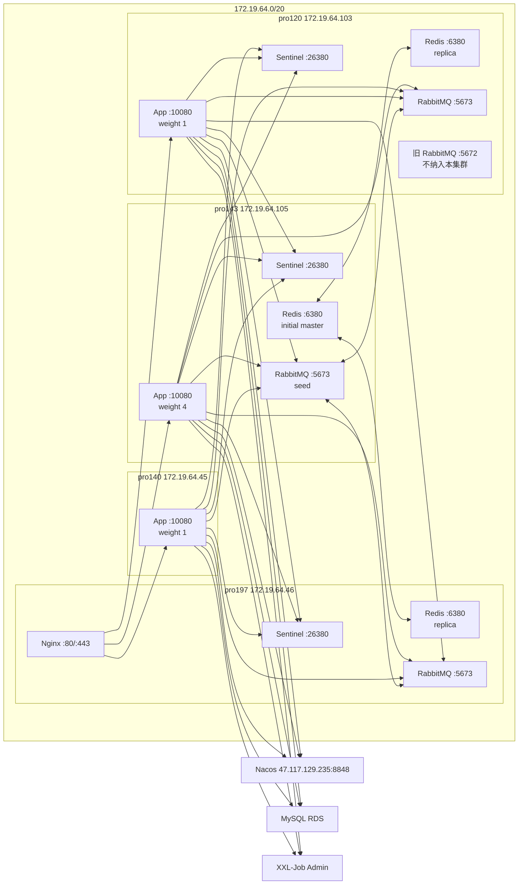

# cardshop-trade-engine 高可用环境部署方案

## 1. 概述

本文档描述在现有服务器上部署 `cardshop-trade-engine` 的过渡高可用环境。当前资源
约束下，中间件统一采用 Docker 隔离部署：

- Redis 7.x：1 master + 2 replica + 3 Sentinel。
- RabbitMQ 4.3.x + Erlang/OTP 27.x：3 节点集群，业务队列使用 Quorum Queue。
- cardshop-trade-engine：应用实例部署在 `pro143`、`pro140`、`pro120`，JVM 统一 4G；
  `pro197` 不部署应用，仅保留中间件和 Nginx 入口职责。

本方案目标是先在现有中间件三节点上获得 Redis 副本确认、RabbitMQ 多节点 quorum，
并在 `pro143`、`pro140`、`pro120` 上获得应用多实例能力。它仍然是混部环境，
中间件容量按最弱节点 pro197 控制，不作为高吞吐终态方案。

## 2. 服务器现状

| 别名 | 内网 IP | 外网 IP | OS | CPU | 内存现状 | 磁盘现状 | 关键存量服务 |
| --- | --- | --- | --- | --- | --- | --- | --- |
| pro143 | `172.19.64.105` | `8.133.164.143` | Alibaba Cloud Linux V4 | 8C | 61Gi，总可用约 60Gi | `/` 可用约 33G，`/data` 可用约 149G | trade-engine Docker 中间件已运行 |
| pro140 | `172.19.64.45` | 待补充 | CentOS 7 | 待补充 | 15G，可用约 5.5G | `/` 可用约 10G | 旧 Java 服务、Elasticsearch；trade-engine 应用包已落地，待放通中间件端口 |
| pro197 | `172.19.64.46` | `47.101.155.197` | CentOS 7 | 4C | 15G，可用约 4.4G | `/` 可用约 18G | 旧 Redis `6379`、Nginx、Elasticsearch、旧 Java 服务、trade-engine Docker 中间件已运行 |
| pro120 | `172.19.64.103` / `172.19.64.104` | `106.14.116.120` | CentOS 8 | 4C | 30Gi，可用约 10Gi | `/` 可用约 15G，`/data` 可用约 61G | 旧 RabbitMQ `4.1.1 + OTP26` 占默认端口、Nginx、多个 yudao Java 服务、trade-engine Docker 中间件已运行 |

### 2.1 端口冲突

| 端口 | 冲突机器 | 存量服务 | 本方案处理 |
| --- | --- | --- | --- |
| `6379` | pro197 | 旧 Redis | trade-engine Redis 统一使用 `6380` |
| `4369` / `5672` / `15672` / `15692` / `25672` | pro120 | 旧 RabbitMQ | trade-engine RabbitMQ 统一使用 `4370` / `5673` / `15673` / `15693` / `25673` |
| `9998` | pro197/pro120 | 存量 Java 服务可能占用 | trade-engine XXL executor 使用 `19999` |
| `80` / `443` | pro197/pro120 | Nginx | 复用 pro197 Nginx 做入口 |

## 3. 总体拓扑



连接口径：

1. 应用通过 Sentinel `26380` 自动发现 Redis master。
2. 应用 RabbitMQ 地址写三个节点，pro143 放第一位。
3. pro143 是 RabbitMQ 集群 seed 和优先连接节点，不是固定 master；Quorum Queue
   按队列选 leader，节点故障后重新选举。
4. pro120 的旧 RabbitMQ 保持默认端口并继续服务旧业务，trade-engine 的 RabbitMQ
   使用独立端口、独立数据目录、独立 vhost。

## 4. 版本与镜像基线

所有 Docker 镜像必须固定到精确 tag 或 digest，禁止使用 `latest`。

| 组件 | 推荐基线 | 镜像口径 |
| --- | --- | --- |
| Redis | Redis 7.x 最新稳定 patch，当前建议 `7.4.x` | `redis:7.4.x` 固定 digest |
| RabbitMQ | RabbitMQ `4.3.x` 同一 patch + Erlang/OTP `27.x` | 使用内部制品镜像，例如 `registry.local/cardshop/rabbitmq:4.3.x-otp27-management`，启动后必须用 `rabbitmq-diagnostics erlang_version` 验证 OTP 为 27.x |
| App | 当前发布包同一版本 | 使用 `scripts/package.sh` 产物或后续应用镜像，三台版本一致 |

如果采用 Docker Hub 官方 RabbitMQ management 镜像，必须先确认镜像内置 Erlang/OTP
版本为 27.x；如果不是 27.x，应构建内部固定镜像，不要让三节点混用不同 OTP major。

## 5. 资源分配

| 组件 | pro143 | pro197 | pro120 |
| --- | --- | --- | --- |
| RabbitMQ Docker | 内存限制 `4g`，数据目录 `/data/trade-engine/rabbitmq` | 内存限制 `1536m`，数据目录 `/data/trade-engine/rabbitmq` | 内存限制 `2g`，数据目录 `/data/trade-engine/rabbitmq` |
| Redis Docker | `maxmemory 2g`，初始 master | `maxmemory 1536mb`，replica | `maxmemory 1536mb`，replica |
| App | `-Xms4g -Xmx4g` | 不部署 | `-Xms4g -Xmx4g` |
| Nginx | 不部署入口 | 复用现有 Nginx | 可后续做备用入口 |

应用补充节点：

| 组件 | pro140 |
| --- | --- |
| App | `-Xms4g -Xmx4g`，需要放通到三台 RabbitMQ `5673` 和 Redis Sentinel `26380` |

容量原则：

1. Redis 容量按 pro197 最弱节点规划，不能按 pro143 的大内存放开。
2. RabbitMQ Quorum Queue 会在三个节点都写入 Raft 日志，pro197 磁盘和内存是集群上限。
3. 应用流量 pro143 权重最高，pro140/pro120 低权重兜底。
4. 若 pro197 内存长期低于 2G 可用，优先排查旧业务、日志、RabbitMQ 队列堆积和 Redis
   AOF rewrite；必要时降低 RabbitMQ `vm_memory_high_watermark.absolute`。pro197
   不部署 trade-engine 应用，不能通过停止 app 释放资源。

## 6. 目录规划

三台统一创建目录：

```bash
mkdir -p /data/trade-engine/{redis/{conf,data,logs},sentinel/{conf,data,logs},rabbitmq/{conf,data,logs},app,logs}
chmod 700 /data/trade-engine
```

pro197 若 `/data` 位于系统盘，需要额外关注磁盘水位；RabbitMQ 队列堆积和 Redis
AOF rewrite 都可能放大磁盘使用。

## 7. Docker Compose 运行要求

三台均要求 Docker 已启用，并安装 Docker Compose v2 插件：

```bash
systemctl enable --now docker
docker version
docker compose version
```

所有中间件容器使用 `--network host`，原因是 RabbitMQ 集群和 Redis Sentinel
都需要向其它节点发布宿主机内网 IP 和固定端口。端口冲突通过应用层配置改为
非默认端口解决。

当前三台已经统一迁移到 Docker Compose 管理，部署目录固定为
`/data/trade-engine/deploy`：

```text
/data/trade-engine/deploy/docker-compose.yml
/data/trade-engine/deploy/.env
/data/trade-engine/deploy/backup/
```

`.env` 保存镜像、主机名、节点名、内存限制和 RabbitMQ Erlang cookie 等运行变量，
文件权限必须为 `600`，不得复制到 Git。`COMPOSE_PROJECT_NAME` 统一为
`cardshop-trade-engine-middleware`，Compose 服务名统一为：

```text
rabbitmq
redis
redis-sentinel
```

`docker-compose.yml` 使用以下结构。RabbitMQ 的 `extra_hosts` 是必需项；否则容器
重建后可能无法解析 `rabbit@rmq-pro120`、`rabbit@rmq-pro143`、
`rabbit@rmq-pro197`，导致局部节点视图不完整。

```yaml
services:
  rabbitmq:
    image: ${RABBITMQ_IMAGE}
    container_name: trade-rabbitmq
    hostname: ${RABBITMQ_HOSTNAME}
    extra_hosts:
      - "rmq-pro143:172.19.64.105"
      - "rmq-pro197:172.19.64.46"
      - "rmq-pro120:172.19.64.103"
    network_mode: host
    restart: unless-stopped
    environment:
      RABBITMQ_NODENAME: ${RABBITMQ_NODENAME}
      RABBITMQ_ERLANG_COOKIE: ${RABBITMQ_ERLANG_COOKIE}
      RABBITMQ_DIST_PORT: ${RABBITMQ_DIST_PORT}
      ERL_EPMD_PORT: ${ERL_EPMD_PORT}
    volumes:
      - /data/trade-engine/rabbitmq/conf:/etc/rabbitmq
      - /data/trade-engine/rabbitmq/data:/var/lib/rabbitmq
      - /data/trade-engine/rabbitmq/logs:/var/log/rabbitmq
    command: rabbitmq-server
    mem_limit: ${RABBITMQ_MEMORY_LIMIT}

  redis:
    image: ${REDIS_IMAGE}
    container_name: trade-redis
    hostname: ${REDIS_HOSTNAME}
    network_mode: host
    restart: unless-stopped
    volumes:
      - /data/trade-engine/redis/conf/redis.conf:/usr/local/etc/redis/redis.conf
      - /data/trade-engine/redis/data:/data
    command: ["redis-server", "/usr/local/etc/redis/redis.conf"]
    mem_limit: ${REDIS_MEMORY_LIMIT}

  redis-sentinel:
    image: ${REDIS_IMAGE}
    container_name: trade-redis-sentinel
    hostname: ${SENTINEL_HOSTNAME}
    network_mode: host
    restart: unless-stopped
    volumes:
      - /data/trade-engine/sentinel/conf:/usr/local/etc/redis
      - /data/trade-engine/sentinel/data:/data
    command: ["redis-server", "/usr/local/etc/redis/sentinel.conf", "--sentinel"]
    mem_limit: ${SENTINEL_MEMORY_LIMIT}
```

日常运维命令：

```bash
cd /data/trade-engine/deploy
docker compose config --quiet
docker compose ps
docker compose up -d
docker compose logs --tail=200 rabbitmq
docker compose logs --tail=200 redis
docker compose logs --tail=200 redis-sentinel
```

禁止使用 `docker compose down -v`，也不要删除 `/data/trade-engine/redis`、
`/data/trade-engine/sentinel`、`/data/trade-engine/rabbitmq` 数据目录。需要重建容器时，
优先使用 `docker compose up -d --force-recreate <service>` 或按服务停删后再
`docker compose up -d <service>`。

## 8. RabbitMQ 4.3 集群部署

### 8.1 端口

| 用途 | trade-engine 端口 | 说明 |
| --- | --- | --- |
| EPMD | `4370` | 避开 pro120 旧 RabbitMQ 的 `4369` |
| AMQP | `5673` | 应用连接端口 |
| Management | `15673` | 仅内网访问 |
| Prometheus | `15693` | 指标采集 |
| Erlang distribution | `25673` | 集群节点互联 |

三台安全组和防火墙仅允许 `172.19.64.0/20` 访问这些端口；不要向公网开放
`5673`、`15673`、`25673`。

### 8.2 主机名

三台容器内使用固定短名：

```text
rmq-pro143 -> 172.19.64.105
rmq-pro197 -> 172.19.64.46
rmq-pro120 -> 172.19.64.103
```

### 8.3 配置文件

每台创建 `/data/trade-engine/rabbitmq/conf/enabled_plugins`：

```erlang
[rabbitmq_management,rabbitmq_prometheus].
```

每台创建 `/data/trade-engine/rabbitmq/conf/rabbitmq.conf`，其中 IP 按本机替换：

```conf
listeners.tcp.1 = {{LOCAL_IP}}:5673

management.tcp.ip = {{LOCAL_IP}}
management.tcp.port = 15673

prometheus.tcp.ip = {{LOCAL_IP}}
prometheus.tcp.port = 15693

disk_free_limit.absolute = 2GB
vm_memory_high_watermark.absolute = {{RABBITMQ_MEMORY_WATERMARK}}

log.console = true
loopback_users.guest = false
```

内存水位建议：

```text
pro143: 3GB
pro197: 1GB
pro120: 1536MB
```

### 8.4 启动容器

三台使用同一个 `RABBITMQ_ERLANG_COOKIE`，但各自 `.env` 中的
`RABBITMQ_HOSTNAME` 和 `RABBITMQ_NODENAME` 必须与本机一致：

```text
pro143: RABBITMQ_HOSTNAME=rmq-pro143, RABBITMQ_NODENAME=rabbit@rmq-pro143
pro197: RABBITMQ_HOSTNAME=rmq-pro197, RABBITMQ_NODENAME=rabbit@rmq-pro197
pro120: RABBITMQ_HOSTNAME=rmq-pro120, RABBITMQ_NODENAME=rabbit@rmq-pro120
```

启动或重建 RabbitMQ：

```bash
cd /data/trade-engine/deploy
docker compose up -d rabbitmq
```

如果是从旧的手工 `docker run` 容器迁移到 Compose，只删除容器壳，不删除数据目录：

```bash
cd /data/trade-engine/deploy
docker stop trade-rabbitmq
docker rm trade-rabbitmq
docker compose up -d rabbitmq
```

### 8.5 组集群

先启动 pro143，再启动 pro197/pro120。新容器没有业务数据时，可在 pro197/pro120
执行：

```bash
docker exec trade-rabbitmq rabbitmqctl stop_app
docker exec trade-rabbitmq rabbitmqctl reset
docker exec trade-rabbitmq rabbitmqctl join_cluster rabbit@rmq-pro143
docker exec trade-rabbitmq rabbitmqctl start_app
```

验证：

```bash
docker exec trade-rabbitmq rabbitmqctl cluster_status
docker exec trade-rabbitmq rabbitmq-diagnostics erlang_version
docker exec trade-rabbitmq rabbitmqctl version
```

### 8.6 vhost、用户和策略

在任一节点执行：

```bash
docker exec trade-rabbitmq rabbitmqctl add_vhost cardshop-trade-prod
docker exec trade-rabbitmq rabbitmqctl add_user trade_engine '{{RABBITMQ_PASSWORD}}'
docker exec trade-rabbitmq rabbitmqctl set_permissions -p cardshop-trade-prod trade_engine '.*' '.*' '.*'
docker exec trade-rabbitmq rabbitmqctl set_user_tags trade_engine monitoring
```

应用代码会声明主队列和 DLQ 为 Quorum Queue、retry queue 为 classic durable queue +
TTL + DLX。不要设置“所有队列强制 quorum”的全局策略，否则会破坏 retry queue
的 classic 设计。可选地只给主队列和 DLQ 设置 delivery limit：

```bash
docker exec trade-rabbitmq rabbitmqctl set_policy -p cardshop-trade-prod trade-engine-quorum \
  '^(recharge\.persist\.mysql\.queue|recharge\.persist\.mysql\.dlq)$' \
  '{"delivery-limit":5}' \
  --apply-to queues
```

## 9. Redis 7.x Sentinel 部署

### 9.1 端口

| 用途 | 端口 |
| --- | --- |
| Redis server | `6380` |
| Redis Sentinel | `26380` |

`26379` 是合法且常见的 Sentinel 默认端口；本方案选择 `26380`，是为了与
Redis `6380` 成对，并通过端口、Sentinel master 名、容器名和数据目录明确区分
trade-engine 专用 Redis，避免误连存量 Redis。

### 9.2 Redis 配置

每台创建 `/data/trade-engine/redis/conf/redis.conf`，按本机替换 IP 和内存。

pro143 初始 master：

```conf
bind 127.0.0.1 172.19.64.105
port 6380
dir /data
appendonly yes
appendfsync everysec
maxmemory 2gb
maxmemory-policy noeviction
requirepass {{REDIS_PASSWORD}}
masterauth {{REDIS_PASSWORD}}
min-replicas-to-write 1
min-replicas-max-lag 2
replica-announce-ip 172.19.64.105
replica-announce-port 6380
```

pro197 replica：

```conf
bind 127.0.0.1 172.19.64.46
port 6380
dir /data
appendonly yes
appendfsync everysec
maxmemory 1536mb
maxmemory-policy noeviction
requirepass {{REDIS_PASSWORD}}
masterauth {{REDIS_PASSWORD}}
replicaof 172.19.64.105 6380
replica-announce-ip 172.19.64.46
replica-announce-port 6380
```

pro120 replica：

```conf
bind 127.0.0.1 172.19.64.103
port 6380
dir /data
appendonly yes
appendfsync everysec
maxmemory 1536mb
maxmemory-policy noeviction
requirepass {{REDIS_PASSWORD}}
masterauth {{REDIS_PASSWORD}}
replicaof 172.19.64.105 6380
replica-announce-ip 172.19.64.103
replica-announce-port 6380
```

### 9.3 Sentinel 配置

每台创建 `/data/trade-engine/sentinel/conf/sentinel.conf`，按本机替换
`sentinel announce-ip`：

```conf
bind 127.0.0.1 {{LOCAL_IP}}
port 26380
dir /data

sentinel monitor trade-engine-master 172.19.64.105 6380 2
sentinel auth-pass trade-engine-master {{REDIS_PASSWORD}}
sentinel down-after-milliseconds trade-engine-master 5000
sentinel failover-timeout trade-engine-master 60000
sentinel parallel-syncs trade-engine-master 1
sentinel announce-ip {{LOCAL_IP}}
sentinel announce-port 26380
```

### 9.4 启动容器

Redis server 和 Sentinel 均由 Compose 管理：

```bash
cd /data/trade-engine/deploy
docker compose up -d redis redis-sentinel
```

如果从旧的手工 `docker run` 容器迁移到 Compose，只删除容器壳，不删除数据目录：

```bash
cd /data/trade-engine/deploy
docker stop trade-redis trade-redis-sentinel
docker rm trade-redis trade-redis-sentinel
docker compose up -d redis redis-sentinel
```

pro197/pro120 的 Redis 容器内存限制可调低到 `1800m`；Redis `maxmemory`
必须小于容器内存限制，给 AOF rewrite、client buffer 和复制 backlog 留余量。

pro143 是当前 Redis master。迁移或重建 pro143 Redis 时，应先确认两个 replica 在线，
并单独重建 Redis，避免同时停止 Sentinel 和 RabbitMQ：

```bash
cd /data/trade-engine/deploy
docker stop -t 3 trade-redis
docker rm trade-redis
docker compose up -d redis
```

### 9.5 验证

```bash
redis-cli -h 172.19.64.105 -p 6380 -a '{{REDIS_PASSWORD}}' info replication
redis-cli -h 172.19.64.46 -p 6380 -a '{{REDIS_PASSWORD}}' info replication
redis-cli -h 172.19.64.103 -p 6380 -a '{{REDIS_PASSWORD}}' info replication

redis-cli -h 172.19.64.105 -p 26380 sentinel masters
redis-cli -h 172.19.64.105 -p 26380 sentinel replicas trade-engine-master
```

## 10. 应用部署

应用部署在 `pro143`、`pro140`、`pro120`，继续使用项目部署包和 JDK 21 启动，
不要求应用 Docker 化。JDK 21 安装在 `/usr/local/jdk21`，不修改系统默认 Java；
pro140 已按该口径安装独立 JDK 21，不设置为默认 `java`，避免影响存量应用。

建议端口：

| 组件 | 端口 |
| --- | --- |
| HTTP | `10080` |
| XXL executor | `19999` |
| Actuator | 复用 HTTP 端口 |

`config/.prod.env` 核心项：

```bash
export APP_PROFILE=prod
export SERVER_PORT=10080
export CARD_SHOP_TRADE_JAVA_HOME=/usr/local/jdk21
export JAVA_OPTS='-Xms4g -Xmx4g -XX:+UseG1GC -XX:+ExitOnOutOfMemoryError -Dfile.encoding=UTF-8 -Xlog:gc*,safepoint:file=${LOG_DIR:-$APP_HOME/logs}/gc-%p-%t.log:time,uptime,level,tags:filecount=10,filesize=100M'
export NACOS_SERVER_ADDR=47.117.129.235:8848
export NACOS_NAMESPACE=494ce583-7775-43e5-abed-cd0cf4802137
export NACOS_GROUP=TRADE_ENGINE_PROD
export TRADE_ENGINE_REDIS_PASSWORD='<从运维密钥获取>'
export XXL_JOB_EXECUTOR_PORT=19999
```

三台应用 JVM 统一 `-Xms4g -Xmx4g`，并开启 Java 21 统一 GC 日志，默认写入
`$APP_HOME/logs/gc-%p-%t.log`，保留 `10` 个、单文件 `100M`。`.prod.env` 必须保持 `600` 权限并归属
`cardshop` 用户，密钥不得写入本文档。`TRADE_ENGINE_REDIS_PASSWORD` 用于让
Nacos 中的 Redis Sentinel 配置引用 `${TRADE_ENGINE_REDIS_PASSWORD}`，避免把
Redis 密码明文写入配置中心内容。

## 11. Nacos 配置

RabbitMQ：

```yaml
spring:
  rabbitmq:
    addresses: 172.19.64.105:5673,172.19.64.46:5673,172.19.64.103:5673
    username: ${SPRING_RABBITMQ_USERNAME}
    password: ${SPRING_RABBITMQ_PASSWORD}
    virtual-host: cardshop-trade-prod
    publisher-confirm-type: correlated
    publisher-returns: true
    template:
      mandatory: true
    listener:
      simple:
        acknowledge-mode: manual
        prefetch: 50
        concurrency: 4
        max-concurrency: 16
```

Redis Sentinel：

```yaml
spring:
  data:
    redis:
      password: ${TRADE_ENGINE_REDIS_PASSWORD}
      sentinel:
        master: trade-engine-master
        nodes:
          - 172.19.64.105:26380
          - 172.19.64.46:26380
          - 172.19.64.103:26380
```

trade-engine：

```yaml
trade:
  engine:
    redis:
      write-enabled: false
      wait-replicas: 1
      wait-timeout-ms: 100
    mq:
      publish-confirm-timeout-ms: 500
      publish-retry-times: 3
    v1:
      merchant-config-preheat:
        enabled: false
        org-codes: []
        fail-on-error: true
```

上线前保持 `write-enabled=false`。完成 Redis WAIT、RabbitMQ confirm、Consumer
落库、pending 补投、监控取证后，再灰度打开写入。

## 12. Nginx 入口

复用 pro197 Nginx 作为第一阶段入口：

```nginx
upstream cardshop_trade_engine {
    server 172.19.64.105:10080 weight=4 max_fails=3 fail_timeout=30s;
    server 172.19.64.45:10080  weight=1 max_fails=3 fail_timeout=30s;
    server 172.19.64.103:10080 weight=1 max_fails=3 fail_timeout=30s;
}

server {
    listen 80;
    server_name trade-engine.internal;

    location / {
        proxy_pass http://cardshop_trade_engine;
        proxy_connect_timeout 3s;
        proxy_read_timeout 10s;
        proxy_send_timeout 10s;
        proxy_set_header Host $host;
        proxy_set_header X-Real-IP $remote_addr;
        proxy_set_header X-Forwarded-For $proxy_add_x_forwarded_for;
    }
}
```

pro197 只作为入口和中间件节点，不部署 trade-engine app。后续可在 pro120 配置同样
upstream，通过 SLB 或 DNS 轮询消除 Nginx 单点。

**2026-10-20现场修订：** 上述pro197入口为早期规划；当前测试域名`http://apitest.kalaiwang.com`实际入口为pro140。已按相同4:1:1权重接入三应用节点，仅代理`/v1/cardapi/`，保留其他旧系统/供应链路由；现场读写超时沿用原30秒，而非示例10秒。显式`proxy_next_upstream error timeout`及`proxy_next_upstream_tries 3`，不启用`non_idempotent`，不重放已发送的POST。执行及验证见第30节；当前入口仍是单点，不宣称SLB/双入口HA已实施。

## 13. 部署顺序

1. 三台确认 Docker 和 Docker Compose v2 可用。
2. 创建目录和密钥，固定 Redis/RabbitMQ 镜像 digest。
3. 在 `/data/trade-engine/deploy` 写入 `docker-compose.yml` 和本机 `.env`。
4. 执行 `docker compose config --quiet`，确认 RabbitMQ `extra_hosts`、节点名和端口无误。
5. 启动 pro143 Redis，再启动 pro197/pro120 Redis replica。
6. 启动三台 Sentinel，确认 master/replica 发现正常。
7. 启动 pro143 RabbitMQ，再启动 pro197/pro120 RabbitMQ。
8. pro197/pro120 RabbitMQ 加入 pro143 集群。
9. 创建 RabbitMQ vhost、用户、权限和可选 policy。
10. 发布 Nacos prod 配置，`write-enabled=false`。
11. 部署 `pro143`、`pro140`、`pro120` 三台 app；pro140 启动前必须确认到三台
    RabbitMQ `5673`、Redis `6380`、Sentinel `26380` 的内网访问已放通。
12. 配置 pro197 Nginx。
13. 执行只读健康检查、RabbitMQ 拓扑检查、Redis WAIT 冒烟。
14. 跑小流量 V1 下单联调，记录到 `docs/集成测试.md`。
15. 证据完整后灰度打开 `trade.engine.redis.write-enabled=true`。

## 14. 验证清单

RabbitMQ：

```bash
cd /data/trade-engine/deploy
docker compose config --quiet
docker compose ps
docker exec trade-rabbitmq getent hosts rmq-pro120 rmq-pro143 rmq-pro197
docker exec trade-rabbitmq rabbitmqctl cluster_status
docker exec trade-rabbitmq rabbitmqctl list_vhosts
docker exec trade-rabbitmq rabbitmqctl list_queues -p cardshop-trade-prod name type durable messages_ready messages_unacknowledged
curl -sS http://172.19.64.105:15693/metrics | head
```

Redis：

```bash
redis-cli -h 172.19.64.105 -p 6380 -a '{{REDIS_PASSWORD}}' set trade:ha:probe ok
redis-cli -h 172.19.64.105 -p 6380 -a '{{REDIS_PASSWORD}}' wait 1 100
redis-cli -h 172.19.64.105 -p 26380 sentinel get-master-addr-by-name trade-engine-master
```

应用：

```bash
curl -sS http://172.19.64.105:10080/actuator/health/readiness
curl -sS http://172.19.64.45:10080/actuator/health/readiness
curl -sS http://172.19.64.103:10080/actuator/health/readiness
curl -sS http://172.19.64.105:10080/actuator/prometheus | grep -E 'trade_engine_mq|trade_engine_redis'
```

## 15. 故障演练

上线前至少执行以下场景：

| 场景 | 操作 | 预期 |
| --- | --- | --- |
| Redis master 故障 | 停 pro143 `trade-redis` 容器 | Sentinel 选出新 master；应用下单在切换窗口 fail closed 或 WAIT 失败；恢复后 pending 不丢 |
| Redis replica 延迟 | 暂停一个 replica 容器 | `WAIT 1 100ms` 在另一个 replica 正常时仍可通过；不足副本时写入关闭或降流 |
| RabbitMQ 单节点故障 | 停一个非 leader 节点容器 | Quorum Queue 保持可用；publisher confirm P99 可接受 |
| RabbitMQ leader 节点故障 | 停当前队列 leader 节点 | 队列 leader 重新选举；应用重连并继续发布 |
| Consumer 写库失败 | 注入 MySQL 异常 | 消息进入 retry/DLQ 或 pending 补偿；不 ack 丢单 |
| pro197 整机异常 | 断开 pro197 中间件或 Nginx | Nginx 入口需人工切换或 SLB 兜底；Redis/RabbitMQ 保持多数节点 |

## 16. 风险与约束

1. 这是三台存量机器混部方案，pro197 是容量短板。
2. pro120 同时运行旧 RabbitMQ 和 trade-engine RabbitMQ，必须用端口、目录、vhost
   和监控名称彻底隔离。
3. Docker 容器使用 host network，所有对外端口必须通过安全组和防火墙限制内网访问。
4. RabbitMQ Quorum Queue 的吞吐受最慢节点磁盘和网络影响，不能用单节点 classic queue
   压测结果推导。
5. Redis `maxmemory-policy` 必须保持 `noeviction`；出现 `evicted_keys > 0` 应立即告警。
6. Nginx 入口第一阶段仍在 pro197，pro197 故障会影响 HTTP 入口；后续应补 SLB 或 pro120 备用 Nginx。
7. 所有密钥只允许进入部署密钥系统、Nacos 密文或本机受限 `.env`，不得写入 Git。

## 17. 回滚策略

1. App 回滚：停止新版本 app，恢复上一版部署包和 `.prod.env`。
2. RabbitMQ 回滚：保持旧 RabbitMQ 4.1.x 不动；trade-engine 新 RabbitMQ 使用独立端口，
   可通过 `docker compose stop rabbitmq` 停止，不影响 pro120 旧业务。
3. Redis 回滚：停止写入开关，等待 pending 收敛；必要时停止 app 后保留 Redis 数据目录用于核查，
   使用 `docker compose stop redis redis-sentinel` 停止容器。
4. 任何回滚前都必须先确认 RabbitMQ 主队列/retry/DLQ、Redis pending、MySQL 落库状态，不能直接清理数据目录。
5. 回滚和清理过程中禁止执行 `docker compose down -v`。

## 18. 后续演进

1. 资源允许后，优先把 pro197 替换为新机器或升级到更高版本 OS。
2. RabbitMQ 继续跟随官方支持线升级，保持同一 patch 和同一 Erlang/OTP major。
3. Redis 流量接近单 master 上限时，再迁移 Redis Cluster；迁移前必须确认所有 Lua key 使用同一 `{orgCode}` hash tag。
4. 补充 SLB 或双 Nginx 入口，消除 pro197 Nginx 单点。

## 19. pro197 部署记录 (2026-07-16)

### 19.1 环境信息

| 项目 | 详情 |
| --- | --- |
| 服务器 | pro197, 172.19.64.46 |
| Docker 版本 | 26.1.4 |
| 部署时间 | 2026-07-16 12:54 UTC |

### 19.2 Docker 镜像

```bash
docker pull redis:7.4              # redis:7.4 → Redis 7.4.9
docker pull rabbitmq:4.3-management # rabbitmq:4.3-management → RabbitMQ 4.3.2 + Erlang/OTP 27.3.4.14
```

镜像加速器配置 (`/etc/docker/daemon.json`)：
```json
{
  "registry-mirrors": [
    "https://93ek2xa0.mirror.aliyuncs.com",
    "https://docker.m.daocloud.io",
    "https://hub-mirror.c.163.com"
  ]
}
```

### 19.3 凭据

| 用途 | 值 |
| --- | --- |
| Redis 密码 | `{{TRADE_ENGINE_SECRET}}` |
| RabbitMQ 密码 | `{{TRADE_ENGINE_SECRET}}` |
| RabbitMQ Erlang Cookie | `{{RABBITMQ_ERLANG_COOKIE}}` |

### 19.4 容器清单

```bash
# trade-redis: Redis 7.4.9 replica (等待 pro143 master)
docker run -d \
  --name trade-redis \
  --restart unless-stopped \
  --network host \
  -v /data/trade-engine/redis/conf/redis.conf:/usr/local/etc/redis/redis.conf:ro \
  -v /data/trade-engine/redis/data:/data \
  --memory=1800m \
  redis:7.4 \
  redis-server /usr/local/etc/redis/redis.conf

# trade-redis-sentinel: Sentinel 监控 trade-engine-master
docker run -d \
  --name trade-redis-sentinel \
  --restart unless-stopped \
  --network host \
  -v /data/trade-engine/sentinel/conf/sentinel.conf:/usr/local/etc/redis/sentinel.conf \
  -v /data/trade-engine/sentinel/data:/data \
  --memory=256m \
  redis:7.4 \
  redis-server /usr/local/etc/redis/sentinel.conf --sentinel

# trade-rabbitmq: RabbitMQ 4.3.2 集群节点
docker run -d \
  --name trade-rabbitmq \
  --restart unless-stopped \
  --network host \
  --hostname rmq-pro197 \
  --add-host rmq-pro143:172.19.64.105 \
  --add-host rmq-pro197:172.19.64.46 \
  --add-host rmq-pro120:172.19.64.103 \
  -e RABBITMQ_NODENAME=rabbit@rmq-pro197 \
  -e 'RABBITMQ_ERLANG_COOKIE={{RABBITMQ_ERLANG_COOKIE}}' \
  -e RABBITMQ_DIST_PORT=25673 \
  -e ERL_EPMD_PORT=4370 \
  -v /data/trade-engine/rabbitmq/conf:/etc/rabbitmq:ro \
  -v /data/trade-engine/rabbitmq/data:/var/lib/rabbitmq \
  -v /data/trade-engine/rabbitmq/logs:/var/log/rabbitmq \
  --memory=1536m \
  rabbitmq:4.3-management
```

### 19.5 Redis 配置文件

`/data/trade-engine/redis/conf/redis.conf`：
```conf
# pro197 Redis replica config
bind 127.0.0.1 172.19.64.46
port 6380
dir /data
appendonly yes
appendfsync everysec
maxmemory 1536mb
maxmemory-policy noeviction
requirepass {{TRADE_ENGINE_SECRET}}
masterauth {{TRADE_ENGINE_SECRET}}
replicaof 172.19.64.105 6380
replica-announce-ip 172.19.64.46
replica-announce-port 6380
```

### 19.6 Sentinel 配置文件

`/data/trade-engine/sentinel/conf/sentinel.conf`：
```conf
bind 127.0.0.1 172.19.64.46
port 26380
dir /data

sentinel monitor trade-engine-master 172.19.64.105 6380 2
sentinel auth-pass trade-engine-master {{TRADE_ENGINE_SECRET}}
sentinel down-after-milliseconds trade-engine-master 5000
sentinel failover-timeout trade-engine-master 60000
sentinel parallel-syncs trade-engine-master 1
sentinel announce-ip 172.19.64.46
sentinel announce-port 26380
```

### 19.7 RabbitMQ 配置文件

`/data/trade-engine/rabbitmq/conf/rabbitmq.conf`：
```conf
listeners.tcp.1 = 172.19.64.46:5673

management.tcp.ip = 172.19.64.46
management.tcp.port = 15673

prometheus.tcp.ip = 172.19.64.46
prometheus.tcp.port = 15693

disk_free_limit.absolute = 2GB
vm_memory_high_watermark.absolute = 1GB

log.console = true
loopback_users.guest = false
```

`/data/trade-engine/rabbitmq/conf/enabled_plugins`：
```erlang
[rabbitmq_management,rabbitmq_prometheus].
```

### 19.8 RabbitMQ vhost 和用户

```bash
docker exec trade-rabbitmq rabbitmqctl add_vhost cardshop-trade-prod
docker exec trade-rabbitmq rabbitmqctl add_user trade_engine '{{TRADE_ENGINE_SECRET}}'
docker exec trade-rabbitmq rabbitmqctl set_permissions -p cardshop-trade-prod trade_engine '.*' '.*' '.*'
docker exec trade-rabbitmq rabbitmqctl set_user_tags trade_engine monitoring
```

### 19.9 验证命令

```bash
# 容器状态
docker ps --format 'table {{.Names}}\t{{.Status}}\t{{.Image}}'

# Redis replication 状态
redis-cli -h 127.0.0.1 -p 6380 -a '{{TRADE_ENGINE_SECRET}}' info replication

# Sentinel master 状态
redis-cli -h 127.0.0.1 -p 26380 sentinel master trade-engine-master

# RabbitMQ 集群状态
docker exec trade-rabbitmq rabbitmqctl cluster_status

# RabbitMQ Erlang/OTP 版本
docker exec trade-rabbitmq rabbitmq-diagnostics erlang_version

# RabbitMQ vhost / 用户
docker exec trade-rabbitmq rabbitmqctl list_vhosts
docker exec trade-rabbitmq rabbitmqctl list_users
```

### 19.10 注意事项

1. Sentinel 配置文件和目录需要写权限（`chmod 777 /data/trade-engine/sentinel/conf/`），否则 Sentinel 无法持久化运行时状态。
2. RabbitMQ 管理后台：`http://172.19.64.46:15673`，账号密码从运维密钥获取，不在文档记录。
3. 所有三板密钥（Redis 密码、RabbitMQ 密码、Erlang Cookie）三台一致，已确认。
4. 2026-07-16 13:14 UTC：pro197 已成功加入 RabbitMQ 集群（rabbit@rmq-pro143 seed），Redis replica 已与 pro143 master 同步（lag=0），三 Sentinel 全部互联。

## 20. pro120 部署记录 (2026-07-16)

### 20.1 环境信息

| 项目 | 详情 |
| --- | --- |
| 服务器 | pro120, 172.19.64.103 |
| OS | CentOS Linux 8 |
| Docker 版本 | 26.1.3 |
| 部署时间 | 2026-07-16 13:41 UTC |

### 20.2 Docker 安装

```bash
# 阿里云镜像源
dnf config-manager --add-repo https://mirrors.aliyun.com/docker-ce/linux/centos/docker-ce.repo
# 修复 CentOS 8 EOL 的 $releasever
sed -i 's/\$releasever/8/g' /etc/yum.repos.d/docker-ce.repo
dnf install -y docker-ce docker-ce-cli containerd.io docker-compose-plugin
systemctl enable --now docker
```

镜像加速器配置 (`/etc/docker/daemon.json`)：
```json
{
  "registry-mirrors": [
    "https://93ek2xa0.mirror.aliyuncs.com",
    "https://docker.m.daocloud.io",
    "https://hub-mirror.c.163.com"
  ]
}
```

### 20.3 Docker 镜像

```bash
docker pull redis:7.4              # redis:7.4 → Redis 7.4.9
docker pull rabbitmq:4.3-management # rabbitmq:4.3-management → RabbitMQ 4.3.2 + Erlang/OTP 27.3.4.14
```

### 20.4 凭据

与 pro197 一致：

| 用途 | 值 |
| --- | --- |
| Redis 密码 | `{{TRADE_ENGINE_SECRET}}` |
| RabbitMQ 密码 | `{{TRADE_ENGINE_SECRET}}` |
| RabbitMQ Erlang Cookie | `{{RABBITMQ_ERLANG_COOKIE}}` |

### 20.5 容器清单

```bash
# trade-redis: Redis 7.4.9 replica (等待 pro143 master)
docker run -d \
  --name trade-redis \
  --restart unless-stopped \
  --network host \
  -v /data/trade-engine/redis/conf/redis.conf:/usr/local/etc/redis/redis.conf:ro \
  -v /data/trade-engine/redis/data:/data \
  --memory=1800m \
  redis:7.4 \
  redis-server /usr/local/etc/redis/redis.conf

# trade-redis-sentinel: Sentinel 监控 trade-engine-master
# 注意：必须挂载目录（不是文件）并 chmod 777，否则 Sentinel 无法写临时文件
docker run -d \
  --name trade-redis-sentinel \
  --restart unless-stopped \
  --network host \
  -v /data/trade-engine/sentinel/conf:/usr/local/etc/redis \
  -v /data/trade-engine/sentinel/data:/data \
  --memory=256m \
  redis:7.4 \
  redis-server /usr/local/etc/redis/sentinel.conf --sentinel

# trade-rabbitmq: RabbitMQ 4.3.2 集群节点
docker run -d \
  --name trade-rabbitmq \
  --restart unless-stopped \
  --network host \
  --hostname rmq-pro120 \
  --add-host rmq-pro143:172.19.64.105 \
  --add-host rmq-pro197:172.19.64.46 \
  --add-host rmq-pro120:172.19.64.103 \
  -e RABBITMQ_NODENAME=rabbit@rmq-pro120 \
  -e 'RABBITMQ_ERLANG_COOKIE={{RABBITMQ_ERLANG_COOKIE}}' \
  -e RABBITMQ_DIST_PORT=25673 \
  -e ERL_EPMD_PORT=4370 \
  -v /data/trade-engine/rabbitmq/conf:/etc/rabbitmq:ro \
  -v /data/trade-engine/rabbitmq/data:/var/lib/rabbitmq \
  -v /data/trade-engine/rabbitmq/logs:/var/log/rabbitmq \
  --memory=2g \
  rabbitmq:4.3-management
```

### 20.6 Redis 配置文件

`/data/trade-engine/redis/conf/redis.conf`：
```conf
# pro120 Redis replica config
bind 127.0.0.1 172.19.64.103
port 6380
dir /data
appendonly yes
appendfsync everysec
maxmemory 1536mb
maxmemory-policy noeviction
requirepass {{TRADE_ENGINE_SECRET}}
masterauth {{TRADE_ENGINE_SECRET}}
replicaof 172.19.64.105 6380
replica-announce-ip 172.19.64.103
replica-announce-port 6380
```

### 20.7 Sentinel 配置文件

`/data/trade-engine/sentinel/conf/sentinel.conf`：
```conf
bind 127.0.0.1 172.19.64.103
port 26380
dir /data

sentinel monitor trade-engine-master 172.19.64.105 6380 2
sentinel auth-pass trade-engine-master {{TRADE_ENGINE_SECRET}}
sentinel down-after-milliseconds trade-engine-master 5000
sentinel failover-timeout trade-engine-master 60000
sentinel parallel-syncs trade-engine-master 1
sentinel announce-ip 172.19.64.103
sentinel announce-port 26380
```

### 20.8 RabbitMQ 配置文件

`/data/trade-engine/rabbitmq/conf/rabbitmq.conf`：
```conf
listeners.tcp.1 = 172.19.64.103:5673

management.tcp.ip = 172.19.64.103
management.tcp.port = 15673

prometheus.tcp.ip = 172.19.64.103
prometheus.tcp.port = 15693

disk_free_limit.absolute = 2GB
vm_memory_high_watermark.absolute = 1536MB

log.console = true
loopback_users.guest = false
```

`/data/trade-engine/rabbitmq/conf/enabled_plugins`：
```erlang
[rabbitmq_management,rabbitmq_prometheus].
```

### 20.9 集群加入

```bash
# pro143 seed 上线后，pro120 加入集群
docker exec trade-rabbitmq rabbitmqctl stop_app
docker exec trade-rabbitmq rabbitmqctl reset
docker exec trade-rabbitmq rabbitmqctl join_cluster rabbit@rmq-pro143
docker exec trade-rabbitmq rabbitmqctl start_app
```

### 20.10 验证命令

```bash
# 容器状态
docker ps --format 'table {{.Names}}\t{{.Status}}\t{{.Image}}'

# Redis replication 状态（通过容器执行）
docker exec trade-redis redis-cli -p 6380 -a '{{TRADE_ENGINE_SECRET}}' --no-auth-warning INFO replication

# Sentinel master 状态
docker exec trade-redis-sentinel redis-cli -p 26380 SENTINEL master trade-engine-master

# RabbitMQ 集群状态
docker exec trade-rabbitmq rabbitmqctl cluster_status
docker exec trade-rabbitmq rabbitmq-diagnostics erlang_version
```

### 20.11 注意事项

1. Sentinel 必须挂载目录（`-v .../conf:/usr/local/etc/redis`）而非单个文件，且需要 `chmod 777` 目录、`chmod 666` 配置文件，否则 Sentinel 退出。
2. pro120 旧 RabbitMQ 保持运行在默认端口（4369/5672/15672），trade-engine RabbitMQ 使用独立端口（4370/5673/15673）完全隔离。
3. RabbitMQ 管理后台：`http://172.19.64.103:15673`，账号密码从运维密钥获取，不在文档记录。
4. 2026-07-16 13:58 UTC：pro120 部署完成并成功加入 RabbitMQ 集群，Redis replica 已与 pro143 master 同步（lag=0）。

## 21. pro143 部署记录 (2026-07-16)

### 21.1 环境信息

| 项目 | 详情 |
| --- | --- |
| 服务器 | pro143, 172.19.64.105 |
| OS | Alibaba Cloud Linux V4 (alinux) |
| Docker 版本 | 24.0.9（系统 dnf 包安装，非 Docker CE repo） |
| 部署时间 | 2026-07-16 13:41 UTC |

### 21.2 Docker 安装

```bash
# Alibaba Cloud Linux V4 使用系统自带 dnf 包
dnf install -y docker
systemctl enable --now docker
# 注意：docker-ce repo 不支持 alinux，需用系统包（24.0.9）
```

镜像加速器配置 (`/etc/docker/daemon.json`)：
```json
{
  "registry-mirrors": [
    "https://93ek2xa0.mirror.aliyuncs.com",
    "https://docker.m.daocloud.io",
    "https://hub-mirror.c.163.com"
  ]
}
```

### 21.3 Docker 镜像

```bash
docker pull redis:7.4              # redis:7.4 → Redis 7.4.9
docker pull rabbitmq:4.3-management # rabbitmq:4.3-management → RabbitMQ 4.3.2 + Erlang/OTP 27.3.4.14
```

### 21.4 凭据

三台一致：

| 用途 | 值 |
| --- | --- |
| Redis 密码 | `{{TRADE_ENGINE_SECRET}}` |
| RabbitMQ 密码 | `{{TRADE_ENGINE_SECRET}}` |
| RabbitMQ Erlang Cookie | `{{RABBITMQ_ERLANG_COOKIE}}` |

### 21.5 容器清单

```bash
# trade-redis: Redis 7.4.9 master（种子主节点）
docker run -d \
  --name trade-redis \
  --restart unless-stopped \
  --network host \
  -v /data/trade-engine/redis/conf/redis.conf:/usr/local/etc/redis/redis.conf:ro \
  -v /data/trade-engine/redis/data:/data \
  --memory=2300m \
  redis:7.4 \
  redis-server /usr/local/etc/redis/redis.conf

# trade-redis-sentinel: Sentinel 监控 trade-engine-master
docker run -d \
  --name trade-redis-sentinel \
  --restart unless-stopped \
  --network host \
  -v /data/trade-engine/sentinel/conf:/usr/local/etc/redis \
  -v /data/trade-engine/sentinel/data:/data \
  --memory=256m \
  redis:7.4 \
  redis-server /usr/local/etc/redis/sentinel.conf --sentinel

# trade-rabbitmq: RabbitMQ 4.3.2 集群 seed 节点
docker run -d \
  --name trade-rabbitmq \
  --restart unless-stopped \
  --network host \
  --hostname rmq-pro143 \
  --add-host rmq-pro143:172.19.64.105 \
  --add-host rmq-pro197:172.19.64.46 \
  --add-host rmq-pro120:172.19.64.103 \
  -e RABBITMQ_NODENAME=rabbit@rmq-pro143 \
  -e RABBITMQ_ERLANG_COOKIE={{RABBITMQ_ERLANG_COOKIE}} \
  -e RABBITMQ_DIST_PORT=25673 \
  -e ERL_EPMD_PORT=4370 \
  -v /data/trade-engine/rabbitmq/conf:/etc/rabbitmq:ro \
  -v /data/trade-engine/rabbitmq/data:/var/lib/rabbitmq \
  -v /data/trade-engine/rabbitmq/logs:/var/log/rabbitmq \
  --memory=4g \
  rabbitmq:4.3-management
```

### 21.6 Redis 配置文件

`/data/trade-engine/redis/conf/redis.conf`：
```conf
# pro143 Redis master config
bind 127.0.0.1 172.19.64.105
port 6380
dir /data
appendonly yes
appendfsync everysec
maxmemory 2gb
maxmemory-policy noeviction
requirepass {{TRADE_ENGINE_SECRET}}
masterauth {{TRADE_ENGINE_SECRET}}
min-replicas-to-write 1
min-replicas-max-lag 2
replica-announce-ip 172.19.64.105
replica-announce-port 6380
```

### 21.7 Sentinel 配置文件

`/data/trade-engine/sentinel/conf/sentinel.conf`：
```conf
bind 127.0.0.1 172.19.64.105
port 26380
dir /data

sentinel monitor trade-engine-master 172.19.64.105 6380 2
sentinel auth-pass trade-engine-master {{TRADE_ENGINE_SECRET}}
sentinel down-after-milliseconds trade-engine-master 5000
sentinel failover-timeout trade-engine-master 60000
sentinel parallel-syncs trade-engine-master 1
sentinel announce-ip 172.19.64.105
sentinel announce-port 26380
```

### 21.8 RabbitMQ 配置文件

`/data/trade-engine/rabbitmq/conf/rabbitmq.conf`：
```conf
listeners.tcp.1 = 172.19.64.105:5673

management.tcp.ip = 172.19.64.105
management.tcp.port = 15673

prometheus.tcp.ip = 172.19.64.105
prometheus.tcp.port = 15693

disk_free_limit.absolute = 2GB
vm_memory_high_watermark.absolute = 3GB

log.console = true
loopback_users.guest = false
```

`/data/trade-engine/rabbitmq/conf/enabled_plugins`：
```erlang
[rabbitmq_management,rabbitmq_prometheus].
```

### 21.9 RabbitMQ vhost、用户和策略

```bash
# vhost
docker exec trade-rabbitmq rabbitmqctl add_vhost cardshop-trade-prod

# 用户
docker exec trade-rabbitmq rabbitmqctl add_user trade_engine '{{TRADE_ENGINE_SECRET}}'
docker exec trade-rabbitmq rabbitmqctl set_permissions -p cardshop-trade-prod trade_engine '.*' '.*' '.*'
docker exec trade-rabbitmq rabbitmqctl set_user_tags trade_engine monitoring

# Quorum Queue delivery-limit 策略（仅主队列和 DLQ）
docker exec trade-rabbitmq rabbitmqctl set_policy -p cardshop-trade-prod trade-engine-quorum \
  '^(recharge\.persist\.mysql\.queue|recharge\.persist\.mysql\.dlq)$' \
  '{"delivery-limit":5}' \
  --apply-to queues
```

### 21.10 验证命令

```bash
# 容器状态
docker ps --format 'table {{.Names}}\t{{.Status}}\t{{.Image}}'

# Redis master 复制状态（应显示 connected_slaves:2, 两台 replica online）
docker exec trade-redis redis-cli -p 6380 -a '{{TRADE_ENGINE_SECRET}}' --no-auth-warning INFO replication

# Sentinel 状态（应显示 2 other sentinels）
docker exec trade-redis-sentinel redis-cli -p 26380 SENTINEL master trade-engine-master

# RabbitMQ 集群状态（应显示 3 Running Nodes）
docker exec trade-rabbitmq rabbitmqctl cluster_status

# Erlang/OTP 版本
docker exec trade-rabbitmq rabbitmq-diagnostics erlang_version

# vhost 和用户
docker exec trade-rabbitmq rabbitmqctl list_vhosts
docker exec trade-rabbitmq rabbitmqctl list_users

# 策略
docker exec trade-rabbitmq rabbitmqctl list_policies -p cardshop-trade-prod
```

### 21.11 集群组建

pro143 作为种子节点先启动，pro197 和 pro120 后启动并加入：

```bash
# 在 pro120 / pro197 上执行
docker exec trade-rabbitmq rabbitmqctl stop_app
docker exec trade-rabbitmq rabbitmqctl reset
docker exec trade-rabbitmq rabbitmqctl join_cluster rabbit@rmq-pro143
docker exec trade-rabbitmq rabbitmqctl start_app
```

加入后三节点集群验证：

```
Disk Nodes: rabbit@rmq-pro120, rabbit@rmq-pro143, rabbit@rmq-pro197
Running Nodes: rabbit@rmq-pro120, rabbit@rmq-pro143, rabbit@rmq-pro197
Total CPU cores cluster-wide: 16
```

### 21.12 注意事项

1. Alibaba Cloud Linux V4 不支持 docker-ce repo（404 错误），需使用系统内置 `dnf install -y docker`。
2. Sentinel 权限同 pro120/pro197：目录需要 `chmod 777`，配置文件需要 `chmod 666`。
3. RabbitMQ 管理后台：`http://172.19.64.105:15673`，账号密码从运维密钥获取，不在文档记录。
4. 三台容器启动顺序：pro143 seed 必须最先启动，pro197/pro120 后启动并 join_cluster。
5. 2026-07-16 13:14 UTC：pro143 部署完成，Redis master 正常运行，2 个 replica 已同步（lag=0），RabbitMQ 三节点集群组建完毕。

## 22. Docker Compose 迁移记录 (2026-07-16)

### 22.1 迁移范围

三台 trade-engine 专用中间件已经从手工 Docker 容器迁移为 Docker Compose 管理：

| 服务器 | Compose 目录 | 服务 |
| --- | --- | --- |
| pro143 | `/data/trade-engine/deploy` | `rabbitmq`、`redis`、`redis-sentinel` |
| pro197 | `/data/trade-engine/deploy` | `rabbitmq`、`redis`、`redis-sentinel` |
| pro120 | `/data/trade-engine/deploy` | `rabbitmq`、`redis`、`redis-sentinel` |

迁移只重建容器壳，复用原有 bind mount 数据目录：

```text
/data/trade-engine/rabbitmq
/data/trade-engine/redis
/data/trade-engine/sentinel
```

### 22.2 迁移顺序

实际采用滚动迁移：

1. pro197：一次性迁移 `trade-rabbitmq`、`trade-redis`、`trade-redis-sentinel`。
2. pro120：一次性迁移 `trade-rabbitmq`、`trade-redis`、`trade-redis-sentinel`，不触碰 pro120 旧 RabbitMQ。
3. pro143：先迁移 `trade-rabbitmq`，确认 RabbitMQ 三节点恢复；再单独迁移 Redis master；最后迁移 Sentinel。

pro143 Redis 迁移时没有触发 Sentinel failover，最终 master 仍为 `172.19.64.105:6380`。

### 22.3 迁移修正项

首次迁移 pro197/pro120 后发现 RabbitMQ 容器内缺少 `rmq-*` 主机名解析，导致部分节点
本机 `cluster_status` 视图不完整。已经在三台 `docker-compose.yml` 的 `rabbitmq`
服务中补充：

```yaml
extra_hosts:
  - "rmq-pro143:172.19.64.105"
  - "rmq-pro197:172.19.64.46"
  - "rmq-pro120:172.19.64.103"
```

补充后重建 pro197/pro120 的 `rabbitmq` 服务，三台 RabbitMQ 节点视图恢复一致。

### 22.4 验收结果

最终验收结果：

1. 三台 `docker compose config --quiet` 通过。
2. 三台 `docker compose ps` 均显示 `rabbitmq`、`redis`、`redis-sentinel` 处于 `Up`。
3. 三台容器均带 Compose 标签：
   `com.docker.compose.project=cardshop-trade-engine-middleware`。
4. RabbitMQ 集群 `Disk Nodes` 和 `Running Nodes` 均为
   `rabbit@rmq-pro120`、`rabbit@rmq-pro143`、`rabbit@rmq-pro197`。
5. RabbitMQ 三节点版本一致：`RabbitMQ 4.3.2 on Erlang 27.3.4.14`。
6. RabbitMQ 无 alarms、无 network partitions。
7. Redis master 为 `172.19.64.105:6380`，pro197/pro120 为 replica，
   `master_link_status=up`。
8. 三台 Sentinel 的 `trade-engine-master` 均指向 `172.19.64.105:6380`。
9. Redis master `WAIT 1 100` 返回 `2`，两个 replica 均确认到位。

### 22.5 后续操作要求

后续中间件启停统一使用 Compose：

```bash
cd /data/trade-engine/deploy
docker compose ps
docker compose up -d
docker compose restart rabbitmq
docker compose restart redis
docker compose restart redis-sentinel
```

涉及 RabbitMQ 重建时，必须先确认 `extra_hosts` 存在；涉及 pro143 Redis 重建时，
必须先确认 pro197/pro120 两个 replica 在线，避免不必要的 Sentinel failover。

日常巡检、启停、滚动重启、故障处理和禁止操作清单见
`docs/高可用环境运维手册.md`。

## 23. 预生产应用部署准备记录 (2026-07-16)

### 23.1 应用节点

预生产应用实例规划为：

| 节点 | 内网 IP | 应用目录 | JVM |
| --- | --- | --- | --- |
| pro143 | `172.19.64.105` | `/data/.cardshop/apps/cardshop-trade-engine-0.1.0-SNAPSHOT` | `-Xms4g -Xmx4g` |
| pro140 | `172.19.64.45` | `/data/.cardshop/apps/cardshop-trade-engine-0.1.0-SNAPSHOT` | `-Xms4g -Xmx4g` |
| pro120 | `172.19.64.103` | `/data/.cardshop/apps/cardshop-trade-engine-0.1.0-SNAPSHOT` | `-Xms4g -Xmx4g` |

pro197 不部署应用，只保留 trade-engine 中间件节点和 Nginx 入口职责。

### 23.2 已完成准备

1. 发布包已落地三台应用节点，包 SHA-256：
   `e1329a4855c4a77eda75b35ec1bfd446bcb06c1f25801cdf1764bfe9dd822f63`。
2. 三台应用目录均已创建 `cardshop` 运行用户并设置 `.prod.env` 为受限权限。
3. pro140 已安装独立 JDK `21.0.11` 到 `/usr/local/jdk-21.0.11`，并建立
   `/usr/local/jdk21` 软链接；未修改系统默认 Java。
4. `.prod.env` 使用 `prod` profile，Nacos 指向 `47.117.129.235:8848`，
   namespace ID 为 `494ce583-7775-43e5-abed-cd0cf4802137`，group 为
   `TRADE_ENGINE_PROD`。
5. RabbitMQ 应用用户 `trade_engine` 已在 pro143 上验证认证通过，vhost 为
   `cardshop-trade-prod`。
6. 三台 `.prod.env` 已补充 `TRADE_ENGINE_REDIS_PASSWORD`，供 Nacos Redis Sentinel
   配置通过环境变量引用。

### 23.3 当前阻塞项

1. Nacos 登录可成功，但当前应用账号读取以下 DataId 仍返回 HTTP `403`：
   `cardshop-trade-engine-common.yaml`、`cardshop-trade-engine-prod.yaml`、
   `cardshop-trade-engine-supplier.yaml`、`cardshop-trade-engine-risk.yaml`。
   启动应用前需要给当前账号授权该 namespace/group/config 的读权限，或替换为有权限的
   生产 Nacos 账号。
2. pro140 当前只能访问 Nacos `47.117.129.235:8848`，到三台中间件
   `5673`、`6380`、`26380` 均不通。启动 pro140 应用前需要在安全组、ACL 或防火墙中
   放通 `172.19.64.45` 到 `172.19.64.105`、`172.19.64.46`、`172.19.64.103`
   的 trade-engine 中间件端口。
3. 截至本记录，`pro143`、`pro140`、`pro120` 的 `prod` 应用进程均未启动。

## 24. 预生产应用部署记录 (2026-10-16)

### 24.1 环境信息

| 项 | 内容 |
| --- | --- |
| 应用节点 | pro143 `172.19.64.105`、pro140 `172.19.64.45`、pro120 `172.19.64.103` |
| 应用目录 | `/data/.cardshop/apps/cardshop-trade-engine-0.1.0-SNAPSHOT`，运行用户 `cardshop` |
| Profile / 端口 | `prod`；HTTP `10080`；XXL executor `19999` |
| JDK | `/usr/local/jdk21`（21.0.11+9-LTS-211），未改系统默认 Java |
| JVM | `-Xms4g -Xmx4g -XX:+UseG1GC -XX:+ExitOnOutOfMemoryError`，GC 日志写入 `logs/gc-%p-%t.log` |
| Nacos | `47.117.129.235:8848`，namespace `494ce583-7775-43e5-abed-cd0cf4802137`，group `cardshop-trade-engine-prod` |
| RabbitMQ | 集群 `172.19.64.105/46/103:5673`，vhost `cardshop-trade-prod` |
| Redis | Sentinel `172.19.64.105/46/103:26380`，master 名 `trade-engine-master`，key-prefix `cardshop:trade:prod` |
| MySQL | 共享测试库 RDS `cardshop_test`，`spring.liquibase.enabled=true` |

相对 §23.3 阻塞项的变化：Nacos 侧 `cardshop-trade-engine-prod.yaml`、`cardshop-trade-engine-supplier.yaml` 已可读（HTTP 200）；`cardshop-trade-engine-common.yaml`、`cardshop-trade-engine-risk.yaml` 仍为 404，但 `bootstrap.yml` 使用 `optional:nacos:` 导入，不阻塞启动；pro140 到三台中间件 `5673`、`6380`、`26380` 已放通。

### 24.2 版本与包校验

| 项 | 值 |
| --- | --- |
| 构建 | 仓库 `dev` 分支 `8876e27`，`./scripts/package.sh`（JDK 21、Maven 3.9.16），单测 71 通过 |
| 部署包 | `cardshop-trade-engine-0.1.0-SNAPSHOT.zip`，sha256 `58f7696bd2a1f9a33e71bbedf262fd59cf8219e83985a298ed304f7485dc1695` |
| 应用 jar | sha256 `76de9d616005f54d3ea171b7c16df33ce1d62f068f031a552653e07d2727cbc5`，三台一致 |

### 24.3 部署动作

1. pro143：备份原 `app/`、`bin/`、`monitoring/`、`nacos/`、`STARTUP.md`、`config/.prod.env` 到 `backup-20261016155233/`，旧部署包备份为 `cardshop-trade-engine-0.1.0-SNAPSHOT.zip.bak-20261016155118`；替换新版本并按 §10 保持 `.prod.env` 为 `600`、归属 `cardshop`。
2. pro140、pro120：首次落地应用目录（此前 `/data/.cardshop/apps` 为空），`.prod.env` 由 pro143 经 SSH 管道下发，仅按节点改写 `XXL_JOB_EXECUTOR_IP`（`172.19.64.45` / `172.19.64.103`），其余配置与 pro143 保持一致。
3. 三台补充 V1.2 主密钥 `V1_SIGNING_KEY_ENCRYPTION_KEY`（32 字节随机、Base64URL 无填充、43 字符），仅写入本机 `config/.prod.env`，同一环境三台取值一致且后续部署需保持不变。
4. 按 `pro143 → pro140 → pro120` 滚动启动：`su -s /bin/bash cardshop -c './bin/start.sh start prod'`，每台 readiness 为 `UP` 后再处理下一台。
5. 修复 XXL 任务日志目录：Nacos `trade.engine.xxl-job.executor.logpath` 为 `/data/.carshop/apps/...`（`carshop` 拼写），pro140/pro120 父目录缺失导致 `XxlJobFileAppender` 报 `No such file or directory`；按 pro143 既有结构创建 `logs/xxl-job` 并归属 `cardshop` 后错误停止。

### 24.4 启动与验证结果

| 检查项 | 结果 |
| --- | --- |
| 进程与健康 | 三台 `start.sh status prod` 为 running；liveness/readiness 均 `UP`；`10080`、`19999` 监听 |
| 启动日志 | `交行直充交易引擎启动完成 activeProfiles=prod, serverPort=10080, beanDefinitionCount=558`；无 Nacos/MySQL/Redis/RabbitMQ 连接错误 |
| Liquibase | pro143 首次启动执行 `0018-v12-signing-credentials`（135ms），`recharge_v12_signing_key` 建表、`recharge_order_ext.signing_key_id` 加列成功；pro140/pro120 `Run: 0` |
| RabbitMQ | 生产 vhost 出现三台连接；`recharge.persist.mysql.queue` 消费者 `24`（每台 8 并发），队列积压为 0 |
| Redis | 三台 Sentinel 视图一致（master `172.19.64.103:6380`），应用 Lettuce 连接正常，`trade_engine_redis_pending=0` |
| 注册发现 | Nacos 中 `cardshop-trade-engine` 三个实例 `healthy=true`；XXL 按 `shardTotal=3` 正常触发并回执 |
| 协议层 | `POST /v1/cardapi/auth/getToken` 空参数探针三台一致返回 `http=200 {"code":"506","msg":"参数错误"}`，未创建订单 |
| 数据安全 | 启动前核对生产 vhost 队列、Redis pending、`recharge_dispatch_outbox`/`balance_delta`/`notify_task` 均为空，存量 `recharge_outbox` 全为终态，启动未触发存量补偿 |

| 遗留项 | 内容 |
| --- | --- |
| 1 | `cardshop-trade-engine-supplier.yaml` 中 `MINISO` 指向 `127.0.0.1:18082`，当前只有 pro143 运行 supplier mock；pro140/pro120 参与派单/查单前需在本地部署 mock 或调整地址 |
| 2 | Nacos `trade.engine.xxl-job.executor.logpath` 拼写为 `/data/.carshop/...`，已通过按既有结构建房规避 |
| 3 | Nacos `trade.engine.redis.write-enabled=true` 生产写入开关已开启 |
| 4 | pro197 Nginx 入口尚未配置 trade-engine upstream，当前三节点内网直连 |

## 25. 预生产应用滚动部署记录 (2026-10-16 21:46)

### 25.1 部署背景与版本

- **代码版本**：`dev` @ `f09b72a`（实现商户级签名密钥生命周期）。
- **包含变更**：统一 V1.2 商户级 signKey 初始化、轮换与撤销规则，新增 Liquibase `0019-v12-merchant-signing-keys` 创建商户签名密钥表。
- **构建结果**：本地 `./scripts/package.sh`（JDK 21、Maven 3.9.16），71 个单元测试全部通过。
  - 部署包：`dist/cardshop-trade-engine-0.1.0-SNAPSHOT.zip`（SHA-256：`5d770fa567b1dd4202c6e1701da2d0a7d591afeab735c55b665b7d593942e8b7`）。
  - 应用 JAR：`cardshop-trade-engine-bootstrap-0.1.0-SNAPSHOT.jar`（SHA-256：`78a7118a88726273ae5ba2c8078814e370b35d666995a35a86c62f2cb3ccea19`，84,419,345 字节）。

### 25.2 滚动部署执行

1. **包分发与校验**：部署包分发至 `pro143`、`pro140`、`pro120`，逐台核验 SHA-256 均为 `5d770fa5…e8b7`。
2. **环境配置保持**：三台节点的 `config/.prod.env` 保持不变（含已配置的 `V1_SIGNING_KEY_ENCRYPTION_KEY`），权限保持 `600`。
3. **滚动部署序列**：
   - **pro143**：备份旧版本至 `backup-20261016214237`，替换新版本启动（PID `3275240`）；Liquibase 成功执行 `0019-v12-merchant-signing-keys`（98ms），建表 `recharge_v12_merchant_key` 与 `recharge_v12_merchant_signing_key`；Readiness/Liveness 均为 `UP`。
   - **pro140**：备份旧版本至 `backup-20261016214337`，替换新版本启动（PID `32384`）；Liquibase `Run: 0`；Readiness/Liveness 均为 `UP`。
   - **pro120**：备份旧版本至 `backup-20261016214409`，替换新版本启动（PID `4116050`）；Liquibase `Run: 0`；Readiness/Liveness 均为 `UP`。

### 25.3 部署后验证结论

- 三台节点应用 JAR SHA-256 完全一致（`78a7118a…ea19`）。
- Nacos 服务注册 3 个实例全部 `healthy=True`、`enabled=True`。
- RabbitMQ `cardshop-trade-prod` vhost 24 个消费者正常接入（每台 8 并发），队列积压为 0。
- Redis Sentinel master 视图一致，Redis pending 监控总量为 0。
- 空参数协议层探针 `POST /v1/cardapi/auth/getToken {}` 三台一致返回 `http=200 {"code":"506","msg":"参数错误","data":null}`。
- 服务启动无任何 ERROR 异常日志，服务升级成功完成。

## 26. 预生产应用滚动部署记录 (2026-10-17 12:40)

### 26.1 部署背景与版本

- **代码版本**：`dev` @ `9a398fe`（feat: 实现名创核销回调处理，含 `e99255a` 实现名创三方接口鉴权与履约闭环）。
- **包含变更**：
  - 名创三方接口鉴权与履约闭环，新增 Liquibase `0020-miniso-fulfillment-receipts`（`recharge_order_ext.supplier_batch_id`、`recharge_miniso_receipt`）；
  - 名创核销回调处理与补偿恢复，新增 Liquibase `0021-miniso-writeoff-events`（`recharge_miniso_writeoff_event`、`recharge_miniso_receipt.use_time`）；
  - 名创核销配置项 `trade.engine.supplier.miniso.callback.enabled` 与 `processing-enabled` 保持默认 `false` 隔离，不影响生产既有链路。
- **构建结果**：本地 `./scripts/package.sh`（JDK 21、Maven 3.9.16），74 个单元测试全部通过。
  - 部署包：`dist/cardshop-trade-engine-0.1.0-SNAPSHOT.zip`（SHA-256：`ab9f3d987a039b5666c99dda8820793385a97b145fe19ff2418e7b19d48fa2cd`）。
  - 应用 JAR：`cardshop-trade-engine-bootstrap-0.1.0-SNAPSHOT.jar`（SHA-256：`be0b470895820a097d8dfd9b8efa5bff00fc6402853bebe1355106abc00ca0f3`，84,491,911 字节）。

### 26.2 滚动部署执行

1. **包分发与校验**：部署包分发至 `pro143`、`pro140`、`pro120`，逐台核验 SHA-256 均为 `ab9f3d98…a2cd`。
2. **环境配置保持**：三台节点的 `config/.prod.env` 保持不变，权限保持 `600`。
3. **滚动部署序列**：
   - **pro143**：备份旧版本，替换新版本启动（PID `679632`）；Liquibase 成功执行 `0020-miniso-fulfillment-receipts`（154ms）与 `0021-miniso-writeoff-events`（92ms）；Readiness/Liveness 均为 `UP`。
   - **pro140**：备份旧版本，替换新版本启动（PID `30434`）；Liquibase `Run: 0`；Readiness/Liveness 均为 `UP`。
   - **pro120**：备份旧版本，替换新版本启动（PID `1176503`）；Liquibase `Run: 0`；Readiness/Liveness 均为 `UP`。

### 26.3 部署后验证结论

- 三台节点应用 JAR SHA-256 完全一致（`be0b4708…0ca0f3`）。
- Nacos 服务注册 3 个实例全部 `healthy=true`、`enabled=true`（`172.19.64.105:10080`、`172.19.64.45:10080`、`172.19.64.103:10080`）。
- RabbitMQ `cardshop-trade-prod` vhost 24 个消费者正常接入（每台 8 并发），队列积压为 0。
- Redis Sentinel master 视图一致（`172.19.64.103:6380`），Redis pending 监控总量为 0。
- 空参数协议层探针 `POST /v1/cardapi/auth/getToken {}` 三台一致返回 `http=200 {"code":"506","msg":"参数错误","data":null}`。
- 服务启动无任何 ERROR 异常日志，XXL-Job 分片调度正常回执，服务升级成功完成。

## 27. 预生产/生产应用滚动部署记录 (2026-10-20 09:45)

### 27.1 部署背景与版本

- **代码版本**：`dev` @ `6ce1a6d`（修正交行订单与券状态并对齐密钥响应及联调文档）。
- **包含变更**：
  - 分离订单终态与券核销、作废状态，补充状态持久化、查询及通知处理；
  - 新增 Liquibase `0022-bocom-voucher-state`（`recharge_order_ext.voucher_use_state`、`voucher_use_time`、`voucher_invalid_time`）；
  - 移除 `getToken` 响应中的 `keyId`，保留内部密钥版本管理，同步模拟器兼容处理与回归测试。
- **构建结果**：本地 `./scripts/package.sh`（JDK 21、Maven 3.9.16），74 个单元测试全部通过。
  - 部署包：`dist/cardshop-trade-engine-0.1.0-SNAPSHOT.zip`（SHA-256：`8b519343929e704caae64204f3b8845dac16ff1e20c6a8190aafa52eea531bca`）。
  - 应用 JAR：`cardshop-trade-engine-bootstrap-0.1.0-SNAPSHOT.jar`（SHA-256：`58fbd37713d50d647303a0908b08954575bdb9f63406e00f4dd70aa6be1dcfca`，84,534,179 字节）。

### 27.2 滚动部署执行

1. **包分发与校验**：部署包分发至 `pro143`、`pro140`、`pro120`，逐台核验 SHA-256 均为 `8b519343…1bca`。
2. **环境配置保持**：三台节点的 `config/.prod.env` 保持不变，权限保持 `600`。
3. **滚动部署序列**：
   - **pro143**：备份旧版本至 `backup-20261020094302`，替换新版本启动（PID `3992727`）；Liquibase 成功执行 `0022-bocom-voucher-state`（82ms），更新 `recharge_order_ext` 结构；Readiness/Liveness 均为 `UP`。
   - **pro140**：备份旧版本至 `backup-20261020094331`，替换新版本启动（PID `822`）；Liquibase `Rows affected: 0`；Readiness/Liveness 均为 `UP`。
   - **pro120**：备份旧版本至 `backup-20261020094413`，替换新版本启动（PID `3221092`）；Liquibase `Rows affected: 0`；Readiness/Liveness 均为 `UP`。

### 27.3 部署后验证结论

- 三台节点应用 JAR SHA-256 完全一致（`58fbd377…1dcfca`）。
- Nacos 服务注册 3 个实例全部 `healthy=true`、`enabled=true`（`172.19.64.105:10080`、`172.19.64.45:10080`、`172.19.64.103:10080`）。
- RabbitMQ `cardshop-trade-prod` vhost 24 个消费者正常接入（每台 8 并发），队列积压为 0。
- Redis Sentinel master 视图一致（`172.19.64.103:6380`，connected_slaves:2，`WAIT 1 100` 返回 2），Redis pending 监控总量为 0。
- 空参数协议层探针 `POST /v1/cardapi/auth/getToken {}` 三台一致返回 `http=200 {"code":"506","msg":"参数错误","data":null}`，符合新契约规范。
- 服务启动无任何 ERROR 异常日志，XXL-Job 端口 19999 正常监听，服务升级成功完成。

## 28. 数据库切换 `cardshop_test_new` 与集群滚动重新部署记录 (2026-10-20 10:35)

### 28.1 部署背景与前置排查

- **切换背景**：Nacos 配置中 `spring.datasource.url` 已变更为 `cardshop_test_new`，应用需连接新数据库并执行全量 Liquibase 结构初始化。
- **前置排查与数据准备**：
  - 检查发现新库 `cardshop_test_new` 初始仅包含 24 项旧卡管历史迁移，未执行新引擎 `0000` 至 `0022` 变更。
  - 在执行 `0003-d2-check-direct-recharge-out-order-duplicates` 前置校验时，发现历史测试数据中存在 1 条重复单：`id=1`（原失败测试单，备注已补发为 `id=2`）与 `id=2`（补发成功单）共享 `out_orderId='SG_aqi122222'`（`org_code='A11'`），导致生成列 `direct_recharge_out_order_key` 出现重复值。
  - 根据历史实践（参考 `cardshop_test` 的 `mc_order_direct_recharge_dup_backup_20260702_230823`），经用户确认，通过 CTAS 创建备份表 `mc_order_direct_recharge_dup_backup_20261020` 完整保存 `id=1` 数据，随后从 `mc_order` 移出，使重复数清零（`duplicate_direct_recharge_orders = 0`），保障后续唯一索引 `uk_direct_recharge_out_order_key` 成功创建。

### 28.2 滚动重新部署执行

三台节点（`pro143`、`pro140`、`pro120`）依序执行滚动重启，各节点环境配置与权限严格保持一致：

1. **pro143** (172.19.64.105)：
   - 停止旧进程（原 PID `3992727`），启动新进程（新 PID `4074930`）。
   - 启动期间 Liquibase 完整执行 24 项变更集（`0000-d1-baseline` 至 `0022-bocom-voucher-state`），总计影响行数 21,562 行，成功创建 `recharge_order_ext`、`recharge_outbox`、`recharge_notify_task`、`recharge_accept_anomaly`、`recharge_dispatch_outbox`、`recharge_balance_delta_outbox`、`recharge_v12_signing_key`、`recharge_v12_merchant_key`、`recharge_v12_merchant_signing_key`、`recharge_miniso_receipt`、`recharge_miniso_writeoff_event` 等核心业务表及交行券状态字段。
   - 健康探针验证：Readiness 与 Liveness 均返回 `{"status":"UP"}`。
2. **pro140** (172.19.64.45)：
   - 停止旧进程（原 PID `822`），启动新进程（新 PID `13939`）。
   - 耗时 11.5s 启动完成，V1 商户配置启动预热成功（`orgCode=A39, enabled=true, version=60`）。
   - 健康探针验证：Readiness 与 Liveness 均返回 `{"status":"UP"}`。
3. **pro120** (172.19.64.103)：
   - 停止旧进程（原 PID `3221092`），启动新进程（新 PID `3290046`）。
   - 耗时约 12s 启动完成，XXL-Job 端口 19999 正常监听并回执。
   - 健康探针验证：Readiness 与 Liveness 均返回 `{"status":"UP"}`。

### 28.3 部署后全链路验证

- **应用与健康状态**：
  - `pro143` (PID `4074930`)：Readiness `UP`、Liveness `UP`。
  - `pro140` (PID `13939`)：Readiness `UP`、Liveness `UP`。
  - `pro120` (PID `3290046`)：Readiness `UP`、Liveness `UP`。
- **Nacos 注册发现**：
  - 命名空间 `cardshop-trade-engine-prod` 下 `cardshop-trade-engine` 服务注册 3 个实例全部 `healthy=True`、`enabled=True`（`172.19.64.105:10080`、`172.19.64.45:10080`、`172.19.64.103:10080`）。
- **RabbitMQ 集群**：
  - 生产 vhost `cardshop-trade-prod` 中 `recharge.persist.mysql.queue` 正常接入 24 个消费者（每实例 8 并发），队列积压为 0。
- **Redis Sentinel**：
  - Sentinel 监控集群 Master 保持为 `172.19.64.103:6380`，从节点复制同步正常，`WAIT 1 100` 正常返回同步副本数，Redis pending 监控总量为 0。
- **数据库一致性**：
  - `cardshop_test_new` 的 `DATABASECHANGELOG` 总变更集达 48 项（24 项历史旧迁移 + 24 项 trade-engine 变更），所有 `recharge_*` 表结构和 `recharge_order_ext.voucher_*` 字段完备就绪。
  - `mc_order.uk_direct_recharge_out_order_key` 唯一键正常生效。
- **协议层探针**：
  - 三台节点针对 `POST /v1/cardapi/auth/getToken {}` 探针一致返回 `http=200 {"code":"506","msg":"参数错误","data":null}`，符合预期契约。

## 29. A35真实MINISO配置与测试资金基线受控启用（2026-10-20 11:41–12:01）

### 29.1 范围与配置

用户确认A35测试余额为99,999,999元，本轮在连接`cardshop_test_new`的现有三节点联调部署执行，存储目标为9,999,999,900分。没有变更JAR、旧卡管生产库、供应商全局核销回调或银行通知实现；部署profile名称仍为prod，不代表本轮进行了生产业务验收。

- 只读旧卡管生产Nacos `cardshop-admin-prod.yml`的mingchuang参数；三节点部署环境文件保存MINISO_BASE_URL/TRIPARTITE/API_KEY/CALLBACK_KEY2，属主为各节点cardshop、权限600。秘密不写仓库或普通日志。
- 新Nacos namespace/group保持本节原值，发布`cardshop-trade-engine-supplier.yaml`：显式开启supplier.http-enabled/miniso.enabled，真实源站为`https://member-center.miniso.com`，其余接入参数引用节点环境变量。核销processing-enabled=true、enabled=false，接收未开放。
- `cardshop-trade-engine-prod.yaml`只扩充商户启动预热名单为[A39,A35]，保留其他配置。发布携带casMd5并读回，最终配置树审计确认无非目标字段漂移。
- pro143/pro140/pro120受限备份目录均为`/data/.cardshop/ops/a35-miniso-20261020`（700）；环境原文备份及pro143的Nacos/资金缓存快照均600。回滚必须重新持维修锁并检查真实订单，不得直接恢复mock或覆盖已发生业务的余额。

### 29.2 切换保护及实际重启

对新库MINISO授权涉及的A04/A07/A13/A17/A19/A23/A33/A35/A39持有Redis维修锁，确认无pending、冻结、派单任务和MINISO订单，MQ主/retry/DLQ均空后变更。A35资金采用SQL行锁/旧值条件和Redis锁owner/旧available/frozen/version CAS，最终两端9999999900分，Redis frozen=0；merchant:config为ENABLED/version56，商品缓存为父80100392→子80100139→批次106552，价格100分。

历史三个旧进程均由root运行。首次按cardshop调用restart在pro143出现进程权限误判和端口冲突，检查真实进程环境后未认定成功；改为root按JAR/cwd精确发现旧PID、TERM优雅停止，再由cardshop执行原start脚本。pro140还纠正了root属主旧PID文件，pro120提前处理同类问题。本轮没有改启动脚本，后续部署必须同时核对进程用户与PID文件属主，不能只看脚本打印Started或既存健康UP。

最终滚动顺序及状态：

- pro143：4074930→37578，UID1000，11:55:47启动，readiness/liveness均UP。
- pro140：13939→30508，UID997，11:56:18启动，readiness/liveness均UP，cardshop执行status返回正确PID。
- pro120：3290046→3410021，UID984，11:57:30启动，readiness/liveness均UP。

三台新进程均直接比对MINISO环境参数与旧源一致，TLS1.2证书校验通过，A35/A39预热2/2成功，新进程所属ERROR日志计数0。JAR SHA-256保持`58fbd37713d50d647303a0908b08954575bdb9f63406e00f4dd70aa6be1dcfca`。新JVM各9条MySQL socket与RDS会话HOST端口精确关联，全部连接`cardshop_test_new`。

### 29.3 完成证据与后续边界

新库共48项迁移，当前changelog的24项新引擎ID逐项存在；11张业务表、关键列、主单/账务/派单/名创凭据/核销唯一约束及A35商品授权均复核。这里只证明本版本及本次测试必需结构、基础数据齐备，不证明旧生产历史数据已全量迁移。

完成后按owner释放9把维修锁；12:01只读复查两端金额不变、冻结0、无测试订单、MQ三队列空、维修锁0。没有调用真实发券、查单、作废、消费核销或银行通知。核销接收仍需HTTPS入口、新旧回调隔离与调度确认；银行2104仍按现有未实现边界管理。完整步骤、失败处理、脚本证据和安全回滚边界见`docs/集成测试.md`的`ENABLE-A35-MINISO-20261020`章节。

## 30. HTTP测试入口三应用实例负载均衡部署（2026-10-20 16:15）

用户授权将现有单节点入口扩为三节点；仅修改pro140的`/usr/local/nginx/conf/vhost/kalaiwang-apitest.conf`，`/v1/cardapi/`转发到upstream `cardshop_trade_engine`。pro143 `172.19.64.105:10080`权重4，pro140 `172.19.64.45:10080`权重1，pro120 `172.19.64.103:10080`权重1，各节点max_fails=3、fail_timeout=30s。HTTP/1.1、请求头、3秒连接超时、30秒读写超时及20M限制保持。其他location不变，未改HTTPS、DNS或名创核销路由。

部署前从入口验证三节点liveness/readiness均UP；各节点运行JAR SHA-256一致为`58fbd37713d50d647303a0908b08954575bdb9f63406e00f4dd70aa6be1dcfca`，APP_PROFILE=prod且Nacos namespace/group一致。数据库仍沿用cardshop_test_new，未切换旧正式生产库。

受限备份位于pro140 `/data/.cardshop/ops/nginx-trade-ha-20261020-161542`（目录700、备份/结果文件600）。变更前配置SHA-256为`cab2c0a566281cba4366b0cb4688a3ec6525fec4a422f1bc20bb44ce7059d025`，变更后为`ca87d5cf080acbd617b990b9ae1e3e063f3004d652ae1eaec2e91a8e486fcbda`；替换前二次校验旧摘要防止覆盖并发修改。16:15:42执行nginx -t及平滑reload均退出0，master PID13002保持，worker换为12986，无应用重启。

24次不带凭证的四接口空参数探针全部HTTP200且业务码符合预期；入口日志实际命中pro143 16次、pro140 4次、pro120 4次，upstream_status全部200，比例4:1:1。发布后三节点readiness仍UP。原有qihaofu.cn在80/443重复server_name警告变更前后均存在，本轮不改该独立站点。未通过停节点验证故障摘除，也未执行真实下单、扣款、发券、核销或银行通知；没有宣称完成双Nginx入口HA。

备份目录中的`apply-result.json`和`verification-result.json`保存变更及实际分流证据。回滚先确认当前配置摘要仍为本次after值，若已被后续修改则人工合并；从`kalaiwang-apitest.conf.before`恢复原文件并保留原属主权限，执行`/usr/local/nginx/sbin/nginx -t -c /usr/local/nginx/conf/nginx.conf`成功后，再执行`/usr/local/nginx/sbin/nginx -s reload -c /usr/local/nginx/conf/nginx.conf`。回滚仅恢复原pro143单节点代理，不改应用或业务数据。完整执行命令、环境及证据同步记录于《集成测试.md》。

## 31. Timer修复、凭据装配修复及原单恢复（2026-10-20）

17:48–18:03发布事实从完整Amp Thread与本地脱敏证据补录，本轮没有重复部署。用户已明确授权三节点发布、开启XXL152/153、149保持关闭；19:18后接续复查，并另获“严格校验原成功响应、恢复原订单、不再次发券”的确认。

- Timer修复JAR SHA-256=`0a3332ed0fc30011c424757e1e24bc91a158f25969729356e53bd5e3809e13f7`，17:48–17:49按pro143→pro140→pro120滚动，PID依次693144/4755/3906313。17:51:15以调度锁、任务行锁及CAS事务按XXL2.4.1原生启动语义启用152/153，149关闭，cron和任务参数不变。
- 原单仅调用一次名创发券；响应完整成功，但后置MyBatis配置漏注入MinisoReceiptStore导致本地终态事务失败。后续六次查单phone=null、开始时间差1秒，按严格合同转人工，没有再次发券/退款。
- 修复后置装配及真实事务回归后，18:01–18:02再次滚动，三台运行JAR均`901c832fb6f364155562e3894eac73bccf9e9c3719e47405eae68f41dfbe6bd4`，最终pro143 PID726888、pro140 PID8090、pro120 PID3925321，均cardshop用户、JDK21、双健康UP、A35/A39预热2/2、env字节不变。18:03各9/9 JVM连接、19:20各8/8当前JVM连接均按socket端口与RDS会话精确证明为cardshop_test_new；Nacos namespace/group和供应商配置未改。
- 两轮备份在三节点`/data/.cardshop/ops/timer-release-20261020-174507`、`/data/.cardshop/ops/receipt-wiring-20261020-180200`（700/600），含旧包/环境/脚本/PID及发布证据。已有真实发券，不允许直接回退到缺陷版本或覆盖余额；保持持久业务证据，后续故障优先前向修复。
- 本轮新增独立维护工具，默认dry-run、仅允许cardshop_test_new，严格复用原始发券响应合同。源代码与23例事务/拒绝/并发测试均在infrastructure模块；不新增HTTP入口或Job。19:30:09在pro143预检VERIFIED，19:30:31以成功流水10016、查单version12单次apply恢复原订单202610200826272563779785，结果RECOVERED；凭据、主单12/PROCESSED、扩展SUCCESS及查单SUCCESS/version13同事务提交，保留retry6及审计标记。
- 维护目录`/data/.cardshop/ops/original-flow-recovery-20261020-codex`（700），before-rows.json含8张相关表备份，文件600；秘密经stdin传给Java，不进入命令行。22197字节工具jar SHA-256=`d39cb859666d4392a684b6769e554a4fa10afb3b68d5cf826cc5d4ccbda3e5f7`，复用现场JAR依赖；三台应用JAR/PID保持上述901c版本，没有为维护工具重启。apply-attempt.json阻止执行器盲重试，提交回执不明必须先只读复查。
- 恢复后V1签名/SM4查单返回200、order_status=12、state_type=3、use_state=1；本地凭据保留原始开始时间17:51:30。A35订单1笔、供应商流水7条、人工任务0、通知0，MySQL/Redis均9999999800分、frozen0，无额外发券或余额变更。该轮协议验证通过SSH回环10080，未新增公网TLS验收。
- 最终本地根构建721例（702通过、19既有可选中间件测试跳过），独立模拟器77例全部通过。新维护代码的完整boot产物只在本地构建，未取代现场三台901c应用包；未来常规发布可携带维护类，不会自动执行。

详细环境、命令、原始流水证据、权限、失败边界及后续核销/银行通知范围见《集成测试.md》「17:48–18:03已授权发布与调度启用补录；19:18–19:32原始成功流水恢复」。本轮未提交或推送Git。

## 32. 交行2104测试环境统一发布（2026-10-21）

用户明确确认使用pro143/pro140/pro120及cardshop_test_new执行迁移/部署，银行发送保持关闭。14:16–14:25临时关闭Nginx HTTP/HTTPS两个`/v1/cardapi/`入口、暂停XXL引擎任务并核验队列/pending/业务任务排空，三台旧进程全部退出后才替换、启动新版本，遵守资金收尾修复不可混跑门禁。旧卡管/供应链location、DNS、TLS证书及中间件连接未变。

- 应用源提交`c501b9606d5cd84f9671006a6d6945b83bd69491`，包含交行2104、已存在的成功资金收尾和名创导出兼容修复。三台新JAR SHA-256=`fd88ac9ad6a0095539286778db73a3f25741231ad2c666b27063f5c7f34d4e0e`，PID分别pro143=`3282539`、pro140=`5176`、pro120=`1439724`；均cardshop用户、JDK21、双健康UP。各节点env及start.sh字节不变。
- 独立Liquibase进程在实际MySQL8.0.28/cardshop_test_new只执行0024；changelog48→49，任务四列和尝试表/索引/默认值读回正确、锁已释放。迁移先于新Worker启动，不启动Spring或触发业务请求。保留新增表列用于应用回退期间的可靠证据。
- Nacos仍为namespace=`494ce583-7775-43e5-abed-cd0cf4802137`、group=`cardshop-trade-engine-prod`、prod profile。主DataId仅新增`trade.engine.notify.bocom.enabled=false`，供应商DataId不变。没有实际银行商户路由/凭据，不能据此宣称银行业务联调完成。
- XXL恢复143/144/145/146/148/150/152/153原开启状态，149仍关闭；Nginx配置恢复原字节及摘要`2148e33e6f5c8b918a3c03935d4de440a336dddf8cfc793877d2b79be1aa3824`。24次HTTP/严格TLS HTTPS空参数探针全部通过，三节点实际命中16/4/4。两笔历史订单、相关业务表/流水、MySQL余额、46个Redis余额键和2条reservation前后相同；待处理任务、MQ及pending均空，不自动修历史资金。
- 三台回退备份均在`/data/.cardshop/ops/bocom2104-20261021-c501b96`，目录700、敏感文件600，含旧JAR/env/脚本及发布证据；完整配置/业务快照只留现场。若后续回退，先暂停写入/Worker并核查新增订单的CONSUMED状态，不能在新旧资金逻辑混跑时直接降级；不删除0024结构或可靠业务证据。

完整迁移、入口维护、XXL、实际命令、异常处理及数据比对证据见《集成测试.md》「2026-10-21 14:09–14:30 交行2104测试环境迁移与三节点统一发布」。本轮未发银行/供应商业务请求、未新增真实订单，未推送。

## 33. 名创作废匹配修复三节点滚动发布（2026-10-21）

用户明确要求按部署手册打包并发布最新代码到三个应用节点。16:13完整`mvn clean package`通过339例，发布包SHA-256=`4872b9cf4dda8898e58322da688f86ee1cc7734f2cfba0e999c0e856475044fe`，应用JAR SHA-256=`3b6dd9bf26309d363f418bc09ff2b3f99edfa0dffb4f119a426ab7f0d81b0120`。本次只替换应用JAR，未改Nacos、Nginx、XXL开关、中间件、DDL或业务配置。

- 按低权重到高权重pro120→pro140→pro143滚动，每台先校验发布包/旧JAR摘要和进程身份，备份旧JAR、`.prod.env`、启动脚本及PID，再停旧进程、原子替换JAR并由cardshop用户启动。旧PID1439724/5176/3282539替换为新PID1661711/25502/3536453，三台JAR摘要一致、双健康UP、启动窗口ERROR=0且完成Spring Boot启动。
- 三台回退目录统一为`/data/.cardshop/ops/release-20261021-163247-miniso-invalid-identity`（700，文件600）。如需回退，先按JAR/cwd精确确认当前进程，等待停机后在原目录用`app.before.jar`恢复原所有者/权限并启动；回退只撤销三项作废匹配代码，不回滚业务券状态、Outbox或资金事实。
- 发布后Nacos三实例healthy/enabled，pro140入口24次HTTP及严格TLS HTTPS无凭证探针全部符合预期并实际分流16/4/4；Liquibase保持49项，最新仍为0024。首次pro120脚本在停服前因相对JAR路径断言失败，所有旧进程保持UP；修正脚本前置断言后继续，未将失败尝试计为发布完成。
- 原订单`202610201139049714510365`的人工作废任务经CAS重置后由新版完成真实作废，V1查单及名创queryGrand均确认券状态3，作废时间`2026-10-21 16:40:15`；生效时间相差1秒未再阻断。该单随后的Redis预扣释放因历史订单快照缺失没有回补100分，保持失败关闭并转后续资金核查，不影响本次应用版本发布结论。

完整命令、失败处理、制品摘要、进程/健康/Nacos/入口证据及真实复验见《集成测试.md》「2026-10-21 名创作废三项匹配修复：三节点滚动发布与真实复验」。本轮未提交或推送Git。

## 34. 订单快照失效退款修复三节点发布（2026-10-21）

用户要求按部署手册将最新代码部署到`pro143`、`pro140`、`pro120`。发布以`dev`提交`24ba2bd`为源，沿用prod profile、`cardshop_test_new`、同一Nacos namespace/group/DataIds、Redis Sentinel/db0/前缀及RabbitMQ配置；未改Nacos、DDL、Liquibase、Nginx永久配置、XXL计划或业务数据。

### 构建与环境门禁

- 本机JDK21.0.11/Maven3.9.16执行`./scripts/package.sh`。首次在受限沙箱内因Mockito MockMaker初始化失败，未生成制品；在允许构建环境重跑后完整`mvn clean package`成功。9个reactor模块全部成功，模块测试合计857例、0失败/错误、50例按既有外部中间件开关跳过，日志`/tmp/cardshop-package-20261021-refund.log`。
- 发布包`dist/cardshop-trade-engine-0.1.0-SNAPSHOT.zip` SHA-256=`a4b94f1fcfa591147c4b06039ab821ccfd5d5cff1cd08fc6e0ae31d65967e575`；包内应用JAR SHA-256=`c860ffbaa0f3e69760d505545ba686b0fcf7eccc5c10ebc4db3d1a36a9b683e0`。旧三节点JAR均为`3b6dd9bf26309d363f418bc09ff2b3f99edfa0dffb4f119a426ab7f0d81b0120`。
- 发布前三节点liveness/readiness均UP；旧PID分别为pro143=`3536453`、pro140=`25502`、pro120=`1661711`，均为cardshop用户、JDK21和固定应用目录。pro143/pro140/pro120 `/data`可用空间分别约103GB/约43GB/约43GB。
- 发布前通过只读快照确认`recharge_dispatch_outbox`、`recharge_balance_delta_outbox`、`recharge_notify_task`和名创核销事件非终态均为0，Redis pending及三类持久化MQ均为0；新引擎订单2笔、凭据2条、reservation2条、Redis余额46个。`trade.engine.redis.write-enabled=true`、`fulfillment.timer-enabled=true`，实际Nacos `terminal-ttl-hours=8`。

### 入口、调度门禁与冻结证据

- 通过pro140 `/usr/local/nginx/conf/vhost/kalaiwang-apitest.conf`的HTTP/HTTPS两个`/v1/cardapi/`位置临时返回503，原配置摘要`2148e33e6f5c8b918a3c03935d4de440a336dddf8cfc793877d2b79be1aa3824`，维护态摘要`6262e1187c84f0ff9c805fe840df0b86c17c210610c717347fe2bfe8d7148244`；`nginx -t`及reload成功，入口探针确认503。
- 备份并通过XXL管理数据源暂停目标执行器任务：143/144/145/146/148/150/152/153原开启，149原关闭；逐项核验全部暂停后，重新采集业务/资金摘要，与发布前基线完全一致且所有在途计数、pending、MQ仍为0。原始任务状态保存于受限发布目录。
- 三节点发布目录统一为`/data/.cardshop/ops/release-20261021-2118-balance-release-without-snapshot`（目录700，JAR/环境/脚本及证据文件600）。每台先校验发布包、旧JAR、进程cwd/用户及环境文件摘要，备份`app.before.jar`、`.prod.env.before`、`start.sh.before`和旧PID，再停服、原子替换JAR、以cardshop用户启动。

### 滚动替换结果

- 按低权重到高权重pro120→pro140→pro143替换。pro120旧PID1661711→新PID2287046，pro140旧PID25502→新PID5605，pro143旧PID3536453→新PID4067375；三台新JAR均为`c860…83e0`，启动均为cardshop用户、原cwd和原启动脚本，双健康UP，启动窗口ERROR=0且各出现一次`Started TradeEngineApplication`。
- 首发在pro120准备阶段因发布前已创建证据目录，旧脚本将“目录存在”误判为“完整备份已存在”而停止；旧进程和旧JAR未变化，未进入停服。修正为“`app.before.jar`存在才视为已备份，否则在同一目录补齐备份”后重跑，后续三台均按顺序成功。
- 发布后三台`.prod.env`、`start.sh`与发布前备份逐字节一致；pro140入口恢复原字节及原摘要`2148e33e…a3824`。Nacos服务列表三实例`healthy=true`、`enabled=true`；Liquibase保持49项，最新`0024-bocom-notify-route-and-attempt`；Redis pending及MQ为0。
- 12次无凭证空`getToken`请求经恢复后的入口全部HTTP200、业务码506；没有执行真实下单、扣款、发券、作废、退款或银行通知。发布前后业务表摘要、Redis余额/预扣摘要完全一致，原历史`INVALID_ORDER/MANUAL_REQUIRED`仍保留且未自动修复。

### 回退与结论

- XXL任务已恢复原开关（149保持关闭），入口维护503已退出。若需回退，先重新门禁入口并暂停XXL/资金Worker，按当前PID、cwd和JAR摘要确认进程，再从本目录`app.before.jar`恢复原所有者权限并启动；不要在旧节点不认识新reservation长期保留及稳定退款凭证时直接混跑或回退。回退不删除业务/资金证据、Liquibase 0024、任务审计或新产生的订单事实。
- **结论：提交`24ba2bd`的订单快照失效退款修复已发布到三节点，版本、Nacos注册、入口、启动日志和业务/资金不变性验证通过。** 原测试单100分退款仍未执行，历史资金数据不随本次发布修复。

完整制品、PID、门禁、暂停/恢复、快照摘要、入口探针及回退证据见《集成测试.md》「2026-10-21 订单快照失效退款修复三节点发布」。

## 35. 资金端口装配修复与A35原单真实作废复验（2026-10-21）

用户要求使用A35原成功单`202610200826272563779785`作废，重点确认Redis订单快照失效后的退款缺口。执行仍限定prod测试环境、`cardshop_test_new`、既有Nacos namespace/group、Redis Sentinel/db0/前缀及MINISO配置；银行发送保持关闭。

### 装配缺陷与修复

- 首次部署24ba2bd的c860包后，152/153履约任务在三节点均返回处理码500，错误为`RechargeSupplierDispatchJob/RechargeSupplierQueryJob is not available`。作废Outbox停留INIT，供应商未被调用。新增的独立资金端口在履约自动配置中直接以事务管理器和Mapper Bean作`@ConditionalOnBean`条件，真实启动时这些后置Definition尚不可见，资金端口及Worker被跳过；原单元测试显式提供依赖，没有覆盖该时序。
- 提交`f8ce922`将资金端口移入已晚于事务管理器自动配置的`TradeEngineMybatisPersistenceAutoConfiguration`，只以`SqlSessionFactory`、事务管理器和Redis预扣释放端口判断就绪，Mapper通过方法参数晚绑定。回归覆盖事务管理器后置创建、Mapper后注册语义和缺资金端口不启用可写Worker；定向51例通过，最终9个reactor完整构建成功。
- 候选包8e4b7a…只替换pro120时仍复现Job不可用，未继续其余节点。最终ZIP SHA-256=`f77223c9c62584f6a40fc480630f265724fa195ccb7f43b08a47abe177f5ff2a`、JAR SHA-256=`425cadb6e73c0044f636157ad22255545618a00a4c47d3f1c0480a6d2430f17b`，按pro120→pro140→pro143滚动完成；最终PID分别2382329、20053、4191227，均cardshop用户、双健康UP、启动窗口ERROR=0。三台回退目录为`/data/.cardshop/ops/release-20261021-2235-funds-wiring-final`（700，文件600），逐节点保存发布前包摘要：pro120为8e4b7a…、pro140/pro143为c860ff…；pro120的8e4b候选仍存在Job不可用缺陷，不得作为盲回退目标。

### 真实验证与边界

- 最终版本152/153在22:32–22:33三节点均trigger_code=200、handle_code=200，Job不可用已消除。指定单的作废只提交一次，名创最终返回券状态3；本地扩展`dispatch_status=CANCELLED`、`voucher_use_state=3`、作废时间`2026-10-21 22:31:45`，V1签名/SM4查单同样返回use_state=3及该时间。
- 退款未完成：INVALID_ORDER任务在22:36:15达到retry10/max10并转MANUAL_REQUIRED，last_error=`release balance reservation failed: 旧预扣缺少资金标记，须人工核查`。该历史reservation为旧结构PENDING_MQ、没有funds_status/org_code；无正向RELEASE Delta，MySQL/Redis available仍9999999700分、frozen0，通知0。业务order/idem快照均不存在，但Lua已不再返回`订单快照不存在`，说明原短期快照耦合已越过，直接阻断转为旧资金标记失败关闭。
- 不补造快照、funds_status或退款凭证，不将历史单结果表述为退款完成。完整退款闭环仍需具备新资金标记的独立订单，或另获批准执行受控历史资金核查。

**结论：资金端口与履约Job装配缺陷已修复并统一发布，指定订单真实作废成功；Redis业务快照缺失不再作为退款阻断原因，但该历史单因旧资金标记缺失未退款。** 如发生紧急回退，须先暂停写入口及XXL任务、处置在途Outbox并选择资金协议一致且已知可运行的完整旧版本；不能直接恢复pro120的8e4b间隔版本，也不能在混跑新旧退款协议时替换。回退只撤销应用代码，不回滚券作废、Outbox或资金事实。

完整命令、制品、PID、XXL任务证据、V1结果及资金事实见《集成测试.md》「2026-10-21 A35 原成功单真实作废与快照失效退款复验」。
