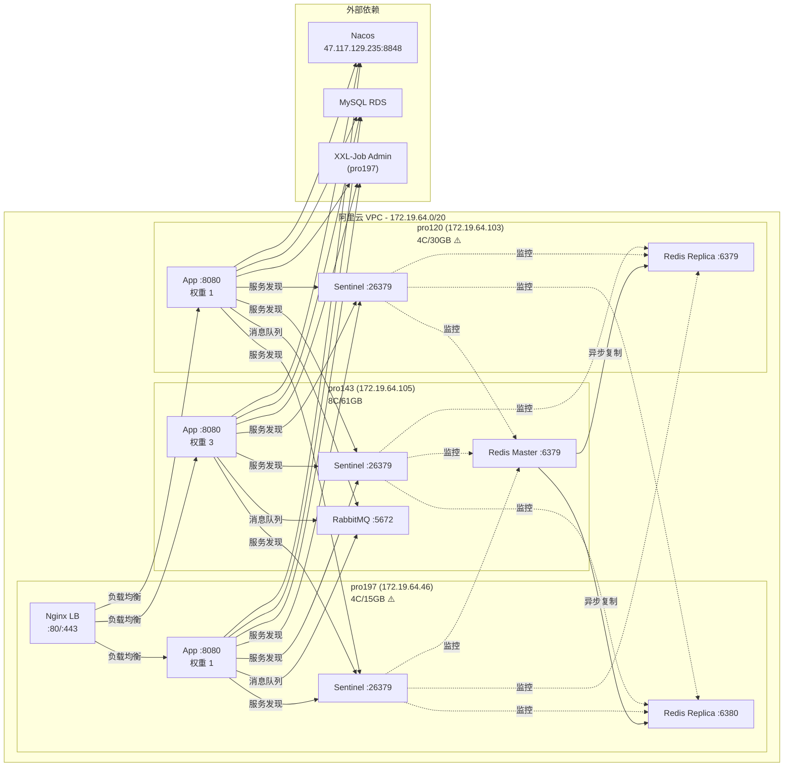

# cardshop-trade-engine 高可用环境部署方案

## 1. 概述

本文档描述在 pro143、pro197、pro120 三台服务器上部署 cardshop-trade-engine 高可用环境的完整方案，涵盖应用服务、Redis Sentinel、RabbitMQ Cluster 的部署架构与配置。

### 1.1 设计依据

本方案基于 `docs/交行直充业务系统高可用方案设计.md` 中的中间件选型要求：
- Redis 7.x Sentinel：1 master + 2 replica + 3 sentinel
- RabbitMQ 3.12+/3.13+ 集群：Quorum Queue 支持
- JDK 21 + Spring Boot 3.x
- 所有组件间连接使用内网 IP（172.19.64.0/20 子网）

### 1.2 服务器资源现状

| 别名 | 主机名 | 内网 IP | 外网 IP | CPU | 内存(可用) | 磁盘(可用) | 运行时间 | OS |
|------|--------|---------|---------|-----|------------|------------|----------|-----|
| pro143 | baseapp1 | 172.19.64.105 | 8.133.164.143 | 8C | 61GB(60G) | 40G(34G) | ~3h | Alibaba Cloud Linux V4 |
| pro197 | iZuf6g5nhezj6rdpodg3b0Z | 172.19.64.46 | 47.101.155.197 | 4C | 15GB(4G) | 40G(19G) | 557天 | CentOS 7 |
| pro120 | iZuf6cpy7zfaatfvloif68Z | 172.19.64.103 | 106.14.116.120 | 4C | 30GB(10G) | 40G(17G) | 378天 | CentOS 8 |

> pro120 有双网卡：eth0=172.19.64.103（主）、eth1=172.19.64.104（辅），部署统一使用 172.19.64.103。

### 1.3 各服务器存量服务详情

**pro143 — 空白新服务器**
- 仅运行 SSH(22) 和 systemd-resolved(5355/53)
- 无 Java、Redis、RabbitMQ、Nginx、Docker

**pro197 — 存量生产服务器（重度使用）⚠️**
- Java: OpenJDK 1.8.0_412
- 运行中 Java 应用: lvtshop-app.jar、lvtshop-business.jar、cereshop-admin、cereshop-business、cereshop-zfbmsg、Elasticsearch、XXL-Job Admin
- Redis 5.0.10（端口 6379，开启 AUTH，被上述 Java 应用使用）
- RabbitMQ 3.10.0（端口 5672/15672，vhost `/`、`/dev_vhost`，用户 admin/dev/guest）
- Nginx（端口 80/443）
- Docker 已安装但无运行容器，有 docker0/docker_gwbridge 网络残留

**pro120 — 存量生产服务器（中度使用）⚠️**
- Java: OpenJDK 17.0.2
- 运行中 Java 应用: yudao-module-of-app.jar、yudao-module-report-server.jar、yudao-module-dc-jdvop.jar、yudao-module-mall 等多个 novo-mall 微服务
- RabbitMQ 4.1.1（端口 5672/15672/15692，vhost `/`、`/cardshop`）
- Nginx（端口 80/443）
- XXL-Job executor（端口 9999，被 yudao 服务使用）
- 无 Redis、无 Docker

## 2. 网络拓扑



**连接说明：**
- 应用 → Redis：通过 Sentinel（26379）自动发现 master，读写分离（写走 master，读可走 replica）
- 应用 → RabbitMQ：直连 pro143 单节点（172.19.64.105:5672），Quorum Queue + 持久化消息保证可靠性
- Redis 主从复制：pro143 master → pro197(6380) / pro120(6379) replicas 异步复制
- RabbitMQ：当前单节点部署于 pro143，后续可扩展集群
- 应用 → Nacos/MySQL/XXL-Job：沿用现有外部依赖
- Nginx LB：部署在 pro197，将请求分发到三台 App 节点

## 3. 组件部署规划

### 3.1 资源分配总览

| 组件 | pro143 (8C/61G) | pro197 (4C/15G) | pro120 (4C/30G) |
|------|-----------------|-----------------|-----------------|
| App | 2C/4G | 1C/2G | 1C/2G |
| Redis | Master 4G | Replica 2G（端口 6380） | Replica 1.5G |
| Sentinel | 256M | 256M | 256M |
| RabbitMQ | 2C/3G（独立新装） | —（不参与） | 复用现有（不加入集群） |
| Nginx LB | — | 复用现有（:80/:443） | 复用现有（:80/:443） |

> 资源分配为建议值，实际生产需根据压测结果调整。
>
> **pro197 内存紧张**：15GB 总量，现有业务已占约 11GB，仅剩 4GB。新组件（Redis replica 2G + App 2G）将基本耗尽剩余内存。
>
> **pro120 内存中度**：30GB 总量，yudao 微服务 + Nginx + RabbitMQ 已占约 20GB，剩余约 10GB。新组件（Redis replica 1.5G + App 2G）可行但需关注。
>
> **RabbitMQ 集群策略调整**：pro197 的 RMQ 3.10.0（被旧业务使用，不可升级）和 pro120 的 RMQ 4.1.1（被 yudao 微服务使用，不可加入新集群）均不可动。trade-engine 在 pro143 上独立部署 RabbitMQ 单节点，依赖 Quorum Queue + 持久化消息保证可靠性，后续可扩展独立集群节点。

### 3.2 JDK 21 安装

三台服务器统一安装 **Oracle JDK 21.0.11 LTS**，路径为 `/usr/local/jdk21`（软链 → `/usr/local/jdk-21.0.11`）。

> **已完成（2026-07-15）**。以下为安装记录，部署时无需重复执行。

#### 安装状态

| 服务器 | JDK 21 路径 | 安装状态 | 系统默认 Java | 受影响？ |
|--------|------------|----------|--------------|---------|
| pro143 | `/usr/local/jdk21` | ✅ 已安装 | 无（之前未装 Java） | 否 |
| pro197 | `/usr/local/jdk21` | ✅ 已安装 | Java 8 (OpenJDK 1.8.0_412) | 否 |
| pro120 | `/usr/local/jdk21` | ✅ 已安装 | Java 17 (OpenJDK 17.0.2) | 否 |

#### 安装方式

采用 Oracle 官方二进制包手动安装，**不修改** `/etc/profile.d/`、`/etc/alternatives` 或系统级 `PATH`/`JAVA_HOME`：

```bash
# 1. 下载 Oracle JDK 21（已执行，各服务器 /tmp/jdk21.tar.gz 可清理）
wget -O /tmp/jdk21.tar.gz \
  'https://download.oracle.com/java/21/latest/jdk-21_linux-x64_bin.tar.gz'

# 2. 解压到 /usr/local 并创建统一软链
cd /usr/local
tar -xzf /tmp/jdk21.tar.gz
ln -sf /usr/local/jdk-21.0.11 /usr/local/jdk21

# 3. 验证
/usr/local/jdk21/bin/java -version
# 输出：java version "21.0.11" 2026-04-21 LTS
#       Java(TM) SE Runtime Environment (build 21.0.11+9-LTS-211)
#       Java HotSpot(TM) 64-Bit Server VM (build 21.0.11+9-LTS-211, mixed mode, sharing)

# 4. 确认系统默认 Java 未被改变
java -version  # pro197 → 1.8.0_412, pro120 → 17.0.2
```

#### 隔离说明

- **未创建** `/etc/profile.d/jdk21.sh` — 全局 shell 不引入 JDK 21
- **未修改** `/etc/alternatives` — 系统级 `java` 命令不受影响
- trade-engine 启动时通过 `config/.prod.env` 中的 `JAVA_HOME=/usr/local/jdk21` 独立指向
- pro197 上 lvtshop/cereshop 继续使用系统 Java 8
- pro120 上 yudao 微服务继续使用系统 Java 17

### 3.3 Redis 7.x Sentinel 部署

#### 3.3.1 安装 Redis 7.x（所有服务器）

```bash
cd /usr/local
wget https://download.redis.io/releases/redis-7.2.5.tar.gz
tar -xzf redis-7.2.5.tar.gz
cd redis-7.2.5
make -j$(nproc)
make install PREFIX=/usr/local/redis

# 创建目录结构
mkdir -p /data/redis/{data,logs,conf,run}
useradd -r -s /sbin/nologin redis 2>/dev/null
chown -R redis:redis /data/redis /usr/local/redis
```

#### 3.3.2 Redis 配置

**pro143 — Master（/data/redis/conf/redis.conf）：**
```conf
bind 172.19.64.105
port 6379
daemonize yes
pidfile /data/redis/run/redis.pid
logfile /data/redis/logs/redis.log
dir /data/redis/data

# 持久化
appendonly yes
appendfsync everysec
auto-aof-rewrite-percentage 100
auto-aof-rewrite-min-size 64mb

# 内存
maxmemory 4gb
maxmemory-policy noeviction

# 主从
min-replicas-to-write 1
min-replicas-max-lag 2

# 密码
requirepass {{REDIS_PASSWORD}}
masterauth {{REDIS_PASSWORD}}

# 慢日志
slowlog-log-slower-than 10000
slowlog-max-len 128

# 副本（无需配置 replicaof，由 Sentinel 管理）
```

**pro197 — Replica（/data/redis/conf/redis.conf）：**

> pro197 上已有旧 Redis 5.0.10 占用 6379 端口，trade-engine Redis 7.x 使用 **6380** 端口。

```conf
bind 172.19.64.46
port 6380
daemonize yes
pidfile /data/redis/run/redis.pid
logfile /data/redis/logs/redis.log
dir /data/redis/data

appendonly yes
appendfsync everysec
auto-aof-rewrite-percentage 100
auto-aof-rewrite-min-size 64mb

maxmemory 2gb
maxmemory-policy noeviction

replicaof 172.19.64.105 6379

requirepass {{REDIS_PASSWORD}}
masterauth {{REDIS_PASSWORD}}

slowlog-log-slower-than 10000
slowlog-max-len 128
```

**pro120 — Replica（/data/redis/conf/redis.conf）：**
```conf
bind 172.19.64.103
port 6379
daemonize yes
pidfile /data/redis/run/redis.pid
logfile /data/redis/logs/redis.log
dir /data/redis/data

appendonly yes
appendfsync everysec
auto-aof-rewrite-percentage 100
auto-aof-rewrite-min-size 64mb

maxmemory 2gb
maxmemory-policy noeviction

replicaof 172.19.64.105 6379

requirepass {{REDIS_PASSWORD}}
masterauth {{REDIS_PASSWORD}}

slowlog-log-slower-than 10000
slowlog-max-len 128
```

#### 3.3.3 Sentinel 配置

**所有服务器（/data/redis/conf/sentinel.conf）：**
```conf
bind {{LOCAL_IP}}
port 26379
daemonize yes
pidfile /data/redis/run/sentinel.pid
logfile /data/redis/logs/sentinel.log
dir /data/redis/data

sentinel monitor mymaster 172.19.64.105 6379 2
sentinel auth-pass mymaster {{REDIS_PASSWORD}}
sentinel down-after-milliseconds mymaster 5000
sentinel failover-timeout mymaster 15000
sentinel parallel-syncs mymaster 1

# 主观下线的响应时间（毫秒）
sentinel deny-scripts-reconfig yes
```

其中 `{{LOCAL_IP}}` 分别为 172.19.64.105 / 172.19.64.46 / 172.19.64.103。

`quorum=2` 表示至少 2 个 Sentinel 同意才触发故障转移。

#### 3.3.4 systemd 服务

**Redis 服务（/etc/systemd/system/redis.service）：**
```ini
[Unit]
Description=Redis Server
After=network.target

[Service]
Type=forking
User=redis
Group=redis
PIDFile=/data/redis/run/redis.pid
ExecStart=/usr/local/redis/bin/redis-server /data/redis/conf/redis.conf
ExecReload=/bin/kill -USR2 $MAINPID
ExecStop=/usr/local/redis/bin/redis-cli -a {{REDIS_PASSWORD}} shutdown
Restart=on-failure
RestartSec=10
LimitNOFILE=65535

[Install]
WantedBy=multi-user.target
```

**Sentinel 服务（/etc/systemd/system/redis-sentinel.service）：**
```ini
[Unit]
Description=Redis Sentinel
After=network.target redis.service

[Service]
Type=forking
User=redis
Group=redis
PIDFile=/data/redis/run/sentinel.pid
ExecStart=/usr/local/redis/bin/redis-sentinel /data/redis/conf/sentinel.conf
ExecStop=/usr/local/redis/bin/redis-cli -p 26379 shutdown
Restart=on-failure
RestartSec=10
LimitNOFILE=65535

[Install]
WantedBy=multi-user.target
```

```bash
systemctl daemon-reload
systemctl enable redis redis-sentinel
# 先启动 master（pro143），再启动 replicas（pro197, pro120），最后启动 sentinels
systemctl start redis
systemctl start redis-sentinel
```

#### 3.3.5 Sentinel 对 pro197 的特殊注意

pro197 的 Redis replica 运行在 6380 端口（非默认 6379），Sentinel 监控的是 master（pro143:6379），replica 端口由 Sentinel 通过 `INFO REPLICATION` 自动发现，无需显式配置。但需确保 pro197 防火墙上 6380 端口已放通（Redis 主从复制流量）。

#### 3.3.6 验证 Redis Sentinel

```bash
# 查看 Sentinel 状态
redis-cli -h 172.19.64.105 -p 26379 -a {{REDIS_PASSWORD}} sentinel masters

# 查看 Sentinel 感知的 replicas
redis-cli -h 172.19.64.105 -p 26379 -a {{REDIS_PASSWORD}} sentinel replicas mymaster

# 查看 master 复制信息
redis-cli -h 172.19.64.105 -p 6379 -a {{REDIS_PASSWORD}} info replication

# 查看 replica 信息（注意 pro197 使用 6380 端口）
redis-cli -h 172.19.64.46 -p 6380 -a {{REDIS_PASSWORD}} info replication
redis-cli -h 172.19.64.103 -p 6379 -a {{REDIS_PASSWORD}} info replication
```

### 3.4 RabbitMQ 部署

#### 3.4.1 部署策略

pro197 的 RMQ 3.10.0 和 pro120 的 RMQ 4.1.1 均为存量生产服务，**不可停机或加入新集群**。
因此 trade-engine 在 pro143 上独立部署 RabbitMQ 单节点。

**单节点下的可靠性保障：**
- Quorum Queue（单节点也支持，基于 Raft 日志持久化）
- `durable` exchange + `durable` queue + `persistent` message（`deliveryMode=2`）
- `publisher confirm` + `mandatory return`
- Consumer `manual ack`（MySQL 事务成功后才 ack）
- 重试队列 + DLQ（死信队列）
- Redis `persist:pending` 作为 RabbitMQ 投递失败的兜底补偿索引

**后续扩展路径：**
- 获取新的独立服务器后，组建 3 节点 RabbitMQ 集群，迁移 trade-engine 队列
- 如 pro120 上 yudao 服务迁移后可考虑复用其 RMQ 节点

#### 3.4.2 RabbitMQ 安装（pro143）

pro143 系统为 Alibaba Cloud Linux V4（兼容 RHEL 8）：

```bash
# 安装 Erlang 26
yum install -y erlang

# 安装 RabbitMQ 3.13.x（与设计文档 3.12+/3.13+ 一致）
rpm --import https://github.com/rabbitmq/signing-keys/releases/download/3.0/rabbitmq-release-signing-key.asc
cat > /etc/yum.repos.d/rabbitmq.repo << 'EOF'
[rabbitmq-server]
name=rabbitmq-server
baseurl=https://packagecloud.io/rabbitmq/rabbitmq-server/el/8/$basearch
gpgcheck=1
gpgkey=https://packagecloud.io/rabbitmq/rabbitmq-server/gpgkey
enabled=1
EOF
yum install -y rabbitmq-server
```

#### 3.4.3 RabbitMQ 配置（pro143）

**/etc/rabbitmq/rabbitmq.conf：**
```conf
# 内网监听
listeners.tcp.default = 5672

# 管理插件端口
management.tcp.port = 15672

# 磁盘空闲空间告警阈值
disk_free_limit.absolute = 2GB

# 内存高水位（pro143 内存充裕，0.6 约 36GB）
vm_memory_high_watermark.relative = 0.4

# 日志
log.dir = /var/log/rabbitmq
log.file = rabbitmq.log
log.file.level = info
```

**启用管理插件：**
```bash
rabbitmq-plugins enable rabbitmq_management
systemctl enable rabbitmq-server
systemctl start rabbitmq-server
```

**创建 vhost 和用户：**
```bash
rabbitmqctl add_vhost cardshop-trade-engine
rabbitmqctl add_user trade_engine {{RABBITMQ_PASSWORD}}
rabbitmqctl set_permissions -p cardshop-trade-engine trade_engine ".*" ".*" ".*"
rabbitmqctl set_user_tags trade_engine administrator
# 删除默认 guest 用户（安全加固）
rabbitmqctl delete_user guest
```

#### 3.4.4 队列策略

```bash
# 所有业务队列使用 Quorum Queue + lazy mode
rabbitmqctl set_policy -p cardshop-trade-engine ha-quorum ".*" \
  '{"queue-mode":"lazy"}' \
  --apply-to queues
```

#### 3.4.5 应用连接配置

```yaml
spring:
  rabbitmq:
    addresses: 172.19.64.105:5672
    virtual-host: cardshop-trade-engine
    username: trade_engine
    password: {{RABBITMQ_PASSWORD}}
    publisher-confirm-type: correlated
    publisher-returns: true
    template:
      mandatory: true
    listener:
      simple:
        acknowledge-mode: manual
        prefetch: 50
        default-requeue-rejected: false
```

> 后续搭建集群时，将 `addresses` 改为逗号分隔的多节点地址即可。

### 3.5 应用部署

#### 3.5.1 构建

```bash
# 本地构建
cd /Users/mac/Documents/codeSpace/cardshop-trade-engine
./scripts/package.sh
# 产出：target/cardshop-trade-engine-*.zip
```

#### 3.5.2 部署目录结构

所有服务器统一：

```bash
# 创建部署目录
mkdir -p /home/cardshop/trade-engine/{bin,conf,logs,lib}
```

#### 3.5.3 上传与解压

```bash
# 本地执行
scp target/cardshop-trade-engine-*.zip pro143:/tmp/
scp target/cardshop-trade-engine-*.zip pro197:/tmp/
scp target/cardshop-trade-engine-*.zip pro120:/tmp/

# 各服务器执行
cd /tmp && unzip -o cardshop-trade-engine-*.zip -d /home/cardshop/trade-engine/
```

#### 3.5.4 环境变量配置

**所有服务器（config/.prod.env）：**
```bash
# JDK
export JAVA_HOME=/usr/local/jdk21
export PATH=$JAVA_HOME/bin:$PATH
export JVM_XMS=1g
export JVM_XMX=2g
export JVM_EXTRA="-XX:+UseG1GC -XX:MaxGCPauseMillis=200 -XX:+HeapDumpOnOutOfMemoryError -XX:HeapDumpPath=/home/cardshop/trade-engine/logs/"

# App Profile
export APP_PROFILE=prod

# Nacos
export NACOS_SERVER_ADDR=47.117.129.235:8848
export NACOS_NAMESPACE=cardshop-trade-engine-prod
export NACOS_GROUP=TRADE_ENGINE_PROD

# 服务端口
export SERVER_PORT=8080
```

#### 3.5.5 Redis 连接配置（Nacos）

以下配置发布到 Nacos `TRADE_ENGINE_PROD` group：

```yaml
spring:
  data:
    redis:
      sentinel:
        master: mymaster
        nodes:
          - 172.19.64.105:26379
          - 172.19.64.46:26379
          - 172.19.64.103:26379
      password: {{REDIS_PASSWORD}}
      lettuce:
        pool:
          max-active: 20
          max-idle: 10
          min-idle: 5
          max-wait: 3000ms
      timeout: 5000ms
```

#### 3.5.6 systemd 服务

**所有服务器（/etc/systemd/system/cardshop-trade-engine.service）：**
```ini
[Unit]
Description=cardshop-trade-engine
After=network.target

[Service]
Type=simple
User=root
WorkingDirectory=/home/cardshop/trade-engine
EnvironmentFile=/home/cardshop/trade-engine/config/.prod.env
ExecStart=/home/cardshop/trade-engine/bin/start.sh
ExecStop=/bin/kill -SIGTERM $MAINPID
Restart=on-failure
RestartSec=30
LimitNOFILE=65535
StandardOutput=append:/home/cardshop/trade-engine/logs/stdout.log
StandardError=append:/home/cardshop/trade-engine/logs/stderr.log

[Install]
WantedBy=multi-user.target
```

```bash
systemctl daemon-reload
systemctl enable cardshop-trade-engine
systemctl start cardshop-trade-engine
```

#### 3.5.7 Nginx 负载均衡

pro197 和 pro120 均已有 Nginx 运行在 80/443 端口，选择 **pro197 的 Nginx** 作为 trade-engine 的统一入口（pro197 内存更紧张，将 Web 流量导向 pro143/pro120 处理）。

**pro197 新增配置（/etc/nginx/conf.d/trade-engine.conf）：**
```nginx
upstream trade_engine_backend {
    # 轮询，pro143 权重更高（资源充裕）
    server 172.19.64.105:8080 weight=3 max_fails=3 fail_timeout=30s;
    server 172.19.64.46:8080  weight=1 max_fails=3 fail_timeout=30s;
    server 172.19.64.103:8080 weight=1 max_fails=3 fail_timeout=30s;
}

server {
    listen 80;
    server_name trade-engine.kalaiwang.com;  # 按实际域名调整

    location / {
        proxy_pass http://trade_engine_backend;
        proxy_set_header Host $host;
        proxy_set_header X-Real-IP $remote_addr;
        proxy_set_header X-Forwarded-For $proxy_add_x_forwarded_for;
        proxy_connect_timeout 10s;
        proxy_read_timeout 60s;
    }

    # Actuator 健康检查（仅内网可访问）
    location /actuator/health {
        proxy_pass http://trade_engine_backend;
        allow 172.19.64.0/20;
        deny all;
    }
}
```

```bash
nginx -t && nginx -s reload
```

> pro143 权重设为 3（8C/61G 最充裕），pro197 和 pro120 权重为 1。
> 后续如需更高可用性，可在 pro120 的 Nginx 上也配置相同的 upstream，通过 DNS 轮询或 SLB 做 Nginx 层高可用。

### 3.6 XXL-Job 执行器配置

> **端口冲突注意**：pro120 上 yudao 服务已占用 XXL-Job executor 默认端口 9999，trade-engine 执行器使用 **9998** 端口。

```yaml
# Nacos 发布
xxl:
  job:
    admin:
      addresses: {{XXL_JOB_ADMIN_URL}}
    executor:
      appname: cardshop-trade-engine
      port: 9998
```

所有补偿任务配置为分片执行，分片总数设为应用节点数（3）：

```
分片总数=3
分片序号=0,1,2（各节点自动获取）
```

## 4. 部署顺序

```text
第一阶段：基础设施准备
  1. 三台服务器安装 JDK 21（pro120 安装到 /usr/local/jdk21，不影响 yudao 的 Java 17）
  2. 创建部署目录结构 /home/cardshop/trade-engine/

第二阶段：中间件部署
  3. pro143 安装 RabbitMQ 3.13+ → 创建 vhost、用户、策略
  4. pro143 安装 Redis 7.x + Sentinel（先不启动）
  5. pro197 安装 Redis 7.x（端口 6380）+ Sentinel
  6. pro120 安装 Redis 7.x + Sentinel
  7. 启动 Redis Sentinel（master → replicas → sentinels）
  8. 验证 Redis Sentinel 拓扑和自动故障转移

第三阶段：配置发布
  9. 发布 prod Nacos 配置：Redis Sentinel 地址、RabbitMQ 地址、MySQL 等
  10. 发布 XXL-Job 执行器配置（端口 9998）

第四阶段：应用部署
  11. 构建应用包（./scripts/package.sh）
  12. 上传并部署到三台服务器
  13. 逐台启动（pro143 → pro120 → pro197），观察日志确认无报错
  14. pro197 Nginx 配置并 reload

第五阶段：验证
  15. 健康检查（/actuator/health）
  16. Redis Sentinel 读写验证
  17. RabbitMQ 消息收发验证
  18. 故障转移验证（逐个模拟 Redis、App 故障）
```

## 5. 故障转移验证方案

### 5.1 Redis Sentinel 故障转移

```bash
# 1. 查看当前 master
redis-cli -h 172.19.64.105 -p 26379 -a {{REDIS_PASSWORD}} sentinel get-master-addr-by-name mymaster

# 2. 手动下线 master
redis-cli -h 172.19.64.105 -p 6379 -a {{REDIS_PASSWORD}} DEBUG SLEEP 30

# 3. 观察 Sentinel 选举新 master（约 5-15s）
redis-cli -h 172.19.64.46 -p 26379 -a {{REDIS_PASSWORD}} sentinel get-master-addr-by-name mymaster

# 4. 验证新 master 可写
redis-cli -h <新master_ip> -p 6379 -a {{REDIS_PASSWORD}} set test:key "value"

# 5. 恢复原 master
systemctl restart redis  # 原 master 变为新 master 的 replica
```

### 5.2 RabbitMQ 故障与恢复

当前 RabbitMQ 部署在 pro143 单节点：

```bash
# 1. 发送测试消息确认正常（通过应用下单接口触发）

# 2. 模拟 RabbitMQ 宕机
systemctl stop rabbitmq-server

# 3. 验证：应用下单接口返回 MQ_PUBLISH_FAILED
#          订单仍保留在 Redis persist:pending 索引中
#          查单接口返回 PROCESSING

# 4. 恢复 RabbitMQ
systemctl start rabbitmq-server

# 5. 触发 XXL-Job 补投任务或等待补偿周期
#          验证 pending 订单最终落库 MySQL
```

### 5.3 应用实例故障

```bash
# 1. 停止 pro197 上的应用
systemctl stop cardshop-trade-engine

# 2. 验证 Nginx 将请求转发到剩余节点
curl http://pro197/actuator/health  # 内网访问

# 3. XXL-Job 分片应自动重新分配

# 4. 恢复应用
systemctl start cardshop-trade-engine
```

## 6. 监控配置

### 6.1 关键指标

| 组件 | 监控指标 | 告警阈值 |
|------|----------|----------|
| App | JVM 堆内存、GC 频率、请求延迟 P99 | 堆>80%、P99>2s |
| Redis | 连接数、内存使用、`WAIT` 延迟、主从切换次数 | 内存>80%、WAIT>100ms |
| Sentinel | 主观下线次数、故障转移次数 | 主观下线>0 |
| RabbitMQ | 队列堆积、publisher confirm P99、consumer ack 延迟 | 堆积>1000 条 |
| Nginx | 5xx 错误率、upstream 不可用次数 | 5xx>1% |

### 6.2 Actuator 端点

应用暴露以下端点供监控采集：
- `/actuator/health`：健康检查
- `/actuator/prometheus`：Micrometer 指标（供 Prometheus 采集）
- `/actuator/info`：应用版本信息

## 7. 注意事项

1. **pro197 Redis 端口冲突**：旧 Redis 5.0.10 占用 6379，trade-engine Redis 7.x 使用 6380 端口。两者互不影响，但需确保 Sentinel 监控的是 6380 端口的实例。

2. **pro197 RabbitMQ 不可动**：旧 RMQ 3.10.0 被 lvtshop/cereshop 等生产服务使用，不可升级或停止。trade-engine 不使用 pro197 的 RabbitMQ。

3. **pro120 RabbitMQ 不可动**：RMQ 4.1.1 被 yudao（novo-mall）微服务使用，vhost `/` 和 `/cardshop` 均有业务队列，不可加入新集群或修改配置。trade-engine 不使用 pro120 的 RabbitMQ。

4. **pro197 内存紧张**：15GB 总量，存量业务已占约 11GB，仅剩约 4GB。新增 Redis replica（2G）+ App（2G）基本耗尽剩余内存，需密切监控，必要时降低 App JVM 堆至 1G。

5. **pro120 磁盘空间**：已使用 60%（24G/40G），需关注 yudao 日志和 RMQ 消息堆积。新增 Redis AOF + App 日志进一步压缩空间。

6. **pro120 端口冲突**：默认 XXL-Job executor 端口 9999 已被 yudao 服务占用，trade-engine 使用 9998。另外主网卡 IP 172.19.64.103 已有大量 yudao 端口占用，需确认 8080/26379/9998 未被占用。

7. **pro120 Java 版本隔离**：yudao 服务依赖 Java 17，JDK 21 需安装到独立路径（`/usr/local/jdk21`），通过 trade-engine 启动脚本的 `JAVA_HOME` 指向，不影响存量服务。

8. **pro120 多网卡**：有两个内网 IP（172.19.64.103 和 172.19.64.104），部署统一使用 172.19.64.103。

9. **密码统一管理**：Redis 密码、RabbitMQ 密码等敏感信息统一由 Nacos 或环境变量管理，不在配置文件中明文存储。

10. **防火墙规则**：确保三台服务器之间以下端口互通：
    - TCP 6380（pro197 Redis replica）
    - TCP 6379（pro143 Redis master、pro120 Redis replica）
    - TCP 26379（Sentinel，三台均需互通）
    - TCP 5672（pro143 RabbitMQ）
    - TCP 15672（pro143 RabbitMQ 管理界面，仅内网）
    - TCP 8080（应用端口，三台均需对 pro197 Nginx 可达）
    - TCP 9998（XXL-Job 执行器端口）

11. **Nacos 配置隔离**：prod 环境使用独立 namespace `cardshop-trade-engine-prod` 和 group `TRADE_ENGINE_PROD`，不可与 dev/test 共用。

12. **RabbitMQ 单点风险**：当前 RabbitMQ 仅部署在 pro143 单节点，pro143 宕机会导致异步持久化中断。订单数据由 Redis `persist:pending` 兜底，pro143 恢复后 XXL-Job 补投任务会自动补偿。后续应扩展至少 3 节点集群。

13. **Nginx 单点**：当前仅 pro197 的 Nginx 配置了 trade-engine upstream。pro197 宕机会导致 HTTP 入口不可用。如有 SLB 或 DNS 轮询，可在 pro120 的 Nginx 上同样配置一份作为冗余。

## 8. 待确认事项

以下事项需在部署前与运维/业务方确认：

1. pro197 上 6380 端口是否空闲可用？
2. pro120 上 8080（App）、26379（Sentinel）、9998（XXL-Job）端口是否空闲？
3. pro197 内存极紧张（仅剩 4G），是否需要先清理或迁移部分存量业务？
4. 生产域名（如 `trade-engine.kalaiwang.com`）的 DNS 解析和 SSL 证书配置。
5. XXL-Job Admin 生产地址（当前 pro197 上已有 XXL-Job Admin，是否复用？）。
6. Redis 和 RabbitMQ 的生产密码。
7. RabbitMQ 后续集群扩展计划（需要几台新服务器？）。
