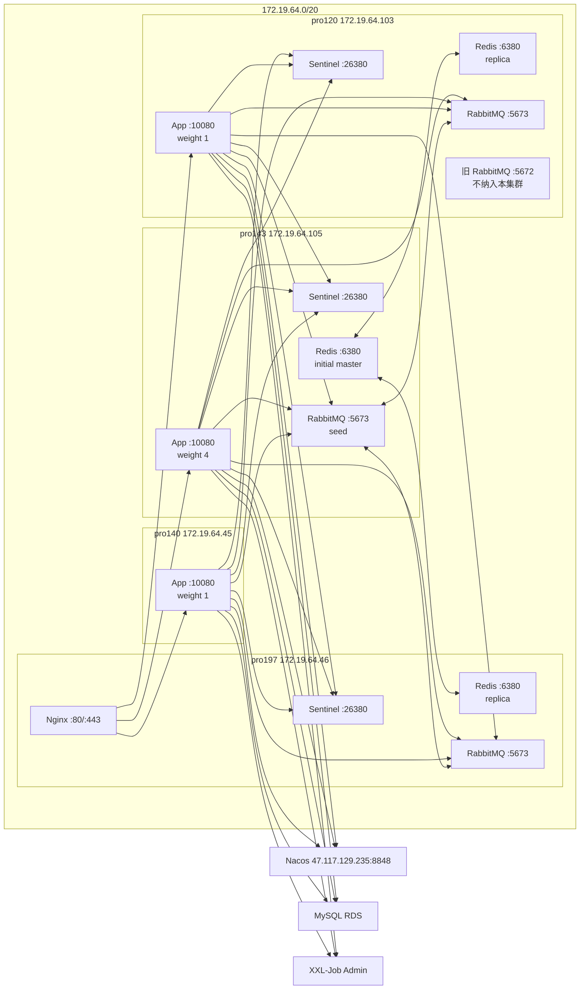

# cardshop-trade-engine 高可用环境部署方案

## 1. 概述

本文档描述在现有服务器上部署 `cardshop-trade-engine` 的过渡高可用环境。当前资源
约束下，中间件统一采用 Docker 隔离部署：

- Redis 7.x：1 master + 2 replica + 3 Sentinel。
- RabbitMQ 4.3.x + Erlang/OTP 27.x：3 节点集群，业务队列使用 Quorum Queue。
- cardshop-trade-engine：应用实例部署在 `pro143`、`pro140`、`pro120`，JVM 统一 4G；
  `pro197` 不部署应用，仅保留中间件和 Nginx 入口职责。

本方案目标是先在现有中间件三节点上获得 Redis 副本确认、RabbitMQ 多节点 quorum，
并在 `pro143`、`pro140`、`pro120` 上获得应用多实例能力。它仍然是混部环境，
中间件容量按最弱节点 pro197 控制，不作为高吞吐终态方案。

## 2. 服务器现状

| 别名 | 内网 IP | 外网 IP | OS | CPU | 内存现状 | 磁盘现状 | 关键存量服务 |
| --- | --- | --- | --- | --- | --- | --- | --- |
| pro143 | `172.19.64.105` | `8.133.164.143` | Alibaba Cloud Linux V4 | 8C | 61Gi，总可用约 60Gi | `/` 可用约 33G，`/data` 可用约 149G | trade-engine Docker 中间件已运行 |
| pro140 | `172.19.64.45` | 待补充 | CentOS 7 | 待补充 | 15G，可用约 5.5G | `/` 可用约 10G | 旧 Java 服务、Elasticsearch；trade-engine 应用包已落地，待放通中间件端口 |
| pro197 | `172.19.64.46` | `47.101.155.197` | CentOS 7 | 4C | 15G，可用约 4.4G | `/` 可用约 18G | 旧 Redis `6379`、Nginx、Elasticsearch、旧 Java 服务、trade-engine Docker 中间件已运行 |
| pro120 | `172.19.64.103` / `172.19.64.104` | `106.14.116.120` | CentOS 8 | 4C | 30Gi，可用约 10Gi | `/` 可用约 15G，`/data` 可用约 61G | 旧 RabbitMQ `4.1.1 + OTP26` 占默认端口、Nginx、多个 yudao Java 服务、trade-engine Docker 中间件已运行 |

### 2.1 端口冲突

| 端口 | 冲突机器 | 存量服务 | 本方案处理 |
| --- | --- | --- | --- |
| `6379` | pro197 | 旧 Redis | trade-engine Redis 统一使用 `6380` |
| `4369` / `5672` / `15672` / `15692` / `25672` | pro120 | 旧 RabbitMQ | trade-engine RabbitMQ 统一使用 `4370` / `5673` / `15673` / `15693` / `25673` |
| `9998` | pro197/pro120 | 存量 Java 服务可能占用 | trade-engine XXL executor 使用 `19999` |
| `80` / `443` | pro197/pro120 | Nginx | 复用 pro197 Nginx 做入口 |

## 3. 总体拓扑



连接口径：

1. 应用通过 Sentinel `26380` 自动发现 Redis master。
2. 应用 RabbitMQ 地址写三个节点，pro143 放第一位。
3. pro143 是 RabbitMQ 集群 seed 和优先连接节点，不是固定 master；Quorum Queue
   按队列选 leader，节点故障后重新选举。
4. pro120 的旧 RabbitMQ 保持默认端口并继续服务旧业务，trade-engine 的 RabbitMQ
   使用独立端口、独立数据目录、独立 vhost。

## 4. 版本与镜像基线

所有 Docker 镜像必须固定到精确 tag 或 digest，禁止使用 `latest`。

| 组件 | 推荐基线 | 镜像口径 |
| --- | --- | --- |
| Redis | Redis 7.x 最新稳定 patch，当前建议 `7.4.x` | `redis:7.4.x` 固定 digest |
| RabbitMQ | RabbitMQ `4.3.x` 同一 patch + Erlang/OTP `27.x` | 使用内部制品镜像，例如 `registry.local/cardshop/rabbitmq:4.3.x-otp27-management`，启动后必须用 `rabbitmq-diagnostics erlang_version` 验证 OTP 为 27.x |
| App | 当前发布包同一版本 | 使用 `scripts/package.sh` 产物或后续应用镜像，三台版本一致 |

如果采用 Docker Hub 官方 RabbitMQ management 镜像，必须先确认镜像内置 Erlang/OTP
版本为 27.x；如果不是 27.x，应构建内部固定镜像，不要让三节点混用不同 OTP major。

## 5. 资源分配

| 组件 | pro143 | pro197 | pro120 |
| --- | --- | --- | --- |
| RabbitMQ Docker | 内存限制 `4g`，数据目录 `/data/trade-engine/rabbitmq` | 内存限制 `1536m`，数据目录 `/data/trade-engine/rabbitmq` | 内存限制 `2g`，数据目录 `/data/trade-engine/rabbitmq` |
| Redis Docker | `maxmemory 2g`，初始 master | `maxmemory 1536mb`，replica | `maxmemory 1536mb`，replica |
| App | `-Xms4g -Xmx4g` | 不部署 | `-Xms4g -Xmx4g` |
| Nginx | 不部署入口 | 复用现有 Nginx | 可后续做备用入口 |

应用补充节点：

| 组件 | pro140 |
| --- | --- |
| App | `-Xms4g -Xmx4g`，需要放通到三台 RabbitMQ `5673` 和 Redis Sentinel `26380` |

容量原则：

1. Redis 容量按 pro197 最弱节点规划，不能按 pro143 的大内存放开。
2. RabbitMQ Quorum Queue 会在三个节点都写入 Raft 日志，pro197 磁盘和内存是集群上限。
3. 应用流量 pro143 权重最高，pro140/pro120 低权重兜底。
4. 若 pro197 内存长期低于 2G 可用，优先排查旧业务、日志、RabbitMQ 队列堆积和 Redis
   AOF rewrite；必要时降低 RabbitMQ `vm_memory_high_watermark.absolute`。pro197
   不部署 trade-engine 应用，不能通过停止 app 释放资源。

## 6. 目录规划

三台统一创建目录：

```bash
mkdir -p /data/trade-engine/{redis/{conf,data,logs},sentinel/{conf,data,logs},rabbitmq/{conf,data,logs},app,logs}
chmod 700 /data/trade-engine
```

pro197 若 `/data` 位于系统盘，需要额外关注磁盘水位；RabbitMQ 队列堆积和 Redis
AOF rewrite 都可能放大磁盘使用。

## 7. Docker Compose 运行要求

三台均要求 Docker 已启用，并安装 Docker Compose v2 插件：

```bash
systemctl enable --now docker
docker version
docker compose version
```

所有中间件容器使用 `--network host`，原因是 RabbitMQ 集群和 Redis Sentinel
都需要向其它节点发布宿主机内网 IP 和固定端口。端口冲突通过应用层配置改为
非默认端口解决。

当前三台已经统一迁移到 Docker Compose 管理，部署目录固定为
`/data/trade-engine/deploy`：

```text
/data/trade-engine/deploy/docker-compose.yml
/data/trade-engine/deploy/.env
/data/trade-engine/deploy/backup/
```

`.env` 保存镜像、主机名、节点名、内存限制和 RabbitMQ Erlang cookie 等运行变量，
文件权限必须为 `600`，不得复制到 Git。`COMPOSE_PROJECT_NAME` 统一为
`cardshop-trade-engine-middleware`，Compose 服务名统一为：

```text
rabbitmq
redis
redis-sentinel
```

`docker-compose.yml` 使用以下结构。RabbitMQ 的 `extra_hosts` 是必需项；否则容器
重建后可能无法解析 `rabbit@rmq-pro120`、`rabbit@rmq-pro143`、
`rabbit@rmq-pro197`，导致局部节点视图不完整。

```yaml
services:
  rabbitmq:
    image: ${RABBITMQ_IMAGE}
    container_name: trade-rabbitmq
    hostname: ${RABBITMQ_HOSTNAME}
    extra_hosts:
      - "rmq-pro143:172.19.64.105"
      - "rmq-pro197:172.19.64.46"
      - "rmq-pro120:172.19.64.103"
    network_mode: host
    restart: unless-stopped
    environment:
      RABBITMQ_NODENAME: ${RABBITMQ_NODENAME}
      RABBITMQ_ERLANG_COOKIE: ${RABBITMQ_ERLANG_COOKIE}
      RABBITMQ_DIST_PORT: ${RABBITMQ_DIST_PORT}
      ERL_EPMD_PORT: ${ERL_EPMD_PORT}
    volumes:
      - /data/trade-engine/rabbitmq/conf:/etc/rabbitmq
      - /data/trade-engine/rabbitmq/data:/var/lib/rabbitmq
      - /data/trade-engine/rabbitmq/logs:/var/log/rabbitmq
    command: rabbitmq-server
    mem_limit: ${RABBITMQ_MEMORY_LIMIT}

  redis:
    image: ${REDIS_IMAGE}
    container_name: trade-redis
    hostname: ${REDIS_HOSTNAME}
    network_mode: host
    restart: unless-stopped
    volumes:
      - /data/trade-engine/redis/conf/redis.conf:/usr/local/etc/redis/redis.conf
      - /data/trade-engine/redis/data:/data
    command: ["redis-server", "/usr/local/etc/redis/redis.conf"]
    mem_limit: ${REDIS_MEMORY_LIMIT}

  redis-sentinel:
    image: ${REDIS_IMAGE}
    container_name: trade-redis-sentinel
    hostname: ${SENTINEL_HOSTNAME}
    network_mode: host
    restart: unless-stopped
    volumes:
      - /data/trade-engine/sentinel/conf:/usr/local/etc/redis
      - /data/trade-engine/sentinel/data:/data
    command: ["redis-server", "/usr/local/etc/redis/sentinel.conf", "--sentinel"]
    mem_limit: ${SENTINEL_MEMORY_LIMIT}
```

日常运维命令：

```bash
cd /data/trade-engine/deploy
docker compose config --quiet
docker compose ps
docker compose up -d
docker compose logs --tail=200 rabbitmq
docker compose logs --tail=200 redis
docker compose logs --tail=200 redis-sentinel
```

禁止使用 `docker compose down -v`，也不要删除 `/data/trade-engine/redis`、
`/data/trade-engine/sentinel`、`/data/trade-engine/rabbitmq` 数据目录。需要重建容器时，
优先使用 `docker compose up -d --force-recreate <service>` 或按服务停删后再
`docker compose up -d <service>`。

## 8. RabbitMQ 4.3 集群部署

### 8.1 端口

| 用途 | trade-engine 端口 | 说明 |
| --- | --- | --- |
| EPMD | `4370` | 避开 pro120 旧 RabbitMQ 的 `4369` |
| AMQP | `5673` | 应用连接端口 |
| Management | `15673` | 仅内网访问 |
| Prometheus | `15693` | 指标采集 |
| Erlang distribution | `25673` | 集群节点互联 |

三台安全组和防火墙仅允许 `172.19.64.0/20` 访问这些端口；不要向公网开放
`5673`、`15673`、`25673`。

### 8.2 主机名

三台容器内使用固定短名：

```text
rmq-pro143 -> 172.19.64.105
rmq-pro197 -> 172.19.64.46
rmq-pro120 -> 172.19.64.103
```

### 8.3 配置文件

每台创建 `/data/trade-engine/rabbitmq/conf/enabled_plugins`：

```erlang
[rabbitmq_management,rabbitmq_prometheus].
```

每台创建 `/data/trade-engine/rabbitmq/conf/rabbitmq.conf`，其中 IP 按本机替换：

```conf
listeners.tcp.1 = {{LOCAL_IP}}:5673

management.tcp.ip = {{LOCAL_IP}}
management.tcp.port = 15673

prometheus.tcp.ip = {{LOCAL_IP}}
prometheus.tcp.port = 15693

disk_free_limit.absolute = 2GB
vm_memory_high_watermark.absolute = {{RABBITMQ_MEMORY_WATERMARK}}

log.console = true
loopback_users.guest = false
```

内存水位建议：

```text
pro143: 3GB
pro197: 1GB
pro120: 1536MB
```

### 8.4 启动容器

三台使用同一个 `RABBITMQ_ERLANG_COOKIE`，但各自 `.env` 中的
`RABBITMQ_HOSTNAME` 和 `RABBITMQ_NODENAME` 必须与本机一致：

```text
pro143: RABBITMQ_HOSTNAME=rmq-pro143, RABBITMQ_NODENAME=rabbit@rmq-pro143
pro197: RABBITMQ_HOSTNAME=rmq-pro197, RABBITMQ_NODENAME=rabbit@rmq-pro197
pro120: RABBITMQ_HOSTNAME=rmq-pro120, RABBITMQ_NODENAME=rabbit@rmq-pro120
```

启动或重建 RabbitMQ：

```bash
cd /data/trade-engine/deploy
docker compose up -d rabbitmq
```

如果是从旧的手工 `docker run` 容器迁移到 Compose，只删除容器壳，不删除数据目录：

```bash
cd /data/trade-engine/deploy
docker stop trade-rabbitmq
docker rm trade-rabbitmq
docker compose up -d rabbitmq
```

### 8.5 组集群

先启动 pro143，再启动 pro197/pro120。新容器没有业务数据时，可在 pro197/pro120
执行：

```bash
docker exec trade-rabbitmq rabbitmqctl stop_app
docker exec trade-rabbitmq rabbitmqctl reset
docker exec trade-rabbitmq rabbitmqctl join_cluster rabbit@rmq-pro143
docker exec trade-rabbitmq rabbitmqctl start_app
```

验证：

```bash
docker exec trade-rabbitmq rabbitmqctl cluster_status
docker exec trade-rabbitmq rabbitmq-diagnostics erlang_version
docker exec trade-rabbitmq rabbitmqctl version
```

### 8.6 vhost、用户和策略

在任一节点执行：

```bash
docker exec trade-rabbitmq rabbitmqctl add_vhost cardshop-trade-prod
docker exec trade-rabbitmq rabbitmqctl add_user trade_engine '{{RABBITMQ_PASSWORD}}'
docker exec trade-rabbitmq rabbitmqctl set_permissions -p cardshop-trade-prod trade_engine '.*' '.*' '.*'
docker exec trade-rabbitmq rabbitmqctl set_user_tags trade_engine monitoring
```

应用代码会声明主队列和 DLQ 为 Quorum Queue、retry queue 为 classic durable queue +
TTL + DLX。不要设置“所有队列强制 quorum”的全局策略，否则会破坏 retry queue
的 classic 设计。可选地只给主队列和 DLQ 设置 delivery limit：

```bash
docker exec trade-rabbitmq rabbitmqctl set_policy -p cardshop-trade-prod trade-engine-quorum \
  '^(recharge\.persist\.mysql\.queue|recharge\.persist\.mysql\.dlq)$' \
  '{"delivery-limit":5}' \
  --apply-to queues
```

## 9. Redis 7.x Sentinel 部署

### 9.1 端口

| 用途 | 端口 |
| --- | --- |
| Redis server | `6380` |
| Redis Sentinel | `26380` |

`26379` 是合法且常见的 Sentinel 默认端口；本方案选择 `26380`，是为了与
Redis `6380` 成对，并通过端口、Sentinel master 名、容器名和数据目录明确区分
trade-engine 专用 Redis，避免误连存量 Redis。

### 9.2 Redis 配置

每台创建 `/data/trade-engine/redis/conf/redis.conf`，按本机替换 IP 和内存。

pro143 初始 master：

```conf
bind 127.0.0.1 172.19.64.105
port 6380
dir /data
appendonly yes
appendfsync everysec
maxmemory 2gb
maxmemory-policy noeviction
requirepass {{REDIS_PASSWORD}}
masterauth {{REDIS_PASSWORD}}
min-replicas-to-write 1
min-replicas-max-lag 2
replica-announce-ip 172.19.64.105
replica-announce-port 6380
```

pro197 replica：

```conf
bind 127.0.0.1 172.19.64.46
port 6380
dir /data
appendonly yes
appendfsync everysec
maxmemory 1536mb
maxmemory-policy noeviction
requirepass {{REDIS_PASSWORD}}
masterauth {{REDIS_PASSWORD}}
replicaof 172.19.64.105 6380
replica-announce-ip 172.19.64.46
replica-announce-port 6380
```

pro120 replica：

```conf
bind 127.0.0.1 172.19.64.103
port 6380
dir /data
appendonly yes
appendfsync everysec
maxmemory 1536mb
maxmemory-policy noeviction
requirepass {{REDIS_PASSWORD}}
masterauth {{REDIS_PASSWORD}}
replicaof 172.19.64.105 6380
replica-announce-ip 172.19.64.103
replica-announce-port 6380
```

### 9.3 Sentinel 配置

每台创建 `/data/trade-engine/sentinel/conf/sentinel.conf`，按本机替换
`sentinel announce-ip`：

```conf
bind 127.0.0.1 {{LOCAL_IP}}
port 26380
dir /data

sentinel monitor trade-engine-master 172.19.64.105 6380 2
sentinel auth-pass trade-engine-master {{REDIS_PASSWORD}}
sentinel down-after-milliseconds trade-engine-master 5000
sentinel failover-timeout trade-engine-master 60000
sentinel parallel-syncs trade-engine-master 1
sentinel announce-ip {{LOCAL_IP}}
sentinel announce-port 26380
```

### 9.4 启动容器

Redis server 和 Sentinel 均由 Compose 管理：

```bash
cd /data/trade-engine/deploy
docker compose up -d redis redis-sentinel
```

如果从旧的手工 `docker run` 容器迁移到 Compose，只删除容器壳，不删除数据目录：

```bash
cd /data/trade-engine/deploy
docker stop trade-redis trade-redis-sentinel
docker rm trade-redis trade-redis-sentinel
docker compose up -d redis redis-sentinel
```

pro197/pro120 的 Redis 容器内存限制可调低到 `1800m`；Redis `maxmemory`
必须小于容器内存限制，给 AOF rewrite、client buffer 和复制 backlog 留余量。

pro143 是当前 Redis master。迁移或重建 pro143 Redis 时，应先确认两个 replica 在线，
并单独重建 Redis，避免同时停止 Sentinel 和 RabbitMQ：

```bash
cd /data/trade-engine/deploy
docker stop -t 3 trade-redis
docker rm trade-redis
docker compose up -d redis
```

### 9.5 验证

```bash
redis-cli -h 172.19.64.105 -p 6380 -a '{{REDIS_PASSWORD}}' info replication
redis-cli -h 172.19.64.46 -p 6380 -a '{{REDIS_PASSWORD}}' info replication
redis-cli -h 172.19.64.103 -p 6380 -a '{{REDIS_PASSWORD}}' info replication

redis-cli -h 172.19.64.105 -p 26380 sentinel masters
redis-cli -h 172.19.64.105 -p 26380 sentinel replicas trade-engine-master
```

## 10. 应用部署

应用部署在 `pro143`、`pro140`、`pro120`，继续使用项目部署包和 JDK 21 启动，
不要求应用 Docker 化。JDK 21 安装在 `/usr/local/jdk21`，不修改系统默认 Java；
pro140 已按该口径安装独立 JDK 21，不设置为默认 `java`，避免影响存量应用。

建议端口：

| 组件 | 端口 |
| --- | --- |
| HTTP | `10080` |
| XXL executor | `19999` |
| Actuator | 复用 HTTP 端口 |

`config/.prod.env` 核心项：

```bash
export APP_PROFILE=prod
export SERVER_PORT=10080
export CARD_SHOP_TRADE_JAVA_HOME=/usr/local/jdk21
export JAVA_OPTS='-Xms4g -Xmx4g -XX:+UseG1GC -XX:+ExitOnOutOfMemoryError -Dfile.encoding=UTF-8 -Xlog:gc*,safepoint:file=${LOG_DIR:-$APP_HOME/logs}/gc-%p-%t.log:time,uptime,level,tags:filecount=10,filesize=100M'
export NACOS_SERVER_ADDR=47.117.129.235:8848
export NACOS_NAMESPACE=494ce583-7775-43e5-abed-cd0cf4802137
export NACOS_GROUP=TRADE_ENGINE_PROD
export TRADE_ENGINE_REDIS_PASSWORD='<从运维密钥获取>'
export XXL_JOB_EXECUTOR_PORT=19999
```

三台应用 JVM 统一 `-Xms4g -Xmx4g`，并开启 Java 21 统一 GC 日志，默认写入
`$APP_HOME/logs/gc-%p-%t.log`，保留 `10` 个、单文件 `100M`。`.prod.env` 必须保持 `600` 权限并归属
`cardshop` 用户，密钥不得写入本文档。`TRADE_ENGINE_REDIS_PASSWORD` 用于让
Nacos 中的 Redis Sentinel 配置引用 `${TRADE_ENGINE_REDIS_PASSWORD}`，避免把
Redis 密码明文写入配置中心内容。

## 11. Nacos 配置

RabbitMQ：

```yaml
spring:
  rabbitmq:
    addresses: 172.19.64.105:5673,172.19.64.46:5673,172.19.64.103:5673
    username: ${SPRING_RABBITMQ_USERNAME}
    password: ${SPRING_RABBITMQ_PASSWORD}
    virtual-host: cardshop-trade-prod
    publisher-confirm-type: correlated
    publisher-returns: true
    template:
      mandatory: true
    listener:
      simple:
        acknowledge-mode: manual
        prefetch: 50
        concurrency: 4
        max-concurrency: 16
```

Redis Sentinel：

```yaml
spring:
  data:
    redis:
      password: ${TRADE_ENGINE_REDIS_PASSWORD}
      sentinel:
        master: trade-engine-master
        nodes:
          - 172.19.64.105:26380
          - 172.19.64.46:26380
          - 172.19.64.103:26380
```

trade-engine：

```yaml
trade:
  engine:
    redis:
      write-enabled: false
      wait-replicas: 1
      wait-timeout-ms: 100
    mq:
      publish-confirm-timeout-ms: 500
      publish-retry-times: 3
    v1:
      merchant-config-preheat:
        enabled: false
        org-codes: []
        fail-on-error: true
```

上线前保持 `write-enabled=false`。完成 Redis WAIT、RabbitMQ confirm、Consumer
落库、pending 补投、监控取证后，再灰度打开写入。

## 12. Nginx 入口

复用 pro197 Nginx 作为第一阶段入口：

```nginx
upstream cardshop_trade_engine {
    server 172.19.64.105:10080 weight=4 max_fails=3 fail_timeout=30s;
    server 172.19.64.45:10080  weight=1 max_fails=3 fail_timeout=30s;
    server 172.19.64.103:10080 weight=1 max_fails=3 fail_timeout=30s;
}

server {
    listen 80;
    server_name trade-engine.internal;

    location / {
        proxy_pass http://cardshop_trade_engine;
        proxy_connect_timeout 3s;
        proxy_read_timeout 10s;
        proxy_send_timeout 10s;
        proxy_set_header Host $host;
        proxy_set_header X-Real-IP $remote_addr;
        proxy_set_header X-Forwarded-For $proxy_add_x_forwarded_for;
    }
}
```

pro197 只作为入口和中间件节点，不部署 trade-engine app。后续可在 pro120 配置同样
upstream，通过 SLB 或 DNS 轮询消除 Nginx 单点。

## 13. 部署顺序

1. 三台确认 Docker 和 Docker Compose v2 可用。
2. 创建目录和密钥，固定 Redis/RabbitMQ 镜像 digest。
3. 在 `/data/trade-engine/deploy` 写入 `docker-compose.yml` 和本机 `.env`。
4. 执行 `docker compose config --quiet`，确认 RabbitMQ `extra_hosts`、节点名和端口无误。
5. 启动 pro143 Redis，再启动 pro197/pro120 Redis replica。
6. 启动三台 Sentinel，确认 master/replica 发现正常。
7. 启动 pro143 RabbitMQ，再启动 pro197/pro120 RabbitMQ。
8. pro197/pro120 RabbitMQ 加入 pro143 集群。
9. 创建 RabbitMQ vhost、用户、权限和可选 policy。
10. 发布 Nacos prod 配置，`write-enabled=false`。
11. 部署 `pro143`、`pro140`、`pro120` 三台 app；pro140 启动前必须确认到三台
    RabbitMQ `5673`、Redis `6380`、Sentinel `26380` 的内网访问已放通。
12. 配置 pro197 Nginx。
13. 执行只读健康检查、RabbitMQ 拓扑检查、Redis WAIT 冒烟。
14. 跑小流量 V1 下单联调，记录到 `docs/集成测试.md`。
15. 证据完整后灰度打开 `trade.engine.redis.write-enabled=true`。

## 14. 验证清单

RabbitMQ：

```bash
cd /data/trade-engine/deploy
docker compose config --quiet
docker compose ps
docker exec trade-rabbitmq getent hosts rmq-pro120 rmq-pro143 rmq-pro197
docker exec trade-rabbitmq rabbitmqctl cluster_status
docker exec trade-rabbitmq rabbitmqctl list_vhosts
docker exec trade-rabbitmq rabbitmqctl list_queues -p cardshop-trade-prod name type durable messages_ready messages_unacknowledged
curl -sS http://172.19.64.105:15693/metrics | head
```

Redis：

```bash
redis-cli -h 172.19.64.105 -p 6380 -a '{{REDIS_PASSWORD}}' set trade:ha:probe ok
redis-cli -h 172.19.64.105 -p 6380 -a '{{REDIS_PASSWORD}}' wait 1 100
redis-cli -h 172.19.64.105 -p 26380 sentinel get-master-addr-by-name trade-engine-master
```

应用：

```bash
curl -sS http://172.19.64.105:10080/actuator/health/readiness
curl -sS http://172.19.64.45:10080/actuator/health/readiness
curl -sS http://172.19.64.103:10080/actuator/health/readiness
curl -sS http://172.19.64.105:10080/actuator/prometheus | grep -E 'trade_engine_mq|trade_engine_redis'
```

## 15. 故障演练

上线前至少执行以下场景：

| 场景 | 操作 | 预期 |
| --- | --- | --- |
| Redis master 故障 | 停 pro143 `trade-redis` 容器 | Sentinel 选出新 master；应用下单在切换窗口 fail closed 或 WAIT 失败；恢复后 pending 不丢 |
| Redis replica 延迟 | 暂停一个 replica 容器 | `WAIT 1 100ms` 在另一个 replica 正常时仍可通过；不足副本时写入关闭或降流 |
| RabbitMQ 单节点故障 | 停一个非 leader 节点容器 | Quorum Queue 保持可用；publisher confirm P99 可接受 |
| RabbitMQ leader 节点故障 | 停当前队列 leader 节点 | 队列 leader 重新选举；应用重连并继续发布 |
| Consumer 写库失败 | 注入 MySQL 异常 | 消息进入 retry/DLQ 或 pending 补偿；不 ack 丢单 |
| pro197 整机异常 | 断开 pro197 中间件或 Nginx | Nginx 入口需人工切换或 SLB 兜底；Redis/RabbitMQ 保持多数节点 |

## 16. 风险与约束

1. 这是三台存量机器混部方案，pro197 是容量短板。
2. pro120 同时运行旧 RabbitMQ 和 trade-engine RabbitMQ，必须用端口、目录、vhost
   和监控名称彻底隔离。
3. Docker 容器使用 host network，所有对外端口必须通过安全组和防火墙限制内网访问。
4. RabbitMQ Quorum Queue 的吞吐受最慢节点磁盘和网络影响，不能用单节点 classic queue
   压测结果推导。
5. Redis `maxmemory-policy` 必须保持 `noeviction`；出现 `evicted_keys > 0` 应立即告警。
6. Nginx 入口第一阶段仍在 pro197，pro197 故障会影响 HTTP 入口；后续应补 SLB 或 pro120 备用 Nginx。
7. 所有密钥只允许进入部署密钥系统、Nacos 密文或本机受限 `.env`，不得写入 Git。

## 17. 回滚策略

1. App 回滚：停止新版本 app，恢复上一版部署包和 `.prod.env`。
2. RabbitMQ 回滚：保持旧 RabbitMQ 4.1.x 不动；trade-engine 新 RabbitMQ 使用独立端口，
   可通过 `docker compose stop rabbitmq` 停止，不影响 pro120 旧业务。
3. Redis 回滚：停止写入开关，等待 pending 收敛；必要时停止 app 后保留 Redis 数据目录用于核查，
   使用 `docker compose stop redis redis-sentinel` 停止容器。
4. 任何回滚前都必须先确认 RabbitMQ 主队列/retry/DLQ、Redis pending、MySQL 落库状态，不能直接清理数据目录。
5. 回滚和清理过程中禁止执行 `docker compose down -v`。

## 18. 后续演进

1. 资源允许后，优先把 pro197 替换为新机器或升级到更高版本 OS。
2. RabbitMQ 继续跟随官方支持线升级，保持同一 patch 和同一 Erlang/OTP major。
3. Redis 流量接近单 master 上限时，再迁移 Redis Cluster；迁移前必须确认所有 Lua key 使用同一 `{orgCode}` hash tag。
4. 补充 SLB 或双 Nginx 入口，消除 pro197 Nginx 单点。

## 19. pro197 部署记录 (2026-07-16)

### 19.1 环境信息

| 项目 | 详情 |
| --- | --- |
| 服务器 | pro197, 172.19.64.46 |
| Docker 版本 | 26.1.4 |
| 部署时间 | 2026-07-16 12:54 UTC |

### 19.2 Docker 镜像

```bash
docker pull redis:7.4              # redis:7.4 → Redis 7.4.9
docker pull rabbitmq:4.3-management # rabbitmq:4.3-management → RabbitMQ 4.3.2 + Erlang/OTP 27.3.4.14
```

镜像加速器配置 (`/etc/docker/daemon.json`)：
```json
{
  "registry-mirrors": [
    "https://93ek2xa0.mirror.aliyuncs.com",
    "https://docker.m.daocloud.io",
    "https://hub-mirror.c.163.com"
  ]
}
```

### 19.3 凭据

| 用途 | 值 |
| --- | --- |
| Redis 密码 | `{{TRADE_ENGINE_SECRET}}` |
| RabbitMQ 密码 | `{{TRADE_ENGINE_SECRET}}` |
| RabbitMQ Erlang Cookie | `{{RABBITMQ_ERLANG_COOKIE}}` |

### 19.4 容器清单

```bash
# trade-redis: Redis 7.4.9 replica (等待 pro143 master)
docker run -d \
  --name trade-redis \
  --restart unless-stopped \
  --network host \
  -v /data/trade-engine/redis/conf/redis.conf:/usr/local/etc/redis/redis.conf:ro \
  -v /data/trade-engine/redis/data:/data \
  --memory=1800m \
  redis:7.4 \
  redis-server /usr/local/etc/redis/redis.conf

# trade-redis-sentinel: Sentinel 监控 trade-engine-master
docker run -d \
  --name trade-redis-sentinel \
  --restart unless-stopped \
  --network host \
  -v /data/trade-engine/sentinel/conf/sentinel.conf:/usr/local/etc/redis/sentinel.conf \
  -v /data/trade-engine/sentinel/data:/data \
  --memory=256m \
  redis:7.4 \
  redis-server /usr/local/etc/redis/sentinel.conf --sentinel

# trade-rabbitmq: RabbitMQ 4.3.2 集群节点
docker run -d \
  --name trade-rabbitmq \
  --restart unless-stopped \
  --network host \
  --hostname rmq-pro197 \
  --add-host rmq-pro143:172.19.64.105 \
  --add-host rmq-pro197:172.19.64.46 \
  --add-host rmq-pro120:172.19.64.103 \
  -e RABBITMQ_NODENAME=rabbit@rmq-pro197 \
  -e 'RABBITMQ_ERLANG_COOKIE={{RABBITMQ_ERLANG_COOKIE}}' \
  -e RABBITMQ_DIST_PORT=25673 \
  -e ERL_EPMD_PORT=4370 \
  -v /data/trade-engine/rabbitmq/conf:/etc/rabbitmq:ro \
  -v /data/trade-engine/rabbitmq/data:/var/lib/rabbitmq \
  -v /data/trade-engine/rabbitmq/logs:/var/log/rabbitmq \
  --memory=1536m \
  rabbitmq:4.3-management
```

### 19.5 Redis 配置文件

`/data/trade-engine/redis/conf/redis.conf`：
```conf
# pro197 Redis replica config
bind 127.0.0.1 172.19.64.46
port 6380
dir /data
appendonly yes
appendfsync everysec
maxmemory 1536mb
maxmemory-policy noeviction
requirepass {{TRADE_ENGINE_SECRET}}
masterauth {{TRADE_ENGINE_SECRET}}
replicaof 172.19.64.105 6380
replica-announce-ip 172.19.64.46
replica-announce-port 6380
```

### 19.6 Sentinel 配置文件

`/data/trade-engine/sentinel/conf/sentinel.conf`：
```conf
bind 127.0.0.1 172.19.64.46
port 26380
dir /data

sentinel monitor trade-engine-master 172.19.64.105 6380 2
sentinel auth-pass trade-engine-master {{TRADE_ENGINE_SECRET}}
sentinel down-after-milliseconds trade-engine-master 5000
sentinel failover-timeout trade-engine-master 60000
sentinel parallel-syncs trade-engine-master 1
sentinel announce-ip 172.19.64.46
sentinel announce-port 26380
```

### 19.7 RabbitMQ 配置文件

`/data/trade-engine/rabbitmq/conf/rabbitmq.conf`：
```conf
listeners.tcp.1 = 172.19.64.46:5673

management.tcp.ip = 172.19.64.46
management.tcp.port = 15673

prometheus.tcp.ip = 172.19.64.46
prometheus.tcp.port = 15693

disk_free_limit.absolute = 2GB
vm_memory_high_watermark.absolute = 1GB

log.console = true
loopback_users.guest = false
```

`/data/trade-engine/rabbitmq/conf/enabled_plugins`：
```erlang
[rabbitmq_management,rabbitmq_prometheus].
```

### 19.8 RabbitMQ vhost 和用户

```bash
docker exec trade-rabbitmq rabbitmqctl add_vhost cardshop-trade-prod
docker exec trade-rabbitmq rabbitmqctl add_user trade_engine '{{TRADE_ENGINE_SECRET}}'
docker exec trade-rabbitmq rabbitmqctl set_permissions -p cardshop-trade-prod trade_engine '.*' '.*' '.*'
docker exec trade-rabbitmq rabbitmqctl set_user_tags trade_engine monitoring
```

### 19.9 验证命令

```bash
# 容器状态
docker ps --format 'table {{.Names}}\t{{.Status}}\t{{.Image}}'

# Redis replication 状态
redis-cli -h 127.0.0.1 -p 6380 -a '{{TRADE_ENGINE_SECRET}}' info replication

# Sentinel master 状态
redis-cli -h 127.0.0.1 -p 26380 sentinel master trade-engine-master

# RabbitMQ 集群状态
docker exec trade-rabbitmq rabbitmqctl cluster_status

# RabbitMQ Erlang/OTP 版本
docker exec trade-rabbitmq rabbitmq-diagnostics erlang_version

# RabbitMQ vhost / 用户
docker exec trade-rabbitmq rabbitmqctl list_vhosts
docker exec trade-rabbitmq rabbitmqctl list_users
```

### 19.10 注意事项

1. Sentinel 配置文件和目录需要写权限（`chmod 777 /data/trade-engine/sentinel/conf/`），否则 Sentinel 无法持久化运行时状态。
2. RabbitMQ 管理后台：`http://172.19.64.46:15673`，账号密码从运维密钥获取，不在文档记录。
3. 所有三板密钥（Redis 密码、RabbitMQ 密码、Erlang Cookie）三台一致，已确认。
4. 2026-07-16 13:14 UTC：pro197 已成功加入 RabbitMQ 集群（rabbit@rmq-pro143 seed），Redis replica 已与 pro143 master 同步（lag=0），三 Sentinel 全部互联。

## 20. pro120 部署记录 (2026-07-16)

### 20.1 环境信息

| 项目 | 详情 |
| --- | --- |
| 服务器 | pro120, 172.19.64.103 |
| OS | CentOS Linux 8 |
| Docker 版本 | 26.1.3 |
| 部署时间 | 2026-07-16 13:41 UTC |

### 20.2 Docker 安装

```bash
# 阿里云镜像源
dnf config-manager --add-repo https://mirrors.aliyun.com/docker-ce/linux/centos/docker-ce.repo
# 修复 CentOS 8 EOL 的 $releasever
sed -i 's/\$releasever/8/g' /etc/yum.repos.d/docker-ce.repo
dnf install -y docker-ce docker-ce-cli containerd.io docker-compose-plugin
systemctl enable --now docker
```

镜像加速器配置 (`/etc/docker/daemon.json`)：
```json
{
  "registry-mirrors": [
    "https://93ek2xa0.mirror.aliyuncs.com",
    "https://docker.m.daocloud.io",
    "https://hub-mirror.c.163.com"
  ]
}
```

### 20.3 Docker 镜像

```bash
docker pull redis:7.4              # redis:7.4 → Redis 7.4.9
docker pull rabbitmq:4.3-management # rabbitmq:4.3-management → RabbitMQ 4.3.2 + Erlang/OTP 27.3.4.14
```

### 20.4 凭据

与 pro197 一致：

| 用途 | 值 |
| --- | --- |
| Redis 密码 | `{{TRADE_ENGINE_SECRET}}` |
| RabbitMQ 密码 | `{{TRADE_ENGINE_SECRET}}` |
| RabbitMQ Erlang Cookie | `{{RABBITMQ_ERLANG_COOKIE}}` |

### 20.5 容器清单

```bash
# trade-redis: Redis 7.4.9 replica (等待 pro143 master)
docker run -d \
  --name trade-redis \
  --restart unless-stopped \
  --network host \
  -v /data/trade-engine/redis/conf/redis.conf:/usr/local/etc/redis/redis.conf:ro \
  -v /data/trade-engine/redis/data:/data \
  --memory=1800m \
  redis:7.4 \
  redis-server /usr/local/etc/redis/redis.conf

# trade-redis-sentinel: Sentinel 监控 trade-engine-master
# 注意：必须挂载目录（不是文件）并 chmod 777，否则 Sentinel 无法写临时文件
docker run -d \
  --name trade-redis-sentinel \
  --restart unless-stopped \
  --network host \
  -v /data/trade-engine/sentinel/conf:/usr/local/etc/redis \
  -v /data/trade-engine/sentinel/data:/data \
  --memory=256m \
  redis:7.4 \
  redis-server /usr/local/etc/redis/sentinel.conf --sentinel

# trade-rabbitmq: RabbitMQ 4.3.2 集群节点
docker run -d \
  --name trade-rabbitmq \
  --restart unless-stopped \
  --network host \
  --hostname rmq-pro120 \
  --add-host rmq-pro143:172.19.64.105 \
  --add-host rmq-pro197:172.19.64.46 \
  --add-host rmq-pro120:172.19.64.103 \
  -e RABBITMQ_NODENAME=rabbit@rmq-pro120 \
  -e 'RABBITMQ_ERLANG_COOKIE={{RABBITMQ_ERLANG_COOKIE}}' \
  -e RABBITMQ_DIST_PORT=25673 \
  -e ERL_EPMD_PORT=4370 \
  -v /data/trade-engine/rabbitmq/conf:/etc/rabbitmq:ro \
  -v /data/trade-engine/rabbitmq/data:/var/lib/rabbitmq \
  -v /data/trade-engine/rabbitmq/logs:/var/log/rabbitmq \
  --memory=2g \
  rabbitmq:4.3-management
```

### 20.6 Redis 配置文件

`/data/trade-engine/redis/conf/redis.conf`：
```conf
# pro120 Redis replica config
bind 127.0.0.1 172.19.64.103
port 6380
dir /data
appendonly yes
appendfsync everysec
maxmemory 1536mb
maxmemory-policy noeviction
requirepass {{TRADE_ENGINE_SECRET}}
masterauth {{TRADE_ENGINE_SECRET}}
replicaof 172.19.64.105 6380
replica-announce-ip 172.19.64.103
replica-announce-port 6380
```

### 20.7 Sentinel 配置文件

`/data/trade-engine/sentinel/conf/sentinel.conf`：
```conf
bind 127.0.0.1 172.19.64.103
port 26380
dir /data

sentinel monitor trade-engine-master 172.19.64.105 6380 2
sentinel auth-pass trade-engine-master {{TRADE_ENGINE_SECRET}}
sentinel down-after-milliseconds trade-engine-master 5000
sentinel failover-timeout trade-engine-master 60000
sentinel parallel-syncs trade-engine-master 1
sentinel announce-ip 172.19.64.103
sentinel announce-port 26380
```

### 20.8 RabbitMQ 配置文件

`/data/trade-engine/rabbitmq/conf/rabbitmq.conf`：
```conf
listeners.tcp.1 = 172.19.64.103:5673

management.tcp.ip = 172.19.64.103
management.tcp.port = 15673

prometheus.tcp.ip = 172.19.64.103
prometheus.tcp.port = 15693

disk_free_limit.absolute = 2GB
vm_memory_high_watermark.absolute = 1536MB

log.console = true
loopback_users.guest = false
```

`/data/trade-engine/rabbitmq/conf/enabled_plugins`：
```erlang
[rabbitmq_management,rabbitmq_prometheus].
```

### 20.9 集群加入

```bash
# pro143 seed 上线后，pro120 加入集群
docker exec trade-rabbitmq rabbitmqctl stop_app
docker exec trade-rabbitmq rabbitmqctl reset
docker exec trade-rabbitmq rabbitmqctl join_cluster rabbit@rmq-pro143
docker exec trade-rabbitmq rabbitmqctl start_app
```

### 20.10 验证命令

```bash
# 容器状态
docker ps --format 'table {{.Names}}\t{{.Status}}\t{{.Image}}'

# Redis replication 状态（通过容器执行）
docker exec trade-redis redis-cli -p 6380 -a '{{TRADE_ENGINE_SECRET}}' --no-auth-warning INFO replication

# Sentinel master 状态
docker exec trade-redis-sentinel redis-cli -p 26380 SENTINEL master trade-engine-master

# RabbitMQ 集群状态
docker exec trade-rabbitmq rabbitmqctl cluster_status
docker exec trade-rabbitmq rabbitmq-diagnostics erlang_version
```

### 20.11 注意事项

1. Sentinel 必须挂载目录（`-v .../conf:/usr/local/etc/redis`）而非单个文件，且需要 `chmod 777` 目录、`chmod 666` 配置文件，否则 Sentinel 退出。
2. pro120 旧 RabbitMQ 保持运行在默认端口（4369/5672/15672），trade-engine RabbitMQ 使用独立端口（4370/5673/15673）完全隔离。
3. RabbitMQ 管理后台：`http://172.19.64.103:15673`，账号密码从运维密钥获取，不在文档记录。
4. 2026-07-16 13:58 UTC：pro120 部署完成并成功加入 RabbitMQ 集群，Redis replica 已与 pro143 master 同步（lag=0）。

## 21. pro143 部署记录 (2026-07-16)

### 21.1 环境信息

| 项目 | 详情 |
| --- | --- |
| 服务器 | pro143, 172.19.64.105 |
| OS | Alibaba Cloud Linux V4 (alinux) |
| Docker 版本 | 24.0.9（系统 dnf 包安装，非 Docker CE repo） |
| 部署时间 | 2026-07-16 13:41 UTC |

### 21.2 Docker 安装

```bash
# Alibaba Cloud Linux V4 使用系统自带 dnf 包
dnf install -y docker
systemctl enable --now docker
# 注意：docker-ce repo 不支持 alinux，需用系统包（24.0.9）
```

镜像加速器配置 (`/etc/docker/daemon.json`)：
```json
{
  "registry-mirrors": [
    "https://93ek2xa0.mirror.aliyuncs.com",
    "https://docker.m.daocloud.io",
    "https://hub-mirror.c.163.com"
  ]
}
```

### 21.3 Docker 镜像

```bash
docker pull redis:7.4              # redis:7.4 → Redis 7.4.9
docker pull rabbitmq:4.3-management # rabbitmq:4.3-management → RabbitMQ 4.3.2 + Erlang/OTP 27.3.4.14
```

### 21.4 凭据

三台一致：

| 用途 | 值 |
| --- | --- |
| Redis 密码 | `{{TRADE_ENGINE_SECRET}}` |
| RabbitMQ 密码 | `{{TRADE_ENGINE_SECRET}}` |
| RabbitMQ Erlang Cookie | `{{RABBITMQ_ERLANG_COOKIE}}` |

### 21.5 容器清单

```bash
# trade-redis: Redis 7.4.9 master（种子主节点）
docker run -d \
  --name trade-redis \
  --restart unless-stopped \
  --network host \
  -v /data/trade-engine/redis/conf/redis.conf:/usr/local/etc/redis/redis.conf:ro \
  -v /data/trade-engine/redis/data:/data \
  --memory=2300m \
  redis:7.4 \
  redis-server /usr/local/etc/redis/redis.conf

# trade-redis-sentinel: Sentinel 监控 trade-engine-master
docker run -d \
  --name trade-redis-sentinel \
  --restart unless-stopped \
  --network host \
  -v /data/trade-engine/sentinel/conf:/usr/local/etc/redis \
  -v /data/trade-engine/sentinel/data:/data \
  --memory=256m \
  redis:7.4 \
  redis-server /usr/local/etc/redis/sentinel.conf --sentinel

# trade-rabbitmq: RabbitMQ 4.3.2 集群 seed 节点
docker run -d \
  --name trade-rabbitmq \
  --restart unless-stopped \
  --network host \
  --hostname rmq-pro143 \
  --add-host rmq-pro143:172.19.64.105 \
  --add-host rmq-pro197:172.19.64.46 \
  --add-host rmq-pro120:172.19.64.103 \
  -e RABBITMQ_NODENAME=rabbit@rmq-pro143 \
  -e RABBITMQ_ERLANG_COOKIE={{RABBITMQ_ERLANG_COOKIE}} \
  -e RABBITMQ_DIST_PORT=25673 \
  -e ERL_EPMD_PORT=4370 \
  -v /data/trade-engine/rabbitmq/conf:/etc/rabbitmq:ro \
  -v /data/trade-engine/rabbitmq/data:/var/lib/rabbitmq \
  -v /data/trade-engine/rabbitmq/logs:/var/log/rabbitmq \
  --memory=4g \
  rabbitmq:4.3-management
```

### 21.6 Redis 配置文件

`/data/trade-engine/redis/conf/redis.conf`：
```conf
# pro143 Redis master config
bind 127.0.0.1 172.19.64.105
port 6380
dir /data
appendonly yes
appendfsync everysec
maxmemory 2gb
maxmemory-policy noeviction
requirepass {{TRADE_ENGINE_SECRET}}
masterauth {{TRADE_ENGINE_SECRET}}
min-replicas-to-write 1
min-replicas-max-lag 2
replica-announce-ip 172.19.64.105
replica-announce-port 6380
```

### 21.7 Sentinel 配置文件

`/data/trade-engine/sentinel/conf/sentinel.conf`：
```conf
bind 127.0.0.1 172.19.64.105
port 26380
dir /data

sentinel monitor trade-engine-master 172.19.64.105 6380 2
sentinel auth-pass trade-engine-master {{TRADE_ENGINE_SECRET}}
sentinel down-after-milliseconds trade-engine-master 5000
sentinel failover-timeout trade-engine-master 60000
sentinel parallel-syncs trade-engine-master 1
sentinel announce-ip 172.19.64.105
sentinel announce-port 26380
```

### 21.8 RabbitMQ 配置文件

`/data/trade-engine/rabbitmq/conf/rabbitmq.conf`：
```conf
listeners.tcp.1 = 172.19.64.105:5673

management.tcp.ip = 172.19.64.105
management.tcp.port = 15673

prometheus.tcp.ip = 172.19.64.105
prometheus.tcp.port = 15693

disk_free_limit.absolute = 2GB
vm_memory_high_watermark.absolute = 3GB

log.console = true
loopback_users.guest = false
```

`/data/trade-engine/rabbitmq/conf/enabled_plugins`：
```erlang
[rabbitmq_management,rabbitmq_prometheus].
```

### 21.9 RabbitMQ vhost、用户和策略

```bash
# vhost
docker exec trade-rabbitmq rabbitmqctl add_vhost cardshop-trade-prod

# 用户
docker exec trade-rabbitmq rabbitmqctl add_user trade_engine '{{TRADE_ENGINE_SECRET}}'
docker exec trade-rabbitmq rabbitmqctl set_permissions -p cardshop-trade-prod trade_engine '.*' '.*' '.*'
docker exec trade-rabbitmq rabbitmqctl set_user_tags trade_engine monitoring

# Quorum Queue delivery-limit 策略（仅主队列和 DLQ）
docker exec trade-rabbitmq rabbitmqctl set_policy -p cardshop-trade-prod trade-engine-quorum \
  '^(recharge\.persist\.mysql\.queue|recharge\.persist\.mysql\.dlq)$' \
  '{"delivery-limit":5}' \
  --apply-to queues
```

### 21.10 验证命令

```bash
# 容器状态
docker ps --format 'table {{.Names}}\t{{.Status}}\t{{.Image}}'

# Redis master 复制状态（应显示 connected_slaves:2, 两台 replica online）
docker exec trade-redis redis-cli -p 6380 -a '{{TRADE_ENGINE_SECRET}}' --no-auth-warning INFO replication

# Sentinel 状态（应显示 2 other sentinels）
docker exec trade-redis-sentinel redis-cli -p 26380 SENTINEL master trade-engine-master

# RabbitMQ 集群状态（应显示 3 Running Nodes）
docker exec trade-rabbitmq rabbitmqctl cluster_status

# Erlang/OTP 版本
docker exec trade-rabbitmq rabbitmq-diagnostics erlang_version

# vhost 和用户
docker exec trade-rabbitmq rabbitmqctl list_vhosts
docker exec trade-rabbitmq rabbitmqctl list_users

# 策略
docker exec trade-rabbitmq rabbitmqctl list_policies -p cardshop-trade-prod
```

### 21.11 集群组建

pro143 作为种子节点先启动，pro197 和 pro120 后启动并加入：

```bash
# 在 pro120 / pro197 上执行
docker exec trade-rabbitmq rabbitmqctl stop_app
docker exec trade-rabbitmq rabbitmqctl reset
docker exec trade-rabbitmq rabbitmqctl join_cluster rabbit@rmq-pro143
docker exec trade-rabbitmq rabbitmqctl start_app
```

加入后三节点集群验证：

```
Disk Nodes: rabbit@rmq-pro120, rabbit@rmq-pro143, rabbit@rmq-pro197
Running Nodes: rabbit@rmq-pro120, rabbit@rmq-pro143, rabbit@rmq-pro197
Total CPU cores cluster-wide: 16
```

### 21.12 注意事项

1. Alibaba Cloud Linux V4 不支持 docker-ce repo（404 错误），需使用系统内置 `dnf install -y docker`。
2. Sentinel 权限同 pro120/pro197：目录需要 `chmod 777`，配置文件需要 `chmod 666`。
3. RabbitMQ 管理后台：`http://172.19.64.105:15673`，账号密码从运维密钥获取，不在文档记录。
4. 三台容器启动顺序：pro143 seed 必须最先启动，pro197/pro120 后启动并 join_cluster。
5. 2026-07-16 13:14 UTC：pro143 部署完成，Redis master 正常运行，2 个 replica 已同步（lag=0），RabbitMQ 三节点集群组建完毕。

## 22. Docker Compose 迁移记录 (2026-07-16)

### 22.1 迁移范围

三台 trade-engine 专用中间件已经从手工 Docker 容器迁移为 Docker Compose 管理：

| 服务器 | Compose 目录 | 服务 |
| --- | --- | --- |
| pro143 | `/data/trade-engine/deploy` | `rabbitmq`、`redis`、`redis-sentinel` |
| pro197 | `/data/trade-engine/deploy` | `rabbitmq`、`redis`、`redis-sentinel` |
| pro120 | `/data/trade-engine/deploy` | `rabbitmq`、`redis`、`redis-sentinel` |

迁移只重建容器壳，复用原有 bind mount 数据目录：

```text
/data/trade-engine/rabbitmq
/data/trade-engine/redis
/data/trade-engine/sentinel
```

### 22.2 迁移顺序

实际采用滚动迁移：

1. pro197：一次性迁移 `trade-rabbitmq`、`trade-redis`、`trade-redis-sentinel`。
2. pro120：一次性迁移 `trade-rabbitmq`、`trade-redis`、`trade-redis-sentinel`，不触碰 pro120 旧 RabbitMQ。
3. pro143：先迁移 `trade-rabbitmq`，确认 RabbitMQ 三节点恢复；再单独迁移 Redis master；最后迁移 Sentinel。

pro143 Redis 迁移时没有触发 Sentinel failover，最终 master 仍为 `172.19.64.105:6380`。

### 22.3 迁移修正项

首次迁移 pro197/pro120 后发现 RabbitMQ 容器内缺少 `rmq-*` 主机名解析，导致部分节点
本机 `cluster_status` 视图不完整。已经在三台 `docker-compose.yml` 的 `rabbitmq`
服务中补充：

```yaml
extra_hosts:
  - "rmq-pro143:172.19.64.105"
  - "rmq-pro197:172.19.64.46"
  - "rmq-pro120:172.19.64.103"
```

补充后重建 pro197/pro120 的 `rabbitmq` 服务，三台 RabbitMQ 节点视图恢复一致。

### 22.4 验收结果

最终验收结果：

1. 三台 `docker compose config --quiet` 通过。
2. 三台 `docker compose ps` 均显示 `rabbitmq`、`redis`、`redis-sentinel` 处于 `Up`。
3. 三台容器均带 Compose 标签：
   `com.docker.compose.project=cardshop-trade-engine-middleware`。
4. RabbitMQ 集群 `Disk Nodes` 和 `Running Nodes` 均为
   `rabbit@rmq-pro120`、`rabbit@rmq-pro143`、`rabbit@rmq-pro197`。
5. RabbitMQ 三节点版本一致：`RabbitMQ 4.3.2 on Erlang 27.3.4.14`。
6. RabbitMQ 无 alarms、无 network partitions。
7. Redis master 为 `172.19.64.105:6380`，pro197/pro120 为 replica，
   `master_link_status=up`。
8. 三台 Sentinel 的 `trade-engine-master` 均指向 `172.19.64.105:6380`。
9. Redis master `WAIT 1 100` 返回 `2`，两个 replica 均确认到位。

### 22.5 后续操作要求

后续中间件启停统一使用 Compose：

```bash
cd /data/trade-engine/deploy
docker compose ps
docker compose up -d
docker compose restart rabbitmq
docker compose restart redis
docker compose restart redis-sentinel
```

涉及 RabbitMQ 重建时，必须先确认 `extra_hosts` 存在；涉及 pro143 Redis 重建时，
必须先确认 pro197/pro120 两个 replica 在线，避免不必要的 Sentinel failover。

日常巡检、启停、滚动重启、故障处理和禁止操作清单见
`docs/高可用环境运维手册.md`。

## 23. 预生产应用部署准备记录 (2026-07-16)

### 23.1 应用节点

预生产应用实例规划为：

| 节点 | 内网 IP | 应用目录 | JVM |
| --- | --- | --- | --- |
| pro143 | `172.19.64.105` | `/data/.cardshop/apps/cardshop-trade-engine-0.1.0-SNAPSHOT` | `-Xms4g -Xmx4g` |
| pro140 | `172.19.64.45` | `/data/.cardshop/apps/cardshop-trade-engine-0.1.0-SNAPSHOT` | `-Xms4g -Xmx4g` |
| pro120 | `172.19.64.103` | `/data/.cardshop/apps/cardshop-trade-engine-0.1.0-SNAPSHOT` | `-Xms4g -Xmx4g` |

pro197 不部署应用，只保留 trade-engine 中间件节点和 Nginx 入口职责。

### 23.2 已完成准备

1. 发布包已落地三台应用节点，包 SHA-256：
   `e1329a4855c4a77eda75b35ec1bfd446bcb06c1f25801cdf1764bfe9dd822f63`。
2. 三台应用目录均已创建 `cardshop` 运行用户并设置 `.prod.env` 为受限权限。
3. pro140 已安装独立 JDK `21.0.11` 到 `/usr/local/jdk-21.0.11`，并建立
   `/usr/local/jdk21` 软链接；未修改系统默认 Java。
4. `.prod.env` 使用 `prod` profile，Nacos 指向 `47.117.129.235:8848`，
   namespace ID 为 `494ce583-7775-43e5-abed-cd0cf4802137`，group 为
   `TRADE_ENGINE_PROD`。
5. RabbitMQ 应用用户 `trade_engine` 已在 pro143 上验证认证通过，vhost 为
   `cardshop-trade-prod`。
6. 三台 `.prod.env` 已补充 `TRADE_ENGINE_REDIS_PASSWORD`，供 Nacos Redis Sentinel
   配置通过环境变量引用。

### 23.3 当前阻塞项

1. Nacos 登录可成功，但当前应用账号读取以下 DataId 仍返回 HTTP `403`：
   `cardshop-trade-engine-common.yaml`、`cardshop-trade-engine-prod.yaml`、
   `cardshop-trade-engine-supplier.yaml`、`cardshop-trade-engine-risk.yaml`。
   启动应用前需要给当前账号授权该 namespace/group/config 的读权限，或替换为有权限的
   生产 Nacos 账号。
2. pro140 当前只能访问 Nacos `47.117.129.235:8848`，到三台中间件
   `5673`、`6380`、`26380` 均不通。启动 pro140 应用前需要在安全组、ACL 或防火墙中
   放通 `172.19.64.45` 到 `172.19.64.105`、`172.19.64.46`、`172.19.64.103`
   的 trade-engine 中间件端口。
3. 截至本记录，`pro143`、`pro140`、`pro120` 的 `prod` 应用进程均未启动。
